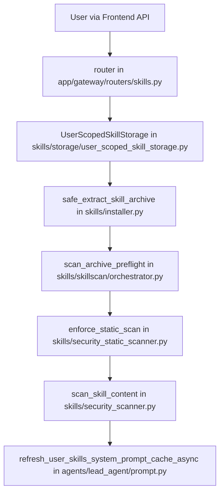
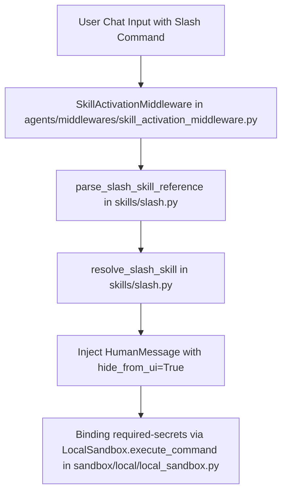

<!-- source: DeepWiki mcp.deepwiki.com · repo bytedance/deer-flow · page 5.7 Skills System · fetched 2026-10-29 -->

# Skills System

Relevant source files

The following files were used as context for generating this wiki page:

- [.github/copilot-instructions.md](.github/copilot-instructions.md)
- [backend/app/gateway/routers/mcp.py](backend/app/gateway/routers/mcp.py)
- [backend/app/gateway/routers/skills.py](backend/app/gateway/routers/skills.py)
- [backend/app/scheduler/notification_text.py](backend/app/scheduler/notification_text.py)
- [backend/docs/MCP_SERVER.md](backend/docs/MCP_SERVER.md)
- [backend/packages/harness/deerflow/agents/middlewares/sandbox_audit_middleware.py](backend/packages/harness/deerflow/agents/middlewares/sandbox_audit_middleware.py)
- [backend/packages/harness/deerflow/agents/middlewares/skill_activation_middleware.py](backend/packages/harness/deerflow/agents/middlewares/skill_activation_middleware.py)
- [backend/packages/harness/deerflow/agents/middlewares/skill_context.py](backend/packages/harness/deerflow/agents/middlewares/skill_context.py)
- [backend/packages/harness/deerflow/agents/middlewares/skill_tool_policy_middleware.py](backend/packages/harness/deerflow/agents/middlewares/skill_tool_policy_middleware.py)
- [backend/packages/harness/deerflow/authz/activation_decisions.py](backend/packages/harness/deerflow/authz/activation_decisions.py)
- [backend/packages/harness/deerflow/config/AGENTS.md](backend/packages/harness/deerflow/config/AGENTS.md)
- [backend/packages/harness/deerflow/config/extensions_config.py](backend/packages/harness/deerflow/config/extensions_config.py)
- [backend/packages/harness/deerflow/config/skill_evolution_config.py](backend/packages/harness/deerflow/config/skill_evolution_config.py)
- [backend/packages/harness/deerflow/config/skills_config.py](backend/packages/harness/deerflow/config/skills_config.py)
- [backend/packages/harness/deerflow/mcp/client.py](backend/packages/harness/deerflow/mcp/client.py)
- [backend/packages/harness/deerflow/runtime/secret_context.py](backend/packages/harness/deerflow/runtime/secret_context.py)
- [backend/packages/harness/deerflow/sandbox/env_policy.py](backend/packages/harness/deerflow/sandbox/env_policy.py)
- [backend/packages/harness/deerflow/skills/AGENTS.md](backend/packages/harness/deerflow/skills/AGENTS.md)
- [backend/packages/harness/deerflow/skills/frontmatter.py](backend/packages/harness/deerflow/skills/frontmatter.py)
- [backend/packages/harness/deerflow/skills/installer.py](backend/packages/harness/deerflow/skills/installer.py)
- [backend/packages/harness/deerflow/skills/parser.py](backend/packages/harness/deerflow/skills/parser.py)
- [backend/packages/harness/deerflow/skills/review/analyzer.py](backend/packages/harness/deerflow/skills/review/analyzer.py)
- [backend/packages/harness/deerflow/skills/review/readers.py](backend/packages/harness/deerflow/skills/review/readers.py)
- [backend/packages/harness/deerflow/skills/security_scanner.py](backend/packages/harness/deerflow/skills/security_scanner.py)
- [backend/packages/harness/deerflow/skills/skillscan/orchestrator.py](backend/packages/harness/deerflow/skills/skillscan/orchestrator.py)
- [backend/packages/harness/deerflow/skills/storage/local_skill_storage.py](backend/packages/harness/deerflow/skills/storage/local_skill_storage.py)
- [backend/packages/harness/deerflow/skills/storage/skill_storage.py](backend/packages/harness/deerflow/skills/storage/skill_storage.py)
- [backend/packages/harness/deerflow/skills/storage/user_scoped_skill_storage.py](backend/packages/harness/deerflow/skills/storage/user_scoped_skill_storage.py)
- [backend/packages/harness/deerflow/skills/types.py](backend/packages/harness/deerflow/skills/types.py)
- [backend/packages/harness/deerflow/skills/validation.py](backend/packages/harness/deerflow/skills/validation.py)
- [backend/packages/harness/deerflow/tools/skill_manage_tool.py](backend/packages/harness/deerflow/tools/skill_manage_tool.py)
- [backend/tests/blocking_io/test_mcp_router.py](backend/tests/blocking_io/test_mcp_router.py)
- [backend/tests/blocking_io/test_skill_manage_tool.py](backend/tests/blocking_io/test_skill_manage_tool.py)
- [backend/tests/blocking_io/test_skills_custom_router.py](backend/tests/blocking_io/test_skills_custom_router.py)
- [backend/tests/blocking_io/test_skills_install.py](backend/tests/blocking_io/test_skills_install.py)
- [backend/tests/blocking_io/test_skills_update_router.py](backend/tests/blocking_io/test_skills_update_router.py)
- [backend/tests/test_activation_decisions.py](backend/tests/test_activation_decisions.py)
- [backend/tests/test_authorization_enforcement.py](backend/tests/test_authorization_enforcement.py)
- [backend/tests/test_client_e2e.py](backend/tests/test_client_e2e.py)
- [backend/tests/test_inline_skill_references.py](backend/tests/test_inline_skill_references.py)
- [backend/tests/test_mcp_client_config.py](backend/tests/test_mcp_client_config.py)
- [backend/tests/test_mcp_config_secrets.py](backend/tests/test_mcp_config_secrets.py)
- [backend/tests/test_mcp_cwd.py](backend/tests/test_mcp_cwd.py)
- [backend/tests/test_notification_text.py](backend/tests/test_notification_text.py)
- [backend/tests/test_parallel_mcp_user_agent.py](backend/tests/test_parallel_mcp_user_agent.py)
- [backend/tests/test_runtime_paths.py](backend/tests/test_runtime_paths.py)
- [backend/tests/test_sandbox_audit_middleware.py](backend/tests/test_sandbox_audit_middleware.py)
- [backend/tests/test_security_scanner.py](backend/tests/test_security_scanner.py)
- [backend/tests/test_skill_context.py](backend/tests/test_skill_context.py)
- [backend/tests/test_skill_frontmatter_boundaries.py](backend/tests/test_skill_frontmatter_boundaries.py)
- [backend/tests/test_skill_history_jsonl.py](backend/tests/test_skill_history_jsonl.py)
- [backend/tests/test_skill_manage_tool.py](backend/tests/test_skill_manage_tool.py)
- [backend/tests/test_skill_request_scoped_secrets.py](backend/tests/test_skill_request_scoped_secrets.py)
- [backend/tests/test_skill_tool_policy_middleware.py](backend/tests/test_skill_tool_policy_middleware.py)
- [backend/tests/test_skills_authorization.py](backend/tests/test_skills_authorization.py)
- [backend/tests/test_skills_custom_router.py](backend/tests/test_skills_custom_router.py)
- [backend/tests/test_skills_installer.py](backend/tests/test_skills_installer.py)
- [backend/tests/test_skills_loader.py](backend/tests/test_skills_loader.py)
- [backend/tests/test_skills_parser.py](backend/tests/test_skills_parser.py)
- [backend/tests/test_skills_router_authz.py](backend/tests/test_skills_router_authz.py)
- [backend/tests/test_skills_validation.py](backend/tests/test_skills_validation.py)
- [backend/tests/test_skillscan_fork_bomb.py](backend/tests/test_skillscan_fork_bomb.py)
- [backend/tests/test_skillscan_native.py](backend/tests/test_skillscan_native.py)
- [backend/tests/test_slash_skills.py](backend/tests/test_slash_skills.py)
- [backend/tests/test_user_scoped_skill_storage.py](backend/tests/test_user_scoped_skill_storage.py)
- [contracts/skill_review/package_snapshot.v1.schema.json](contracts/skill_review/package_snapshot.v1.schema.json)
- [docs/images/composer-mentions.png](docs/images/composer-mentions.png)
- [extensions_config.example.json](extensions_config.example.json)

The Skills System provides a modular and secure framework for extending the lead agent’s capabilities with domain-specific knowledge and workflows. Skills are self-contained packages that inject additional context into the agent’s system prompt, enabling focused expertise such as data analysis, chart visualization, or custom business logic. This page thoroughly documents skill structure, the `.skill` archive format, installation workflows, frontmatter validation, statically deterministic SkillScan, sandbox projection, layered security scanning, and the skill management API.

---

## 1. Overview and Skill Categories

Skills augment the lead agent by injecting rich contextual knowledge via markdown packages stored on disk. The system manages skills across several categorized directories:

- **Public skills**: Official, globally distributed skills live in `deer-flow/skills/public/` `[backend/packages/harness/deerflow/skills/AGENTS.md:14]()`.
- **Custom skills**: User-created or user-installed skills live under `{DEER_FLOW_HOME}/users/{user_id}/skills/custom/` `[backend/packages/harness/deerflow/skills/AGENTS.md:14]()`.
- **Legacy skills**: Read-only legacy shared directories for backward compatibility `[backend/packages/harness/deerflow/skills/AGENTS.md:16]()`.
- **Integration skills**: Managed global integration skills located at `{DEER_FLOW_HOME}/integrations/skills/{provider}/` `[backend/packages/harness/deerflow/skills/AGENTS.md:14]()`.

Each skill directory contains a canonical markdown file `SKILL.md` that includes a YAML-based frontmatter section followed by markdown content. The Skill content is parsed and injected into agent system prompts as contextual knowledge to specialize the agent’s behavior `[backend/packages/harness/deerflow/skills/AGENTS.md:1-16]`, `[backend/packages/harness/deerflow/skills/types.py:1-40]()`.

Sources: `[backend/packages/harness/deerflow/skills/AGENTS.md:1-17]`, `[backend/packages/harness/deerflow/skills/types.py:1-40]()`

---

## 2. Skill Structure and Format

### 2.1. SKILL.md and Frontmatter

Each skill is defined primarily by a `SKILL.md` file inside its directory. This file contains:
- A YAML frontmatter section enclosed between `---` fences.
- Markdown content providing detailed description, examples, or additional documents.

The YAML frontmatter is parsed with `yaml.safe_load` to extract metadata fields. The markdown body is the primary content injected into the agent’s prompt `[backend/packages/harness/deerflow/skills/AGENTS.md:15]`, `[backend/packages/harness/deerflow/skills/installer.py:1-30]()`.

### 2.2. Frontmatter Fields

| Property             | Type                      | Description                                                                                                                                                   |
|----------------------|---------------------------|---------------------------------------------------------------------------------------------------------------------------------------------------------------|
| `name`               | string                    | Unique hyphen-case identifier for the skill.                                                                                                                  |
| `description`        | string                    | Short explanation of the skill’s function.                                                                                                                   |
| `license`            | string (optional)         | License information specifying usage rights.                                                                                                                 |
| `allowed-tools`      | string or list            | Specifies permitted tools. Accepts a space-separated string or YAML list. Portable aliases like `Bash` are normalized to `bash`. Unknown or argument-scoped tool names pass as-is. `[backend/packages/harness/deerflow/skills/AGENTS.md:15]()` |
| `required-secrets`   | list of secrets           | Declares environment variables or secrets this skill requires. Supports names and optionality flags. `[backend/packages/harness/deerflow/skills/AGENTS.md:15]()` |
| `secrets-autonomous` | bool (optional)           | Whether to bind declared secrets during autonomous model loads (default `True`).                                                                               |
| `argument-hint`      | string (optional)         | Hint text to guide argument input for the skill.                                                                                                             |

Parsing and validation enforce strict typing and syntax for these fields. Unrecognized properties or malformed fields result in validation errors `[backend/packages/harness/deerflow/skills/AGENTS.md:3-6]`, `[backend/tests/test_skill_review_core.py:70-98]()`.

Sources: `[backend/packages/harness/deerflow/skills/AGENTS.md:3-16]`, `[backend/tests/test_skill_review_core.py:70-98]()`

---

## 3. Skill Storage and Discovery

The system abstracts skill discovery using storage providers, with principal implementations:
- `UserScopedSkillStorage`: Manages per-user custom skills isolated at `{base_dir}/users/{user_id}/skills/custom/` `[backend/packages/harness/deerflow/skills/AGENTS.md:14]()`.
- `LocalSkillStorage`: Manages global skills visible system-wide (public, legacy) `[backend/packages/harness/deerflow/skills/AGENTS.md:16]()`.

The fundamental discovery logic (`load_skills()`) recursively scans all configured skill category roots for directories containing `SKILL.md`, treating each as a package boundary. Nested `SKILL.md` files inside such packages are excluded from registration as runtime skills, avoiding collisions with eval fixtures or helpers `[backend/packages/harness/deerflow/skills/AGENTS.md:13-17]()`.

Enabled/disabled state flags:
- For PUBLIC skills, stored globally in `extensions_config.json` `[backend/packages/harness/deerflow/skills/AGENTS.md:16]()`.
- For CUSTOM and LEGACY skills, stored in per-user state files `[backend/packages/harness/deerflow/skills/AGENTS.md:16]()`.

Sources: `[backend/packages/harness/deerflow/skills/AGENTS.md:13-17]`, `[backend/app/gateway/routers/skills.py:30-55]()`

---

## 4. Skill Installation and Security Protections

### 4.1. Skill Archive Format
Skills are typically packaged as `.skill` archives, which are standard ZIP files containing a skill root directory, `SKILL.md`, and optional supporting references or scripts `[backend/app/gateway/routers/skills.py:126-132]`, `[backend/packages/harness/deerflow/skills/installer.py:115-134]()`.

### 4.2. Secure Installation
Installation is performed using `safe_extract_skill_archive()` in `[backend/packages/harness/deerflow/skills/installer.py:115-176]()` which assures:
- **Zip Slip Protection**: Rejects unsafe paths that are absolute, contain directory traversal (`..`), or NTFS ADS colons (`:`) using `is_unsafe_zip_member()` `[backend/packages/harness/deerflow/skills/installer.py:51-82]()`.
- **Symlink Suppression**: Skips symlink entries identified by ZIP external attributes with `is_symlink_member()` `[backend/packages/harness/deerflow/skills/installer.py:85-89]()`.
- **Binary Executable Ban**: Rejects files whose first read chunk appears as executable binaries (`is_executable_binary_prefix()`) `[backend/packages/harness/deerflow/skills/installer.py:167-170]()`.
- **Zip Bomb Defense**: Enforces limits on archive entries count (max 4096) and total uncompressed size (max 512 MB) `[backend/packages/harness/deerflow/skills/installer.py:118-146]()`.

### 4.3. Skill Installation Flow
Installation workflow in `UserScopedSkillStorage.ainstall_skill_from_archive()` includes unpacking, preflight static archive scan via `scan_archive_preflight()`, static enforcement via `enforce_static_scan()`, async LLM content check via `scan_skill_content()`, atomic commit, and asynchronous system prompt cache refresh `[backend/app/gateway/routers/skills.py:98-154]`, `[backend/packages/harness/deerflow/skills/installer.py:1-30]()`.

Sources: `[backend/packages/harness/deerflow/skills/installer.py:1-176]`, `[backend/app/gateway/routers/skills.py:98-154]()`

---

## 5. Frontmatter Validation

The YAML frontmatter in each `SKILL.md` is validated carefully:
- Required fields `name` and `description` must be present and well-typed `[backend/tests/test_skill_review_core.py:61-68]()`.
- `name` must follow hyphen-case.
- `allowed-tools` maps portable aliases to internal tool names `[backend/packages/harness/deerflow/skills/AGENTS.md:15]()`.
- `required-secrets` validates secret descriptors and optional flags `[backend/tests/test_skill_review_core.py:86-98]()`.

Sources: `[backend/packages/harness/deerflow/skills/AGENTS.md:3-6]`, `[backend/tests/test_skill_review_core.py:61-98]()`

---

## 6. SkillScan: Static and LLM Security Scanning

### 6.1. Static Security Scanning
The native `deerflow.skills.skillscan` module implements a deterministic, stateless scanning engine (`scan_archive_preflight()`, `scan_skill_dir()`) that evaluates skill archives and directories synchronously `[backend/packages/harness/deerflow/skills/skillscan/orchestrator.py:1-38]()`.
- Detects ZIP archive path traversal, absolute paths, symlinks, nested `SKILL.md` files `[backend/packages/harness/deerflow/skills/skillscan/orchestrator.py:48-66]()`.
- Matches embedded secret patterns such as private keys and cloud tokens, redacting evidence `[backend/packages/harness/deerflow/skills/skillscan/orchestrator.py:67-69]`, `[backend/tests/test_skillscan_native.py:80-96]()`.
- Analyzes Python and shell scripts for dynamic execution, reverse shells, and sensitive path reads combined with network sinks `[backend/packages/harness/deerflow/skills/skillscan/orchestrator.py:74-87]()`.
- `CRITICAL` severity findings trigger `StaticScanBlockedError` `[backend/packages/harness/deerflow/skills/skillscan/orchestrator.py:1-9]()`.

### 6.2. LLM-Based Moderation Scanning
Asynchronous semantic checks are performed by `scan_skill_content()` to evaluate complex prompt injection risks and produce structured `ScanResult` instances `[backend/app/gateway/routers/skills.py:46]`, `[backend/tests/test_skills_custom_router.py:98-154]()`.

Sources: `[backend/packages/harness/deerflow/skills/skillscan/orchestrator.py:1-87]`, `[backend/tests/test_skillscan_native.py:1-169]()`

---

## 7. Sandbox Projection

The projection layer (`skills/projection.py`) materializes read-only views of enabled skills under sandbox-accessible directories, preventing mutable runtime writes to canonical sources and validating symlink boundaries `[backend/packages/harness/deerflow/skills/AGENTS.md:16]()`.

Sources: `[backend/packages/harness/deerflow/skills/AGENTS.md:13-17]()`

---

## 8. Slash Activation and Request-Scoped Secret Binding

### 8.1. Slash Command Activation
Users activate skills interactively via slash commands (`/skill-name ...`). `SkillActivationMiddleware` parses the reference via `parse_slash_skill_reference()`, resolves enabled skills, and injects content as a hidden `HumanMessage(hide_from_ui=True)` into the agent prompt chain `[backend/packages/harness/deerflow/skills/AGENTS.md:15]()`.

### 8.2. Request-Scoped Secret Binding
When a skill declares `required-secrets`, environment variables are scoped to the current execution runtime and passed to `Sandbox.execute_command(env=...)`, keeping secrets isolated from global environments `[backend/tests/test_skill_request_scoped_secrets.py:1-94]()`.

Sources: `[backend/packages/harness/deerflow/skills/AGENTS.md:15]`, `[backend/tests/test_skill_request_scoped_secrets.py:1-94]()`

---

## 9. Skill Management API

The FastAPI Gateway exposes REST endpoints under `/api/skills` in `[backend/app/gateway/routers/skills.py:1-170]()`:
- `GET /api/skills`: List available skills across categories.
- `POST /api/skills/install`: Install skill from thread storage archive.
- `POST /api/skills/install/upload`: Multipart upload and install `.skill` archive.
- `POST /api/skills/reload`: Admin-only cache invalidation hook `[backend/packages/harness/deerflow/skills/AGENTS.md:17]`.
- `GET/PUT /api/skills/custom/{name}`: Custom skill content retrieval and editing.
- `PATCH/DELETE /api/skills/{name}`: Enable/disable or delete a skill package.

Sources: `[backend/app/gateway/routers/skills.py:1-170]`, `[backend/packages/harness/deerflow/skills/AGENTS.md:10-17]()`

---

### Diagram: Natural Language to Code Entities for Skills Installation

Diagram mapping user archive submission to validation, scanning, and prompt cache reload code entities.

Sources: `[backend/app/gateway/routers/skills.py:1-170]`, `[backend/packages/harness/deerflow/skills/installer.py:1-176]`, `[backend/packages/harness/deerflow/skills/skillscan/orchestrator.py:1-87]()`

---

### Diagram: Natural Language to Code Entities for Slash Skill Activation & Secret Injection

Diagram mapping user chat input commands to activation middleware, prompt injection, and sandbox secret-bound command execution.

Sources: `[backend/packages/harness/deerflow/agents/middlewares/skill_activation_middleware.py]()`, `[backend/packages/harness/deerflow/sandbox/local/local_sandbox.py:44-94]()`

---

