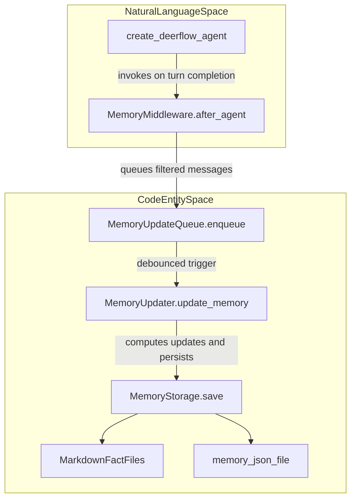
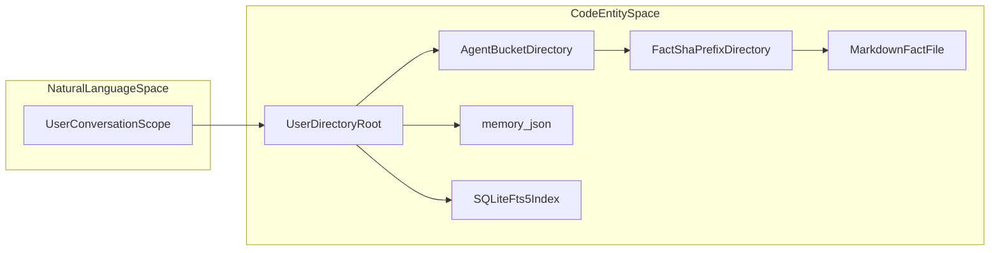

<!-- source: DeepWiki mcp.deepwiki.com · repo bytedance/deer-flow · page 5.8 Memory System · fetched 2026-10-29 -->

# Memory System

Relevant source files

The following files were used as context for generating this wiki page:

- [backend/app/gateway/routers/memory.py](backend/app/gateway/routers/memory.py)
- [backend/docs/MEMORY_IMPROVEMENTS.md](backend/docs/MEMORY_IMPROVEMENTS.md)
- [backend/docs/MEMORY_IMPROVEMENTS_SUMMARY.md](backend/docs/MEMORY_IMPROVEMENTS_SUMMARY.md)
- [backend/docs/RUN_INTERACTION_POLICY.md](backend/docs/RUN_INTERACTION_POLICY.md)
- [backend/docs/plan_mode_usage.md](backend/docs/plan_mode_usage.md)
- [backend/packages/harness/deerflow/agents/memory/AGENTS.md](backend/packages/harness/deerflow/agents/memory/AGENTS.md)
- [backend/packages/harness/deerflow/agents/memory/__init__.py](backend/packages/harness/deerflow/agents/memory/__init__.py)
- [backend/packages/harness/deerflow/agents/memory/backends/README.md](backend/packages/harness/deerflow/agents/memory/backends/README.md)
- [backend/packages/harness/deerflow/agents/memory/backends/deermem/deer_mem.py](backend/packages/harness/deerflow/agents/memory/backends/deermem/deer_mem.py)
- [backend/packages/harness/deerflow/agents/memory/backends/deermem/deermem/config.py](backend/packages/harness/deerflow/agents/memory/backends/deermem/deermem/config.py)
- [backend/packages/harness/deerflow/agents/memory/backends/deermem/deermem/core/prompts/consolidation.yaml](backend/packages/harness/deerflow/agents/memory/backends/deermem/deermem/core/prompts/consolidation.yaml)
- [backend/packages/harness/deerflow/agents/memory/backends/deermem/deermem/core/prompts/memory_update.chat.yaml](backend/packages/harness/deerflow/agents/memory/backends/deermem/deermem/core/prompts/memory_update.chat.yaml)
- [backend/packages/harness/deerflow/agents/memory/backends/deermem/deermem/core/queue.py](backend/packages/harness/deerflow/agents/memory/backends/deermem/deermem/core/queue.py)
- [backend/packages/harness/deerflow/agents/memory/backends/deermem/deermem/core/retrieval.py](backend/packages/harness/deerflow/agents/memory/backends/deermem/deermem/core/retrieval.py)
- [backend/packages/harness/deerflow/agents/memory/backends/deermem/deermem/core/storage.py](backend/packages/harness/deerflow/agents/memory/backends/deermem/deermem/core/storage.py)
- [backend/packages/harness/deerflow/agents/memory/backends/deermem/deermem/core/updater.py](backend/packages/harness/deerflow/agents/memory/backends/deermem/deermem/core/updater.py)
- [backend/packages/harness/deerflow/agents/memory/backends/honcho/README.md](backend/packages/harness/deerflow/agents/memory/backends/honcho/README.md)
- [backend/packages/harness/deerflow/agents/memory/backends/honcho/config.py](backend/packages/harness/deerflow/agents/memory/backends/honcho/config.py)
- [backend/packages/harness/deerflow/agents/memory/backends/honcho/honcho_manager.py](backend/packages/harness/deerflow/agents/memory/backends/honcho/honcho_manager.py)
- [backend/packages/harness/deerflow/agents/memory/backends/mem0/config.py](backend/packages/harness/deerflow/agents/memory/backends/mem0/config.py)
- [backend/packages/harness/deerflow/agents/memory/backends/mem0/mem0_manager.py](backend/packages/harness/deerflow/agents/memory/backends/mem0/mem0_manager.py)
- [backend/packages/harness/deerflow/agents/memory/backends/openviking/__init__.py](backend/packages/harness/deerflow/agents/memory/backends/openviking/__init__.py)
- [backend/packages/harness/deerflow/agents/memory/backends/openviking/config.py](backend/packages/harness/deerflow/agents/memory/backends/openviking/config.py)
- [backend/packages/harness/deerflow/agents/memory/backends/openviking/openviking_manager.py](backend/packages/harness/deerflow/agents/memory/backends/openviking/openviking_manager.py)
- [backend/packages/harness/deerflow/agents/memory/manager.py](backend/packages/harness/deerflow/agents/memory/manager.py)
- [backend/packages/harness/deerflow/agents/memory/summarization_hook.py](backend/packages/harness/deerflow/agents/memory/summarization_hook.py)
- [backend/packages/harness/deerflow/agents/middlewares/memory_middleware.py](backend/packages/harness/deerflow/agents/middlewares/memory_middleware.py)
- [backend/tests/blocking_io/test_openviking_memory_backend.py](backend/tests/blocking_io/test_openviking_memory_backend.py)
- [backend/tests/test_deermem_self_contained.py](backend/tests/test_deermem_self_contained.py)
- [backend/tests/test_honcho_memory_backend.py](backend/tests/test_honcho_memory_backend.py)
- [backend/tests/test_mem0_memory_backend.py](backend/tests/test_mem0_memory_backend.py)
- [backend/tests/test_memory_consolidation.py](backend/tests/test_memory_consolidation.py)
- [backend/tests/test_memory_manager_interface.py](backend/tests/test_memory_manager_interface.py)
- [backend/tests/test_memory_prompt_injection.py](backend/tests/test_memory_prompt_injection.py)
- [backend/tests/test_memory_queue.py](backend/tests/test_memory_queue.py)
- [backend/tests/test_memory_queue_deadlines.py](backend/tests/test_memory_queue_deadlines.py)
- [backend/tests/test_memory_queue_user_isolation.py](backend/tests/test_memory_queue_user_isolation.py)
- [backend/tests/test_memory_retrieval_adapter.py](backend/tests/test_memory_retrieval_adapter.py)
- [backend/tests/test_memory_router.py](backend/tests/test_memory_router.py)
- [backend/tests/test_memory_staleness_review.py](backend/tests/test_memory_staleness_review.py)
- [backend/tests/test_memory_storage.py](backend/tests/test_memory_storage.py)
- [backend/tests/test_memory_updater.py](backend/tests/test_memory_updater.py)
- [backend/tests/test_memory_upload_filtering.py](backend/tests/test_memory_upload_filtering.py)
- [backend/tests/test_openviking_memory_backend.py](backend/tests/test_openviking_memory_backend.py)
- [docs/OPENVIKING.md](docs/OPENVIKING.md)
- [skills/public/deep-research/SKILL.md](skills/public/deep-research/SKILL.md)
- [skills/public/ppt-generation/SKILL.md](skills/public/ppt-generation/SKILL.md)
- [skills/public/ppt-generation/scripts/generate.py](skills/public/ppt-generation/scripts/generate.py)

The Memory System provides long-term, persistent context storage enabling DeerFlow agents to remember user preferences, work context, and accumulated facts across conversation sessions. Unlike ephemeral conversation history, memory persists indefinitely and is carefully injected into the system prompt to personalize and contextualize agent behavior [backend/packages/harness/deerflow/agents/memory/AGENTS.md:1-3]().

---

## Overview

DeerFlow's memory system is a background processing pipeline that extracts structured facts, preferences, and context from conversations, stores this data persistently, and retrieves relevant subsets to inject into agent prompts. It operates asynchronously, offloading memory maintenance to a background worker that calls an LLM to analyze conversation turns and update persistent memory state accordingly [backend/packages/harness/deerflow/agents/middlewares/memory_middleware.py:29-37]().

Key features include:

- **Automatic Fact Extraction:** Conversation turns are parsed to derive facts, context sections, and user preferences based on the content of messages [backend/packages/harness/deerflow/agents/memory/backends/deermem/deermem/core/updater.py:1-20]().

- **Facts with Confidence Scores:** Each fact has a confidence score between 0.0 and 1.0 representing reliability. This score influences fact retention, ordering, and prompt injection prioritization [backend/tests/test_memory_prompt_injection.py:73-89]().

- **User and Historical Context:** Memory is organized into user context (`workContext`, `personalContext`, `topOfMind`, `cognitiveStyle`) and history context (`recentMonths`, `earlierContext`, `longTermBackground`) to retain summaries across timescales [backend/app/gateway/routers/memory.py:43-68]().

- **Background Updates:** A debounced update queue batches conversation turns for efficient async processing, avoiding overload and supporting concurrency control [backend/packages/harness/deerflow/agents/memory/backends/deermem/deermem/core/queue.py:6-41]().

- **Memory Injection:** Memory data is injected into system prompts by formatting high-confidence facts and guaranteed categories, subject to token budgets [backend/packages/harness/deerflow/agents/memory/backends/deermem/deermem/core/prompt.py:7-30]().

- **Staleness and Consolidation:** Periodic review flags stale facts for longevity evaluation or removal; consolidation merges related facts improving data quality [backend/tests/test_memory_staleness_review.py:1-20](), [backend/tests/test_memory_consolidation.py:1-25]().

- **User Identity and Isolation:** Memory lives isolated per user and per agent bucket, controlled by normalized user IDs, ensuring data separation and consistent retrieval [backend/packages/harness/deerflow/agents/memory/AGENTS.md:30-48]().

Sources:
- [backend/packages/harness/deerflow/agents/memory/AGENTS.md:1-22]()
- [backend/packages/harness/deerflow/agents/middlewares/memory_middleware.py:29-37]()
- [backend/tests/test_memory_prompt_injection.py:73-89]()
- [backend/app/gateway/routers/memory.py:43-68]()
- [backend/packages/harness/deerflow/agents/memory/backends/deermem/deermem/core/prompt.py:7-30]()
- [backend/tests/test_memory_staleness_review.py:1-20]()
- [backend/tests/test_memory_consolidation.py:1-25]()

---

## Architecture and Pluggable Backend Contract

The memory system's core contract is `MemoryManager`, an abstract interface defined in `backend/packages/harness/deerflow/agents/memory/manager.py`. It handles fact CRUD, summary updates, locking, concurrency, migrations, and querying [backend/packages/harness/deerflow/agents/memory/manager.py:1-136]().

### Execution and Persistence Flow

The overall process flow bridges natural language conversation events to memory storage operations:

*Figure 1: Natural language conversation events mapped to system components for persistent memory updates.*

Sources:
- [backend/packages/harness/deerflow/agents/memory/manager.py:1-136]()
- [backend/packages/harness/deerflow/agents/middlewares/memory_middleware.py:121-147]()
- [backend/packages/harness/deerflow/agents/memory/backends/deermem/deermem/core/queue.py:6-41]()

---

## Core Components

### Memory Middleware (`MemoryMiddleware`)

`MemoryMiddleware` monitors conversation turn completion in the agent lifecycle. It filters and queues user messages and final assistant replies for memory capture, filtering out tool calls and upload metadata [backend/packages/harness/deerflow/agents/middlewares/memory_middleware.py:28-80]().

- Captures the current `user_id` and trace context ensuring identity propagation across async boundaries.
- Queued messages are debounced to avoid excessive memory updates.
- Passes conversation chunks asynchronously to `MemoryUpdateQueue` for eventual LLM-driven fact extraction.

Sources:
- [backend/packages/harness/deerflow/agents/middlewares/memory_middleware.py:28-123]()
- [backend/tests/test_memory_upload_filtering.py:1-72]()

### Memory Update Queue (`MemoryUpdateQueue`)

`MemoryUpdateQueue` manages timing and batching of update entries to optimize LLM invocation frequency [backend/packages/harness/deerflow/agents/memory/backends/deermem/deermem/core/queue.py:6-135](). It supports:

- Debounce intervals set by configuration to cluster multiple messages before update.
- Backpressure via a queue max depth to reject excess items except important "signals" which must always be stored.
- Signal detection logic identifies corrections or reinforcements for prioritization.
- Async task scheduling to offload execution from the main event loop.

Sources:
- [backend/packages/harness/deerflow/agents/memory/backends/deermem/deermem/core/queue.py:6-135]()
- [backend/tests/test_memory_queue.py:1-72]()

### Memory Updater (`MemoryUpdater`)

This is the core LLM-driven component performing:

- Parsing conversation segments and previous memory state.
- Constructing memory update prompts using injected instructions (`prompt_prepend`, `prompt_append`) [backend/packages/harness/deerflow/agents/memory/backends/deermem/deermem/config.py:49-51]().
- Model call to update facts, context summaries, and remove contradictions.
- Confidence score normalization and gating [backend/tests/test_memory_prompt_injection.py:78-95]().
- Staleness review and facts eviction per configured policies [backend/tests/test_memory_staleness_review.py:1-32]().
- Consolidation of similar facts into richer entries.
- Applying updates optimistically with revision checks [backend/packages/harness/deerflow/agents/memory/backends/deermem/deermem/core/storage.py:62-73]().
- Persisting updated memory state back through the configured storage backend [backend/packages/harness/deerflow/agents/memory/backends/deermem/deermem/core/updater.py:1-188]().

Sources:
- [backend/packages/harness/deerflow/agents/memory/backends/deermem/deermem/config.py:49-51]()
- [backend/packages/harness/deerflow/agents/memory/backends/deermem/deermem/core/updater.py:1-188]()
- [backend/tests/test_memory_prompt_injection.py:78-95]()
- [backend/tests/test_memory_staleness_review.py:1-32]()

---

## Memory Data Structure and Fact Management

Memory data is structured as a manifest with revision tracking and individual fact records:

| Field         | Description                                               | Code Entity / Source                                             |
|:--------------|:----------------------------------------------------------|:-----------------------------------------------------------------|
| `version`     | Schema version string (e.g., "1.0")                       | `MemoryResponse.version` [backend/app/gateway/routers/memory.py:109-115]() |
| `revision`    | Manifest revision for optimistic concurrency control      | `MemoryResponse.revision` [backend/app/gateway/routers/memory.py:109-115]()|
| `lastUpdated` | Timestamp of last update                                   | `MemoryResponse.lastUpdated` [backend/app/gateway/routers/memory.py:114]()|
| `user`        | User context containing sections like `workContext`      | `UserContext` model [backend/app/gateway/routers/memory.py:50-60]()      |
| `history`     | Historical summaries over recent and earlier periods     | `HistoryContext` model [backend/app/gateway/routers/memory.py:62-68]()   |
| `facts`       | List of fact entries, each with id, content, category, confidence, source, timestamps, and metadata | `Fact` model [backend/app/gateway/routers/memory.py:70-89]()             |

Sources:
- [backend/app/gateway/routers/memory.py:50-89]()
- [backend/packages/harness/deerflow/agents/memory/AGENTS.md:41-60]()
- [backend/tests/test_memory_staleness_review.py:68-105]()

---

## DeerMem Backend Implementation

DeerMem is the default local persistent backend. It leverages a file-based hierarchical storage and optional Markdown fact files with rich YAML front matter for metadata. It uses a SQLite FTS5 full-text index for efficient fact retrieval [backend/packages/harness/deerflow/agents/memory/AGENTS.md:41-55, 133-140]().

### Storage Layout

- Root directory configured by `storage_path` [backend/packages/harness/deerflow/agents/memory/backends/deermem/deermem/config.py:53-56]().
- Per-user directories: `users/{user_id}/` [backend/packages/harness/deerflow/agents/memory/AGENTS.md:52-55]()
- Agent-specific buckets: `agents/{agent_name}/` [backend/packages/harness/deerflow/agents/memory/AGENTS.md:52-55]()
- Facts stored inside nested dirs under `facts/{sha256-prefix}/` as individual Markdown files per fact [backend/packages/harness/deerflow/agents/memory/AGENTS.md:52-55]().
- Shared summary manifest `memory.json` contains sanitized global/user-wide summaries and metadata without fact details [backend/packages/harness/deerflow/agents/memory/AGENTS.md:57-58]().
- A SQLite full-text search index supports fast semantic lookup by content [backend/packages/harness/deerflow/agents/memory/backends/deermem/deermem/core/retrieval.py:1-30]().

*Figure 2: Logical and physical organization of the DeerMem backend.*

Sources:
- [backend/packages/harness/deerflow/agents/memory/AGENTS.md:40-70]()
- [backend/packages/harness/deerflow/agents/memory/backends/deermem/deermem/config.py:53-56]()
- [backend/packages/harness/deerflow/agents/memory/backends/deermem/deermem/core/storage.py:1-50]()
- [backend/packages/harness/deerflow/agents/memory/backends/deermem/deermem/core/retrieval.py:1-30]()

---

## Memory Injection and Usage in Agents

Memory injection is the process of adding summarized memory data into the agent's system prompt. This influences agent responses by providing relevant factual and contextual knowledge along with user preferences and long-term background [backend/packages/harness/deerflow/agents/memory/backends/deermem/deermem/core/prompt.py:7-30]().

Sources:
- [backend/packages/harness/deerflow/agents/memory/backends/deermem/deermem/core/prompt.py:7-30]()
- [backend/packages/harness/deerflow/agents/memory/AGENTS.md:83-122]()
- [backend/tests/test_memory_prompt_injection.py:32-184]()

---

## Alternative Memory Backends

DeerFlow supports multiple pluggable memory backends configurable via `memory.backend_config.manager_class` [backend/packages/harness/deerflow/config/memory_config.py:21-23](). These alternatives provide different tradeoffs in deployment and usage:

- **Mem0 Backend:** A minimal local memory backend with lightweight storage and simple fact management, ideal for minimal setups or testing [backend/packages/harness/deerflow/agents/memory/AGENTS.md:11-18]().

- **Honcho Backend:** A remote HTTP-backed memory system that stores memory in per-user workspaces and peer namespaces. It supports API key authorization, read fail-closed policies, and workspace/peer overrides [backend/packages/harness/deerflow/agents/memory/AGENTS.md:11-18]().

- **No-op Backend:** A stub memory manager that disables memory features entirely, useful for environments that do not want memory or for testing [backend/packages/harness/deerflow/agents/memory/backends/noop/noop_manager.py:1-20]().

Sources:
- [backend/packages/harness/deerflow/config/memory_config.py:21-23]()
- [backend/packages/harness/deerflow/agents/memory/AGENTS.md:11-18]()
- [backend/packages/harness/deerflow/agents/memory/backends/noop/noop_manager.py:1-20]()

---

## Memory API Integration and User Context Resolution

The Gateway exposes memory API routes under `/api/memory` for retrieval, import, export, update, and clearing of memory data [backend/app/gateway/routers/memory.py:1-18]().

Sources:
- [backend/app/gateway/routers/memory.py:1-143]()
- [backend/packages/harness/deerflow/agents/memory/AGENTS.md:33-37]()

---

# Summary

DeerFlow's Memory System is a modular, extensible, and backend-pluggable implementation designed to persist and maintain relevant state across user interactions. It integrates strongly with the agent lifecycle and prompt construction while offering robust per-user and per-agent isolation.

# End of Memory System Section (5.8)

---

