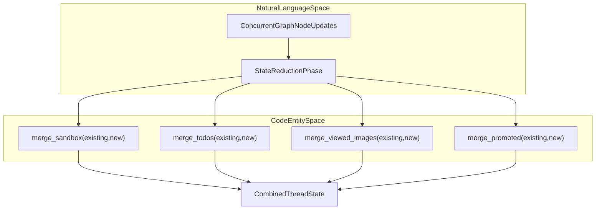
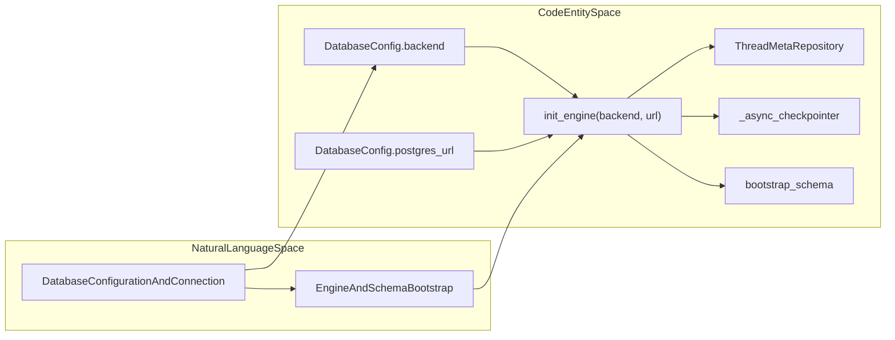

<!-- source: DeepWiki mcp.deepwiki.com · repo bytedance/deer-flow · page 5.9 Thread State and Data Management · fetched 2026-10-29 -->

# Thread State and Data Management

Relevant source files

The following files were used as context for generating this wiki page:

- [backend/app/gateway/health.py](backend/app/gateway/health.py)
- [backend/app/gateway/routers/threads.py](backend/app/gateway/routers/threads.py)
- [backend/packages/extension-api/deerflow_extension_api/auth.py](backend/packages/extension-api/deerflow_extension_api/auth.py)
- [backend/packages/harness/deerflow/agents/AGENTS.md](backend/packages/harness/deerflow/agents/AGENTS.md)
- [backend/packages/harness/deerflow/agents/assembly_descriptor.py](backend/packages/harness/deerflow/agents/assembly_descriptor.py)
- [backend/packages/harness/deerflow/config/checkpointer_config.py](backend/packages/harness/deerflow/config/checkpointer_config.py)
- [backend/packages/harness/deerflow/config/database_config.py](backend/packages/harness/deerflow/config/database_config.py)
- [backend/packages/harness/deerflow/config/postgres_schema.py](backend/packages/harness/deerflow/config/postgres_schema.py)
- [backend/packages/harness/deerflow/constants.py](backend/packages/harness/deerflow/constants.py)
- [backend/packages/harness/deerflow/persistence/AGENTS.md](backend/packages/harness/deerflow/persistence/AGENTS.md)
- [backend/packages/harness/deerflow/persistence/bootstrap.py](backend/packages/harness/deerflow/persistence/bootstrap.py)
- [backend/packages/harness/deerflow/persistence/channel_connections/sql.py](backend/packages/harness/deerflow/persistence/channel_connections/sql.py)
- [backend/packages/harness/deerflow/persistence/engine.py](backend/packages/harness/deerflow/persistence/engine.py)
- [backend/packages/harness/deerflow/persistence/feedback/sql.py](backend/packages/harness/deerflow/persistence/feedback/sql.py)
- [backend/packages/harness/deerflow/persistence/json_compat.py](backend/packages/harness/deerflow/persistence/json_compat.py)
- [backend/packages/harness/deerflow/persistence/migrations/AGENTS.md](backend/packages/harness/deerflow/persistence/migrations/AGENTS.md)
- [backend/packages/harness/deerflow/persistence/migrations/_helpers.py](backend/packages/harness/deerflow/persistence/migrations/_helpers.py)
- [backend/packages/harness/deerflow/persistence/models/__init__.py](backend/packages/harness/deerflow/persistence/models/__init__.py)
- [backend/packages/harness/deerflow/persistence/notification_deliveries/model.py](backend/packages/harness/deerflow/persistence/notification_deliveries/model.py)
- [backend/packages/harness/deerflow/persistence/notification_deliveries/sql.py](backend/packages/harness/deerflow/persistence/notification_deliveries/sql.py)
- [backend/packages/harness/deerflow/persistence/postgres_schema.py](backend/packages/harness/deerflow/persistence/postgres_schema.py)
- [backend/packages/harness/deerflow/persistence/run/model.py](backend/packages/harness/deerflow/persistence/run/model.py)
- [backend/packages/harness/deerflow/persistence/thread_meta/__init__.py](backend/packages/harness/deerflow/persistence/thread_meta/__init__.py)
- [backend/packages/harness/deerflow/persistence/thread_meta/base.py](backend/packages/harness/deerflow/persistence/thread_meta/base.py)
- [backend/packages/harness/deerflow/persistence/thread_meta/memory.py](backend/packages/harness/deerflow/persistence/thread_meta/memory.py)
- [backend/packages/harness/deerflow/persistence/thread_meta/sql.py](backend/packages/harness/deerflow/persistence/thread_meta/sql.py)
- [backend/packages/harness/deerflow/runtime/cancellation.py](backend/packages/harness/deerflow/runtime/cancellation.py)
- [backend/packages/harness/deerflow/runtime/checkpointer/async_provider.py](backend/packages/harness/deerflow/runtime/checkpointer/async_provider.py)
- [backend/packages/harness/deerflow/runtime/checkpointer/provider.py](backend/packages/harness/deerflow/runtime/checkpointer/provider.py)
- [backend/packages/harness/deerflow/runtime/context_compaction.py](backend/packages/harness/deerflow/runtime/context_compaction.py)
- [backend/packages/harness/deerflow/runtime/store/async_provider.py](backend/packages/harness/deerflow/runtime/store/async_provider.py)
- [backend/packages/harness/deerflow/runtime/store/provider.py](backend/packages/harness/deerflow/runtime/store/provider.py)
- [backend/packages/harness/deerflow/tracing/AGENTS.md](backend/packages/harness/deerflow/tracing/AGENTS.md)
- [backend/packages/harness/deerflow/workspace_changes/__init__.py](backend/packages/harness/deerflow/workspace_changes/__init__.py)
- [backend/packages/harness/deerflow/workspace_changes/api.py](backend/packages/harness/deerflow/workspace_changes/api.py)
- [backend/packages/harness/deerflow/workspace_changes/diff.py](backend/packages/harness/deerflow/workspace_changes/diff.py)
- [backend/packages/harness/deerflow/workspace_changes/recorder.py](backend/packages/harness/deerflow/workspace_changes/recorder.py)
- [backend/packages/harness/deerflow/workspace_changes/scanner.py](backend/packages/harness/deerflow/workspace_changes/scanner.py)
- [backend/packages/harness/deerflow/workspace_changes/types.py](backend/packages/harness/deerflow/workspace_changes/types.py)
- [backend/tests/_repository_race_helpers.py](backend/tests/_repository_race_helpers.py)
- [backend/tests/blocking_io/test_persistence_bootstrap.py](backend/tests/blocking_io/test_persistence_bootstrap.py)
- [backend/tests/blocking_io/test_persistence_engine_sqlite.py](backend/tests/blocking_io/test_persistence_engine_sqlite.py)
- [backend/tests/blocking_io/test_workspace_changes_cancellation.py](backend/tests/blocking_io/test_workspace_changes_cancellation.py)
- [backend/tests/blocking_io/test_workspace_changes_recorder.py](backend/tests/blocking_io/test_workspace_changes_recorder.py)
- [backend/tests/test_agent_assembly_descriptor.py](backend/tests/test_agent_assembly_descriptor.py)
- [backend/tests/test_channel_connections_repository.py](backend/tests/test_channel_connections_repository.py)
- [backend/tests/test_checkpointer.py](backend/tests/test_checkpointer.py)
- [backend/tests/test_checkpointer_none_fix.py](backend/tests/test_checkpointer_none_fix.py)
- [backend/tests/test_compact_interrupted_thread.py](backend/tests/test_compact_interrupted_thread.py)
- [backend/tests/test_context_compaction.py](backend/tests/test_context_compaction.py)
- [backend/tests/test_feedback.py](backend/tests/test_feedback.py)
- [backend/tests/test_feedback_router.py](backend/tests/test_feedback_router.py)
- [backend/tests/test_gateway_health.py](backend/tests/test_gateway_health.py)
- [backend/tests/test_gateway_imports.py](backend/tests/test_gateway_imports.py)
- [backend/tests/test_json_integer_matching.py](backend/tests/test_json_integer_matching.py)
- [backend/tests/test_migration_0004_run_ownership_dedupe.py](backend/tests/test_migration_0004_run_ownership_dedupe.py)
- [backend/tests/test_migration_0007_scheduled_run_active_dedupe.py](backend/tests/test_migration_0007_scheduled_run_active_dedupe.py)
- [backend/tests/test_migration_0015_scheduled_task_enqueue.py](backend/tests/test_migration_0015_scheduled_task_enqueue.py)
- [backend/tests/test_migration_0021_batch_acceptance.py](backend/tests/test_migration_0021_batch_acceptance.py)
- [backend/tests/test_migration_0027_0028_notification_outbox.py](backend/tests/test_migration_0027_0028_notification_outbox.py)
- [backend/tests/test_migration_0029_scheduler_agent_tasks.py](backend/tests/test_migration_0029_scheduler_agent_tasks.py)
- [backend/tests/test_migration_0032_activity_and_task_events.py](backend/tests/test_migration_0032_activity_and_task_events.py)
- [backend/tests/test_migration_0034_run_event_seq_watermark.py](backend/tests/test_migration_0034_run_event_seq_watermark.py)
- [backend/tests/test_migration_0035_login_throttle.py](backend/tests/test_migration_0035_login_throttle.py)
- [backend/tests/test_migration_0037_project_document_summaries.py](backend/tests/test_migration_0037_project_document_summaries.py)
- [backend/tests/test_migration_0038_channel_thread_bindings.py](backend/tests/test_migration_0038_channel_thread_bindings.py)
- [backend/tests/test_persistence_bootstrap.py](backend/tests/test_persistence_bootstrap.py)
- [backend/tests/test_persistence_bootstrap_concurrency.py](backend/tests/test_persistence_bootstrap_concurrency.py)
- [backend/tests/test_persistence_bootstrap_pg_lock.py](backend/tests/test_persistence_bootstrap_pg_lock.py)
- [backend/tests/test_persistence_bootstrap_regression.py](backend/tests/test_persistence_bootstrap_regression.py)
- [backend/tests/test_persistence_engine_auto_create_cancellation.py](backend/tests/test_persistence_engine_auto_create_cancellation.py)
- [backend/tests/test_persistence_engine_close_cancellation.py](backend/tests/test_persistence_engine_close_cancellation.py)
- [backend/tests/test_persistence_engine_postgres_config.py](backend/tests/test_persistence_engine_postgres_config.py)
- [backend/tests/test_persistence_forward_revision_compat.py](backend/tests/test_persistence_forward_revision_compat.py)
- [backend/tests/test_persistence_retry_dispose_cancellation.py](backend/tests/test_persistence_retry_dispose_cancellation.py)
- [backend/tests/test_persistence_scaffold.py](backend/tests/test_persistence_scaffold.py)
- [backend/tests/test_postgres_schema_helper.py](backend/tests/test_postgres_schema_helper.py)
- [backend/tests/test_runtime_cancellation.py](backend/tests/test_runtime_cancellation.py)
- [backend/tests/test_runtime_db_provider_close_cancellation.py](backend/tests/test_runtime_db_provider_close_cancellation.py)
- [backend/tests/test_scanner_text_cache_atomic.py](backend/tests/test_scanner_text_cache_atomic.py)
- [backend/tests/test_thread_meta_repo.py](backend/tests/test_thread_meta_repo.py)
- [backend/tests/test_thread_runs_internal_scope.py](backend/tests/test_thread_runs_internal_scope.py)
- [backend/tests/test_threads_router.py](backend/tests/test_threads_router.py)
- [backend/tests/test_workspace_changes.py](backend/tests/test_workspace_changes.py)
- [frontend/src/components/workspace/changes/workspace-change-panel.tsx](frontend/src/components/workspace/changes/workspace-change-panel.tsx)
- [frontend/src/core/workspace-changes/summary.ts](frontend/src/core/workspace-changes/summary.ts)

This page provides a high-level overview of thread state representation, thread-specific data directories, state persistence mechanisms, the execution run management system including the run journal and checkpointer, schema migration strategies, and file/document management. 

This is a PARENT page. Detailed technical implementations for document shelves and file ingestion are documented in its child pages:
- For projects, document repositories, content-addressed storage, and context injection, see [Projects and Document Shelf](#5.9.1).
- For uploads management, routing, middleware, file conversion pipelines, and channel file attachments, see [Uploads and File Ingestion](#5.9.2).

---

## Overview

DeerFlow manages thread state and data persistence through a set of coordinated components. These provide isolated thread states, data mounting in sandboxed environments, checkpointed durability, run event journaling, and database schema migration support. 

Key components include:

- **Thread State Structure**: The core `ThreadState` schema captures agent execution data, including sandbox info, artifacts, viewed images metadata, and subagent delegation ledgers. Custom reducer functions merge concurrent partial state updates from multiple graph nodes in the same graph step [backend/packages/harness/deerflow/agents/thread_state.py:1-163]().

- **Checkpointer and Run Journal**: The checkpointer manages snapshot persistence for thread states, supporting multiple backends (memory, SQLite, Postgres) via asynchronous factory providers [backend/packages/harness/deerflow/runtime/checkpointer/async_provider.py:112-147](). The `RunJournal` intercepts LangChain callback events to record run history, normalize events, and accumulate token usage metrics in a thread-safe asynchronous manner [backend/packages/harness/deerflow/runtime/journal.py:1-53]().

- **Persistence and Migrations**: DeerFlow’s database subsystems share a unified `DatabaseConfig` driving SQLAlchemy engine setup (`backend/packages/harness/deerflow/persistence/engine.py:1-100]`), connection pooling, and schema search paths for both metadata and LangGraph state storage. Alembic migrations are applied automatically on startup with a hybrid bootstrap mechanism that handles empty, legacy, and versioned databases safely and idempotently [backend/packages/harness/deerflow/persistence/migrations/AGENTS.md:1-72](), [backend/packages/harness/deerflow/persistence/bootstrap.py:1-72]().

Sources:
- [backend/packages/harness/deerflow/agents/thread_state.py:1-163]()
- [backend/packages/harness/deerflow/runtime/checkpointer/async_provider.py:112-147]()
- [backend/packages/harness/deerflow/runtime/journal.py:1-53]()
- [backend/packages/harness/deerflow/persistence/engine.py:1-100]()
- [backend/packages/harness/deerflow/persistence/bootstrap.py:1-72]()
- [backend/packages/harness/deerflow/persistence/migrations/AGENTS.md:1-72]()

---

## Thread State and Reducers

`ThreadState` is the primary data structure representing the agent's state persisted in LangGraph graph checkpoints. It consists of diverse fields capturing sandbox allocation, artifacts, viewed images metadata, task notes, todos, subagent delegation ledgers, goal state, and promoted tools [backend/packages/harness/deerflow/agents/thread_state.py:36-192]().

### Concurrent Updates and Reducers

LangGraph’s architecture allows multiple graph nodes in the same graph step to emit partial updates concurrently. Each key in `ThreadState` uses a **reducer function** that combines existing and new values deterministically.

### Key Reducer Functions

| Reducer            | Description                                                                                         | Location in Code                          |
|--------------------|-------------------------------------------------------------------------------------------------|------------------------------------------|
| `merge_sandbox`    | Accepts only idempotent writes; raises on conflicting sandbox IDs to avoid inconsistent state.   | [backend/packages/harness/deerflow/agents/thread_state.py:79-98]() |
| `merge_todos`      | "Last non-None" wins semantics for task lists: preserves existing if new is None, else replaces. | [backend/packages/harness/deerflow/agents/thread_state.py:130-141]() |
| `merge_viewed_images` | Merges viewed images dictionaries; empty dict clears all viewed images.                          | [backend/packages/harness/deerflow/agents/thread_state.py:113-128]() |
| `merge_promoted`   | Handles deferred tool promotions; replaces on catalog hash change; merges and deduplicates names.| [backend/packages/harness/deerflow/agents/thread_state.py:155-174]() |

### Reducer Flow Diagram

Title: "Thread State Reduction Mapping"

Sources:
- [backend/packages/harness/deerflow/agents/thread_state.py:79-174]()

---

## Checkpointer and Run Journal

### Checkpointer Subsystem

The checkpointer component is responsible for persisting complete thread state snapshots in a durable backend. It supports memory-based storage, SQLite, and PostgreSQL. `_async_checkpointer` constructs and returns the checkpointer instance configured by the application, supporting asynchronous context managers for lifecycle management [backend/packages/harness/deerflow/runtime/checkpointer/async_provider.py:112-147]().

### Run Journal

The `RunJournal` component captures detailed events from run executions as a LangChain callback handler. It records run starts/finishes, tool invocations, token usage per model call and run, and intermediate message/artifact states, buffering them before flushing asynchronously to a persistent event store [backend/packages/harness/deerflow/runtime/journal.py:1-53]().

Sources:
- [backend/packages/harness/deerflow/runtime/checkpointer/async_provider.py:112-147]()
- [backend/packages/harness/deerflow/runtime/journal.py:1-53]()

---

## Persistence Architecture and Schema Migrations

DeerFlow uses a unified database configuration (`DatabaseConfig`) to orchestrate database interactions across metadata, run events, and LangGraph states using SQLAlchemy engines and session factories [backend/packages/harness/deerflow/persistence/engine.py:1-100]() [backend/packages/harness/deerflow/config/database_config.py:1-50]().

### Hybrid Bootstrap and Migrations

Schema migrations are managed via Alembic with a hybrid bootstrap strategy implemented in `persistence/bootstrap.py`:
1. **Empty Database**: Calls `Base.metadata.create_all()` and stamps Alembic head [backend/packages/harness/deerflow/persistence/migrations/AGENTS.md:11-13]().
2. **Legacy Database**: Runs restricted `create_all()` to backfill baseline tables, stamps `0001_baseline`, and upgrades to head [backend/packages/harness/deerflow/persistence/migrations/AGENTS.md:12-18]().
3. **Versioned Database**: Performs standard Alembic upgrades to the latest migration head [backend/packages/harness/deerflow/persistence/migrations/AGENTS.md:13]().

### Persistence Component Diagram

Title: "Persistence and Engine Initialization Mapping"

Sources:
- [backend/packages/harness/deerflow/persistence/engine.py:1-100]()
- [backend/packages/harness/deerflow/persistence/bootstrap.py:1-72]()
- [backend/packages/harness/deerflow/persistence/migrations/AGENTS.md:1-72]()

---

## Projects and Document Shelf

DeerFlow provides a dedicated project repository and document shelf system for managing persistent user documents, content-addressed deduplication, trash tiers, lazy format conversions, and runtime project context injection.

For full technical details, see [Projects and Document Shelf](#5.9.1).

Sources:
- [backend/packages/harness/deerflow/persistence/models/__init__.py:1-50]()

---

## Uploads and File Ingestion

Thread-scoped file uploads are managed through specialized routers, ingestion services, middleware, and sandbox synchronization layers. They support multi-file uploads, size limits, reserved path rejection, and automatic document-to-markdown conversion.

For full technical details, see [Uploads and File Ingestion](#5.9.2).

Sources:
- [backend/app/gateway/routers/uploads.py:1-66]()
- [backend/packages/harness/deerflow/uploads/manager.py:1-45]()

---

## Lightweight Image State Management

To avoid checkpoint bloat caused by large base64-encoded image payloads, DeerFlow stores lightweight metadata (`ViewedImageData`) inside thread state while deferring actual base64 data URL encoding to just-in-time model request interception via `ViewImageMiddleware` [backend/packages/harness/deerflow/agents/thread_state.py:62-77](), [backend/packages/harness/deerflow/agents/middlewares/view_image_middleware.py:33-52]().

Sources:
- [backend/packages/harness/deerflow/agents/thread_state.py:62-77]()
- [backend/packages/harness/deerflow/agents/middlewares/view_image_middleware.py:33-52]()
- [backend/packages/harness/deerflow/tools/builtins/view_image_tool.py:106-181]()

# End of 5.9 Thread State and Data Management

---

