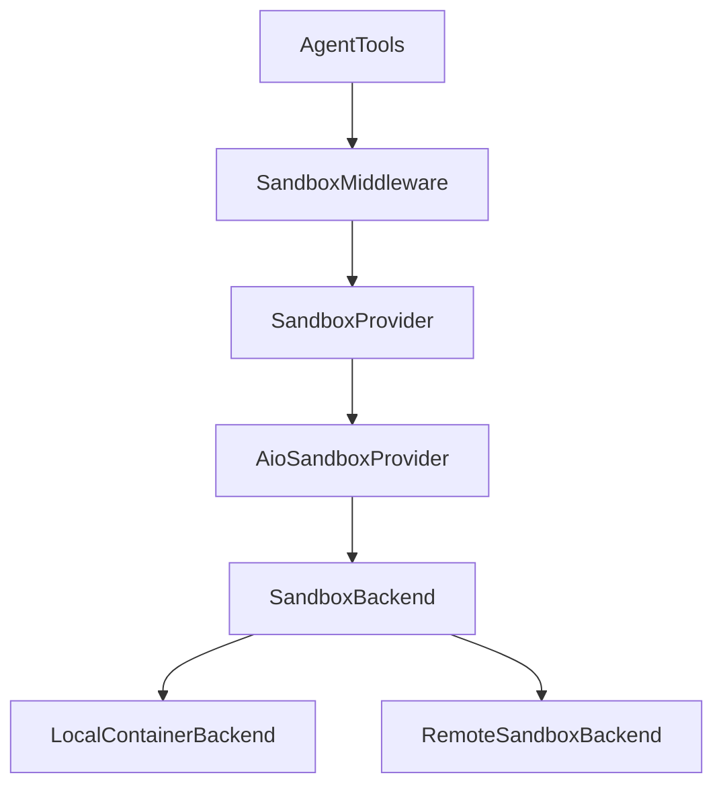
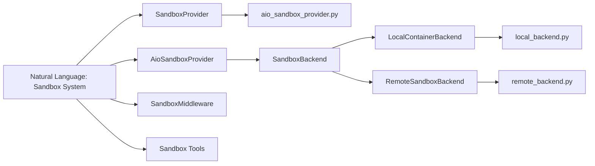
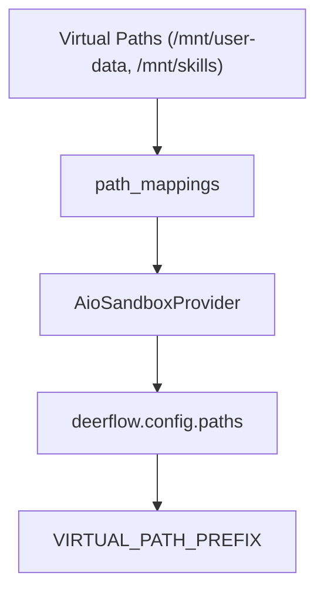

<!-- source: DeepWiki mcp.deepwiki.com · repo bytedance/deer-flow · page 6 Sandbox Execution Environment · fetched 2026-10-29 -->

# Sandbox Execution Environment

Relevant source files

The following files were used as context for generating this wiki page:

- [.github/workflows/sandbox-image-smoke.yml](.github/workflows/sandbox-image-smoke.yml)
- [backend/packages/harness/deerflow/community/aio_sandbox/aio_sandbox_provider.py](backend/packages/harness/deerflow/community/aio_sandbox/aio_sandbox_provider.py)
- [backend/packages/harness/deerflow/community/aio_sandbox/backend.py](backend/packages/harness/deerflow/community/aio_sandbox/backend.py)
- [backend/packages/harness/deerflow/community/aio_sandbox/local_backend.py](backend/packages/harness/deerflow/community/aio_sandbox/local_backend.py)
- [backend/packages/harness/deerflow/community/aio_sandbox/remote_backend.py](backend/packages/harness/deerflow/community/aio_sandbox/remote_backend.py)
- [backend/packages/harness/deerflow/config/sandbox_config.py](backend/packages/harness/deerflow/config/sandbox_config.py)
- [backend/packages/harness/deerflow/sandbox/AGENTS.md](backend/packages/harness/deerflow/sandbox/AGENTS.md)
- [backend/tests/blocking_io/test_aio_sandbox_get.py](backend/tests/blocking_io/test_aio_sandbox_get.py)
- [backend/tests/blocking_io/test_sandbox_release.py](backend/tests/blocking_io/test_sandbox_release.py)
- [backend/tests/test_aio_sandbox_local_backend.py](backend/tests/test_aio_sandbox_local_backend.py)
- [backend/tests/test_aio_sandbox_provider.py](backend/tests/test_aio_sandbox_provider.py)
- [backend/tests/test_aio_sandbox_readiness.py](backend/tests/test_aio_sandbox_readiness.py)
- [backend/tests/test_provisioner_pvc_volumes.py](backend/tests/test_provisioner_pvc_volumes.py)
- [backend/tests/test_provisioner_request_threading.py](backend/tests/test_provisioner_request_threading.py)
- [backend/tests/test_remote_sandbox_backend.py](backend/tests/test_remote_sandbox_backend.py)
- [backend/tests/test_sandbox_orphan_reconciliation.py](backend/tests/test_sandbox_orphan_reconciliation.py)
- [docker/provisioner/README.md](docker/provisioner/README.md)
- [docker/provisioner/app.py](docker/provisioner/app.py)

This page provides an overview of DeerFlow's sandbox system designed for isolated, secure, and flexible code execution environments [backend/packages/harness/deerflow/sandbox/AGENTS.md:1-16](). The sandbox enables agents to run shell commands, manage files, and produce outputs within isolated execution contexts that are scoped per conversation thread and user [backend/packages/harness/deerflow/sandbox/AGENTS.md:14-16](). This architecture separates code execution from the Gateway API process, ensuring stability, security, multi-tenancy, and lifecycle management [backend/packages/harness/deerflow/sandbox/AGENTS.md:1-16]().

This is a parent page. For deep technical details, see the child pages:
- [Sandbox Architecture and Providers](#6.1)
- [Sandbox Backends](#6.2)
- [Path Virtualization and Security](#6.3)
- [Sandbox Tools](#6.4)

---

## Purpose and Scope

DeerFlow’s sandbox system provides foundational capabilities:

- **Isolation and Thread-bound Scope**: Each sandbox instance corresponds to a user-thread identity pair, deterministically derived to avoid collisions and enable explicit lifecycle ownership and lease tracking [backend/packages/harness/deerflow/sandbox/AGENTS.md:14-16]().
- **Stateful Executions**: Sandboxes maintain persistent shell sessions and file system mounts allowing command state, files, and artifacts to be stored securely across conversation turns [backend/packages/harness/deerflow/community/aio_sandbox/aio_sandbox.py:40-69]().
- **Pluggable Execution Backends**: Support for local execution on the host, container-based execution via Docker or Apple Container (`LocalContainerBackend`), and remote cloud sandbox providers such as Kubernetes Pods via a provisioner service (`RemoteSandboxBackend`) [backend/packages/harness/deerflow/community/aio_sandbox/aio_sandbox_provider.py:1-69](), [backend/packages/harness/deerflow/community/aio_sandbox/local_backend.py:1-5](), [backend/packages/harness/deerflow/community/aio_sandbox/remote_backend.py:1-16]().
- **Security and Policy Enforcement**: Sandbox authorization gates manage permission to execute commands per user roles, while virtual path mappings limit file system access scope and sanitize command outputs [backend/packages/harness/deerflow/sandbox/AGENTS.md:4-11]().
- **Lifecycle and Lease Management**: Providers manage sandbox acquisition, ownership leases across Gateway instances, warm pool maintenance, idle timeouts, and graceful shutdown [backend/packages/harness/deerflow/community/aio_sandbox/aio_sandbox_provider.py:1-11]().

Sources: [backend/packages/harness/deerflow/sandbox/AGENTS.md:1-16](), [backend/packages/harness/deerflow/community/aio_sandbox/aio_sandbox.py:40-69](), [backend/packages/harness/deerflow/community/aio_sandbox/aio_sandbox_provider.py:1-69](), [backend/packages/harness/deerflow/community/aio_sandbox/local_backend.py:1-5](), [backend/packages/harness/deerflow/community/aio_sandbox/remote_backend.py:1-16]()

---

## Abstraction Layers and Components

DeerFlow’s sandbox system comprises multiple abstraction layers to separate concerns and support flexible implementations:

Sources: [backend/packages/harness/deerflow/sandbox/AGENTS.md:1-16](), [backend/packages/harness/deerflow/community/aio_sandbox/aio_sandbox_provider.py:1-69]()

- **SandboxMiddleware**: Intercepts tool invocations to eagerly manage sandbox lifecycle acquisition and enforce network authorization policies [backend/packages/harness/deerflow/sandbox/AGENTS.md:5-7]().
- **SandboxProvider Interface**: Abstract base class defining canonical methods like `acquire`, `release`, and `get` [backend/packages/harness/deerflow/sandbox/AGENTS.md:14]().
- **AioSandboxProvider**: Asynchronous provider orchestrating sandbox containers using warm pools, cross-instance ownership, leasing, idle cleanup, and configuration injection [backend/packages/harness/deerflow/community/aio_sandbox/aio_sandbox_provider.py:1-69]().
- **SandboxBackend Protocol**: Pluggable backend protocol implemented by `LocalContainerBackend` (Docker/Apple Container) and `RemoteSandboxBackend` (Kubernetes provisioner) [backend/packages/harness/deerflow/community/aio_sandbox/local_backend.py:1-5](), [backend/packages/harness/deerflow/community/aio_sandbox/remote_backend.py:1-16]().

For detailed architecture, see [Sandbox Architecture and Providers](#6.1) and [Sandbox Backends](#6.2).

Sources: [backend/packages/harness/deerflow/sandbox/AGENTS.md:1-16](), [backend/packages/harness/deerflow/community/aio_sandbox/aio_sandbox_provider.py:1-69](), [backend/packages/harness/deerflow/community/aio_sandbox/local_backend.py:1-5](), [backend/packages/harness/deerflow/community/aio_sandbox/remote_backend.py:1-16]()

---

## Path Virtualization and Security

To maintain security and prevent host escape, DeerFlow employs strict path virtualization and validation:

| Virtual Path Prefix | Description / Mount Mapping |
|---------------------|-----------------------------|
| `/mnt/user-data/`   | Workspace directory mapped to thread- and user-specific host paths or PVC subpaths [docker/provisioner/README.md:157-161]() |
| `/mnt/skills/`      | Read-only mounts representing enabled public, custom, and legacy skill projections [backend/packages/harness/deerflow/community/aio_sandbox/aio_sandbox_provider.py:45-56](), [docker/provisioner/README.md:27-29]() |
| `/mnt/acp-workspace/` | Ephemeral workspace for skill builds and runtime files [docker/provisioner/app.py:124-124]() |

Key security mechanisms include path validation against traversal sequences [backend/packages/harness/deerflow/community/aio_sandbox/remote_backend.py:65-80](), output masking to prevent leaking host paths [backend/packages/harness/deerflow/sandbox/AGENTS.md:3](), and mount boundary enforcement [backend/packages/harness/deerflow/community/aio_sandbox/remote_backend.py:75-80](). For details, see [Path Virtualization and Security](#6.3).

Sources: [backend/packages/harness/deerflow/sandbox/AGENTS.md:3-4](), [backend/packages/harness/deerflow/community/aio_sandbox/aio_sandbox_provider.py:45-56](), [backend/packages/harness/deerflow/community/aio_sandbox/remote_backend.py:65-80](), [docker/provisioner/README.md:27-29]()

---

## Sandbox Tools Overview

Agents interact with the sandbox through a set of built-in tools:
- `bash`: Executes arbitrary shell commands with virtual path and environment isolation [backend/packages/harness/deerflow/sandbox/AGENTS.md:3]().
- `ls`: Lists directory contents with path and depth restrictions [backend/packages/harness/deerflow/sandbox/AGENTS.md:12]().
- `read_file`: Reads file contents from within the sandbox scope [backend/packages/harness/deerflow/sandbox/AGENTS.md:12]().
- `write_file`: Writes data to files with serialization [backend/packages/harness/deerflow/sandbox/AGENTS.md:12]().
- `str_replace`: Performs string replacements on file contents.

For tool parameters and integration patterns, see [Sandbox Tools](#6.4).

Sources: [backend/packages/harness/deerflow/sandbox/AGENTS.md:3-12]()

---

## Bridging Namespaces: Natural Language to Code Entities

### Map of Sandbox System Concepts to Code Implementation

Sources: [backend/packages/harness/deerflow/sandbox/AGENTS.md:1-16](), [backend/packages/harness/deerflow/community/aio_sandbox/aio_sandbox_provider.py:1-69](), [backend/packages/harness/deerflow/community/aio_sandbox/local_backend.py:1-5](), [backend/packages/harness/deerflow/community/aio_sandbox/remote_backend.py:1-16]()

### Mapping Virtual Paths to Physical Configuration in Code

Sources: [backend/packages/harness/deerflow/community/aio_sandbox/aio_sandbox_provider.py:44-46]()

---

## Child Pages for Detailed Topics

- [Sandbox Architecture and Providers](#6.1) — `SandboxProvider` interface, `AioSandboxProvider`, warm pool, leases, ownership stores, and orphan reconciliation.
- [Sandbox Backends](#6.2) — `LocalContainerBackend`, `RemoteSandboxBackend`, E2B, BoxLite, Tenki, and OpenSandbox providers.
- [Path Virtualization and Security](#6.3) — Virtual path system, path translation, output masking, and validation.
- [Sandbox Tools](#6.4) — `bash`, `ls`, `read_file`, `write_file`, and `str_replace` tool integration.

Sources: [backend/packages/harness/deerflow/sandbox/AGENTS.md:1-16]()

---

