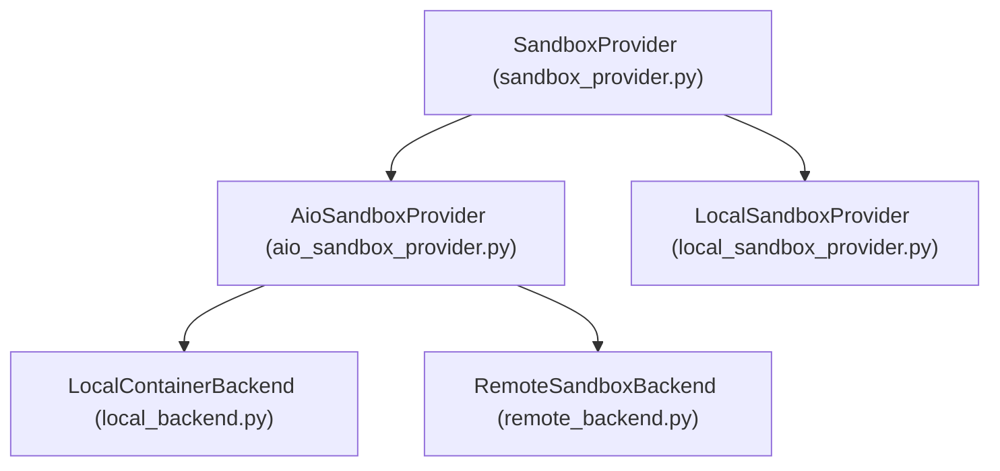
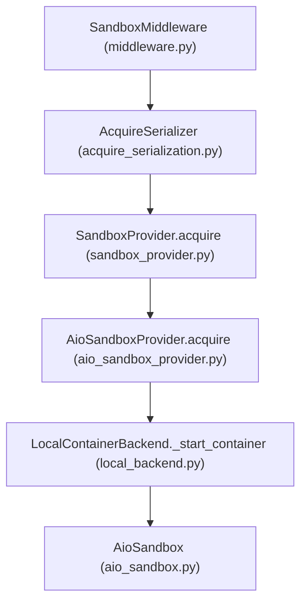

<!-- source: DeepWiki mcp.deepwiki.com · repo bytedance/deer-flow · page 6.1 Sandbox Architecture and Providers · fetched 2026-10-29 -->

# Sandbox Architecture and Providers

Relevant source files

The following files were used as context for generating this wiki page:

- [.github/workflows/sandbox-image-smoke.yml](.github/workflows/sandbox-image-smoke.yml)
- [backend/packages/harness/deerflow/community/aio_sandbox/aio_sandbox_provider.py](backend/packages/harness/deerflow/community/aio_sandbox/aio_sandbox_provider.py)
- [backend/packages/harness/deerflow/community/aio_sandbox/backend.py](backend/packages/harness/deerflow/community/aio_sandbox/backend.py)
- [backend/packages/harness/deerflow/community/aio_sandbox/local_backend.py](backend/packages/harness/deerflow/community/aio_sandbox/local_backend.py)
- [backend/packages/harness/deerflow/community/aio_sandbox/remote_backend.py](backend/packages/harness/deerflow/community/aio_sandbox/remote_backend.py)
- [backend/packages/harness/deerflow/config/sandbox_config.py](backend/packages/harness/deerflow/config/sandbox_config.py)
- [backend/packages/harness/deerflow/sandbox/AGENTS.md](backend/packages/harness/deerflow/sandbox/AGENTS.md)
- [backend/packages/harness/deerflow/sandbox/lease.py](backend/packages/harness/deerflow/sandbox/lease.py)
- [backend/packages/harness/deerflow/sandbox/local/local_sandbox_provider.py](backend/packages/harness/deerflow/sandbox/local/local_sandbox_provider.py)
- [backend/packages/harness/deerflow/sandbox/middleware.py](backend/packages/harness/deerflow/sandbox/middleware.py)
- [backend/packages/harness/deerflow/sandbox/overwrite.py](backend/packages/harness/deerflow/sandbox/overwrite.py)
- [backend/packages/harness/deerflow/sandbox/sandbox_provider.py](backend/packages/harness/deerflow/sandbox/sandbox_provider.py)
- [backend/tests/blocking_io/test_aio_sandbox_get.py](backend/tests/blocking_io/test_aio_sandbox_get.py)
- [backend/tests/blocking_io/test_sandbox_release.py](backend/tests/blocking_io/test_sandbox_release.py)
- [backend/tests/test_aio_sandbox_local_backend.py](backend/tests/test_aio_sandbox_local_backend.py)
- [backend/tests/test_aio_sandbox_provider.py](backend/tests/test_aio_sandbox_provider.py)
- [backend/tests/test_aio_sandbox_readiness.py](backend/tests/test_aio_sandbox_readiness.py)
- [backend/tests/test_ensure_sandbox_initialized.py](backend/tests/test_ensure_sandbox_initialized.py)
- [backend/tests/test_local_sandbox_provider_mounts.py](backend/tests/test_local_sandbox_provider_mounts.py)
- [backend/tests/test_provisioner_pvc_volumes.py](backend/tests/test_provisioner_pvc_volumes.py)
- [backend/tests/test_provisioner_request_threading.py](backend/tests/test_provisioner_request_threading.py)
- [backend/tests/test_remote_sandbox_backend.py](backend/tests/test_remote_sandbox_backend.py)
- [backend/tests/test_sandbox_lease_rebind_cancellation.py](backend/tests/test_sandbox_lease_rebind_cancellation.py)
- [backend/tests/test_sandbox_leases.py](backend/tests/test_sandbox_leases.py)
- [backend/tests/test_sandbox_middleware.py](backend/tests/test_sandbox_middleware.py)
- [backend/tests/test_sandbox_orphan_reconciliation.py](backend/tests/test_sandbox_orphan_reconciliation.py)
- [docker/provisioner/README.md](docker/provisioner/README.md)
- [docker/provisioner/app.py](docker/provisioner/app.py)

## Purpose and Scope

This page documents the architecture and implementation of the sandbox execution environment within DeerFlow. It explains the `SandboxProvider` interface `[backend/packages/harness/deerflow/sandbox/sandbox_provider.py:15-134]()`, the concrete `AioSandboxProvider` implementation `[backend/packages/harness/deerflow/community/aio_sandbox/aio_sandbox_provider.py:1-179]()`, and how sandbox lifecycles are orchestrated across warm pool management, lease-based ownership tracking, orphan reconciliation, and idle timeout handling. Additional details cover the ownership stores abstraction for distributed lease coordination and how idle timeouts ensure sandbox resource cleanup. The page targets understanding the full sandbox provisioning, acquisition, and release lifecycle used for isolated code execution in DeerFlow.

Sources:  
- `[backend/packages/harness/deerflow/sandbox/sandbox_provider.py:15-134]()`  
- `[backend/packages/harness/deerflow/community/aio_sandbox/aio_sandbox_provider.py:1-179]()`  
- `[backend/packages/harness/deerflow/sandbox/lease.py]()`  
- `[backend/packages/harness/deerflow/community/aio_sandbox/ownership/__init__.py]()`  
- `[backend/packages/harness/deerflow/community/warm_pool_lifecycle.py]()`

---

## Overview and Provider Interface (`SandboxProvider`)

DeerFlow’s sandbox system provides controlled, ephemeral, isolated execution environments for running arbitrary code safely, such as AI-generated scripts or shell commands. The sandbox abstraction enables these operations without polluting or risking the host system.

The sandbox environment is accessed through a standardized abstract base class called `SandboxProvider` `[backend/packages/harness/deerflow/sandbox/sandbox_provider.py:15-24]()`. This interface abstracts the lifecycle management of sandbox instances, including creation (`acquire`/`acquire_async`), retrieval (`get`/`get_scoped`), skill synchronization (`sync_agent_skills`), and release (`release`) `[backend/packages/harness/deerflow/sandbox/sandbox_provider.py:25-115]`, allowing different backends or infrastructure modes to be plugged in seamlessly.

Thread-safety for global provider access is managed via a dedicated module-level `_provider_lock` and `get_initialized_sandbox_provider()` helper functions that protect instance registration without blocking slow provider callbacks `[backend/packages/harness/deerflow/sandbox/sandbox_provider.py:162-182]()`.

Diagram: Sandbox Provider Hierarchy (Code Entity Space)

Sources:  
- `[backend/packages/harness/deerflow/sandbox/sandbox_provider.py:15-182]()`  
- `[backend/packages/harness/deerflow/community/aio_sandbox/aio_sandbox_provider.py:1-11]()`  
- `[backend/packages/harness/deerflow/sandbox/local/local_sandbox_provider.py:36-71]()`

---

## Concrete Implementation: `AioSandboxProvider` and Backends

### Purpose and Composition

`AioSandboxProvider` is a sophisticated sandbox provider implementation that manages containerized sandboxes running the DeerFlow AIO sandbox image `[backend/packages/harness/deerflow/community/aio_sandbox/aio_sandbox_provider.py:1-11]()`. It:

- Supports provisioning via local Docker or Apple Containers (`LocalContainerBackend` `[backend/packages/harness/deerflow/community/aio_sandbox/local_backend.py:1-5]()`) or remote Kubernetes pods (`RemoteSandboxBackend` `[backend/packages/harness/deerflow/community/aio_sandbox/remote_backend.py]()`).
- Implements warm pool management with configurable maximum replicas via `WarmPoolLifecycleMixin` `[backend/packages/harness/deerflow/community/warm_pool_lifecycle.py]()`.
- Enforces idle timeouts via background loops to automatically shut down unused sandboxes.
- Coordinates distributed leases with an ownership store `[backend/packages/harness/deerflow/community/aio_sandbox/ownership/__init__.py]()`.
- Supports thread-specific volume mounts for user data, skills, and ACP workspaces.

Sandbox acquisition and release involve critical concurrency coordination to avoid race conditions. DeerFlow addresses this with `AcquireSerializer` `[backend/packages/harness/deerflow/sandbox/acquire_serialization.py]()` and asynchronous worker helpers like `_run_started_acquire_worker` `[backend/packages/harness/deerflow/community/aio_sandbox/aio_sandbox_provider.py:140-174]()`, which serialize selected acquire/release transitions with a bounded, refcounted per-key lock table `[backend/packages/harness/deerflow/sandbox/AGENTS.md:16]()`.

Diagram: Acquisition and Execution Flow (Code Entity Space)

Sources:
- `[backend/packages/harness/deerflow/sandbox/AGENTS.md:13-17]()`
- `[backend/packages/harness/deerflow/sandbox/middleware.py:129-163]()`
- `[backend/packages/harness/deerflow/community/aio_sandbox/aio_sandbox_provider.py:140-174]()`

---

## Lease Management and Ownership Stores

### Lease-Based Ownership and Configuration

To prevent conflicts in multi-instance or multi-threaded deployments, sandbox ownership is tracked using leases stored in a `SandboxOwnershipStore` (`memory` or `redis`) configured via `SandboxOwnershipConfig` `[backend/packages/harness/deerflow/config/sandbox_config.py:88-146]()`. These leases:

- Associate sandbox IDs with owners via a unique `owner_id` `[backend/packages/harness/deerflow/sandbox/AGENTS.md:13-15]()`.
- Have time-to-live (TTL) values derived from `renewal_interval_seconds` and `ttl_multiplier` `[backend/packages/harness/deerflow/config/sandbox_config.py:108-122]`.
- Track concurrent lead, subagent, Gateway-request, and channel-upload users locally through `SandboxLeaseManager` `[backend/packages/harness/deerflow/sandbox/lease.py]()`.

Sources:
- `[backend/packages/harness/deerflow/config/sandbox_config.py:88-146]()`
- `[backend/packages/harness/deerflow/sandbox/AGENTS.md:13-17]()`
- `[backend/packages/harness/deerflow/sandbox/lease.py]()`

---

## Orphan Reconciliation and Idle Timeout Management

### Warm Pools and Idle Cleanup

The `AioSandboxProvider` and its associated warm pool mixin maintain a pool of ready sandboxes bounded by replica limits (`DEFAULT_REPLICAS`) and idle timeouts (`DEFAULT_IDLE_TIMEOUT`) `[backend/packages/harness/deerflow/community/warm_pool_lifecycle.py]()`. 

### Orphan Container Reconciliation

Background coroutines and reconciliation hooks scan warm pools and active runtimes to reclaim sandboxes with stale owners or inconsistent state:
- For each container, ownership lease validity is verified against the ownership store.
- Sandboxes with expired or missing leases, or those flagged by quarantine checks, are reclaimed, closed via idempotent `close()` calls, or marked for replacement `[backend/packages/harness/deerflow/sandbox/AGENTS.md:13-17]`.
- Failures during reconciliation are logged safely without disrupting active cancellation handles or event loop tasks.

Sources:
- `[backend/packages/harness/deerflow/sandbox/AGENTS.md:13-17]()`
- `[backend/packages/harness/deerflow/community/aio_sandbox/aio_sandbox_provider.py:69-78]()`
- `[backend/packages/harness/deerflow/community/warm_pool_lifecycle.py]()`

---

## References

- [`SandboxProvider` interface `[backend/packages/harness/deerflow/sandbox/sandbox_provider.py:15-134]()`]()  
- [`AioSandboxProvider` implementation `[backend/packages/harness/deerflow/community/aio_sandbox/aio_sandbox_provider.py:1-179]()`]()  
- [Sandbox ownership configuration `[backend/packages/harness/deerflow/config/sandbox_config.py:88-146]()`]()  
- [Warm Pool Lifecycle Mixin `[backend/packages/harness/deerflow/community/warm_pool_lifecycle.py]()`]()  
- [AcquireSerializer concurrency control `[backend/packages/harness/deerflow/sandbox/acquire_serialization.py]()`]()  
- [Sandbox Middleware integration `[backend/packages/harness/deerflow/sandbox/middleware.py]()`]()

---

