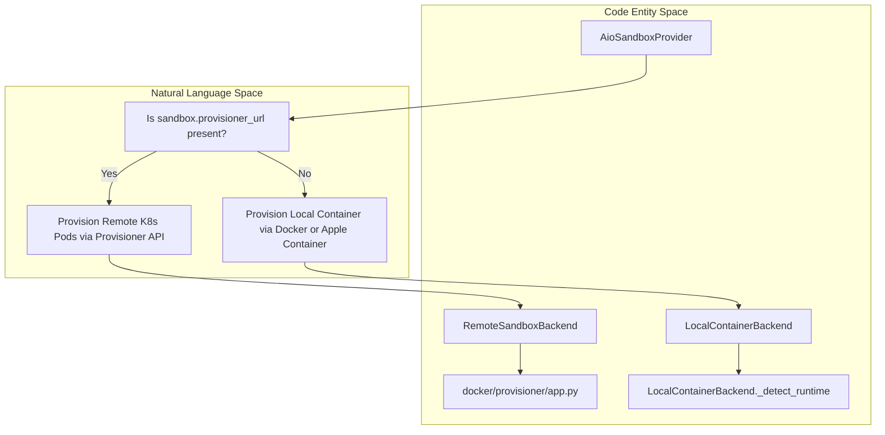
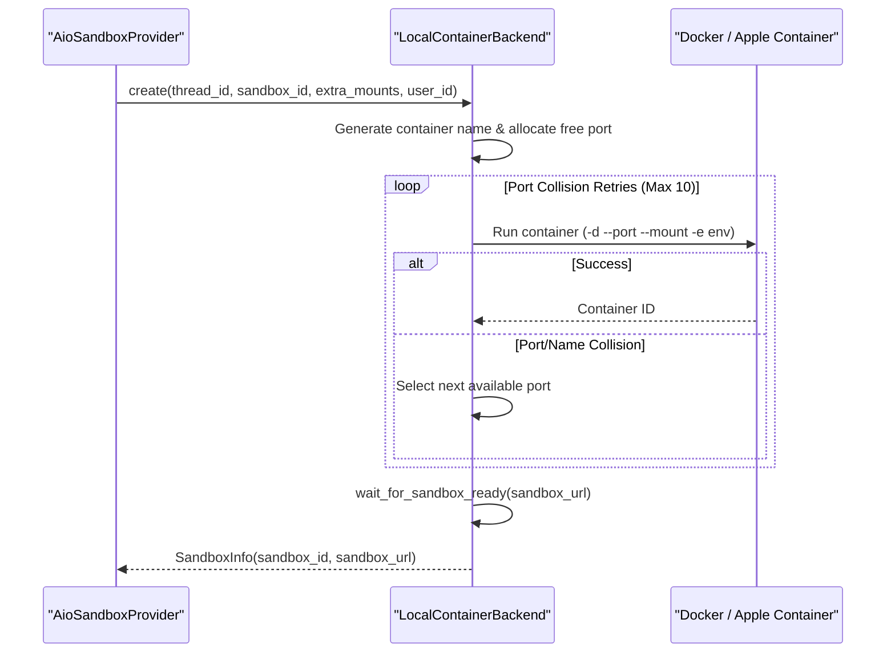
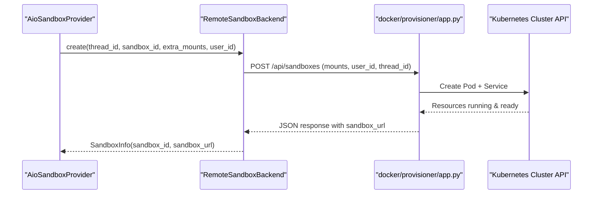
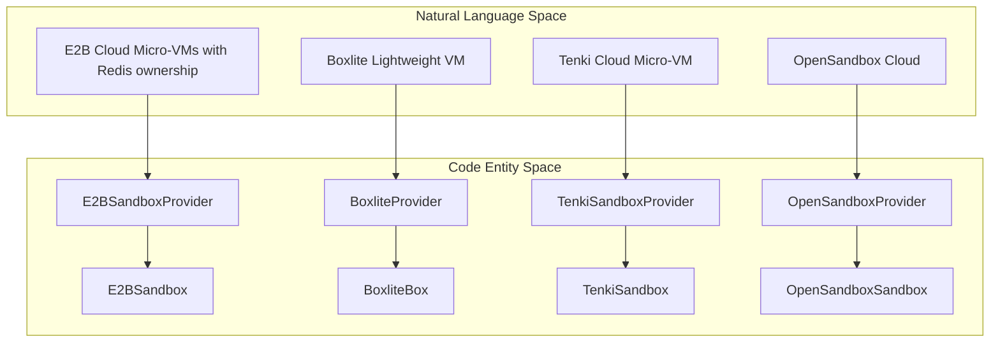

<!-- source: DeepWiki mcp.deepwiki.com · repo bytedance/deer-flow · page 6.2 Sandbox Backends · fetched 2026-10-29 -->

# Sandbox Backends

Relevant source files

The following files were used as context for generating this wiki page:

- [backend/packages/harness/deerflow/community/aio_sandbox/aio_sandbox.py](backend/packages/harness/deerflow/community/aio_sandbox/aio_sandbox.py)
- [backend/packages/harness/deerflow/community/boxlite/README.md](backend/packages/harness/deerflow/community/boxlite/README.md)
- [backend/packages/harness/deerflow/community/boxlite/__init__.py](backend/packages/harness/deerflow/community/boxlite/__init__.py)
- [backend/packages/harness/deerflow/community/boxlite/box.py](backend/packages/harness/deerflow/community/boxlite/box.py)
- [backend/packages/harness/deerflow/community/boxlite/provider.py](backend/packages/harness/deerflow/community/boxlite/provider.py)
- [backend/packages/harness/deerflow/community/e2b_sandbox/AGENTS.md](backend/packages/harness/deerflow/community/e2b_sandbox/AGENTS.md)
- [backend/packages/harness/deerflow/community/e2b_sandbox/e2b_sandbox.py](backend/packages/harness/deerflow/community/e2b_sandbox/e2b_sandbox.py)
- [backend/packages/harness/deerflow/community/e2b_sandbox/e2b_sandbox_provider.py](backend/packages/harness/deerflow/community/e2b_sandbox/e2b_sandbox_provider.py)
- [backend/packages/harness/deerflow/community/opensandbox/AGENTS.md](backend/packages/harness/deerflow/community/opensandbox/AGENTS.md)
- [backend/packages/harness/deerflow/community/opensandbox/README.md](backend/packages/harness/deerflow/community/opensandbox/README.md)
- [backend/packages/harness/deerflow/community/opensandbox/provider.py](backend/packages/harness/deerflow/community/opensandbox/provider.py)
- [backend/packages/harness/deerflow/community/opensandbox/sandbox.py](backend/packages/harness/deerflow/community/opensandbox/sandbox.py)
- [backend/packages/harness/deerflow/community/tenki/README.md](backend/packages/harness/deerflow/community/tenki/README.md)
- [backend/packages/harness/deerflow/community/tenki/__init__.py](backend/packages/harness/deerflow/community/tenki/__init__.py)
- [backend/packages/harness/deerflow/community/tenki/provider.py](backend/packages/harness/deerflow/community/tenki/provider.py)
- [backend/packages/harness/deerflow/community/tenki/sandbox.py](backend/packages/harness/deerflow/community/tenki/sandbox.py)
- [backend/packages/harness/deerflow/sandbox/acquire_serialization.py](backend/packages/harness/deerflow/sandbox/acquire_serialization.py)
- [backend/packages/harness/deerflow/sandbox/exceptions.py](backend/packages/harness/deerflow/sandbox/exceptions.py)
- [backend/packages/harness/deerflow/sandbox/sandbox.py](backend/packages/harness/deerflow/sandbox/sandbox.py)
- [backend/tests/test_acquire_serialization.py](backend/tests/test_acquire_serialization.py)
- [backend/tests/test_aio_sandbox.py](backend/tests/test_aio_sandbox.py)
- [backend/tests/test_boxlite_provider.py](backend/tests/test_boxlite_provider.py)
- [backend/tests/test_e2b_sandbox_provider.py](backend/tests/test_e2b_sandbox_provider.py)
- [backend/tests/test_opensandbox_provider.py](backend/tests/test_opensandbox_provider.py)
- [backend/tests/test_sandbox_search_contract.py](backend/tests/test_sandbox_search_contract.py)
- [backend/tests/test_tenki_provider.py](backend/tests/test_tenki_provider.py)

This page provides detailed technical documentation for the various sandbox backend implementations used in DeerFlow for provisioning isolated code execution environments. It covers the local container backend (using Docker or Apple Container), the remote Kubernetes-based sandbox backend via the provisioner service, and community-backed cloud/native SDK providers: E2B, BoxLite, Tenki, and OpenSandbox.

This is a leaf page focused on full technical details about the sandbox backends — implementation, data flow, key classes and functions, integration points, and example interaction diagrams. For broader sandbox system concepts like ownership, leases, warm pools, and lifecycle, see page 6.1. For path virtualization and sandbox file system security, see page 6.3.

---

## 1. Sandbox Backend Interface and Abstraction

All sandbox backends implement the abstract interface `SandboxBackend` which prescribes core methods to manage sandbox lifecycle and discovery:

- **create**(`thread_id: str, sandbox_id: str, extra_mounts: list, user_id: str`) → `SandboxInfo`  
  Requests provisioning of a new sandbox instance identified by `sandbox_id`. Accepts optional mounts and user context. Returns a `SandboxInfo` data object describing the live sandbox.
- **destroy**(`info: SandboxInfo`) → None  
  Tears down or releases resources associated with the sandbox.
- **is_alive**(`info: SandboxInfo`) → bool  
  Checks whether the sandbox runtime is alive.
- **discover**(`sandbox_id: str`) → `SandboxInfo | None`  
  Attempts cross-process re-attachment or discovery of a sandbox instance by ID.
- **list_running**() → list[`SandboxInfo`]  
  Lists currently running sandboxes managed by this backend.

These methods encapsulate provider-specific runtime interactions and allow the `AioSandboxProvider` class to manage a warm pool and coordinate sandbox lifecycles uniformly across different backends [backend/packages/harness/deerflow/community/aio_sandbox/backend.py:103-192]().

`SandboxInfo` instances hold immutable sandbox metadata including IDs, HTTP URLs, container/pod identifiers, and authentication tokens used to communicate with sandboxes [backend/packages/harness/deerflow/community/aio_sandbox/sandbox_info.py:1-21]().

Sources:
- [backend/packages/harness/deerflow/community/aio_sandbox/backend.py:103-192]()
- [backend/packages/harness/deerflow/community/aio_sandbox/sandbox_info.py:1-21]()

---

## 2. Backend Selection Architecture

The `AioSandboxProvider` dynamically chooses the sandbox backend implementation at runtime based on configuration:

- If `sandbox.provisioner_url` is configured, `RemoteSandboxBackend` is selected. It uses the Kubernetes provisioner service's HTTP/REST API to create sandbox Pods remotely.
- Otherwise, `LocalContainerBackend` is used. It manages sandbox containers locally on the host with Docker or Apple Container tools.

Sources:
- [backend/packages/harness/deerflow/community/aio_sandbox/aio_sandbox_provider.py:187-210]()
- [backend/packages/harness/deerflow/community/aio_sandbox/local_backend.py:227-241]()

---

## 3. LocalContainerBackend (Docker / Apple Container)

`LocalContainerBackend` manages sandbox containers on the local host machine through Docker CLI or Apple Container (macOS/Apple Silicon). Its responsibilities include container lifecycle, port allocation, environment injection, mounts, and network configuration.

### Runtime Detection
- Attempts to detect Apple Container CLI (`container --version`) on macOS Apple Silicon [backend/packages/harness/deerflow/community/aio_sandbox/local_backend.py:227-241]().
- Otherwise defaults to Docker CLI by checking `docker info`.
- Detects Docker Desktop running to adjust behavior for mount syntax and network isolation support.

### Container Creation and Startup
- Generates a unique container name combining the configured prefix and the sandbox ID [backend/packages/harness/deerflow/community/aio_sandbox/local_backend.py:73-204]().
- Finds a free TCP port in the configured range for sandbox service binding.
- Constructs bind mounts and environment variable injections.
- Uses Docker's `--mount type=bind` syntax for Windows compatibility, or `-v` for Apple Container.
- Supports `--network` configuration based on sandbox network policy modes: `"open"` (default), `"isolated"`, or `"allowlist"`.
- Logs the container run command with sensitive environment variables redacted.

### Container Launch Retry Logic
- Attempts up to 10 retries when port or container name conflicts occur.
- On conflict, increments port number and retries with exponential backoff.

### Ready Detection and Lifecycle Management
- Waits for HTTP readiness probe on the sandbox endpoint (container's bound port) [backend/packages/harness/deerflow/community/aio_sandbox/local_backend.py:301-382]().
- On success, returns a `SandboxInfo` containing the container ID, URL, and metadata.

Title: Local Container Provisioning Sequence

Sources:
- [backend/packages/harness/deerflow/community/aio_sandbox/local_backend.py:73-204]()
- [backend/packages/harness/deerflow/community/aio_sandbox/local_backend.py:227-241]()
- [backend/packages/harness/deerflow/community/aio_sandbox/local_backend.py:301-382]()

---

## 4. RemoteSandboxBackend (Kubernetes Provisioner)

`RemoteSandboxBackend` provisions sandbox Pods inside a Kubernetes cluster using an external REST API provisioner service (`docker/provisioner/app.py`).

### Provisioning Protocol
- Sends a `POST /api/sandboxes` request containing:
  - `sandbox_id`, `thread_id`, `user_id` [backend/packages/harness/deerflow/community/aio_sandbox/remote_backend.py:91-176]()
  - Additional volume mounts (mounted directories like skills or user data).
- The provisioner creates a Kubernetes Pod and Service exposing the sandbox container on a port [docker/provisioner/app.py:11-150]().
- The response JSON includes the public sandbox URL ready for connections.
- Supports idempotent create calls (same `sandbox_id` returns existing sandbox info).
- Supports deletion and status queries by sandbox ID.

### Kubernetes Provisioner Service
- A FastAPI app that manages Kubernetes resources using the official k8s client [docker/provisioner/app.py:11-150]().
- Creates Pods with the configured sandbox container image (`all-in-one-sandbox`).
- Optionally uses PVCs for persistent volumes for skills, user data.
- Creates Kubernetes Services exposing pods via `NodePort` or `ClusterIP`.
- Tracks sandbox ownership and reconciles orphan pods.
- Allows configuring container environment variables, init containers like `lark-cli` credential initializer.

Title: Kubernetes Provisioner Request Flow

Sources:
- [backend/packages/harness/deerflow/community/aio_sandbox/remote_backend.py:91-176]()
- [docker/provisioner/app.py:11-150]()

---

## 5. Community and Cloud Sandbox Providers

DeerFlow includes several specialized external community sandbox providers that integrate with cloud or lightweight VM environments. Each provider implements the DeerFlow `SandboxProvider` interface and creates `Sandbox`-conforming sandbox handles.

### 5.1 E2B Cloud Sandbox Provider
- `E2BSandboxProvider` connects to E2B cloud micro-VM environment [backend/packages/harness/deerflow/community/e2b_sandbox/e2b_sandbox_provider.py:1-34]().
- Uses a Redis-backed capacity and ownership store for concurrency control.
- Supports lifecycle management with reconciliation, idle timeouts, and mount uploads.
- Configured via API key, template, domain, and mounted volumes.
- Relies on the official `e2b_code_interpreter` SDK client sandbox [backend/packages/harness/deerflow/community/e2b_sandbox/e2b_sandbox.py:44-56]().
- `E2BSandbox` adapts DeerFlow virtual paths `/mnt/user-data` inside the remote home directory (default `/home/user`) [backend/packages/harness/deerflow/community/e2b_sandbox/e2b_sandbox.py:114-132]().
- Commands serialize calls over HTTP/2 with a threading lock to serialize concurrent requests [backend/packages/harness/deerflow/community/e2b_sandbox/e2b_sandbox.py:134-157]().

### 5.2 BoxLite Lightweight VM Provider
- `BoxliteProvider` manages sandbox micro-VMs using the BoxLite SDK [backend/packages/harness/deerflow/community/boxlite/provider.py:1-12]().
- `BoxliteBox` wraps the BoxLite `SimpleBox` async API behind a synchronous thread pool via an `_EventLoopThread` bridge [backend/packages/harness/deerflow/community/boxlite/box.py:1-14]().
- Each command runs in a forked shell session (`sh -lc`), with no persistent shell state [backend/packages/harness/deerflow/community/boxlite/box.py:63-65]().
- Implements strict path traversal checks and environment key validation [backend/packages/harness/deerflow/community/boxlite/box.py:157-173]().

### 5.3 Tenki Cloud Sandbox Provider
- `TenkiSandboxProvider` integrates with Tenki micro-VMs via the tenki Python SDK [backend/packages/harness/deerflow/community/tenki/sandbox.py:1-19]().
- `TenkiSandbox` provides native file system streaming primitives (`sandbox.fs` API) for improved performance and binary safety [backend/packages/harness/deerflow/community/tenki/sandbox.py:6-8]().
- Uses standard `find` and `grep` shell commands compatible with BusyBox for search [backend/packages/harness/deerflow/community/tenki/sandbox.py:9-13]().
- Maps DeerFlow's virtual mount `/mnt/user-data` to Tenki's home directory (default `/home/tenki`) [backend/packages/harness/deerflow/community/tenki/sandbox.py:49-54]().

### 5.4 OpenSandbox Provider (Optional)
- `OpenSandboxProvider` supports a sandbox backend that leverages the OpenSandbox SDK [backend/packages/harness/deerflow/community/opensandbox/sandbox.py:1]().
- Lazy-loads the SDK to avoid hard dependencies.
- Wraps the SDK's sandbox instances with a DeerFlow conformant `Sandbox` adapter (`OpenSandboxSandbox`) [backend/packages/harness/deerflow/community/opensandbox/sandbox.py:94-96]().
- Implements command execution, file download/upload, and search via shell commands [backend/packages/harness/deerflow/community/opensandbox/sandbox.py:97-122]().

Title: Community and Cloud Sandbox Providers Mapping

Sources:
- [backend/packages/harness/deerflow/community/e2b_sandbox/e2b_sandbox_provider.py:1-181]()
- [backend/packages/harness/deerflow/community/e2b_sandbox/e2b_sandbox.py:43-176]()
- [backend/packages/harness/deerflow/community/boxlite/box.py:49-186]()
- [backend/packages/harness/deerflow/community/boxlite/provider.py:1-128]()
- [backend/packages/harness/deerflow/community/tenki/sandbox.py:1-159]()
- [backend/packages/harness/deerflow/community/opensandbox/provider.py:1-130]()
- [backend/packages/harness/deerflow/community/opensandbox/sandbox.py:1-120]()

---

## 6. Kubernetes Provisioner REST API Summary

The Kubernetes sandbox provisioner service exposes REST endpoints to create, delete, list, and query sandbox Pods and Services:

| Endpoint | Method | Description | Source / Lines |
|---|---|---|---|
| `/api/sandboxes` | POST | Create sandbox Pod + Service | [docker/provisioner/app.py:12]() |
| `/api/sandboxes/{sandbox_id}` | DELETE | Delete sandbox Pod + Service | [docker/provisioner/app.py:13]() |
| `/api/sandboxes/{sandbox_id}` | GET | Get sandbox status and sandbox URL | [docker/provisioner/app.py:14]() |
| `/api/sandboxes` | GET | List all managed sandboxes | [docker/provisioner/app.py:15]() |
| `/health` | GET | Health check of the provisioner | [docker/provisioner/app.py:16]() |

Sources:
- [docker/provisioner/app.py:11-150]()

---

## 7. Summary Table of Sandbox Backends

| Backend | Type | Runtime/Language | Provisioning Mode | Key Classes / Files | Notes |
|---|---|---|---|---|---|
| `LocalContainerBackend` | Local Container | Python + Docker CLI | Direct Docker/Apple Container | `LocalContainerBackend`, `sandbox_info.py` | Detects runtime; manages local containers |
| `RemoteSandboxBackend` | Kubernetes Provisioner | Python, FastAPI, Kubernetes API | REST API to provision K8s Pods | `RemoteSandboxBackend`, `docker/provisioner/app.py` | Manages Kubernetes Pod lifecycle |
| `E2BSandboxProvider` | Cloud Micro-VM | Python + e2b SDK | E2B Cloud Micro-VM Service | `E2BSandboxProvider`, `E2BSandbox` | Redis-backed ownership and concurrency |
| `BoxliteProvider` | Lightweight VM | Python + BoxLite SDK | Local lightweight VM via SDK | `BoxliteProvider`, `BoxliteBox` | Async loop bridge for synchronous API |
| `TenkiSandboxProvider` | Cloud Micro-VM | Python + Tenki SDK | Tenki Cloud Micro-VM Service | `TenkiSandboxProvider`, `TenkiSandbox` | Native fs API with streaming file primitives |
| `OpenSandboxProvider` | Cloud Micro-VM (optional) | Python + OpenSandbox SDK | Optional remote OpenSandbox | `OpenSandboxProvider`, `OpenSandboxSandbox` | Lazy load SDK; supports session eviction |

Sources:
- [backend/packages/harness/deerflow/community/aio_sandbox/backend.py:103-192]()
- [backend/packages/harness/deerflow/community/aio_sandbox/local_backend.py:73-204]()
- [backend/packages/harness/deerflow/community/aio_sandbox/remote_backend.py:91-176]()
- [docker/provisioner/app.py:11-150]()
- [backend/packages/harness/deerflow/community/e2b_sandbox/e2b_sandbox_provider.py:1-181]()
- [backend/packages/harness/deerflow/community/boxlite/provider.py:1-128]()
- [backend/packages/harness/deerflow/community/tenki/sandbox.py:1-159]()
- [backend/packages/harness/deerflow/community/opensandbox/sandbox.py:1-120]()

---

