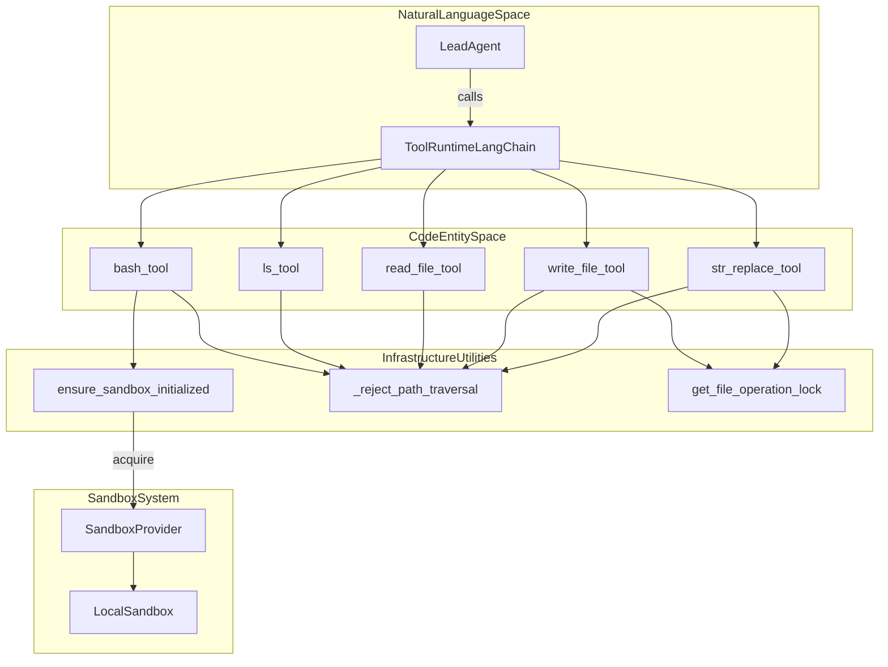
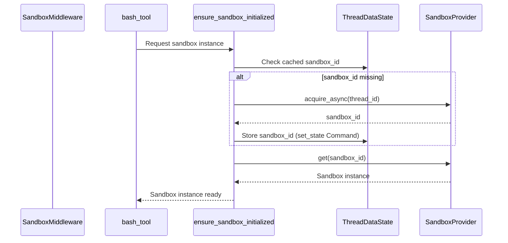
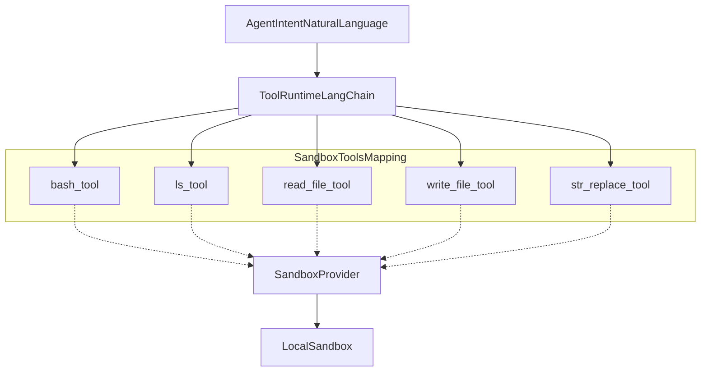
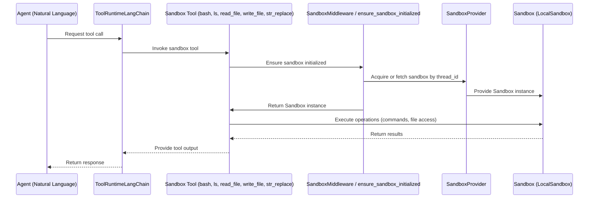

<!-- source: DeepWiki mcp.deepwiki.com · repo bytedance/deer-flow · page 6.4 Sandbox Tools · fetched 2026-10-29 -->

# Sandbox Tools

Relevant source files

The following files were used as context for generating this wiki page:

- [backend/packages/harness/deerflow/community/aio_sandbox/AGENTS.md](backend/packages/harness/deerflow/community/aio_sandbox/AGENTS.md)
- [backend/packages/harness/deerflow/extensions/cli.py](backend/packages/harness/deerflow/extensions/cli.py)
- [backend/packages/harness/deerflow/integrations/lark_broker.py](backend/packages/harness/deerflow/integrations/lark_broker.py)
- [backend/packages/harness/deerflow/sandbox/local/local_sandbox.py](backend/packages/harness/deerflow/sandbox/local/local_sandbox.py)
- [backend/packages/harness/deerflow/sandbox/path_patterns.py](backend/packages/harness/deerflow/sandbox/path_patterns.py)
- [backend/packages/harness/deerflow/sandbox/tools.py](backend/packages/harness/deerflow/sandbox/tools.py)
- [backend/packages/harness/deerflow/skills/review/resource_graph.py](backend/packages/harness/deerflow/skills/review/resource_graph.py)
- [backend/packages/harness/deerflow/utils/host_paths.py](backend/packages/harness/deerflow/utils/host_paths.py)
- [backend/tests/test_bench_sandbox_provider.py](backend/tests/test_bench_sandbox_provider.py)
- [backend/tests/test_extension_check_script.py](backend/tests/test_extension_check_script.py)
- [backend/tests/test_extension_dependency_sync.py](backend/tests/test_extension_dependency_sync.py)
- [backend/tests/test_extension_manager.py](backend/tests/test_extension_manager.py)
- [backend/tests/test_lark_broker.py](backend/tests/test_lark_broker.py)
- [backend/tests/test_lark_shim_atomic.py](backend/tests/test_lark_shim_atomic.py)
- [backend/tests/test_local_sandbox_command_timeout.py](backend/tests/test_local_sandbox_command_timeout.py)
- [backend/tests/test_local_sandbox_encoding.py](backend/tests/test_local_sandbox_encoding.py)
- [backend/tests/test_local_sandbox_path_regex_cache.py](backend/tests/test_local_sandbox_path_regex_cache.py)
- [backend/tests/test_read_file_line_range.py](backend/tests/test_read_file_line_range.py)
- [backend/tests/test_read_file_tool_binary.py](backend/tests/test_read_file_tool_binary.py)
- [backend/tests/test_read_file_truncation_continuation.py](backend/tests/test_read_file_truncation_continuation.py)
- [backend/tests/test_sandbox_path_patterns.py](backend/tests/test_sandbox_path_patterns.py)
- [backend/tests/test_sandbox_search_tools.py](backend/tests/test_sandbox_search_tools.py)
- [backend/tests/test_sandbox_tools_security.py](backend/tests/test_sandbox_tools_security.py)
- [backend/tests/test_skill_review_core.py](backend/tests/test_skill_review_core.py)
- [backend/tests/test_skill_storage_support_files.py](backend/tests/test_skill_storage_support_files.py)
- [backend/tests/test_tool_output_truncation.py](backend/tests/test_tool_output_truncation.py)
- [docker/lark-cli-broker/README.md](docker/lark-cli-broker/README.md)
- [tests/skills/skill_loader.py](tests/skills/skill_loader.py)

## Purpose and Scope
This page documents the sandbox tools that agents use to interact with files and execute commands within isolated environments. These tools provide the primary interface for file I/O and shell command execution during agent interaction, supporting both local container and remote sandbox backends.

For architecture and lifecycle management, see [6.1 Sandbox Architecture and Providers]() and for path virtualization and security see [6.3 Path Virtualization and Security]().

Sources: [backend/packages/harness/deerflow/sandbox/tools.py:1-167]()

---

## Overview

Sandbox tools are LangChain `@tool` decorated functions enabling agents to perform file operations and execute bash commands securely inside sandboxes. They interact with the `SandboxProvider` to acquire or reuse sandbox instances associated with a thread. The key tools documented here are:

| Tool Name    | Description                                    | Main Operations                                     |
|--------------|------------------------------------------------|-----------------------------------------------------|
| `bash`       | Execute shell commands                          | Run scripts, install dependencies, build projects   |
| `ls`         | List files and directories                      | Explore file system structure with controlled depth |
| `read_file`  | Read file content                               | Inspect source code, logs, and configuration files  |
| `write_file` | Write or append text to files                    | Create or modify files, generate artifacts           |
| `str_replace`| Edit files by targeted string replacement       | Modify specific text segments in files               |

These tools enforce secure and scoped file system access with careful authorization, path resolution and validation, locking to avoid race conditions on writes, and output masking to hide host filesystem details from tool outputs.

Sources: [backend/packages/harness/deerflow/sandbox/tools.py:1-167](), [backend/packages/harness/deerflow/sandbox/sandbox_provider.py:15-78]()

---

## Tool Architecture and Data Flow

Sandbox tools convert natural language commands from agents into sandboxed execution commands or file operations by following these main steps:

- **Sandbox Initialization:** Tools invoke `ensure_sandbox_initialized` to acquire or reuse sandbox environments for the current thread and user, obtaining a live `Sandbox` instance from the relevant provider.
- **Path Resolution:** Virtual container paths (e.g., `/mnt/user-data/workspace`) are translated into host filesystem paths based on per-thread mounts and configured mappings. This maintains the contract between virtual and physical paths while preventing traversal and leakage.
- **Security Validation:** Tool inputs (commands, paths) are validated for unsafe constructs such as path traversal, unauthorized host path usage, or disallowed bash commands (especially when host bash is disabled).
- **File Operation Locking:** To prevent concurrent writes to the same file and potential race conditions, tools that modify files acquire an asynchronous per-file lock via `get_file_operation_lock`.
- **Output Masking:** Outputs and file contents from sandbox execution are filtered to mask any real host system paths, replacing them with the corresponding virtual container paths before returning to the agent or system.

### Data Flow Diagram

Sources: [backend/packages/harness/deerflow/sandbox/tools.py:1-167](), [backend/packages/harness/deerflow/sandbox/file_operation_lock.py:1-27]()

---

## Sandbox Lifecycle and Middleware

Sandbox environment lifecycles are managed by `SandboxMiddleware` and sandbox providers:

- Sandboxes are acquired lazily on the first tool call or eagerly before agent invocation based on middleware configuration.
- Leases provide sandbox ownership tracking allowing concurrent lead and subagent executions to hold independent leases on the same sandbox.
- The helper `ensure_sandbox_initialized` performs sandbox acquisition and caching referenced by the thread's runtime state.
- Lifecycle commands are stored in agent state to ensure proper release and reuse.

### Sequence Diagram of Sandbox Initialization

Sources: [backend/packages/harness/deerflow/sandbox/tools.py:30-65](), [backend/packages/harness/deerflow/agents/thread_state.py:1-40](), [backend/packages/harness/deerflow/sandbox/lease.py:30-41]()

---

## Tool Catalog

### 1. `bash` — Execute Shell Commands

`bash_tool` runs shell commands inside the sandbox securely. Main features:

- Validates commands for restricted host path usage if host bash is disabled.
- Replaces virtual paths inside command strings to their real host equivalents.
- Injects IM channel environment variables for contextual execution.
- Executes commands with timeouts and captures combined stdout/stderr output along with exit code.
- Masks local paths from output to preserve sandbox abstraction.
- Enforces a configurable timeout preventing blocking or runaway processes.

Typical usage includes running build scripts, installs, or shell commands needed by agents.

Sources: [backend/packages/harness/deerflow/sandbox/tools.py:300-375](), [backend/packages/harness/deerflow/sandbox/local/local_sandbox.py:95-176]()

---

### 2. `ls` — List Directory Contents

`ls_tool` enumerates files and directories under a specified path:

- Validates the target path against security rules.
- Limits recursive listing to a default max depth of 2 for performance.
- Uses sandbox backend `list_dir` APIs which internally run appropriate system commands or traversals.
- Returns a sorted list of directory entries relative to the target path.

Useful for exploring and discovering the sandbox filesystem structure.

Sources: [backend/packages/harness/deerflow/sandbox/tools.py:380-420](), [backend/packages/harness/deerflow/sandbox/local/local_sandbox.py:20-24]()

---

### 3. `read_file` — Read File Contents with Line Range

`read_file_tool` reads file content safely and supports optional slicing:

- Validates paths and prevents unsafe traversal.
- Supports reading the whole file or specific line ranges (`start_line`, `end_line`).
- UTF-8 is the decoding fallback on Windows to handle encoding differences gracefully.
- Outputs can be truncated or prepended with truncated markers if content is very large.
- The read content is stamped with a hash mark to enforce later read-before-write gating downstream.

This tool is essential for agents to inspect source code, logs, or configs.

Sources: [backend/packages/harness/deerflow/sandbox/tools.py:430-475](), [backend/tests/test_read_file_tool_binary.py:1-179](), [backend/tests/test_read_file_line_range.py:1-123]()

---

### 4. `write_file` — Write or Append Text Atomically

`write_file_tool` writes or appends text into files under sandbox control:

- Enforces a maximum content size (defaults to 80 KB) for non-append writes to avoid large payload timeouts.
- Acquires a file-specific async lock to serialize access and prevent race conditions.
- Checks path allows write operations (rejects writes to read-only mounts like `/mnt/skills/public`).
- Supports both overwrite and append modes.
- Raises errors when blocked by read-before-write gate.

Use for creating artifacts, updating configs or logs, and partial file generation tasks.

Sources: [backend/packages/harness/deerflow/sandbox/tools.py:480-515](), [backend/packages/harness/deerflow/sandbox/file_operation_lock.py:1-27]()

---

### 5. `str_replace` — Targeted File Edit by String Replacement

`str_replace_tool` modifies files by replacing a single occurrence of a string:

- Uses the file operation lock to avoid concurrent edits.
- Reads the current file content.
- Validates the old string occurs exactly once to avoid unsafe overwrite.
- Performs the replacement and writes back atomically.
- Throws on invalid arguments (zero or multiple matches).
- Masks output and enforces sandbox path validation.

This precise editing tool supports code fixes, patching, or text-based transformations safely.

Sources: [backend/packages/harness/deerflow/sandbox/tools.py:520-585]()

---

## Path Resolution and Security

Sandbox tools rely on comprehensive path resolution and validation helpers:

| Helper Function                     | Purpose                                                                                         |
|-----------------------------------|-------------------------------------------------------------------------------------------------|
| `validate_local_tool_path`        | Validates virtual user-data paths, rejects traversal, validates write permissions in mounts    |
| `_resolve_skills_path`            | Resolves `/mnt/skills/` virtual container paths to actual host skill project directories        |
| `_resolve_acp_workspace_path`     | Resolves `/mnt/acp-workspace/` multi-user collaborative workspaces                              |
| `_reject_path_traversal`          | Rejects paths containing `..` segments to enforce workspace containment                          |

These functions prevent unauthorized access or escape outside the sandbox roots.

The sandbox output masking uses cached regex path patterns to find and replace real host paths with virtual prefixes, preserving abstraction.

Sources: [backend/packages/harness/deerflow/sandbox/tools.py:155-184](), [backend/packages/harness/deerflow/sandbox/local/local_sandbox.py:80-95](), [backend/tests/test_sandbox_tools_security.py:1-154](), [backend/tests/test_local_sandbox_path_regex_cache.py:1-161]()

---

## Bridging Natural Language to Code Entities

The following diagrams link agent-level natural language concepts and intentions to their concrete code implementations in the sandbox tools subsystem.

### 1. Natural Language Intent to Tool Implementation

Sources: [backend/packages/harness/deerflow/sandbox/tools.py:1-167](), [backend/packages/harness/deerflow/sandbox/sandbox_provider.py:15-80]()

### 2. Natural Language to Internal Tool Call and Sandbox Execution Flow

Sources: [backend/packages/harness/deerflow/sandbox/tools.py:1-167](), [backend/packages/harness/deerflow/sandbox/sandbox_provider.py:15-80](), [backend/packages/harness/deerflow/sandbox/lease.py:30-41]()

---

# Summary

The DeerFlow sandbox tools provide a secure and extensible interface for executing shell commands and performing file I/O within sandboxed environments, strictly enforcing path restrictions and authorization policies. The tools `bash`, `ls`, `read_file`, `write_file`, and `str_replace` collectively enable comprehensive file manipulation and script execution, enabling rich agent workflows. Tight integration with sandbox lifecycle middleware and providers ensures controlled resource acquisition and concurrency management. Masking and validation protect host system details while giving agents a consistent virtualized view of their workspace.

Sources: All cited above

---

