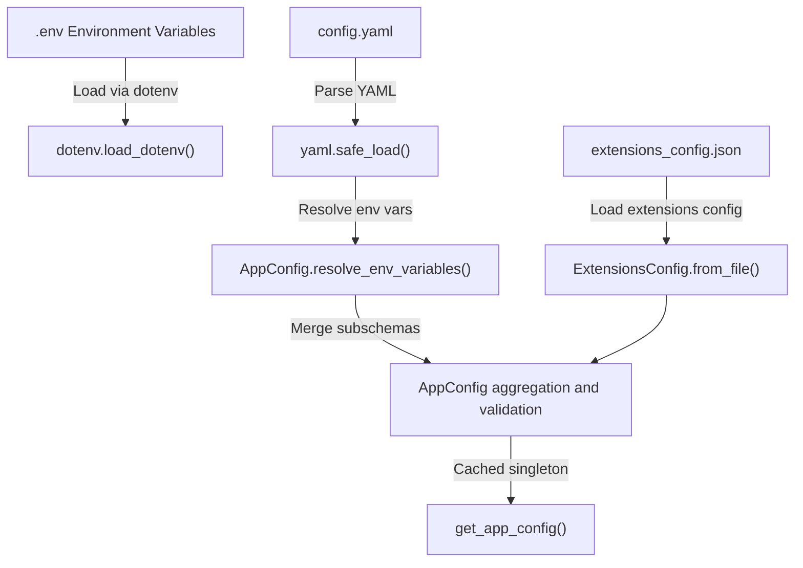
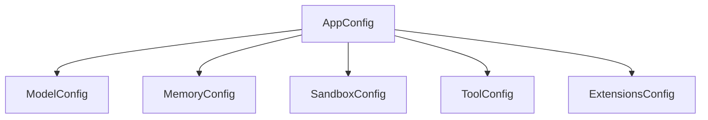
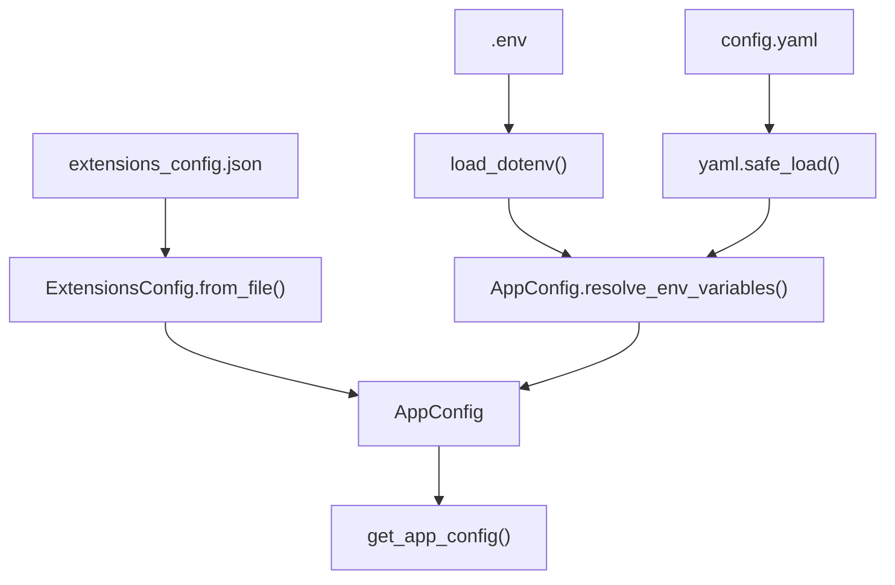

<!-- source: DeepWiki mcp.deepwiki.com · repo bytedance/deer-flow · page 7 Configuration System · fetched 2026-10-29 -->

# Configuration System

<details>
<summary>Relevant source files</summary>

The following files were used as context for generating this wiki page:

- [.env.example](.env.example)
- [CHANGELOG.md](CHANGELOG.md)
- [CHANGELOG_zh.md](CHANGELOG_zh.md)
- [README.md](README.md)
- [backend/AGENTS.md](backend/AGENTS.md)
- [backend/app/gateway/routers/mcp.py](backend/app/gateway/routers/mcp.py)
- [backend/app/gateway/routers/skills.py](backend/app/gateway/routers/skills.py)
- [backend/docs/CONFIGURATION.md](backend/docs/CONFIGURATION.md)
- [backend/docs/MCP_SERVER.md](backend/docs/MCP_SERVER.md)
- [backend/packages/harness/deerflow/agents/middlewares/AGENTS.md](backend/packages/harness/deerflow/agents/middlewares/AGENTS.md)
- [backend/packages/harness/deerflow/agents/middlewares/llm_error_handling_middleware.py](backend/packages/harness/deerflow/agents/middlewares/llm_error_handling_middleware.py)
- [backend/packages/harness/deerflow/config/AGENTS.md](backend/packages/harness/deerflow/config/AGENTS.md)
- [backend/packages/harness/deerflow/config/extensions_config.py](backend/packages/harness/deerflow/config/extensions_config.py)
- [backend/packages/harness/deerflow/mcp/client.py](backend/packages/harness/deerflow/mcp/client.py)
- [backend/tests/blocking_io/test_mcp_router.py](backend/tests/blocking_io/test_mcp_router.py)
- [backend/tests/blocking_io/test_skill_manage_tool.py](backend/tests/blocking_io/test_skill_manage_tool.py)
- [backend/tests/blocking_io/test_skills_custom_router.py](backend/tests/blocking_io/test_skills_custom_router.py)
- [backend/tests/blocking_io/test_skills_update_router.py](backend/tests/blocking_io/test_skills_update_router.py)
- [backend/tests/test_extensions_config_raw_writes.py](backend/tests/test_extensions_config_raw_writes.py)
- [backend/tests/test_llm_error_handling_middleware.py](backend/tests/test_llm_error_handling_middleware.py)
- [backend/tests/test_mcp_client_config.py](backend/tests/test_mcp_client_config.py)
- [backend/tests/test_mcp_config_secrets.py](backend/tests/test_mcp_config_secrets.py)
- [backend/tests/test_mcp_cwd.py](backend/tests/test_mcp_cwd.py)
- [backend/tests/test_parallel_mcp_user_agent.py](backend/tests/test_parallel_mcp_user_agent.py)
- [backend/tests/test_skills_custom_router.py](backend/tests/test_skills_custom_router.py)
- [backend/tests/test_skills_router_authz.py](backend/tests/test_skills_router_authz.py)
- [backend/tests/test_support_bundle.py](backend/tests/test_support_bundle.py)
- [config.example.yaml](config.example.yaml)
- [extensions_config.example.json](extensions_config.example.json)
- [scripts/AGENTS.md](scripts/AGENTS.md)
- [scripts/support_bundle.py](scripts/support_bundle.py)

</details>


The Configuration System in DeerFlow centralizes the definition and management of all runtime parameters influencing agent behavior, tool integration, sandbox execution, memory handling, and deployment settings. It enables loading from structured YAML and JSON files, resolves environment variables securely, supports runtime hot reload, and provides a unified access point throughout the codebase via the `AppConfig` class defined in `backend/packages/harness/deerflow/config/app_config.py` [backend/packages/harness/deerflow/config/app_config.py:1-132]().

This is a parent page providing a high-level overview of the Configuration System architecture. For detailed technical information, see the child pages linked below.

---

## Configuration Files and Their Roles

DeerFlow relies on primary configuration files located in the project root directory, each serving a specialized role in parameterizing the harness:

| File | Purpose | Format | Location |
|---|---|---|---|
| `config.yaml` | Core system configuration: models, tools, sandbox, skills, memory, and various subsystems | YAML | Project root |
| `extensions_config.json` | MCP server settings and enabled skill states, supporting dynamic runtime extension management | JSON | Project root |
| `.env` | Sensitive environment variables such as API keys or service credentials | ENV | Project root |

These files interplay to provide comprehensive runtime control. The `.env` file variables are loaded at startup using `dotenv.load_dotenv()`, enabling environment variable substitution inside other configurations [scripts/AGENTS.md:1-25](). This layered separation keeps sensitive data secure, facilitates dynamic extensions, and centralizes core system parameters.

**Sources:** [backend/packages/harness/deerflow/config/app_config.py:1-70](), [config.example.yaml:1-131](), [.env.example:1-142](), [scripts/AGENTS.md:1-25]()

---

## Configuration Architecture and Loading

The core configuration loading process involves several steps orchestrated by the `AppConfig` singleton:

- Load environment variables from `.env` using `dotenv.load_dotenv()` [scripts/AGENTS.md:1-25]()
- Read and parse the primary `config.yaml` via YAML safe loading
- Resolve embedded environment variables in YAML values, e.g., `$OPENAI_API_KEY` [config.example.yaml:1-15]()
- Load `extensions_config.json` separately for MCP servers and skill extension metadata [backend/docs/CONFIGURATION.md:121-134]()
- Construct the `AppConfig` instance, aggregating all validated sub-configurations
- Cache configuration signatures to detect changes and enable runtime hot reload without restarting services [backend/docs/CONFIGURATION.md:121-134]()

Title: Configuration Loading Architecture


For deeper technical details on `AppConfig`, config file resolution order, environment variable substitution, and hot reload semantics, see [Configuration Loading and Structure](#7.1).

**Sources:** [backend/packages/harness/deerflow/config/app_config.py:1-70](), [config.example.yaml:1-24](), [backend/docs/CONFIGURATION.md:121-134](), [scripts/AGENTS.md:1-25]()

---

## Core Subsystem Configurations

The root `AppConfig` consolidates multiple domain-specific sub-configurations modeled as Pydantic classes in `backend/packages/harness/deerflow/config/app_config.py` [backend/packages/harness/deerflow/config/app_config.py:10-65](). Notable domains include models, tools, memory, extensions, sandbox, and guardrails.

Title: Subsystem Configuration Hierarchy


This modular design allows fine-grained control over each part of the agent runtime via one composite `AppConfig` object accessed throughout the codebase. For example, extension middlewares declared in `extensions_config.json` are loaded and instantiated at runtime, enabling flexible customization without code changes [config.example.yaml:60-70]().

For deep dives on these components, please consult the respective child pages.

**Sources:** [backend/packages/harness/deerflow/config/app_config.py:10-65](), [config.example.yaml:60-70]()

---

## Navigating Child Pages for Detailed Configuration Topics

DeerFlow’s configuration system encompasses extensive technical detail spanning many domains. The following child pages cover each domain comprehensively:

- [Configuration Loading and Structure](#7.1) — Core `AppConfig` loading, YAML resolution, env var substitution, hot reload, and config file resolution
- [Model Configuration](#7.2) — Model definitions, provider setup, capabilities flags, credential loaders, and the model factory method
- [Tool Configuration](#7.3) — Tool and tool group schemas, web tools like Tavily, Firecrawl, Serply, Brave, and detailed parameter descriptions
- [MCP Server Configuration](#7.4) — MCP server setup details including transports (stdio, SSE, HTTP), OAuth flows, session management, tool caching
- [Skills Configuration](#7.5) — Skills discovery, enabled skill lists, permissions, skill system setup, and container path mappings
- [Memory and Summarization Configuration](#7.6) — Memory subsystem settings, summarization triggers, and long-term memory context management
- [Subagent and Sandbox Configuration](#7.7) — Subagent runtime tuning, sandbox provider selection, volume mounts, guardrails configuration
- [Environment Variables](#7.8) — Comprehensive listing of environment variables for API keys, service URLs, deployment flags, and runtime toggles

Each child page contains detailed schema definitions, usage patterns, and example excerpts from configuration files to jumpstart operator customization.

---

## Bridging Natural Language Concepts and Configuration Code Entities

Below diagrams associate commonly referenced system names in documentation and user configuration contexts with their precise code entities, clarifying module names and classes for efficient codebase navigation.

Title: Natural Language To Code Entities
```mermaid
graph LR
    NL_ConfigFile["\"config.yaml\""]
    NL_ExtConfig["\"extensions_config.json\""]
    NL_EnvFile["\"Environment Variables (.env)\""]

    NL_ConfigFile --> AppConfig["AppConfig"]
    NL_ExtConfig --> ExtConfig["ExtensionsConfig"]
    NL_EnvFile --> LoadDotenv["load_dotenv()"]

    AppConfig --> Models["ModelConfig"]
    AppConfig --> Tools["ToolConfig"]
    AppConfig --> Memory["MemoryConfig"]
    AppConfig --> Sandbox["SandboxConfig"]
    AppConfig --> Guardrails["GuardrailsConfig"]
    AppConfig --> Extensions["ExtensionsConfig"]
```

Title: Configuration File Loading Flow


**Sources:** [backend/packages/harness/deerflow/config/app_config.py:1-70](), [config.example.yaml:1-24](), [scripts/AGENTS.md:1-25]()

---

