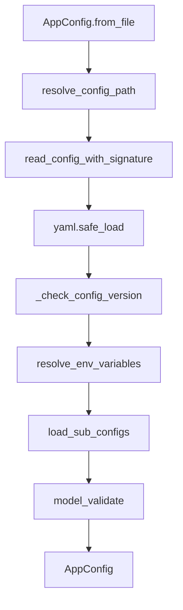
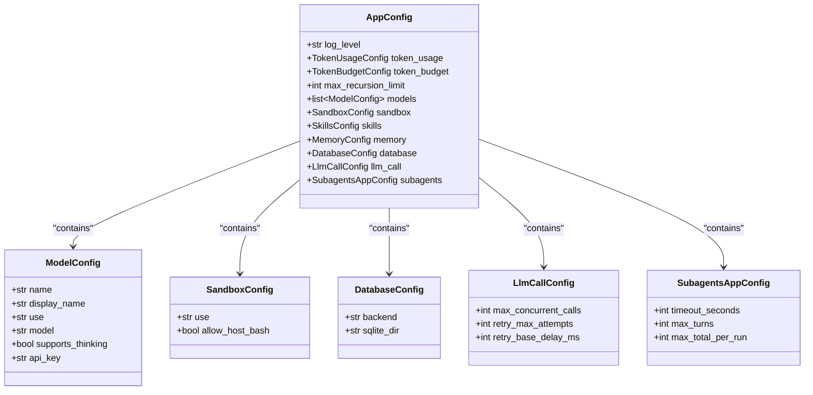
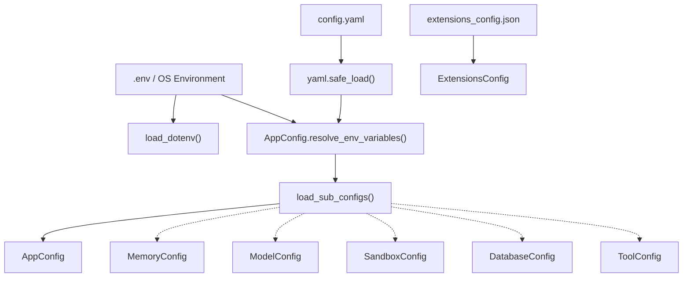
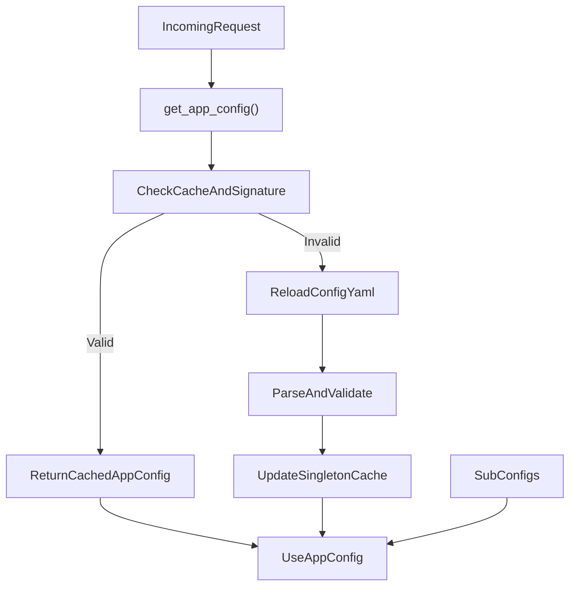

<!-- source: DeepWiki mcp.deepwiki.com · repo bytedance/deer-flow · page 7.1 Configuration Loading and Structure · fetched 2026-10-29 -->

# Configuration Loading and Structure

<details>
<summary>Relevant source files</summary>

The following files were used as context for generating this wiki page:

- [backend/app/gateway/app.py](backend/app/gateway/app.py)
- [backend/app/gateway/deps.py](backend/app/gateway/deps.py)
- [backend/packages/harness/deerflow/agents/lead_agent/agent.py](backend/packages/harness/deerflow/agents/lead_agent/agent.py)
- [backend/packages/harness/deerflow/agents/lead_agent/prompt.py](backend/packages/harness/deerflow/agents/lead_agent/prompt.py)
- [backend/packages/harness/deerflow/agents/middlewares/configured_extensions.py](backend/packages/harness/deerflow/agents/middlewares/configured_extensions.py)
- [backend/packages/harness/deerflow/agents/middlewares/tool_error_handling_middleware.py](backend/packages/harness/deerflow/agents/middlewares/tool_error_handling_middleware.py)
- [backend/packages/harness/deerflow/config/app_config.py](backend/packages/harness/deerflow/config/app_config.py)
- [backend/packages/harness/deerflow/config/memory_config.py](backend/packages/harness/deerflow/config/memory_config.py)
- [backend/packages/harness/deerflow/config/reload_boundary.py](backend/packages/harness/deerflow/config/reload_boundary.py)
- [backend/packages/harness/deerflow/skills/tool_policy.py](backend/packages/harness/deerflow/skills/tool_policy.py)
- [backend/tests/test_app_config_reload.py](backend/tests/test_app_config_reload.py)
- [backend/tests/test_gateway_lifespan_shutdown.py](backend/tests/test_gateway_lifespan_shutdown.py)
- [backend/tests/test_gateway_run_drain_shutdown.py](backend/tests/test_gateway_run_drain_shutdown.py)
- [backend/tests/test_gateway_run_recovery.py](backend/tests/test_gateway_run_recovery.py)
- [backend/tests/test_lead_agent_model_resolution.py](backend/tests/test_lead_agent_model_resolution.py)
- [backend/tests/test_lead_agent_prompt.py](backend/tests/test_lead_agent_prompt.py)
- [backend/tests/test_lead_agent_skills.py](backend/tests/test_lead_agent_skills.py)
- [backend/tests/test_multi_worker_postgres_gate.py](backend/tests/test_multi_worker_postgres_gate.py)
- [backend/tests/test_tool_error_handling_middleware.py](backend/tests/test_tool_error_handling_middleware.py)
- [deploy/helm/deer-flow/README.md](deploy/helm/deer-flow/README.md)
- [deploy/helm/deer-flow/templates/gateway-deployment.yaml](deploy/helm/deer-flow/templates/gateway-deployment.yaml)
- [deploy/helm/deer-flow/values.yaml](deploy/helm/deer-flow/values.yaml)

</details>


This page documents the configuration system's loading mechanism, file resolution strategy, environment variable substitution, and the hierarchical structure of configuration objects. DeerFlow uses a centralized configuration approach to manage LLM models, sandbox environments, tools, and agent behaviors via the `AppConfig` class.

Sources: [backend/packages/harness/deerflow/config/app_config.py:10-137]()

## Overview

DeerFlow's configuration system centers around several key files and concepts:

- **`config.yaml`**: The primary YAML file that defines the comprehensive configuration, including models, tools, sandbox settings, skills, memory, guardrails, database, and agent properties. This file is represented in the codebase by the `AppConfig` class, a complex Pydantic model aggregating many sub-configurations.
- **`extensions_config.json`**: Manages MCP server config and enabled skills state separately from `config.yaml`, allowing atomic runtime updates without restarting the backend.
- **`.env` files**: Loaded automatically on startup via `dotenv.load_dotenv()`, they provide environment variables mainly for sensitive credentials and service URLs referenced in `config.yaml`.

DeerFlow resolves and loads the configuration files during runtime, supporting environment variable substitution and hot reloading (for part of the configuration). This provides dynamic updates to many system behaviors without requiring a full gateway restart.

Sources: [backend/packages/harness/deerflow/config/app_config.py:9-64]()

## Configuration File Resolution

### Resolution Priority and Locations

DeerFlow locates the main config file (`config.yaml`) with a specific priority order implemented in `AppConfig.resolve_config_path()`:

1. An explicitly provided `config_path` argument to loader functions.
2. The environment variable `DEER_FLOW_CONFIG_PATH`, if set (a missing file here is an error, not fallback).
3. `config.yaml` found under the project root directory (deduced by environment or current working directory).
4. Legacy locations with lower priority: `backend/config.yaml` then repo root `config.yaml`.

This strategy ensures flexible configuration loading suitable for local development, CI runs, and deployed environments.

Similarly, the extensions configuration file `extensions_config.json` location is resolved from the `DEER_FLOW_EXTENSIONS_CONFIG_PATH` environment variable or a standard path derived from the project root.

Sources: [backend/packages/harness/deerflow/config/app_config.py:20-57](), []()

### Configuration Loading Pipeline

The main entrypoint to load the configuration is the class method:

```python
AppConfig.from_file(config_path: str | None = None) -> AppConfig
```

This method executes this loading pipeline:


Sources: [backend/packages/harness/deerflow/config/app_config.py:10-57](), [backend/packages/harness/deerflow/config/file_signature.py:29-79]()

Steps breakdown:

- **Path resolution**: Determines the exact `config.yaml` path to use.
- **File reading with file signature**: Uses `read_config_with_signature()` to get contents plus metadata including SHA256 hash for reload detection.
- **YAML parsing**: Converts raw bytes to Python dict.
- **Version checking**: Inspects `config_version` for schema compatibility warning.
- **Environment variable substitution**: Recurses deeply and replaces `$VAR` values with actual OS environment variables.
- **Load and validate sub-config sections** via their respective loaders, e.g. for memory, agents_api, guardrails, etc.
- **Final Pydantic validation** on the full `AppConfig` tree.

The loaded `AppConfig` object is cached with the signature to enable efficient hot reload checks.

Sources: [backend/packages/harness/deerflow/config/app_config.py:10-57](), [backend/packages/harness/deerflow/config/file_signature.py:29-79]()

## Environment Variable Substitution

DeerFlow supports environment variable interpolation in the config YAML. Any string value in the form `$VAR_NAME` is replaced recursively with the corresponding environment variable value from the process environment. This enables sensitive or environment-specific keys (API keys, URLs, feature flags) to remain out of source-controlled config files.

The substitution is performed by:

```python
AppConfig.resolve_env_variables(config_dict: dict) -> dict
```

This method creates a new dict with all `$VAR` references substituted. The process recurses through nested mappings and lists. Values not matching the `$VAR` pattern remain unchanged.

Example usage in YAML:

```yaml
models:
- name: gpt-4
  api_key: $OPENAI_API_KEY
```

At runtime, `api_key` is replaced with the environment variable `OPENAI_API_KEY`'s value.

Sources: [backend/packages/harness/deerflow/config/app_config.py:50-56]()

## AppConfig Structure

The `AppConfig` class aggregates every significant configuration aspect into a single typed object. It is implemented as a Pydantic model with many fields referencing other named sub-configuration models.

### Key Fields and Sub-configurations

| Field | Type | Description |
|---|---|---|
| `log_level` | `str` | Logging verbosity level |
| `token_usage` | `TokenUsageConfig` | Tracks how tokens are consumed per request |
| `token_budget` | `TokenBudgetConfig` | Limits and bursts for token usage |
| `max_recursion_limit` | `int` | Maximum call recursion depth allowed |
| `models` | `list[ModelConfig]` | List of configured LLM models and providers |
| `sandbox` | `SandboxConfig` | Code execution sandbox environment settings |
| `tools` | `list[ToolConfig]` | Declared set of tools usable by agents |
| `tool_groups` | `list[ToolGroupConfig]` | Tool groupings that share properties |
| `skills` | `SkillsConfig` | Skill system settings and enabled skills |
| `memory` | `MemoryConfig` | Long-term memory backend and injection behavior |
| `guardrails` | `GuardrailsConfig` | Tool call pre-authorization guardrails |
| `circuit_breaker` | `CircuitBreakerConfig` | LLM call failure threshold configuration |
| `database` | `DatabaseConfig` | Persistence backend and connection parameters |
| `read_before_write` | `ReadBeforeWriteConfig` | Read-before-write consistency enforcement |
| `llm_call` | `LlmCallConfig` | LLM call concurrency and retry shaping |
| `subagents` | `SubagentsAppConfig` | Configuration for global subagent system |

### Class Diagram: Configuration and Sub-config Mappings


Sources: [backend/packages/harness/deerflow/config/app_config.py:10-137]()

The `AppConfig` is the central source of truth for all runtime configuration consumed by various DeerFlow subsystems.

Sources: [backend/packages/harness/deerflow/config/app_config.py:10-137]()

## Sub-configurations and Defaults

`AppConfig` automatically loads and validates nested sub-config sections. If a subsection is missing, default values or fallback constants are used. This pattern ensures backward compatibility and safe operation even with incomplete user configs.

A prime example is the `database` section’s default:

```yaml
database:
  backend: sqlite
  sqlite_dir: ".deer-flow/data"
```

This default is implemented as a constant dictionary in `CONFIG_FILE_DATABASE_DEFAULTS` [backend/packages/harness/deerflow/config/app_config.py:75-78]() and injected during loading if no database config is found.

Another example is `MemoryConfig`, which migrates legacy flat keys (like `storage_path`, `debounce_seconds`, etc.) into a nested `backend_config` dictionary to maintain backward compatibility with pre-abstraction config files.

Sources: [backend/packages/harness/deerflow/config/app_config.py:66-72](), [backend/packages/harness/deerflow/config/memory_config.py:23-52]()

## Hot Reload and Startup-Frozen Configuration Fields

### Hot Reloading

DeerFlow’s Gateway layer calls `get_app_config()` [backend/app/gateway/app.py:71]() for each incoming request. This function checks the cached `AppConfig` instance against the current disk file signature (mtime, size, SHA256). If changed, it reloads the configuration dynamically. This allows edits to `config.yaml` to reflect almost immediately in the running system without a manual restart.

Hot-reloadable fields mostly include higher-layer settings that do not require deep resource rebuilding such as:

- `models`
- `summarization`
- `title`
- `memory`
- `subagents`
- `tools`
- `system prompt overlays`

### Startup-Only (Restart Required) Fields

Some configuration fields require a gateway restart because they impact low-level components or resources initialized once at process start. These are tracked in `STARTUP_ONLY_FIELDS` in the `reload_boundary.py` module and flagged in Pydantic field descriptions:

- `database`
- `checkpointer`
- `sandbox`
- `stream_bridge`
- `scheduler`
- `agent_storage`
- `plugins`
- `logging`
- `channels`
- `channel_connections`
- `mcp_tasks`
- `subagent_runtime`
- `subagent_batches`
- `run_ownership`
- `dedupe_storage`

A special case is `llm_call.max_concurrent_calls` [backend/packages/harness/deerflow/config/app_config.py:111-130](), which is frozen after the first LLM call and requires a restart to change to avoid concurrency races.

Sources: [backend/packages/harness/deerflow/config/app_config.py:89-110](), [backend/packages/harness/deerflow/config/reload_boundary.py:1-100]()

## LLM Call Configuration Details

The `LlmCallConfig` [backend/packages/harness/deerflow/config/app_config.py:101-131]() portion of `AppConfig` provides fine-grained controls over how LLM calls are executed:

- **`max_concurrent_calls`**: Process-wide cap on number of simultaneous LLM invocations. Limits burst rate spikes by smoothing the concurrency slope. Defaults to 0 (disabled). Read once on the first LLM run and frozen for process lifetime.
- **`retry_max_attempts`**: Maximum retries on transient failures (0 disables retry).
- **`retry_base_delay_ms`**: Base delay in milliseconds for retry backoff with "decorrelated jitter". Seeds the first retry’s sleep duration.
- **`retry_cap_delay_ms`**: Maximum delay for any retry attempt to avoid runaway backoff.
- **`burst_retry_base_delay_ms`**: Base delay specifically for 429 (Too Many Requests) errors due to burst rate excess. Usually set higher than the normal retry base delay.

These parameters enable the Gateway to precisely control request pacing, rate limit handling, and failure recovery strategy.

Sources: [backend/packages/harness/deerflow/config/app_config.py:82-132]()

---

## Summary Diagrams

### Summary Diagram: From Configuration Files to AppConfig Object


Sources: [backend/packages/harness/deerflow/config/app_config.py:10-137](), [backend/packages/harness/deerflow/config/file_signature.py:29-79]()

### Summary Diagram: Runtime Configuration Resolution and Access Flow


Sources: [backend/packages/harness/deerflow/config/app_config.py:25-57](), [backend/tests/test_app_config_reload.py:80-142]()

---

# References

- `AppConfig` and sub-config implementation: [backend/packages/harness/deerflow/config/app_config.py:10-137]()
- Runtime reload and environment substitution: [backend/packages/harness/deerflow/config/app_config.py:25-57]()
- File signature detection utility: [backend/packages/harness/deerflow/config/file_signature.py:29-79]()
- Memory config migration and defaults: [backend/packages/harness/deerflow/config/memory_config.py:23-52]()
- Configuration reloading tests (hot reload and mtime): [backend/tests/test_app_config_reload.py:80-142]()

---

