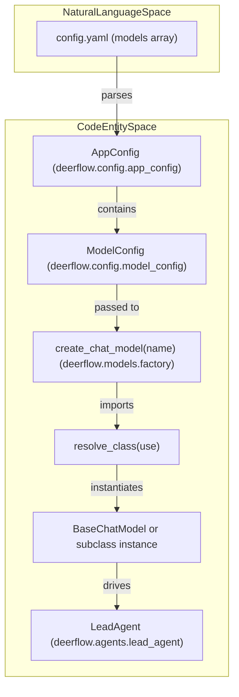
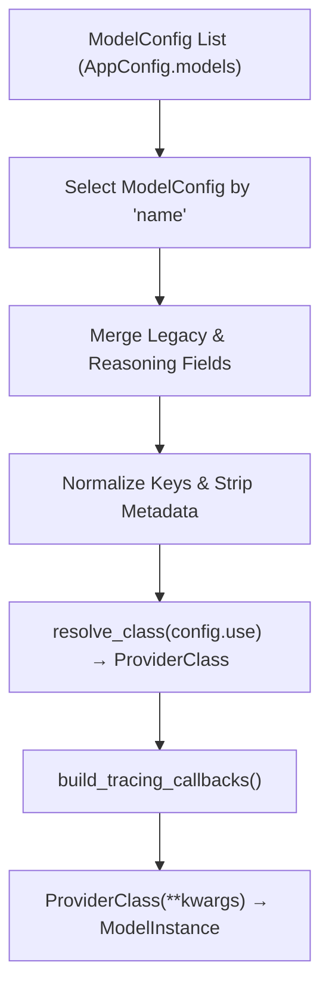

<!-- source: DeepWiki mcp.deepwiki.com · repo bytedance/deer-flow · page 7.2 Model Configuration · fetched 2026-10-29 -->

# Model Configuration

Relevant source files

The following files were used as context for generating this wiki page:

- [backend/packages/harness/deerflow/config/model_config.py](backend/packages/harness/deerflow/config/model_config.py)
- [backend/packages/harness/deerflow/models/AGENTS.md](backend/packages/harness/deerflow/models/AGENTS.md)
- [backend/packages/harness/deerflow/models/assistant_payload_replay.py](backend/packages/harness/deerflow/models/assistant_payload_replay.py)
- [backend/packages/harness/deerflow/models/claude_provider.py](backend/packages/harness/deerflow/models/claude_provider.py)
- [backend/packages/harness/deerflow/models/credential_loader.py](backend/packages/harness/deerflow/models/credential_loader.py)
- [backend/packages/harness/deerflow/models/factory.py](backend/packages/harness/deerflow/models/factory.py)
- [backend/packages/harness/deerflow/models/mindie_provider.py](backend/packages/harness/deerflow/models/mindie_provider.py)
- [backend/packages/harness/deerflow/models/openai_codex_provider.py](backend/packages/harness/deerflow/models/openai_codex_provider.py)
- [backend/packages/harness/deerflow/models/patched_deepseek.py](backend/packages/harness/deerflow/models/patched_deepseek.py)
- [backend/packages/harness/deerflow/models/patched_minimax.py](backend/packages/harness/deerflow/models/patched_minimax.py)
- [backend/packages/harness/deerflow/models/vllm_provider.py](backend/packages/harness/deerflow/models/vllm_provider.py)
- [backend/tests/test_claude_fd_encoding.py](backend/tests/test_claude_fd_encoding.py)
- [backend/tests/test_claude_provider_oauth_billing.py](backend/tests/test_claude_provider_oauth_billing.py)
- [backend/tests/test_claude_provider_prompt_caching.py](backend/tests/test_claude_provider_prompt_caching.py)
- [backend/tests/test_claude_provider_thinking.py](backend/tests/test_claude_provider_thinking.py)
- [backend/tests/test_cli_auth_providers.py](backend/tests/test_cli_auth_providers.py)
- [backend/tests/test_codex_provider.py](backend/tests/test_codex_provider.py)
- [backend/tests/test_codex_stream_terminal_events.py](backend/tests/test_codex_stream_terminal_events.py)
- [backend/tests/test_codex_tool_choice.py](backend/tests/test_codex_tool_choice.py)
- [backend/tests/test_codex_tool_strict.py](backend/tests/test_codex_tool_strict.py)
- [backend/tests/test_credential_file_encoding.py](backend/tests/test_credential_file_encoding.py)
- [backend/tests/test_credential_loader.py](backend/tests/test_credential_loader.py)
- [backend/tests/test_mindie_provider.py](backend/tests/test_mindie_provider.py)
- [backend/tests/test_model_factory.py](backend/tests/test_model_factory.py)
- [backend/tests/test_patched_deepseek.py](backend/tests/test_patched_deepseek.py)
- [backend/tests/test_patched_minimax.py](backend/tests/test_patched_minimax.py)
- [backend/tests/test_vllm_provider.py](backend/tests/test_vllm_provider.py)

This page documents the model configuration system in DeerFlow. Models are defined in the `models` array in `config.yaml`, validated by the `ModelConfig` Pydantic schema, and instantiated via the `create_chat_model` factory function.

The configuration system covers model definitions, provider setup, model capabilities, request admission pacing, patched providers for reasoning content enrichment and XML/numeric tool argument parsing, credential loaders for authentication, and the implementation details of the model factory.

**Related Pages**: [7.1 Configuration Loading and Structure](7.1), [5.3 Lead Agent and System Prompt](5.3), [7.3 Tool Configuration](7.3), [7.8 Environment Variables](7.8)

---

## Model Definition Structure

Models are configured as entries in the `models` array within the main `config.yaml`. Each model corresponds to a `ModelConfig` instance validated with Pydantic. The central responsibilities of this configuration are:

- Specifying the provider implementation and model identifier.
- Declaring model capabilities relevant to UI and runtime behavior.
- Optional request-admission settings for local pacing control.
- Enabling reasoning and "thinking" feature toggles via templates and declarative reasoning contracts.

### Key Configuration Fields

| Field | Description |
|---|---|
| `name` | Unique internal name for the model. |
| `use` | Provider class path as `"package.module:ClassName"`, dynamically imported at runtime. |
| `model` | Identifier string passed to the provider client, e.g., `"gpt-4"`. |
| `display_name` | Friendly display name used in UI listings. |
| `description` | Human-readable model description. |
| `request_admission` | Optional local request pacing configuration controlling rate and concurrency. |
| `supports_thinking` | Enables the "Thinking" toggle at the UI and in internal logic. |
| `supports_reasoning_effort` | Enables difficulty/intensity selection for reasoning features. |
| `reasoning` | Optional declarative mapping-valued reasoning contract (`unsupported | optional | required`). |
| `when_thinking_enabled` | Provider config overrides applied when thinking is enabled. |
| `when_thinking_disabled` | Provider config overrides applied when thinking is disabled. |
| `thinking` | Legacy "thinking" settings block merged into `when_thinking_enabled`. |
| `supports_vision` | Enables support for vision/image input capabilities. |
| `context_window` | Declared maximum input context size, used for UI and summarization triggering. |
| `stream_chunk_timeout` | Timeout (seconds) for streaming output chunks; defaults to 240 for OpenAI-compatible models. |

Sources: [backend/packages/harness/deerflow/config/model_config.py:1-137](), [backend/packages/harness/deerflow/models/factory.py:1-41]()

---

## Model Architecture and Configuration Data Flow

Upon application startup:

- The YAML configuration file is loaded and parsed as an `AppConfig` object.
- The `models` array is parsed into a list of validated `ModelConfig` instances.
- When a model is requested by name, the `create_chat_model(name)` factory locates the matching config.
- The factory dynamically imports the provider class specified in the `use` field (format `"package.module:ClassName"`).
- Configuration fields are merged, normalized, and metadata stripped.
- The provider class is instantiated with the resulting keyword arguments.
- The returned instance (a `BaseChatModel` or subclass) is used by DeerFlow's agents or subagents.

Title: Model Configuration Architecture Data Flow

Sources: [backend/packages/harness/deerflow/models/factory.py:1-136](), [backend/tests/test_model_factory.py:111-121]()

---

## Request Admission and Rate Pacing

DeerFlow introduces a process-local request admission system enabling throttling of outbound calls to LLM providers to mitigate quota overruns or provider-side throttling.

### Features

- Configurable via `RequestAdmissionConfig` in each `ModelConfig` [backend/packages/harness/deerflow/config/model_config.py:29-36]().
- Request-admission waits follow the next scheduled admission and configured interval, capped at 50 ms [backend/packages/harness/deerflow/models/AGENTS.md:27]().
- Local `AdmissionError` is structurally non-retriable in LLM error handling regardless of its message text [backend/packages/harness/deerflow/models/AGENTS.md:28]().
- Immediate admission and joining the blocking FIFO are one lock-protected decision [backend/packages/harness/deerflow/models/AGENTS.md:31-33]().
- Attaches a process-shared `BaseRateLimiter` at the model factory. Identical explicit groups share one FIFO across model instances, threads and event loops; implicit groups use the configured model name [backend/packages/harness/deerflow/models/AGENTS.md:41-43]().
- Bounded waiters poll without occupying executor threads and unregister in `finally`. The factory strips the policy from provider kwargs and sets exposed SDK `max_retries=0` so middleware retries re-enter admission [backend/packages/harness/deerflow/models/AGENTS.md:43]().

Sources: [backend/packages/harness/deerflow/config/model_config.py:29-36](), [backend/packages/harness/deerflow/models/AGENTS.md:25-43]()

---

## Reasoning Capability Contract and Thinking Integration

Mapping-valued `ModelConfig.reasoning` (issue #5073) is an optional declarative contract beside the legacy `supports_thinking` / `supports_reasoning_effort` booleans [backend/packages/harness/deerflow/models/AGENTS.md:46-49]():
- Thinking modes: `unsupported`, `optional`, or `required` [backend/packages/harness/deerflow/config/model_config.py:115]().
- `on_disable_request`: `keep_enabled` or `reject` (required-thinking only) [backend/packages/harness/deerflow/config/model_config.py:116-119]().
- Payload `dialect`: `auto` infers it from `when_thinking_enabled` [backend/packages/harness/deerflow/config/model_config.py:120-122]().
- Reasoning `history` requirement, and an `effort` vocabulary with `default`, generic-value `aliases`, and a serialization `path` [backend/packages/harness/deerflow/config/model_config.py:123-125]().
- A boolean or level-string `reasoning` remains a native ChatOllama provider setting; the factory forwards it on the legacy path [backend/packages/harness/deerflow/models/AGENTS.md:54-55]().

When the block is present, booleans are derived from it and contradictory profiles fail at config load [backend/packages/harness/deerflow/models/reasoning.py:10](). The factory supports `thinking_enabled` flag with per-model `when_thinking_enabled` / `when_thinking_disabled` overrides [backend/packages/harness/deerflow/models/AGENTS.md:36](). Every template and synthesized `extra_body` payload goes through `_merge_thinking_payload` [backend/packages/harness/deerflow/models/AGENTS.md:36]().

Sources: [backend/packages/harness/deerflow/models/AGENTS.md:44-67](), [backend/packages/harness/deerflow/models/reasoning.py:1-60](), [backend/packages/harness/deerflow/config/model_config.py:106-133]()

---

## Supported Providers and Patched Models

DeerFlow integrates multiple providers, including vanilla LangChain models and patched/custom clients enabling advanced features such as extended reasoning content handling, OAuth flows, and XML tool call parsing.

### Officially Supported Model Providers

| Provider Class | Description | Source Reference |
|---|---|---|
| `CodexChatModel` | Custom OpenAI Codex Responses API client using Codex CLI OAuth credentials, streaming, tools | `deerflow.models.openai_codex_provider:CodexChatModel` [backend/packages/harness/deerflow/models/openai_codex_provider.py:91-99]() |
| `ClaudeChatModel` | Custom Claude provider with OAuth Bearer auth (`sk-ant-oat`), prompt caching, smart thinking | `deerflow.models.claude_provider:ClaudeChatModel` [backend/packages/harness/deerflow/models/claude_provider.py:53-62]() |
| `MindIEChatModel` | Custom MindIE provider with XML tool argument parsing and robust numeric conversion | `deerflow.models.mindie_provider:MindIEChatModel` [backend/packages/harness/deerflow/models/mindie_provider.py:399-407]() |
| `PatchedChatDeepSeek` | Patch of DeepSeek provider preserving reasoning content and enabling replay | `deerflow.models.patched_deepseek` |
| `VllmChatModel` | Model supporting vLLM/Qwen `chat_template` thinking toggles and reasoning fields | `deerflow.models.vllm_provider` |

### OpenAI Codex Responses API — `CodexChatModel`

- Implements a LangChain chat model targeting the Codex Responses API [backend/packages/harness/deerflow/models/openai_codex_provider.py:91-99]().
- Uses OAuth tokens loaded via credential loaders (`CodexCliCredential`) from paths like `~/.codex/auth.json` [backend/packages/harness/deerflow/models/openai_codex_provider.py:133-139]().
- Supports streaming responses, token usage metadata, tool calling, and reasoning content parsing [backend/packages/harness/deerflow/models/openai_codex_provider.py:6-12]().
- Transforms LangChain messages to/from the specialized Responses API format [backend/packages/harness/deerflow/models/openai_codex_provider.py:148-172]() and parses responses [backend/packages/harness/deerflow/models/openai_codex_provider.py:300-308]().

### MindIE Provider XML Tool Argument Parsing (`MindIEChatModel`)

- Parses XML tool calls from the original model response before applying escaped-newline compatibility fixes to remaining prose [backend/packages/harness/deerflow/models/AGENTS.md:1-5]().
- Parses JSON and Python-literal arguments from original escapes; decodes literal `\n` outside fenced code while trimming surrounding whitespace [backend/packages/harness/deerflow/models/AGENTS.md:5-9]().
- Recognizes JSON numeric syntax including signed, fractional, and exponent values, preventing silent float underflow/overflow [backend/packages/harness/deerflow/models/AGENTS.md:15-24]().
- The `_parse_xml_tool_call_to_dict` function handles the extraction of tool calls from the model's raw text output [backend/packages/harness/deerflow/models/mindie_provider.py:123-155]().

Sources: [backend/packages/harness/deerflow/models/openai_codex_provider.py:1-172](), [backend/packages/harness/deerflow/models/claude_provider.py:1-62](), [backend/packages/harness/deerflow/models/mindie_provider.py:1-155](), [backend/packages/harness/deerflow/models/AGENTS.md:1-24]()

---

## Credential Loading for Model Providers

Credential loaders support authentication secrets needed by different providers.

### Claude Code OAuth Token Loader

- Supports loading via environment variables (`CLAUDE_CODE_OAUTH_TOKEN`, `ANTHROPIC_AUTH_TOKEN`), file descriptor handoff (`CLAUDE_CODE_OAUTH_TOKEN_FILE_DESCRIPTOR`), and credentials files (`CLAUDE_CODE_CREDENTIALS_PATH` or `~/.claude/.credentials.json`) [backend/packages/harness/deerflow/models/credential_loader.py:1-16]().
- Caches drained file descriptor tokens to prevent duplicate reads or lost tokens across multiple model instantiations [backend/packages/harness/deerflow/models/credential_loader.py:38-40](). The `_fd_secret_cache` and `_fd_secret_lock` manage this caching [backend/packages/harness/deerflow/models/credential_loader.py:38-40]().

### Codex CLI Credential Loader

- Loads tokens from `~/.codex/auth.json` or path override `CODEX_AUTH_PATH` [backend/packages/harness/deerflow/models/credential_loader.py:9-12]().
- Supports both legacy top-level tokens and current nested tokens shape [backend/packages/harness/deerflow/models/credential_loader.py:11-12](). The `load_codex_cli_credential` function handles the logic [backend/packages/harness/deerflow/models/credential_loader.py:220-269]().

Sources: [backend/packages/harness/deerflow/models/credential_loader.py:1-269](), [backend/tests/test_credential_loader.py:1-100]()

---

## Model Factory Implementation

The key function to instantiate models from configuration is `create_chat_model(name)` [backend/packages/harness/deerflow/models/factory.py:600-601]().

### Workflow

1.  **Model Selection**: If `name` is `None`, selects the first model in `AppConfig.models`. Raises `ValueError` if the specified model is not found [backend/tests/test_model_factory.py:111-129]().
2.  **Class Resolution**: Uses `resolve_class(config.use)` to dynamically import the provider class [backend/packages/harness/deerflow/models/factory.py:616]().
3.  **Settings Merge and Normalization**: Deep-merges legacy `thinking` blocks, applies per-model reasoning contracts, and strips metadata fields (`pricing`, `context_window`, `request_admission`) so they never reach provider client constructors [backend/packages/harness/deerflow/models/factory.py:15-41](), [backend/packages/harness/deerflow/models/factory.py:620-621](), [backend/tests/test_model_factory.py:131-159](). The `_merge_thinking_payload` function is crucial for handling thinking-related overrides [backend/packages/harness/deerflow/models/factory.py:102-140]().
4.  **Admission Policy Setup**: Attaches FIFO admission limiters wrapped as `BaseRateLimiter` if configured [backend/packages/harness/deerflow/models/AGENTS.md:42]().
5.  **Instance Creation**: Instantiates the resolved provider class with final kwargs and sets the `profile` attribute with context window information [backend/packages/harness/deerflow/models/factory.py:622](), [backend/tests/test_model_factory.py:161-177]().

Title: Model Factory Instantiation Flow

Sources: [backend/packages/harness/deerflow/models/factory.py:1-150](), [backend/tests/test_model_factory.py:108-177](), [backend/packages/harness/deerflow/models/AGENTS.md:25-43]()

---

## Model Capabilities and Frontend Integration

Certain configuration flags impact DeerFlow's frontend features and agent runtime behaviors:

| Capability Field | UI/Feature Effect | Code Reference |
|---|---|---|
| `supports_thinking` | Enables "Thinking" toggle in chat interface | `backend/packages/harness/deerflow/config/model_config.py` |
| `supports_reasoning_effort` | Enables selection of reasoning effort level | `backend/packages/harness/deerflow/config/model_config.py` |
| `supports_vision` | Enables upload and rendering of image inputs | `backend/packages/harness/deerflow/config/model_config.py` |
| `context_window` | Drives UI context window display and summarization triggers | `backend/packages/harness/deerflow/config/model_config.py` |

Sources: [backend/packages/harness/deerflow/config/model_config.py:1-137]()

---

## Summary

This page detailed the complete model configuration system in DeerFlow, covering the `ModelConfig` schema, request admission pacing, declarative reasoning contracts, supported providers and patched models (Codex, Claude, MindIE), credential loading mechanisms, and the `create_chat_model` factory pipeline.

---

