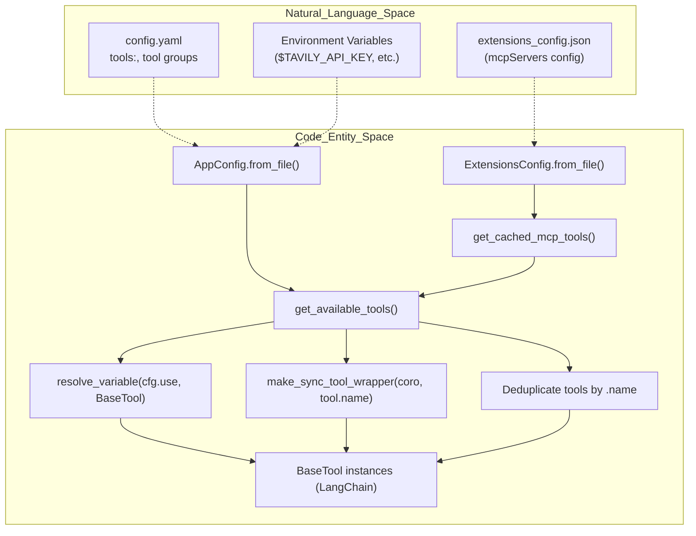
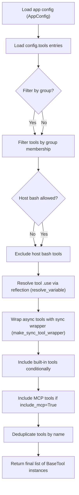
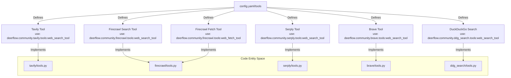

<!-- source: DeepWiki mcp.deepwiki.com · repo bytedance/deer-flow · page 7.3 Tool Configuration · fetched 2026-10-29 -->

# Tool Configuration

Relevant source files

The following files were used as context for generating this wiki page:

- [backend/packages/harness/deerflow/community/ddg_search/AGENTS.md](backend/packages/harness/deerflow/community/ddg_search/AGENTS.md)
- [backend/packages/harness/deerflow/community/ddg_search/__init__.py](backend/packages/harness/deerflow/community/ddg_search/__init__.py)
- [backend/packages/harness/deerflow/community/ddg_search/tools.py](backend/packages/harness/deerflow/community/ddg_search/tools.py)
- [backend/packages/harness/deerflow/community/fastcrw/tools.py](backend/packages/harness/deerflow/community/fastcrw/tools.py)
- [backend/packages/harness/deerflow/community/firecrawl/tools.py](backend/packages/harness/deerflow/community/firecrawl/tools.py)
- [backend/packages/harness/deerflow/config/acp_config.py](backend/packages/harness/deerflow/config/acp_config.py)
- [backend/packages/harness/deerflow/tools/AGENTS.md](backend/packages/harness/deerflow/tools/AGENTS.md)
- [backend/packages/harness/deerflow/tools/builtins/invoke_acp_agent_tool.py](backend/packages/harness/deerflow/tools/builtins/invoke_acp_agent_tool.py)
- [backend/tests/blocking_io/test_invoke_acp_agent_tool.py](backend/tests/blocking_io/test_invoke_acp_agent_tool.py)
- [backend/tests/test_ddg_search_tools.py](backend/tests/test_ddg_search_tools.py)
- [backend/tests/test_doctor.py](backend/tests/test_doctor.py)
- [backend/tests/test_fastcrw_tools.py](backend/tests/test_fastcrw_tools.py)
- [backend/tests/test_firecrawl_tools.py](backend/tests/test_firecrawl_tools.py)
- [backend/tests/test_invoke_acp_agent_tool.py](backend/tests/test_invoke_acp_agent_tool.py)
- [frontend/src/content/en/harness/tools.mdx](frontend/src/content/en/harness/tools.mdx)
- [frontend/src/content/zh/harness/tools.mdx](frontend/src/content/zh/harness/tools.mdx)
- [scripts/doctor.py](scripts/doctor.py)
- [scripts/wizard/providers.py](scripts/wizard/providers.py)

This page explains the configuration and implementation of tools in DeerFlow (`config.yaml` and `extensions_config.json`). Tools are the primary mechanism by which the Lead Agent and subagents interact with the external world—performing web searches, managing files, executing code in sandboxes, delegating tasks, and loading external extensions.

---

## 1. Overview and Configuration Architecture

Tools in DeerFlow are defined declaratively in `config.yaml` under the `tools:` block and can be augmented dynamically via runtime extensions and Model Context Protocol (MCP) server configurations. The backend loads these tool definitions at startup, resolving declared tool references into executable LangChain `BaseTool` instances via Python reflection combined with configuration-driven filters and wrappers.

### Tool Resolution and Code Entity Mapping

This diagram visualizes the flow from natural language configuration files and environment variables into code-level tool instances used at runtime.

Sources: [backend/packages/harness/deerflow/tools/AGENTS.md:59-62](), [backend/packages/harness/deerflow/tools/AGENTS.md:102-102]()

---

## 2. Tool Assembly and Lifecycle

### `get_available_tools()`

The core function orchestrating tool collection is `get_available_tools()` in `backend/packages/harness/deerflow/tools/AGENTS.md` (line 59). It produces the active set of tools available for the agent considering multiple inputs and options:

- **Config-defined tools**: Resolved from `config.yaml` via `resolve_variable()` [backend/packages/harness/deerflow/tools/AGENTS.md:61]().
- **MCP tools**: From enabled MCP servers (lazy initialized, cached with resolved-path + content-signature invalidation) [backend/packages/harness/deerflow/tools/AGENTS.md:62]().
- **Built-in tools**: Core runtime capabilities always available to the agent [backend/packages/harness/deerflow/tools/AGENTS.md:63-69]().
- **Subagent tool**: If enabled [backend/packages/harness/deerflow/tools/AGENTS.md:69]().
- **Filtering by Group**: Filters tools defined in `config.tools` by groups if specified, e.g., `"web"` for web search/fetch tools.
- **Host Bash Access Check**: Uses `is_host_bash_allowed(config)` to disable host-level bash execution tools when the sandbox environment does not permit them.
- **Variable Resolution**: Resolves the `use` string in tool configs via `resolve_variable` reflection into the actual Python `BaseTool` subclass or instance.
- **Sync Wrapper Injection**: Detects async-only tools and wraps them with `make_sync_tool_wrapper` to provide synchronous `.func` for sync code paths safely.
- **Knowledge and Special Groups**: Enforces conditional inclusion based on capabilities such as `knowledge_base` configuration.
- **Deduplication**: Removes duplicate tools by `.name`, favoring config-defined tools and preventing schema collision failures.

---

### Detailed Lifecycle Flow

Sources: [backend/packages/harness/deerflow/tools/AGENTS.md:59-69]()

---

## 3. Web Tools and Parameters

DeerFlow supports multiple pre-integrated community web tools for search and content retrieval. These are enabled by configuring them under the `tools:` section in `config.yaml` with their Python import path in `use:` and optional parameters.

### Web Search Providers (Tavily, Firecrawl, Serply, Brave, Exa, InfoQuest, GroundRoute, Sofya, You.com, DuckDuckGo)

- **DuckDuckGo (default)**: No API key required. Configured with `use: deerflow.community.ddg_search.tools:web_search_tool` [frontend/src/content/en/harness/tools.mdx:118-121](). Supports region inference, time-range filtering (`day`, `week`, `month`, `year`), and image search filtering (`size`, `color`, `type_image`, `layout`, `license_image`) [backend/packages/harness/deerflow/community/ddg_search/tools.py:1-40](), [backend/packages/harness/deerflow/community/ddg_search/tools.py:107-155]().
- **Tavily**: High-quality search with structured results. Requires a Tavily API key. Configured with `use: deerflow.community.tavily.tools:web_search_tool` and `api_key: $TAVILY_API_KEY` [frontend/src/content/en/harness/tools.mdx:127-130]().
- **Brave**: Results from Brave's independent index via the official Brave Search API. Requires an API key. `max_results` is capped at 20. Configured with `use: deerflow.community.brave.tools:web_search_tool` and `api_key: $BRAVE_SEARCH_API_KEY` [frontend/src/content/en/harness/tools.mdx:136-140]().
- **Serply**: Live Google results as JSON. Requires a Serply API key. Supports `vertical: news` or `vertical: scholar` and `gl`/`hl` for country/language. Configured with `use: deerflow.community.serply.tools:web_search_tool` and `api_key: $SERPLY_API_KEY` [frontend/src/content/en/harness/tools.mdx:147-152]().
- **Exa**: Semantic search with neural retrieval. Requires an Exa API key. Configured with `use: deerflow.community.exa.tools:web_search_tool` and `api_key: $EXA_API_KEY` [frontend/src/content/en/harness/tools.mdx:159-162]().
- **InfoQuest**: InfoQuest search integration. Configured with `use: deerflow.community.infoquest.tools:web_search_tool` and `api_key: $INFOQUEST_API_KEY` [frontend/src/content/zh/harness/tools.mdx:169-172]().
- **Firecrawl**: Firecrawl driven search and crawl. Requires a Firecrawl API key. Configured with `use: deerflow.community.firecrawl.tools:web_search_tool` and `api_key: $FIRECRAWL_API_KEY` [frontend/src/content/en/harness/tools.mdx:176-179](). Uses `AsyncFirecrawlApp` for web search and scraping, handling per-call HTTP client teardown via `_aclose_firecrawl_client()` [backend/packages/harness/deerflow/community/firecrawl/tools.py:14-50]().
- **GroundRoute**: A meta-search layer routing queries to multiple engines (Serper, Brave, Exa, Tavily, Firecrawl, Perplexity). Requires a GroundRoute API key. Configured with `use: deerflow.community.groundroute.tools:web_search_tool` and `api_key: $GROUNDROUTE_API_KEY` [frontend/src/content/zh/harness/tools.mdx:183-193]().
- **Sofya**: Search results include full body content. Requires a Sofya API key. `max_results` capped at 20, `contents_max_characters` controls body length. Configured with `use: deerflow.community.sofya.tools:web_search_tool` and `api_key: $SOFYA_API_KEY` [frontend/src/content/zh/harness/tools.mdx:197-201]().
- **You.com**: Results from You.com's own index. API key is optional; anonymous use has rate limits. Configured with `use: deerflow.community.youcom.tools:web_search_tool` [frontend/src/content/zh/harness/tools.mdx:205-208]().

### Web Fetching Providers (Jina AI, Browserless, Exa, InfoQuest, Firecrawl, GroundRoute, Sofya, Unbrowse)

- **Jina AI (default)**: Converts web pages to clean Markdown. API key optional, anonymous use has rate limits. Configured with `use: deerflow.community.jina_ai.tools:web_fetch_tool` and `api_key: $JINA_API_KEY` [frontend/src/content/zh/harness/tools.mdx:223-226]().
- **Browserless**: Uses headless Chrome to render JavaScript-heavy pages and extract Markdown. Configured with `use: deerflow.community.browserless.tools:web_fetch_tool` and `base_url: http://localhost:3032` [frontend/src/content/zh/harness/tools.mdx:232-236]().
- **Exa**: Semantic fetching. Requires an Exa API key. Configured with `use: deerflow.community.exa.tools:web_fetch_tool` and `api_key: $EXA_API_KEY` [frontend/src/content/zh/harness/tools.mdx:242-245]().
- **InfoQuest**: InfoQuest fetch integration. Configured with `use: deerflow.community.infoquest.tools:web_fetch_tool` and `api_key: $INFOQUEST_API_KEY` [frontend/src/content/zh/harness/tools.mdx:251-254]().
- **Firecrawl**: Firecrawl driven search and crawl. Requires a Firecrawl API key. Configured with `use: deerflow.community.firecrawl.tools:web_fetch_tool` and `api_key: $FIRECRAWL_API_KEY` [frontend/src/content/zh/harness/tools.mdx:260-263]().
- **GroundRoute**: A meta-search layer. Requires a GroundRoute API key. Configured with `use: deerflow.community.groundroute.tools:web_fetch_tool` and `api_key: $GROUNDROUTE_API_KEY` [frontend/src/content/zh/harness/tools.mdx:269-272]().
- **Sofya**: Fetching with full body content. Requires a Sofya API key. Configured with `use: deerflow.community.sofya.tools:web_fetch_tool` and `api_key: $SOFYA_API_KEY` [frontend/src/content/zh/harness/tools.mdx:278-281]().
- **Unbrowse**: Fetches web pages as Markdown. Requires an Unbrowse API key. Configured with `use: deerflow.community.unbrowse.tools:web_fetch_tool` and `api_key: $UNBROWSE_API_KEY` [frontend/src/content/zh/harness/tools.mdx:287-290]().

Sources: [frontend/src/content/en/harness/tools.mdx:116-216](), [frontend/src/content/zh/harness/tools.mdx:113-216](), [frontend/src/content/zh/harness/tools.mdx:219-290](), [backend/packages/harness/deerflow/community/firecrawl/tools.py:14-50](), [backend/packages/harness/deerflow/community/ddg_search/tools.py:1-40](), [backend/packages/harness/deerflow/community/ddg_search/tools.py:107-155]()

---

## 4. Sandbox and Filesystem Tools

These tools operate inside the isolated sandbox environment or container, interacting with the filesystem or local shell commands. They are configured in `config.yaml` under the `tools:` section [frontend/src/content/en/harness/tools.mdx:97-108]().

| Tool Name | `use:` Path | Description |
|---|---|---|
| `ls` | `deerflow.sandbox.tools:ls_tool` | List files in a directory [frontend/src/content/en/harness/tools.mdx:88]() |
| `read_file` | `deerflow.sandbox.tools:read_file_tool` | Read file contents [frontend/src/content/en/harness/tools.mdx:90]() |
| `glob` | `deerflow.sandbox.tools:glob_tool` | Find files matching a pattern [frontend/src/content/en/harness/tools.mdx:91]() |
| `grep` | `deerflow.sandbox.tools:grep_tool` | Search file contents [frontend/src/content/en/harness/tools.mdx:92]() |
| `write_file` | `deerflow.sandbox.tools:write_file_tool` | Write content to a file [frontend/src/content/en/harness/tools.mdx:93]() |
| `str_replace` | `deerflow.sandbox.tools:str_replace_tool` | Replace a string in a file [frontend/src/content/en/harness/tools.mdx:94]() |
| `bash` | `deerflow.sandbox.tools:bash_tool` | Execute a shell command (requires `allow_host_bash: true` or a container sandbox) [frontend/src/content/en/harness/tools.mdx:95]() |

> **Security Note:** Host bash execution via `bash_tool` is controlled by the configuration flag `allow_host_bash`. When disallowed, bash commands that would run on the host are filtered out during tool assembly.

Sources: [frontend/src/content/en/harness/tools.mdx:84-108]()

---

## 5. Built-in and Subagent Tools

DeerFlow provides essential built-in tools assembled during tool collection:

- **`present_files`**: Makes output files visible to the user under `/mnt/user-data/outputs` using user-scoped virtual path resolution. Files at `/mnt/user-data/uploads/*` are copied into `/mnt/user-data/outputs/*` before being presented [frontend/src/content/en/harness/tools.mdx:41-46]().
- **`ask_clarification`**: Requests clarification from the user, supporting both text/options and structured v2 form cards (`fields` for multi-value inputs) [backend/packages/harness/deerflow/tools/AGENTS.md:64-65](). This is triggered by the `ClarificationMiddleware` when the model decides it does not have enough information to act [frontend/src/content/en/harness/tools.mdx:55-58]().
- **`view_image`**: Reads image bytes for vision-capable models, requiring `sandbox:execute` permission and supporting blob-backed storage integration. Only available when the active model has `supports_vision: true` [frontend/src/content/en/harness/tools.mdx:49-52](), [backend/packages/harness/deerflow/tools/AGENTS.md:66]().
- **`task`**: Delegates execution to a subagent. The Lead Agent uses this tool when a task is too broad for a single reasoning thread or when parallel work would be beneficial [frontend/src/content/en/harness/tools.mdx:29-32]().
- **`batch_task`**: Opts into JSON checks with `file:<path> json-valid` [backend/packages/harness/deerflow/tools/AGENTS.md:30]().
- **`setup_agent`**: Dynamically configures the current agent session. Used during the bootstrap flow when setting up a new custom agent [frontend/src/content/en/harness/tools.mdx:61-64](), [backend/packages/harness/deerflow/tools/AGENTS.md:67]().
- **`update_agent`**: Persists updates to the current custom agent's `SOUL.md` and `config.yaml` from inside a normal chat. Bound when `agent_name` is set and `is_bootstrap=False` [frontend/src/content/en/harness/tools.mdx:67-69](), [backend/packages/harness/deerflow/tools/AGENTS.md:68]().
- **`invoke_acp_agent`**: Invokes an external agent using the Agent Connect Protocol (ACP). Requires `acp_agents:` configuration in `config.yaml` [frontend/src/content/en/harness/tools.mdx:74-76](). The `_get_work_dir` function determines the per-thread ACP workspace directory, isolating concurrent sessions [backend/packages/harness/deerflow/tools/builtins/invoke_acp_agent_tool.py:21-51]().
- **`tool_search`**: Searches for tools by name or description and loads them into the agent's context on demand. Only active when `tool_search.enabled: true` in `config.yaml` [frontend/src/content/en/harness/tools.mdx:79-82]().

Sources: [frontend/src/content/en/harness/tools.mdx:26-82](), [backend/packages/harness/deerflow/tools/AGENTS.md:30](), [backend/packages/harness/deerflow/tools/AGENTS.md:64-68](), [backend/packages/harness/deerflow/tools/builtins/invoke_acp_agent_tool.py:21-51]()

---

## Summary

Tool configuration in DeerFlow is a robust, layered system combining:
- Declarative YAML and environment variable configuration.
- Dynamic Python reflection via `resolve_variable`.
- Automatic sync wrapper generation for async-only tools.
- Group filtering, host bash restriction, and strict name deduplication.
- Pre-integrated community search and fetching tools with secure credential handling.

---

# End of 7.3 Tool Configuration

---

