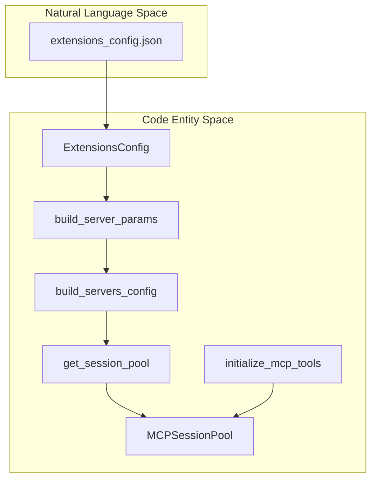
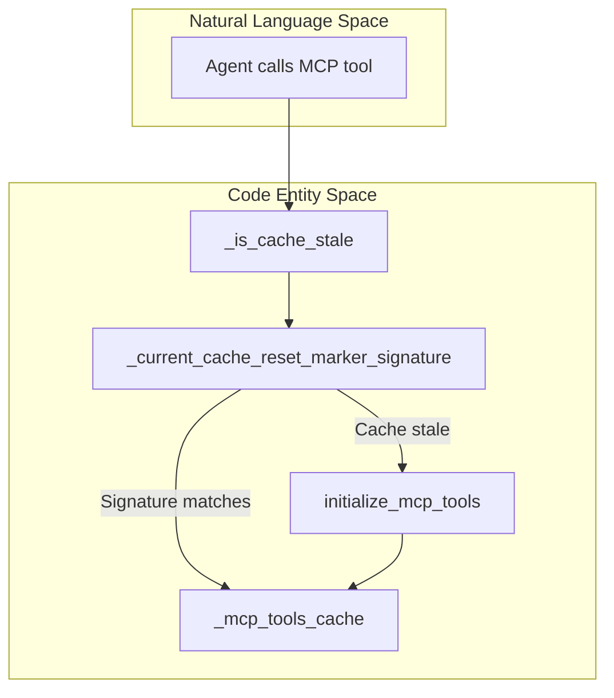

<!-- source: DeepWiki mcp.deepwiki.com · repo bytedance/deer-flow · page 7.4 MCP Server Configuration · fetched 2026-10-29 -->

# MCP Server Configuration

<details>
<summary>Relevant source files</summary>

The following files were used as context for generating this wiki page:

- [backend/app/gateway/routers/mcp.py](backend/app/gateway/routers/mcp.py)
- [backend/app/gateway/routers/skills.py](backend/app/gateway/routers/skills.py)
- [backend/docs/MCP_SERVER.md](backend/docs/MCP_SERVER.md)
- [backend/packages/harness/deerflow/config/AGENTS.md](backend/packages/harness/deerflow/config/AGENTS.md)
- [backend/packages/harness/deerflow/config/extensions_config.py](backend/packages/harness/deerflow/config/extensions_config.py)
- [backend/packages/harness/deerflow/mcp/AGENTS.md](backend/packages/harness/deerflow/mcp/AGENTS.md)
- [backend/packages/harness/deerflow/mcp/cache.py](backend/packages/harness/deerflow/mcp/cache.py)
- [backend/packages/harness/deerflow/mcp/client.py](backend/packages/harness/deerflow/mcp/client.py)
- [backend/packages/harness/deerflow/mcp/session_pool.py](backend/packages/harness/deerflow/mcp/session_pool.py)
- [backend/packages/harness/deerflow/mcp/task_tool_caller.py](backend/packages/harness/deerflow/mcp/task_tool_caller.py)
- [backend/packages/harness/deerflow/mcp/tasks/ordinary.py](backend/packages/harness/deerflow/mcp/tasks/ordinary.py)
- [backend/packages/harness/deerflow/mcp/tools.py](backend/packages/harness/deerflow/mcp/tools.py)
- [backend/tests/blocking_io/test_mcp_router.py](backend/tests/blocking_io/test_mcp_router.py)
- [backend/tests/blocking_io/test_skill_manage_tool.py](backend/tests/blocking_io/test_skill_manage_tool.py)
- [backend/tests/blocking_io/test_skills_custom_router.py](backend/tests/blocking_io/test_skills_custom_router.py)
- [backend/tests/blocking_io/test_skills_update_router.py](backend/tests/blocking_io/test_skills_update_router.py)
- [backend/tests/test_mcp_binding_fencing.py](backend/tests/test_mcp_binding_fencing.py)
- [backend/tests/test_mcp_cache.py](backend/tests/test_mcp_cache.py)
- [backend/tests/test_mcp_cache_discovery.py](backend/tests/test_mcp_cache_discovery.py)
- [backend/tests/test_mcp_cache_reconciliation.py](backend/tests/test_mcp_cache_reconciliation.py)
- [backend/tests/test_mcp_client_config.py](backend/tests/test_mcp_client_config.py)
- [backend/tests/test_mcp_config_secrets.py](backend/tests/test_mcp_config_secrets.py)
- [backend/tests/test_mcp_cwd.py](backend/tests/test_mcp_cwd.py)
- [backend/tests/test_mcp_file_migration.py](backend/tests/test_mcp_file_migration.py)
- [backend/tests/test_mcp_lifecycle_invalid.py](backend/tests/test_mcp_lifecycle_invalid.py)
- [backend/tests/test_mcp_session_pool.py](backend/tests/test_mcp_session_pool.py)
- [backend/tests/test_mcp_session_pool_active_calls.py](backend/tests/test_mcp_session_pool_active_calls.py)
- [backend/tests/test_mcp_session_pool_loop_isolation.py](backend/tests/test_mcp_session_pool_loop_isolation.py)
- [backend/tests/test_mcp_task_ordinary_driver.py](backend/tests/test_mcp_task_ordinary_driver.py)
- [backend/tests/test_mcp_task_tool_caller.py](backend/tests/test_mcp_task_tool_caller.py)
- [backend/tests/test_parallel_mcp_user_agent.py](backend/tests/test_parallel_mcp_user_agent.py)
- [backend/tests/test_skills_custom_router.py](backend/tests/test_skills_custom_router.py)
- [backend/tests/test_skills_router_authz.py](backend/tests/test_skills_router_authz.py)
- [extensions_config.example.json](extensions_config.example.json)

</details>


## Purpose and Scope
This document specifies the architecture, configuration structures, transport mechanisms, authentication workflows, session pooling, tool caching, and path virtualization for Model Context Protocol (MCP) servers integrated within DeerFlow. MCP servers enable DeerFlow to dynamically discover and execute external tools without modifying the core application code.

Sources: `[backend/docs/MCP_SERVER.md:1-5]()`, `[backend/packages/harness/deerflow/mcp/tools.py:1-4]()`

---

## Configuration File Location

MCP server settings are defined in `extensions_config.json` located in the project root directory. This file is distinct from `config.yaml`, allowing MCP extensions and skills to be updated independently and reloaded dynamically via the Gateway API.

The configuration is parsed by the `ExtensionsConfig` Pydantic model (`[backend/packages/harness/deerflow/config/extensions_config.py:130-165]()`), which includes MCP server entries, middleware interceptors, and skills. The Gateway API handles MCP configuration management requests via the router defined in `[backend/app/gateway/routers/mcp.py:1-24]()`.

Sensitive fields—such as environment variables, `client_secret`s, and per-user scoped authentication credentials—are masked or sanitized in API responses to prevent credential leaks.

This design allows operators to enable, disable, or reconfigure MCP servers on the fly without requiring a full backend restart.

Sources:  
`[backend/docs/MCP_SERVER.md:1-15]()`,  
`[backend/app/gateway/routers/mcp.py:1-24]()`,  
`[backend/packages/harness/deerflow/config/extensions_config.py:130-165]()`,  
`[extensions_config.example.json:1-5]()`

---

## Configuration Structure & Data Flow

### Overview Diagram: MCP Configuration to Runtime Entities

The following diagram shows how the MCP-related configuration in `extensions_config.json` flows into runtime code components responsible for building MCP server parameters, managing sessions, and caching MCP tools for use by agents.

Title: MCP Configuration Data Flow Diagram



Sources:  
`[backend/packages/harness/deerflow/mcp/tools.py:13-24]()`,  
`[backend/packages/harness/deerflow/mcp/session_pool.py:20-50]()`,  
`[backend/packages/harness/deerflow/config/extensions_config.py:40-165]()`

### MCP Server Configuration Example

An MCP server entry for a PostgreSQL-backed MCP server might look like the following:

```json
{
  "mcpServers": {
    "postgres": {
      "enabled": true,
      "type": "stdio",
      "command": "npx",
      "args": ["-y", "@modelcontextprotocol/server-postgres", "postgresql://localhost/mydb"],
      "routing": {
        "mode": "prefer",
        "priority": 50,
        "keywords": ["orders", "users", "SQL", "database", "table"]
      }
    }
  }
}
```

Routing hints such as `mode`, `priority`, and `keywords` serve as soft guidance to the agent for preferring this MCP server or its tools based on context. These hints modify the generated prompt but do not enforce hard restrictions.

Sources:  
`[extensions_config.example.json:41-76]()`,  
`[backend/docs/MCP_SERVER.md:127-163]()`

---

## MCP Transport Types

DeerFlow supports three main transport mechanisms configurable per MCP server entry:

1.  **stdio**  
    -   Runs a local subprocess using the specified `command` and optional `args`.  
    -   Communicates with the subprocess over stdin/stdout using the `langchain-mcp-adapters` StdIOTransport.  
    -   Enforces a command allowlist for security to prevent arbitrary code execution. The allowlist is configured via the `DEER_FLOW_MCP_STDIO_COMMAND_ALLOWLIST` environment variable, defaulting to `npx` and `uvx` (`[backend/app/gateway/routers/mcp.py:51-52]()`).  
    -   Supports setting a working directory (`cwd`) anchored inside the thread workspace; this directory is used for discovery and subsequent tool calls `[backend/docs/MCP_SERVER.md:17-41]()`.  
    -   Local files generated by the server inside the thread workspace are translated into DeerFlow's virtual path space (`/mnt/user-data/...`) to integrate with sandbox and artifact APIs `[backend/packages/harness/deerflow/mcp/tools.py:133-155]()`.  

2.  **SSE (Server-Sent Events)**  
    -   Connects to an MCP server exposing an HTTP SSE endpoint (streaming events).  
    -   Uses the provided `url` and optional headers for authentication.  
    -   Suitable for real-time streaming MCP servers.  

3.  **HTTP**  
    -   Uses synchronous HTTP POST requests to perform tool calls.  
    -   Supports custom headers, OAuth flows, and request-scoped authentication.  

All transports are configured and abstracted within `build_server_params()` (`[backend/packages/harness/deerflow/mcp/client.py]`) and routed via the MCP client system.

Sources:  
`[backend/packages/harness/deerflow/config/extensions_config.py:120-150]()`,  
`[extensions_config.example.json:5-31]()`,  
`[backend/docs/MCP_SERVER.md:17-41]()`,
`[backend/app/gateway/routers/mcp.py:51-52]()`

---

## OAuth and Authentication

For MCP servers using HTTP or SSE transports, DeerFlow supports OAuth client credentials and refresh token flows. The system uses an `OAuthTokenManager` (`[backend/packages/harness/deerflow/mcp/oauth.py:41-142]()`) to manage access tokens, transparently refreshing tokens as needed.

### Key Features:
-   **Locking:** Implements a per-server, cross-thread, and cross-event loop concurrency lock to ensure only one token refresh occurs at a time `[backend/packages/harness/deerflow/mcp/oauth.py:32-58]()`.
-   **Token Storage:** Retrieved tokens and refresh tokens are cached per MCP server entry and used to inject `Authorization` headers.
-   **Interceptor Integration:** MCP tool calls decorated with an OAuth tool interceptor automatically include the correct headers `[backend/packages/harness/deerflow/mcp/oauth.py:14-14]()`.
-   **Refresh Logic:** Tokens are refreshed based on expiration time and server-provided capabilities depicted in headers. The `expires_in` value is guarded against missing, non-convertible, or overflowing values, defaulting to one hour if invalid `[backend/packages/harness/deerflow/mcp/AGENTS.md:6-6]()`.

This design decouples token acquisition/refresh from the direct MCP calls and ensures resilience against concurrent usage scenarios.

Sources:  
`[backend/packages/harness/deerflow/mcp/oauth.py:27-113]()`,  
`[backend/tests/test_mcp_oauth.py:43-88]()`,
`[backend/packages/harness/deerflow/mcp/AGENTS.md:6-6]()`

---

## Persistent Session Management with MCPSessionPool

Many MCP servers, especially those using `stdio` transport with stateful backend services (e.g., Playwright browsers), require persistent MCP sessions to maintain state between tool calls.

### MCPSessionPool Design (`[backend/packages/harness/deerflow/mcp/session_pool.py:1-40]()`):

-   Manages MCP `ClientSession` instances scoped by `(server_name, scope_key, owning_loop, ownership_domain)`.  
-   **`server_name`:** Identifier of the MCP server.  
-   **`scope_key`:** Usually a compound key such as user and thread ID that isolates sessions.  
-   **`owning_loop`:** The asyncio event loop that owns the session context; ensures lifecycle compatibility.
-   **`ownership_domain`**: Distinguishes between "deployment" (shared) and "personal" (user-specific) sessions, ensuring isolation `[backend/packages/harness/deerflow/mcp/session_pool.py:144-184]()`.

### Features:

-   **Capacity management:**  
    Maximum of concurrent sessions; evicts least recently used sessions when the pool fills.  

-   **Dedicated owner task:**  
    Each session is bound to a dedicated asyncio task, which enters and exits the MCP session context to avoid cross-task `async with` exit errors `[backend/packages/harness/deerflow/mcp/session_pool.py:13-40]()`.  

-   **Session Reuse:**  
    Calls on the same event loop with the same session key reuse the existing MCP session, preserving remote state such as open browser pages `[backend/packages/harness/deerflow/mcp/session_pool.py:126-143]()`.  

-   **Disconnect detection & cleanup:**  
    Detects MCP transport disconnection errors and closes sessions with a cleanup task to remove broken sessions proactively `[backend/packages/harness/deerflow/mcp/session_pool.py:112-178]()`.  

-   **Thread-safe locking:**  
    Uses a threading lock to safely manage internal state even under concurrent multi-threaded access.

### Typical Usage

The `call_pooled_session_tool()` helper asynchronously obtains a pooled session and invokes a tool call on it:

```python
await call_pooled_session_tool(
    session,
    pool,
    server_name="myserver",
    scope_key="user-thread-incarnation",
    tool_name="do_something",
    arguments={"param": "value"},
    call_kwargs={}
)
```

This preserves the session and remotely maintained context across calls.

Sources:  
`[backend/packages/harness/deerflow/mcp/session_pool.py:1-167]()`,  
`[backend/tests/test_mcp_session_pool.py:1-209]()`,
`[backend/packages/harness/deerflow/mcp/session_pool.py:144-184]()`

---

## MCP Tool Caching and Cache Staleness Detection

To avoid expensive and repeated MCP tool discovery on each backend start or request, DeerFlow maintains a process-global cached MCP tools list (`[backend/packages/harness/deerflow/mcp/cache.py:83-111]()`).

### Cache Keying:
-   Based on the resolved full path of `extensions_config.json` `[backend/packages/harness/deerflow/mcp/cache.py:90-100]()`.  
-   Uses a content signature tuple `(mtime, size, sha256)` to track file version.  
-   Also includes the serialized MCP configuration snapshot (enabled servers, interceptors).  

### Cache Lifecycle:
-   On first access or upon detecting a stale config signature, the tools reload from configured MCP servers with discovery.  
-   The cache is stored in-thread and guarded by a reentrant lock plus a condition variable for synchronicity `[backend/packages/harness/deerflow/mcp/cache.py:85-88]()`.  
-   The Gateway exposes `POST /api/mcp/cache/reset` to manually clear the cache and reset the session pool, enabling administrators to force refresh MCP tool data at runtime `[backend/docs/MCP_SERVER.md:77-82]()`. This endpoint publishes a shared generation so every worker refreshes before its next MCP lookup if they share the writable extensions-config directory `[backend/docs/MCP_SERVER.md:80-82]()`.

### Cache Diagram:

Title: MCP Tool Cache Staleness Flow Diagram



Sources:  
`[backend/packages/harness/deerflow/mcp/cache.py:1-152]()`,  
`[backend/tests/test_mcp_cache.py:1-172]()`,  
`[backend/app/gateway/routers/mcp.py:25-26]()`,
`[backend/docs/MCP_SERVER.md:77-82]()`

---

## Path Translation and Virtualization

Local MCP servers using the `stdio` transport often create temporary files during processing. These files need to be accessible within DeerFlow's sandboxed environment but must not expose confidential files outside the thread's user-data area `[backend/packages/harness/deerflow/mcp/tools.py:133-155]()`.

### Path Translation Flow:

-   **Detection:** Extract local file paths or URIs embedded in MCP server response text `[backend/packages/harness/deerflow/mcp/tools.py:60-75]()`.  
-   **Resolution:** Resolve relative paths against the MCP subprocess working directory (`cwd` in config) pinned inside the thread's user-data workspace `[backend/packages/harness/deerflow/mcp/tools.py:83-131]()`.  
-   **Validation:** Confirm the resolved file exists and is inside the thread's user-data tree (`sandbox_work_dir` or `sandbox_outputs_dir`).  
-   **Virtualization:** Replace file system path references with virtual paths prefixed by `/mnt/user-data/` or `/mnt/outputs/` `[backend/packages/harness/deerflow/mcp/tools.py:133-155]()`.  
-   **Safety:** Files outside the user-data workspace are not exposed or rewritten, preventing accidental leaks.  

This mechanism allows MCP tools returning local file references (such as screenshots or logs) to seamlessly integrate with the frontend's artifact viewing system and sandbox file access while preserving security.

Sources:  
`[backend/packages/harness/deerflow/mcp/tools.py:74-156]()`,  
`[backend/tests/test_mcp_file_migration.py:1-160]()`

---

## Background Task Management

DeerFlow provides a foundation for managing long-running MCP tasks, allowing agents to submit work, poll for status, and cancel tasks asynchronously. This system is protocol-neutral and relies on the `McpTaskDriver` contract.

### Key Components:
-   **`McpTaskDriver`**: Defines the interface for submitting, polling, and canceling tasks, normalizing task states (`submitted`, `working`, `input_required`, `completed`, `failed`, `cancelled`) `[backend/packages/harness/deerflow/mcp/AGENTS.md:7-7]()`.
-   **`McpTaskService`**: Performs status updates, cancellation, and notification work outside the Agent/LLM loop `[backend/packages/harness/deerflow/mcp/AGENTS.md:7-7]()`.
-   **`McpTaskRepository`**: Manages durable remote-handle mapping, poll schedules, notification states, and lease ownership in a SQL database backend (`sqlite` or `postgres`) `[backend/packages/harness/deerflow/mcp/AGENTS.md:7-7]()`.
-   **Task OAuth Lifetime**: Shared OAuth state for enabled deployment servers with `task_toolsets` is managed by `tasks/runtime.py` `[backend/packages/harness/deerflow/mcp/AGENTS.md:9-9]()`.

### Configuration:
Background task support is configured via the `task_toolsets` field within an `McpServerConfig` entry in `extensions_config.json`. An example is shown below:

```json
{
  "mcpServers": {
    "long-running-reports": {
      "enabled": false,
      "type": "http",
      "url": "https://reports.example.com/mcp",
      "description": "Example ordinary MCP background-task contract",
      "session_init_timeout": 60,
      "tool_call_timeout": 60,
      "task_toolsets": [
        {
          "name": "report-generation",
          "submit_tool": "submit_report",
          "status_tool": "get_report_status",
          "cancel_tool": "cancel_report"
        }
      ]
    }
  }
}
```
The `name` field provides a stable local name for tasks from this toolset, while `submit_tool`, `status_tool`, and `cancel_tool` specify the raw MCP tool names for these operations `[backend/packages/harness/deerflow/config/extensions_config.py:88-95]()`.

Sources:
`[backend/packages/harness/deerflow/mcp/AGENTS.md:7-9]()`,
`[backend/packages/harness/deerflow/config/extensions_config.py:88-95]()`,
`[extensions_config.example.json:77-93]()`

---

# Summary

DeerFlow’s MCP server configuration system enables deployment of rich, external tool servers integrated with the Lead Agent through a unified protocol. It supports diverse transport mechanisms (stdio, HTTP, SSE), robust OAuth authentication flows, persistent session pooling for stateful servers, and extensive caching with staleness detection to optimize runtime efficiency. It also provides a robust framework for managing long-running background tasks.

Careful design of path virtualization and strict command allowlisting protect host security and sandbox consistency. The configuration is dynamically reloadable, allowing operators to extend and modify MCP server capabilities without restarting the entire backend.

This comprehensive system makes DeerFlow a flexible super-agent harness capable of safely harnessing external MCP tool servers for enhanced functionality.

---

# Additional References

-   **MCP integration user guide:** Found under `frontend/src/content/en/harness/mcp.mdx` for detailed usage and UI experience.  
-   **Advanced task drivers:** See `[backend/packages/harness/deerflow/mcp/tasks/runtime.py]` for background task support over MCP.  
-   **Tests:** Robust unit and integration tests reside in `[backend/tests/test_mcp_*.py]` ensuring system reliability.

---

Sources:  
`[backend/docs/MCP_SERVER.md:1-162]()`,  
`[backend/packages/harness/deerflow/mcp/tools.py:1-160]()`,  
`[backend/packages/harness/deerflow/mcp/session_pool.py:1-167]()`,  
`[backend/packages/harness/deerflow/mcp/oauth.py:27-113]()`,  
`[backend/packages/harness/deerflow/mcp/cache.py:1-152]()`,  
`[backend/app/gateway/routers/mcp.py:1-137]()`,  
`[extensions_config.example.json:1-95]()`,  
`[backend/tests/test_mcp_session_pool.py:1-209]()`,  
`[backend/tests/test_mcp_file_migration.py:1-160]()`,
`[backend/packages/harness/deerflow/mcp/AGENTS.md:1-9]()`

---

