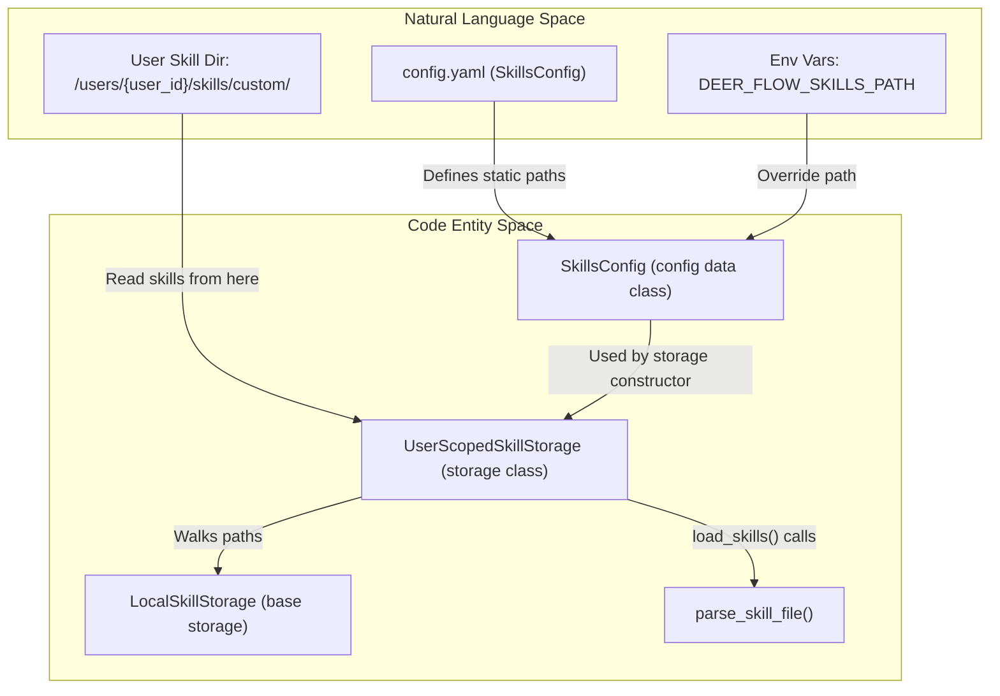
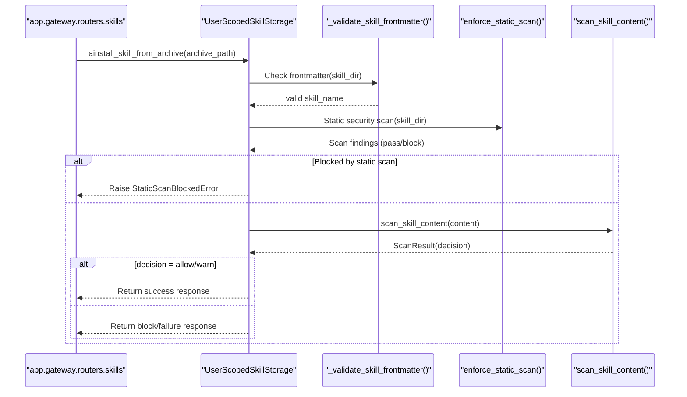
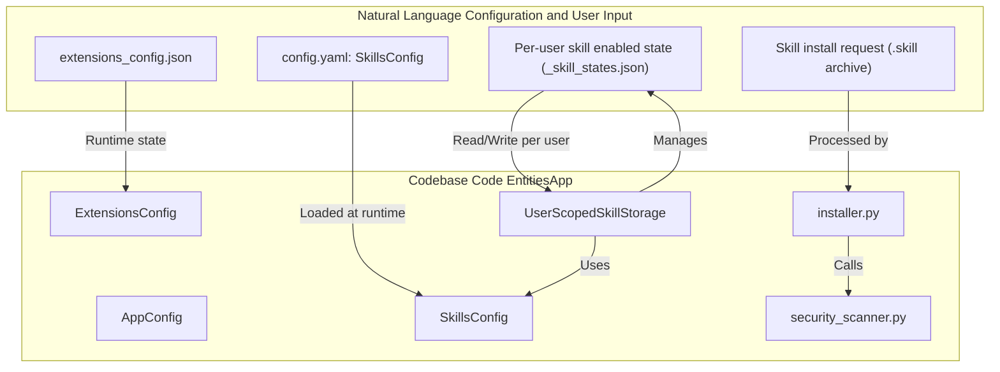

<!-- source: DeepWiki mcp.deepwiki.com · repo bytedance/deer-flow · page 7.5 Skills Configuration · fetched 2026-10-29 -->

# Skills Configuration

<details>
<summary>Relevant source files</summary>

The following files were used as context for generating this wiki page:

- [backend/app/gateway/routers/mcp.py](backend/app/gateway/routers/mcp.py)
- [backend/app/gateway/routers/skills.py](backend/app/gateway/routers/skills.py)
- [backend/docs/MCP_SERVER.md](backend/docs/MCP_SERVER.md)
- [backend/packages/harness/deerflow/config/AGENTS.md](backend/packages/harness/deerflow/config/AGENTS.md)
- [backend/packages/harness/deerflow/config/extensions_config.py](backend/packages/harness/deerflow/config/extensions_config.py)
- [backend/packages/harness/deerflow/config/skill_evolution_config.py](backend/packages/harness/deerflow/config/skill_evolution_config.py)
- [backend/packages/harness/deerflow/config/skills_config.py](backend/packages/harness/deerflow/config/skills_config.py)
- [backend/packages/harness/deerflow/mcp/client.py](backend/packages/harness/deerflow/mcp/client.py)
- [backend/packages/harness/deerflow/skills/security_scanner.py](backend/packages/harness/deerflow/skills/security_scanner.py)
- [backend/packages/harness/deerflow/tools/skill_manage_tool.py](backend/packages/harness/deerflow/tools/skill_manage_tool.py)
- [backend/tests/blocking_io/test_mcp_router.py](backend/tests/blocking_io/test_mcp_router.py)
- [backend/tests/blocking_io/test_skill_manage_tool.py](backend/tests/blocking_io/test_skill_manage_tool.py)
- [backend/tests/blocking_io/test_skills_custom_router.py](backend/tests/blocking_io/test_skills_custom_router.py)
- [backend/tests/blocking_io/test_skills_update_router.py](backend/tests/blocking_io/test_skills_update_router.py)
- [backend/tests/test_mcp_client_config.py](backend/tests/test_mcp_client_config.py)
- [backend/tests/test_mcp_config_secrets.py](backend/tests/test_mcp_config_secrets.py)
- [backend/tests/test_mcp_cwd.py](backend/tests/test_mcp_cwd.py)
- [backend/tests/test_parallel_mcp_user_agent.py](backend/tests/test_parallel_mcp_user_agent.py)
- [backend/tests/test_runtime_paths.py](backend/tests/test_runtime_paths.py)
- [backend/tests/test_security_scanner.py](backend/tests/test_security_scanner.py)
- [backend/tests/test_skill_manage_tool.py](backend/tests/test_skill_manage_tool.py)
- [backend/tests/test_skill_tool_policy_middleware.py](backend/tests/test_skill_tool_policy_middleware.py)
- [backend/tests/test_skills_custom_router.py](backend/tests/test_skills_custom_router.py)
- [backend/tests/test_skills_loader.py](backend/tests/test_skills_loader.py)
- [backend/tests/test_skills_router_authz.py](backend/tests/test_skills_router_authz.py)
- [extensions_config.example.json](extensions_config.example.json)

</details>


This page documents the configuration settings for the DeerFlow skills system, including directory paths, enabled skills management, permissions, frontmatter parsing rules (such as `required-secrets` and `allowed-tools`), security scanning, and the overall setup of the skill system.

## Purpose and Scope

The skills subsystem provides modular capabilities ("skills") that are loaded from filesystem directories or packaged `.skill` archives. This page explains how skills path configuration is handled statically and dynamically, how enabled/disabled states are managed per-user or globally, how security scanning integrates into skill installation, skill system initialization, and permissions enforcement. It covers the key classes and functions involved in these processes.

Sources:  
[backend/packages/harness/deerflow/config/extensions_config.py:1-42](),  
[backend/app/gateway/routers/skills.py:33-57](),  
[backend/packages/harness/deerflow/skills/storage/user_scoped_skill_storage.py:1-157](),  
[backend/packages/harness/deerflow/skills/installer.py:1-45](),  
[backend/packages/harness/deerflow/skills/security_scanner.py:1-50](),  
[backend/packages/harness/deerflow/skills/parser.py:106-177]()

---

## 7.5.1 Skills Path Configuration

### Static Configuration via `SkillsConfig`

Static skills configuration is modeled by the `SkillsConfig` data class in the configuration module. It specifies:

- `skills_path`: The root filesystem path where skills are stored (the base directory). This defaults to a subdirectory `skills/` under the project root, or may be overridden by the environment variable `DEER_FLOW_SKILLS_PATH`.
- `skills_container_path`: The in-container mount path for skills, typically `/mnt/skills`.
- `namespaces_enabled`: A boolean flag enabling segmented skill namespaces.

This static configuration determines where the system looks for skill definitions on disk and where they are mounted inside containers/sandboxes.

### Per-User Isolation with `UserScopedSkillStorage`

The user-scoped skill storage extends the local filesystem skill store to provide per-user isolation for custom skills. Instead of reading/writing custom skills globally under:

```
<base_dir>/skills/custom/
```

custom skills for a given user ID are redirected under:

```
<base_dir>/users/{user_id}/skills/custom/
```

This design prevents users from accessing or modifying other users' custom skills by safely isolating filesystem paths.

Public skills (built-in, read-only) remain under the global:

```
<base_dir>/skills/public/
```

and managed integration skills reside globally under:

```
<base_dir>/integrations/skills/<provider>/
```

#### Directory Layout Summary

| Location                                           | Description                     | Access            |
|--------------------------------------------------|--------------------------------|-------------------|
| `<base_dir>/skills/public/<name>/`                | Global built-in public skills   | Read-only         |
| `<base_dir>/users/{user_id}/skills/custom/<name>/` | User's custom skills            | Read-write        |
| `<base_dir>/skills/custom/<name>/`                 | Legacy global custom skills     | Read-only (legacy) |
| `<base_dir>/integrations/skills/{provider}/{name}/`| Managed integration skills      | Global read-only  |

### Enabled Skill States Storage

Enabled/disabled state for custom and legacy skills is stored per-user in the skill states JSON file:

```
<base_dir>/users/{user_id}/skills/_skill_states.json
```

This JSON maps skill names to their enabled boolean state.

Public skill enabled states are stored globally in `extensions_config.json`.

This avoids cross-user state bleed and preserves backward compatibility via legacy fallback loading when a user has no custom skills directory.

Sources:  
[backend/packages/harness/deerflow/config/extensions_config.py:1-42](),  
[backend/app/gateway/routers/skills.py:33-57](),  
[backend/packages/harness/deerflow/skills/storage/user_scoped_skill_storage.py:1-157]()

---

## 7.5.2 Enabled Skills Management and Permissions

### Managing Enabled State in `UserScopedSkillStorage`

The class `UserScopedSkillStorage` provides API methods to read per-user skill states from `_skill_states.json`, persist changes atomically using file locking mechanisms, and provide a default enabled state of `True` for new or unchecked skills.

### Gateway API Authorization

API endpoints in the Gateway (`backend/app/gateway/routers/skills.py`) enforce authorization:

- Listing skills filters visibility using a resolved skill authorization context per request principal [backend/app/gateway/routers/skills.py:18-20]().
- Mutations (install, edit, enable/disable) require admin user permissions [backend/app/gateway/routers/skills.py:20]().
- Authorization filters skills proactively to prevent unauthorized access.

Authorized skills drive downstream middleware behavior for activation and execution. The skill filtering enforces that only permitted skills appear or execute for a user.

Sources:  
[backend/app/gateway/routers/skills.py:10-57](),  
[backend/packages/harness/deerflow/config/extensions_config.py:1-42]()

---

## 7.5.3 Skill Package Frontmatter and Parsing

A DeerFlow skill is a directory containing a `SKILL.md` Markdown file with YAML frontmatter metadata. Important fields include:

- `name`: Skill identifier, must be lowercase matching slug rules.
- `description`: Human-readable description.
- `license`: License text or shorthand.
- `allowed-tools`: Specifies allowed tool names, parsed via `parse_allowed_tools()` [backend/packages/harness/deerflow/skills/parser.py:107-135](). Known portable client aliases map to canonical DeerFlow runtime names (e.g., `Bash` → `bash`, `Edit` → `str_replace`, `Read` → `read_file`, `Write` → `write_file`) [backend/packages/harness/deerflow/skills/parser.py:14-23]().
- `required-secrets`: List of environment variable names or mappings declaring required/optional secrets needed by the skill, parsed via `parse_required_secrets()` [backend/packages/harness/deerflow/skills/parser.py:138-177](). Invalid environment variable names or malformed structures are handled safely with warnings or validation rejections.

The parsing pipeline uses `yaml.safe_load` consistently to avoid string quoting mismatches [backend/tests/test_skills_parser.py:1-9]().

Sources:  
[backend/packages/harness/deerflow/skills/parser.py:1-177](),  
[backend/tests/test_skills_parser.py:1-65]()

---

## 7.5.4 Skill Discovery and Loading Flow

Skill loading recursively scans configured skill root directories on every call to maintain freshness, avoiding stale caches inside the storage layers. The loader walks skill directories by category (`public`, `custom`, `integrations`, `legacy`), stops recursion at package boundaries (`SKILL.md`), skips hidden directories prefixed with `.`, and handles symlinked roots.

### Diagram: From Natural Language Config to Skill Code Entities



Sources:  
[backend/packages/harness/deerflow/skills/storage/user_scoped_skill_storage.py:1-157](),  
[backend/packages/harness/deerflow/skills/parser.py:1-30]()

---

## 7.5.5 Skill Installation and Security Validation

### Installation Flow Overview

Skill installation typically proceeds via unpacking `.skill` archive ZIP files submitted by users or automation. The key steps are:

1.  **Safe Extraction**: Extracts files to a temporary directory, enforcing strict validations against path traversal and unsafe file types.
2.  **Skill Root Identification**: Identifies the root directory inside the extracted contents containing the `SKILL.md`.
3.  **Frontmatter Validation**: Parses the `SKILL.md` frontmatter via `_validate_skill_frontmatter()` [backend/tests/test_skills_validation.py:11-29]().
4.  **Static Security Scan**: Runs static analyzers via `scan_archive_preflight()` or `enforce_static_scan()` to detect unsafe code or secret leaks [backend/app/gateway/routers/skills.py:47-52](). This is a pre-flight check that happens before any content is written to disk.
5.  **AI-Driven Security Scan**: Calls `scan_skill_content()` to classify skill content security [backend/app/gateway/routers/skills.py:46](). This uses an LLM to moderate the skill content.
6.  **Commit Installation**: Moves archive contents atomically to the user's custom skills directory.

### Diagram: Skill Installation and Security Pipeline



Sources:  
[backend/app/gateway/routers/skills.py:22-57](),  
[backend/packages/harness/deerflow/skills/security_scanner.py:1-50](),  
[backend/packages/harness/deerflow/skills/validation.py:1-20]()

---

## 7.5.6 Skill System Setup and Permissions

### Skill System Initialization

At startup, the system creates skill storage instances based on configuration. Public skills are mounted globally read-only, while custom skill storage uses `UserScopedSkillStorage` to isolate skill access per user.

### Permissions and Enforcement

File writes and removals use atomic filesystem operations with permission bits enabling sandboxed runtime containers to read skill files fully. Symlink validations forbid absolute or escaping symlinks. Skill projection materializes enabled skills into forward-only copies to isolate runtime tool execution. API endpoints enforce admin privileges for skill mutation actions.

### Diagram: Bridging Natural Language Configuration to Key Code Entities



Sources:  
[backend/packages/harness/deerflow/config/extensions_config.py:1-42](),  
[backend/app/gateway/routers/skills.py:33-57](),  
[backend/packages/harness/deerflow/skills/storage/user_scoped_skill_storage.py:1-157]()

---

# Summary

The DeerFlow skills configuration system combines static path settings, dynamic enablement state, user isolation, frontmatter parsing (`required-secrets`, `allowed-tools`), and security scanning to provide a secure, extensible, and permission-aware skill system.

Sources: Aggregated above.

---

