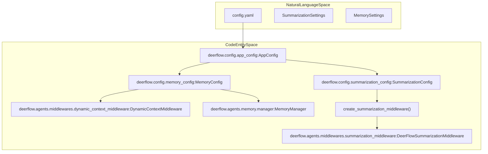
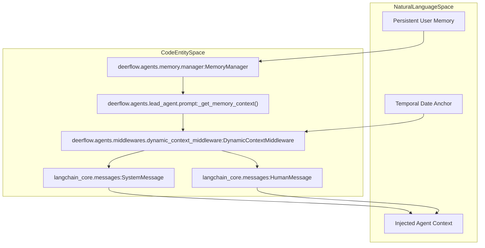

<!-- source: DeepWiki mcp.deepwiki.com · repo bytedance/deer-flow · page 7.6 Memory and Summarization Configuration · fetched 2026-10-29 -->

# Memory and Summarization Configuration

Relevant source files

The following files were used as context for generating this wiki page:

- [backend/app/gateway/routers/memory.py](backend/app/gateway/routers/memory.py)
- [backend/docs/summarization.md](backend/docs/summarization.md)
- [backend/packages/harness/deerflow/agents/memory/AGENTS.md](backend/packages/harness/deerflow/agents/memory/AGENTS.md)
- [backend/packages/harness/deerflow/agents/memory/__init__.py](backend/packages/harness/deerflow/agents/memory/__init__.py)
- [backend/packages/harness/deerflow/agents/memory/backends/deermem/deer_mem.py](backend/packages/harness/deerflow/agents/memory/backends/deermem/deer_mem.py)
- [backend/packages/harness/deerflow/agents/memory/backends/deermem/deermem/config.py](backend/packages/harness/deerflow/agents/memory/backends/deermem/deermem/config.py)
- [backend/packages/harness/deerflow/agents/memory/backends/deermem/deermem/core/prompts/consolidation.yaml](backend/packages/harness/deerflow/agents/memory/backends/deermem/deermem/core/prompts/consolidation.yaml)
- [backend/packages/harness/deerflow/agents/memory/backends/deermem/deermem/core/prompts/memory_update.chat.yaml](backend/packages/harness/deerflow/agents/memory/backends/deermem/deermem/core/prompts/memory_update.chat.yaml)
- [backend/packages/harness/deerflow/agents/memory/backends/deermem/deermem/core/retrieval.py](backend/packages/harness/deerflow/agents/memory/backends/deermem/deermem/core/retrieval.py)
- [backend/packages/harness/deerflow/agents/memory/backends/deermem/deermem/core/storage.py](backend/packages/harness/deerflow/agents/memory/backends/deermem/deermem/core/storage.py)
- [backend/packages/harness/deerflow/agents/memory/backends/deermem/deermem/core/updater.py](backend/packages/harness/deerflow/agents/memory/backends/deermem/deermem/core/updater.py)
- [backend/packages/harness/deerflow/agents/memory/manager.py](backend/packages/harness/deerflow/agents/memory/manager.py)
- [backend/packages/harness/deerflow/agents/middlewares/dynamic_context_middleware.py](backend/packages/harness/deerflow/agents/middlewares/dynamic_context_middleware.py)
- [backend/packages/harness/deerflow/agents/middlewares/summarization_middleware.py](backend/packages/harness/deerflow/agents/middlewares/summarization_middleware.py)
- [backend/packages/harness/deerflow/config/summarization_config.py](backend/packages/harness/deerflow/config/summarization_config.py)
- [backend/tests/blocking_io/test_dynamic_context_middleware.py](backend/tests/blocking_io/test_dynamic_context_middleware.py)
- [backend/tests/test_deermem_self_contained.py](backend/tests/test_deermem_self_contained.py)
- [backend/tests/test_dynamic_context_middleware.py](backend/tests/test_dynamic_context_middleware.py)
- [backend/tests/test_extension_system_model_calls.py](backend/tests/test_extension_system_model_calls.py)
- [backend/tests/test_jev_context_extension.py](backend/tests/test_jev_context_extension.py)
- [backend/tests/test_memory_consolidation.py](backend/tests/test_memory_consolidation.py)
- [backend/tests/test_memory_retrieval_adapter.py](backend/tests/test_memory_retrieval_adapter.py)
- [backend/tests/test_memory_router.py](backend/tests/test_memory_router.py)
- [backend/tests/test_memory_staleness_review.py](backend/tests/test_memory_staleness_review.py)
- [backend/tests/test_memory_storage.py](backend/tests/test_memory_storage.py)
- [backend/tests/test_memory_updater.py](backend/tests/test_memory_updater.py)
- [backend/tests/test_summarization_chunk_cooldown.py](backend/tests/test_summarization_chunk_cooldown.py)
- [backend/tests/test_summarization_middleware.py](backend/tests/test_summarization_middleware.py)
- [backend/tests/test_summarization_summary_text.py](backend/tests/test_summarization_summary_text.py)

## Purpose and Scope

This page documents the configuration and runtime mechanics of DeerFlow's **summarization** and **long-term memory** systems. These subsystems control how the agent manages conversation context over extended sessions (including summarization triggers, token trimming, and retention policies) and maintains persistent user profiles, preferences, and facts across conversations (memory backends, dynamic context injection, and update queues).

For detailed implementation on memory system architecture refer to [Memory System (5.8)](). The middleware execution pipeline is detailed in [Middleware Pipeline (5.4)]().

---

## Configuration Loading Architecture

DeerFlow loads summarization and memory configuration into the global `AppConfig` singleton (`[backend/packages/harness/deerflow/config/app_config.py]()`), which in turn instantiates `SummarizationConfig` (`[backend/packages/harness/deerflow/config/summarization_config.py]()`) and `MemoryConfig` (`[backend/packages/harness/deerflow/config/memory_config.py]()`) objects. These objects encapsulate configuration settings, enabling the agent to initialize summarization and memory subsystems accordingly.

### Configuration to Code Entity Mapping

This diagram bridges the **natural language configuration concepts** with their respective **code implementations**:

**Explanation:**
- `config.yaml` defines summarization and memory settings.
- `AppConfig` (`[backend/packages/harness/deerflow/config/app_config.py]()`) loads these into structured sub-objects:
  - `SummarizationConfig` governs summarization behavior.
  - `MemoryConfig` (`[backend/packages/harness/deerflow/config/memory_config.py]()`) governs memory system settings.
- `create_summarization_middleware()` factory uses `SummarizationConfig` to instantiate `DeerFlowSummarizationMiddleware` (`[backend/packages/harness/deerflow/agents/middlewares/summarization_middleware.py:117-161]()`).
- Memory configuration controls dynamic context injection via `DynamicContextMiddleware` (`[backend/packages/harness/deerflow/agents/middlewares/dynamic_context_middleware.py:117-161]()`) and persistent storage managed by `MemoryManager` (`[backend/packages/harness/deerflow/agents/memory/manager.py]()`).

Sources:  
[backend/packages/harness/deerflow/config/app_config.py]()
[backend/packages/harness/deerflow/config/memory_config.py]()
[backend/packages/harness/deerflow/agents/middlewares/summarization_middleware.py:117-161]()
[backend/packages/harness/deerflow/agents/middlewares/dynamic_context_middleware.py:117-161]()
[backend/packages/harness/deerflow/agents/memory/manager.py]()

---

## Summarization Configuration

Summarization automatically compresses older conversation context to prevent overflowing the model's token window during long chats. It runs periodically based on configured triggers and retention policies, producing a concise summary that preserves conversational state (`[backend/docs/summarization.md:1-16]()`).

### Configuration Schema (`SummarizationConfig`)

| Field | Type | Description |
|---|---|---|
| `enabled` | `bool` | Master toggle enabling summarization middleware |
| `model_name` | `str | None` | Name of the model used specifically for summarization. If `null`, uses the run's own chat model |
| `trigger` | `ContextSize` or list | Conditions (messages count, tokens, or fractions) that trigger summarization |
| `keep` | `ContextSize` | Number or fraction of recent messages or tokens to retain verbatim |
| `trim_tokens_to_summarize` | `int | None` | Token budget that controls input size to the summary generation process |
| `skill_file_read_tool_names` | `list[str]` | Tool names treated as skill file reads for durable skill context |

### Implementation Details

- **No-Stream Tagging:** The summarization middleware creates a special model copy tagged with `TAG_NOSTREAM` to prevent streaming partial summaries to the user interface (`[backend/packages/harness/deerflow/agents/middlewares/summarization_middleware.py:154-160]()`).
- **Model Ownership and Fallback:** Summarization can use an explicitly configured summary model (`model_name`). If unset or unavailable, it falls back to the underlying run's resolved model (`[backend/docs/summarization.md:109-116]()`).
- **Trigger Conditions:** Triggered when any condition in the list of `ContextSize` objects is met (`[backend/docs/summarization.md:117-139]()`).
- **Telemetry and Caching:** Successful summaries emit a `middleware:summarize` journal event tracking changes, no-op status, and cache reuse (`[backend/docs/summarization.md:67-88]()`).
- **Chunking and Cooldown:** Summarization processes history in bounded text chunks. If a pass exceeds `_MAX_SUMMARY_CHUNKS` (`[backend/packages/harness/deerflow/agents/middlewares/summarization_middleware.py:42]()`), it enters a cooldown period (`_SUMMARY_CHUNK_RETRY_SECONDS`) to prevent excessive LLM calls (`[backend/packages/harness/deerflow/agents/middlewares/summarization_middleware.py:43]()`). This cooldown is managed by `_SUMMARY_CHUNK_RETRY_CACHE` (`[backend/packages/harness/deerflow/agents/middlewares/summarization_middleware.py:45]()`) and `_SUMMARY_CHUNK_RETRY_LOCK` (`[backend/packages/harness/deerflow/agents/middlewares/summarization_middleware.py:46]()`).
- **PII Redaction:** Input is PII-redacted before splitting into chunks and escaped before insertion into prompt blocks (`[backend/docs/summarization.md:24-25]()`).

Sources:  
[backend/packages/harness/deerflow/agents/middlewares/summarization_middleware.py:1-161]()
[backend/docs/summarization.md:1-154]()
[backend/tests/test_summarization_middleware.py:1-151]()
[backend/packages/harness/deerflow/agents/middlewares/summarization_middleware.py:42-46]()

---

## Memory System and Context Injection

DeerFlow persists long-term user knowledge and preferences via its memory subsystem (`[backend/packages/harness/deerflow/config/memory_config.py]()`), dynamically injected into conversation contexts.

### Memory Configuration Schema (`MemoryConfig`)

| Field | Type | Description |
|---|---|---|
| `enabled` | `bool` | Toggle master switch for the memory subsystem |
| `mode` | `Literal["middleware","tool"]` | Mode of memory operation: passive capture or tool-driven calls |
| `injection_enabled`| `bool` | Whether to inject retrieved memory into context |
| `manager_class` | `str` | Backend memory manager class or dotted path (default is `deermem`) |
| `backend_config` | `DeerMemConfig` | DeerMem-specific configuration, including storage paths, retrieval settings, and LLM model for updates. |

### DeerMem Backend Configuration (`DeerMemConfig`)

The `DeerMemConfig` (`[backend/packages/harness/deerflow/agents/memory/backends/deermem/deermem/config.py:46-436]()`) provides granular control over the default DeerMem backend:

| Field | Type | Description |
|---|---|---|
| `prompt_prepend`, `prompt_append` | `str` | Literal instructions prepended/appended to the memory-update system message. |
| `storage_path` | `str` | Root directory for DeerMem data. Empty uses `$DEERMEM_DATA_DIR` or `~/.deermem/`. |
| `storage_class` | `str` | Dotted class path for an alternative storage provider (e.g., `file`, `markdown`). |
| `strict_user_scope` | `bool` | Requires `user_id` for every storage scope. |
| `manifest_filename` | `str` | Filename for user-global summary JSON (`memory.json`). |
| `file_lock_timeout_seconds` | `int` | Maximum wait for cross-process advisory file lock. |
| `retrieval_adapter` | `str` | Retrieval adapter factory (`fts5`, empty to disable, or custom dotted path). |
| `retrieval_index_path` | `str` | Directory for the derived SQLite FTS5 retrieval index. |
| `fact_dedup_enabled` | `bool` | Enables deterministic near-duplicate detection for new facts. |
| `fact_dedup_similarity_threshold` | `float` | Minimum token-Jaccard similarity for fact deduplication. |
| `retrieval_relevance_enabled` | `bool` | Enables relevance-aware retrieval, bypassing `retrieval_adapter`. |
| `retrieval_relevance_weight` | `float` | Weight of lexical relevance vs. confidence in combined retrieval score. |
| `retrieval_diversity_weight` | `float` | Greedy MMR similarity penalty for diversifying search results. |
| `max_facts` | `int` | Maximum number of facts to store per agent. |
| `fact_confidence_threshold` | `float` | Minimum confidence for a fact to be stored. |
| `fact_eviction_policy` | `Literal["fifo", "lru", "hybrid-v1"]` | Policy for evicting facts when `max_facts` is reached. |
| `fact_eviction_batch_size` | `int` | Number of facts to evict in a batch. |
| `fact_eviction_min_age_days` | `int` | Minimum age in days for a fact to be considered for eviction. |
| `fact_eviction_max_age_days` | `int` | Maximum age in days for a fact to be considered for eviction. |
| `fact_eviction_max_confidence` | `float` | Maximum confidence for a fact to be considered for eviction. |
| `fact_eviction_min_confidence` | `float` | Minimum confidence for a fact to be considered for eviction. |
| `fact_eviction_protected_categories` | `list[str]` | Categories of facts protected from eviction. |
| `staleness_review_enabled` | `bool` | Enables LLM-driven review of stale facts. |
| `staleness_review_min_candidates` | `int` | Minimum number of stale facts to trigger a review. |
| `staleness_review_max_candidates` | `int` | Maximum number of stale facts to present for review. |
| `staleness_review_max_extension_days` | `int` | Maximum days a fact's validity can be extended during review. |
| `staleness_max_lifetime_multiplier` | `float` | Multiplier for `expected_valid_days` to cap new fact lifetimes. |
| `model` | `DeerMemModelConfig` | LLM configuration for memory updates (provider, model, API key, etc.). |
| `max_wait_seconds` | `int` | Maximum debounce deferral for memory updates. |
| `max_queue_size` | `int` | Maximum number of pending memory update items. |
| `max_workers` | `int` | Maximum concurrent workers for memory updates. |
| `should_keep_hidden_message` | `Callable | None` | Optional host-injected hook to filter hidden messages. |

### Dynamic Context Middleware

- `DynamicContextMiddleware` (`[backend/packages/harness/deerflow/agents/middlewares/dynamic_context_middleware.py:56-60]()`) injects memory and temporal markers (current date) as special `<system-reminder>` messages.
- **Frozen Snapshot Pattern:** Injection happens once per conversation as a dedicated system reminder message before the first user message (`[backend/packages/harness/deerflow/agents/middlewares/dynamic_context_middleware.py:3-8]()`).
- **Date Update Detection:** Detects midnight crossovers based on a configured or server-local timezone (`DEER_FLOW_DATE_TIMEZONE`) (`[backend/packages/harness/deerflow/agents/middlewares/dynamic_context_middleware.py:9-39]()`). The timezone can be set via the `DEER_FLOW_DATE_TIMEZONE` environment variable (`[backend/packages/harness/deerflow/agents/middlewares/dynamic_context_middleware.py:102]()`).
- **Security & Role Separation:** Date reminders are `SystemMessage` instances (`[backend/packages/harness/deerflow/agents/middlewares/dynamic_context_middleware.py:58]()`), while memory content is injected as `HumanMessage` entries to comply with OWASP LLM01 (`[backend/tests/test_dynamic_context_middleware.py:134-144]()`).

### Natural Language to Code Entity Mapping: Memory Injection

**Explanation:**
- `MemoryManager` manages persisted user data.
- `_get_memory_context` fetches formatted memory text.
- `DynamicContextMiddleware` (`[backend/packages/harness/deerflow/agents/middlewares/dynamic_context_middleware.py:56-60]()`) uses this to inject context into the conversation graph.

Sources:  
[backend/packages/harness/deerflow/agents/middlewares/dynamic_context_middleware.py:1-160]()
[backend/tests/test_dynamic_context_middleware.py:94-170]()
[backend/packages/harness/deerflow/config/memory_config.py]()
[backend/packages/harness/deerflow/agents/memory/backends/deermem/deermem/config.py:46-436]()

---

## Memory Update Queue and Message Filtering

- The memory update queue is managed by `MemoryMiddleware`, which asynchronously debounces and batches conversation messages for memory updates (`[backend/packages/harness/deerflow/agents/middlewares/memory_middleware.py]()`).
- It filters out ephemeral content, tool calls, and UI-hidden messages to maintain high signal-to-noise ratios in facts extracted by `MemoryUpdater` (`[backend/tests/test_memory_updater.py:109-158]()`).
- DeerMem debounces each `(thread_id, user_id, agent_name)` independently using monotonic deadlines, with `backend_config.max_wait_seconds` (default 300) capping deferral (`[backend/packages/harness/deerflow/agents/memory/AGENTS.md:90-95]()`).
- The `MemoryUpdater` (`[backend/packages/harness/deerflow/agents/memory/backends/deermem/deermem/core/updater.py]()`) applies updates, handling existing duplicates, whitespace-only facts, and reinforcing existing facts based on detected signals (`[backend/tests/test_memory_updater.py:109-189]()`).
- Staleness review is an LLM-driven process to identify and remove outdated facts. It selects candidates based on `expected_valid_days` and `staleness_review_min_candidates` (`[backend/tests/test_memory_staleness_review.py:1-17]()`).

Sources:  
[backend/packages/harness/deerflow/agents/middlewares/memory_middleware.py]()
[backend/tests/test_memory_updater.py:109-189]()
[backend/packages/harness/deerflow/agents/memory/AGENTS.md:90-95]()
[backend/packages/harness/deerflow/agents/memory/backends/deermem/deermem/core/updater.py]()
[backend/tests/test_memory_staleness_review.py:1-17]()

---

## Memory Backend and Manager Interface

- Supported backends are specified via `manager_class` in `MemoryConfig` (`[backend/packages/harness/deerflow/config/memory_config.py]()`). The default backend is `deermem`, storing data in Markdown with JSON frontmatter.
- `MemoryManager` (`[backend/packages/harness/deerflow/agents/memory/manager.py]()`) exposes CRUD interfaces for facts (`add`, `get_context`, `update_fact`, `delete_fact`, `import_memory`, `export_memory`) (`[backend/app/gateway/routers/memory.py:1-141]()`).
- Implements optimistic concurrency with revision checking, raising `MemoryManifestRevisionConflict` or `MemoryFactRevisionConflict` on conflicts (`[backend/packages/harness/deerflow/agents/memory/backends/deermem/deermem/core/storage.py:66-70]()`).
- DeerMem stores memory in a structured file layout: `memory.json` for shared summaries and revision data, and individual Markdown files for facts under `users/{user_id}/agents/{agent_name}/facts/{sha256-prefix}/{fact-id}.md` (`[backend/packages/harness/deerflow/agents/memory/AGENTS.md:50-54]()`).
- The `MemoryStorage` interface (`[backend/packages/harness/deerflow/agents/memory/backends/deermem/deermem/core/storage.py:1-182]()`) defines the contract for loading and saving memory data.

Sources:  
[backend/packages/harness/deerflow/agents/memory/manager.py]()
[backend/packages/harness/deerflow/config/memory_config.py]()
[backend/app/gateway/routers/memory.py:1-141]()
[backend/tests/test_memory_router.py:36-113]()
[backend/packages/harness/deerflow/agents/memory/backends/deermem/deermem/core/storage.py:66-70]()
[backend/packages/harness/deerflow/agents/memory/AGENTS.md:50-54]()
[backend/packages/harness/deerflow/agents/memory/backends/deermem/deermem/core/storage.py:1-182]()

---

## Tool Mode and Gateway API Integration

- When `memory.mode` is set to `"tool"` (`[backend/packages/harness/deerflow/config/memory_config.py]()`), the model invokes memory tools directly (`memory_search`, `memory_add`, `memory_update`, `memory_delete`).
- The Gateway API serves endpoints under `/api/memory` for import, export, and fact management with appropriate permission checks and trusted user ID resolution (`[backend/app/gateway/routers/memory.py:21-41]()`).
- The `_resolve_memory_user_id` function (`[backend/app/gateway/routers/memory.py:21-41]()`) determines the memory owner, prioritizing internal owner headers for channel workers.
- The API handles `MemoryConflictError` and `MemoryCorruptionError` by returning appropriate HTTP status codes (`[backend/app/gateway/routers/memory.py:133-137]()`).

Sources:  
[backend/packages/harness/deerflow/config/memory_config.py]()
[backend/app/gateway/routers/memory.py:1-141]()
[backend/tests/test_memory_router.py:36-170]()
[backend/app/gateway/routers/memory.py:21-41]()
[backend/app/gateway/routers/memory.py:133-137]()

---

## Appendix: Notable Classes and Functions

| Symbol | Description | Code Location |
|---|---|---|
| `DeerFlowSummarizationMiddleware` | Summarization middleware with pre-hooks and fallback | `agents/middlewares/summarization_middleware.py` |
| `DynamicContextMiddleware` | Injects memory and date reminders into conversation | `agents/middlewares/dynamic_context_middleware.py` |
| `MemoryManager` | Backend-neutral memory manager interface | `agents/memory/manager.py` |
| `MemoryUpdater` | Fact extraction, update, and eviction component | `agents/memory/backends/deermem/deermem/core/updater.py` |
| `create_summarization_middleware()` | Factory constructing summarization middleware | `agents/middlewares/summarization_middleware.py` |
| `DeerMemConfig` | Configuration for the DeerMem memory backend | `agents/memory/backends/deermem/deermem/config.py` |
| `MemoryStorage` | Abstract base class for memory storage backends | `agents/memory/backends/deermem/deermem/core/storage.py` |
| `_resolve_memory_user_id` | Resolves the memory owner for a given request | `app/gateway/routers/memory.py` |

Sources:  
[backend/packages/harness/deerflow/config/app_config.py]()
[backend/packages/harness/deerflow/config/memory_config.py]()
[backend/packages/harness/deerflow/agents/middlewares/summarization_middleware.py:117-161]()
[backend/packages/harness/deerflow/agents/middlewares/dynamic_context_middleware.py:56-60]()
[backend/packages/harness/deerflow/agents/memory/manager.py]()
[backend/packages/harness/deerflow/agents/memory/backends/deermem/deermem/core/updater.py]()
[backend/packages/harness/deerflow/agents/memory/backends/deermem/deermem/config.py]()
[backend/packages/harness/deerflow/agents/memory/backends/deermem/deermem/core/storage.py]()
[backend/app/gateway/routers/memory.py]()

---

