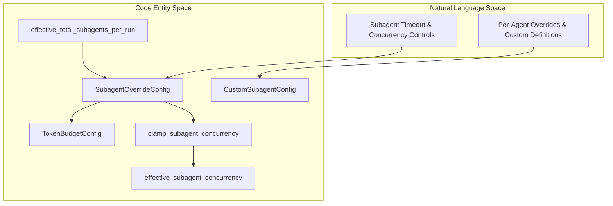
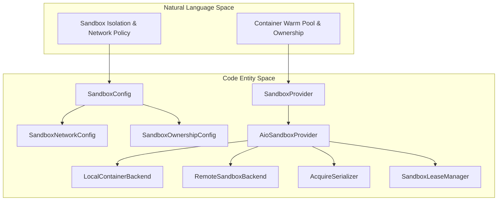

<!-- source: DeepWiki mcp.deepwiki.com · repo bytedance/deer-flow · page 7.7 Subagent and Sandbox Configuration · fetched 2026-10-29 -->

# Subagent and Sandbox Configuration

Relevant source files

The following files were used as context for generating this wiki page:

- [.github/workflows/sandbox-image-smoke.yml](.github/workflows/sandbox-image-smoke.yml)
- [backend/packages/harness/deerflow/agents/middlewares/input_sanitization_middleware.py](backend/packages/harness/deerflow/agents/middlewares/input_sanitization_middleware.py)
- [backend/packages/harness/deerflow/community/aio_sandbox/aio_sandbox_provider.py](backend/packages/harness/deerflow/community/aio_sandbox/aio_sandbox_provider.py)
- [backend/packages/harness/deerflow/community/aio_sandbox/backend.py](backend/packages/harness/deerflow/community/aio_sandbox/backend.py)
- [backend/packages/harness/deerflow/community/aio_sandbox/local_backend.py](backend/packages/harness/deerflow/community/aio_sandbox/local_backend.py)
- [backend/packages/harness/deerflow/community/aio_sandbox/remote_backend.py](backend/packages/harness/deerflow/community/aio_sandbox/remote_backend.py)
- [backend/packages/harness/deerflow/config/sandbox_config.py](backend/packages/harness/deerflow/config/sandbox_config.py)
- [backend/packages/harness/deerflow/config/subagents_config.py](backend/packages/harness/deerflow/config/subagents_config.py)
- [backend/packages/harness/deerflow/sandbox/AGENTS.md](backend/packages/harness/deerflow/sandbox/AGENTS.md)
- [backend/packages/harness/deerflow/subagents/builtins/bash_agent.py](backend/packages/harness/deerflow/subagents/builtins/bash_agent.py)
- [backend/packages/harness/deerflow/subagents/builtins/general_purpose.py](backend/packages/harness/deerflow/subagents/builtins/general_purpose.py)
- [backend/packages/harness/deerflow/subagents/config.py](backend/packages/harness/deerflow/subagents/config.py)
- [backend/packages/harness/deerflow/subagents/registry.py](backend/packages/harness/deerflow/subagents/registry.py)
- [backend/tests/blocking_io/test_aio_sandbox_get.py](backend/tests/blocking_io/test_aio_sandbox_get.py)
- [backend/tests/blocking_io/test_sandbox_release.py](backend/tests/blocking_io/test_sandbox_release.py)
- [backend/tests/test_aio_sandbox_local_backend.py](backend/tests/test_aio_sandbox_local_backend.py)
- [backend/tests/test_aio_sandbox_provider.py](backend/tests/test_aio_sandbox_provider.py)
- [backend/tests/test_aio_sandbox_readiness.py](backend/tests/test_aio_sandbox_readiness.py)
- [backend/tests/test_input_sanitization_middleware.py](backend/tests/test_input_sanitization_middleware.py)
- [backend/tests/test_provisioner_pvc_volumes.py](backend/tests/test_provisioner_pvc_volumes.py)
- [backend/tests/test_provisioner_request_threading.py](backend/tests/test_provisioner_request_threading.py)
- [backend/tests/test_remote_sandbox_backend.py](backend/tests/test_remote_sandbox_backend.py)
- [backend/tests/test_sandbox_orphan_reconciliation.py](backend/tests/test_sandbox_orphan_reconciliation.py)
- [backend/tests/test_subagent_prompt_security.py](backend/tests/test_subagent_prompt_security.py)
- [backend/tests/test_subagent_routing_prompt.py](backend/tests/test_subagent_routing_prompt.py)
- [backend/tests/test_subagent_skills_config.py](backend/tests/test_subagent_skills_config.py)
- [backend/tests/test_subagent_timeout_config.py](backend/tests/test_subagent_timeout_config.py)
- [backend/tests/test_subagents_acp_boolean_backstops.py](backend/tests/test_subagents_acp_boolean_backstops.py)
- [docker/provisioner/README.md](docker/provisioner/README.md)
- [docker/provisioner/app.py](docker/provisioner/app.py)

This page documents the configuration options related to subagent execution, task timeouts, sandbox environment provisioning, volume mounts, network security policies, path virtualization, and guardrails in DeerFlow. These settings control how long subagents run, how isolated execution environments are managed, and the security boundaries for shell command execution and file operations.

Sources: [backend/packages/harness/deerflow/config/subagents_config.py:1-169](), [backend/packages/harness/deerflow/config/sandbox_config.py:1-147]()

---

## Subagent Configuration and Timeouts

DeerFlow's subagent system enables delegation of tasks to specialized agents that operate with their own lifecycle constraints, runtime environment, and resource limits. The configuration system lets operators control subagent timeouts, turn limits, model usage, and token budgets to constrain resource consumption and avoid runaway executions.

### Key Configuration Classes and Parameters

The subagent settings are encapsulated mainly within Pydantic models defined in `backend/packages/harness/deerflow/config/subagents_config.py`:

- `SubagentOverrideConfig`: Per-agent overrides for parameters such as `timeout_seconds`, `max_turns`, `model`, `skills`, and `token_budget` [backend/packages/harness/deerflow/config/subagents_config.py:89-116]().
- `CustomSubagentConfig`: User-defined subagent types declaring descriptions, system prompts, tool whitelists, and blacklists [backend/packages/harness/deerflow/config/subagents_config.py:124-161]().

Main configurable fields include:
- `timeout_seconds`: Default per-subagent execution timeout in seconds [backend/packages/harness/deerflow/config/subagents_config.py:95-98]().
- `max_turns`: Optional global limit on the number of subagent turns [backend/packages/harness/deerflow/config/subagents_config.py:99-102]().
- `max_total_per_run`: Backstop on total number of subagent invocations per lead agent run, constrained between `MIN_TOTAL_SUBAGENTS_PER_RUN` and `MAX_TOTAL_SUBAGENTS_PER_RUN` [backend/packages/harness/deerflow/config/subagents_config.py:13-15]().
- `token_budget`: Managed via `TokenBudgetConfig` to govern token consumption per subagent run [backend/packages/harness/deerflow/config/subagents_config.py:113-116]().

Runtime constraints are enforced using helper functions like `clamp_subagent_concurrency`, `effective_subagent_concurrency`, and `effective_total_subagents_per_run` [backend/packages/harness/deerflow/config/subagents_config.py:20-56]().

### Diagram: Subagent Configuration Resolution and Registry Architecture

Sources: [backend/packages/harness/deerflow/config/subagents_config.py:1-169]()

---

## Sandbox Configuration and Providers

The sandbox system provides secure isolated environments for executing shell commands and file operations requested by agents. Configuration enables tailored containerization, networking restrictions, mounting host paths, and ownership coordination across gateway instances.

### Configuration Models

Core configuration models in `backend/packages/harness/deerflow/config/sandbox_config.py` include:
- `SandboxConfig`: Main sandbox provider configuration including container image, idle timeouts, and mounts.
- `SandboxNetworkConfig`: Outbound network policy supporting `open`, `isolated`, and `allowlist` modes [backend/packages/harness/deerflow/config/sandbox_config.py:20-86]().
- `SandboxOwnershipConfig`: Cross-instance container ownership management utilizing `memory` or `redis` backends [backend/packages/harness/deerflow/config/sandbox_config.py:9-100]().

### Provider Implementation

The `SandboxProvider` interface abstracts sandbox lifecycle operations [backend/packages/harness/deerflow/sandbox/AGENTS.md:15](). Implementations include `AioSandboxProvider` [backend/packages/harness/deerflow/community/aio_sandbox/aio_sandbox_provider.py:11](), which manages warm pools, idle timeout management, graceful shutdown, and mount computation [backend/packages/harness/deerflow/community/aio_sandbox/aio_sandbox_provider.py:7-10](). It composes with `SandboxBackend` implementations like `LocalContainerBackend` for Docker/Apple Container [backend/packages/harness/deerflow/community/aio_sandbox/local_backend.py:1-5]() and `RemoteSandboxBackend` for Kubernetes provisioners [backend/packages/harness/deerflow/community/aio_sandbox/remote_backend.py:1-5]().

`AioSandboxProvider` also handles cross-instance ownership using `AcquireSerializer` for serialization of acquire/release transitions [backend/packages/harness/deerflow/sandbox/AGENTS.md:16]() and `SandboxLeaseManager` for tracking concurrent users [backend/packages/harness/deerflow/sandbox/AGENTS.md:17]().

### Diagram: Sandbox Configuration and Provider Architecture

Sources: [backend/packages/harness/deerflow/config/sandbox_config.py:1-147](), [backend/packages/harness/deerflow/community/aio_sandbox/aio_sandbox_provider.py:1-11](), [backend/packages/harness/deerflow/community/aio_sandbox/local_backend.py:1-5](), [backend/packages/harness/deerflow/community/aio_sandbox/remote_backend.py:1-5](), [backend/packages/harness/deerflow/sandbox/AGENTS.md:15-17]()

---

## Volume Mounts and Path Virtualization

Subagent sandboxes require access to host directories such as user workspace data and skills mapped into container virtual paths such as `/mnt/user-data` and `/mnt/skills`.

### Key Details and Path Mappings

- `AioSandboxProvider` computes thread-specific and skills mounts [backend/packages/harness/deerflow/community/aio_sandbox/aio_sandbox_provider.py:10]().
- The provisioner service (for `RemoteSandboxBackend`) creates Pods with HostPath volumes mounted for skills (`{skills_container_path}/{public,custom,legacy,integrations}`) and user data (`/mnt/user-data`) [docker/provisioner/README.md:27-30]().
- `_normalize_skills_container_path` ensures that the skills container path does not overlap with reserved sandbox paths like `/mnt/user-data` or `/mnt/integrations/lark-cli` [backend/packages/harness/deerflow/community/aio_sandbox/remote_backend.py:65-81]().
- `_format_container_mount` formats bind-mount arguments for Docker or Apple Container runtimes, using `--mount` for Docker to avoid ambiguity with Windows drive letters [backend/packages/harness/deerflow/community/aio_sandbox/local_backend.py:127-145]().

Sources: [backend/packages/harness/deerflow/community/aio_sandbox/aio_sandbox_provider.py:10](), [docker/provisioner/README.md:27-30](), [backend/packages/harness/deerflow/community/aio_sandbox/remote_backend.py:65-81](), [backend/packages/harness/deerflow/community/aio_sandbox/local_backend.py:127-145]()

---

## Guardrails and Execution Security

DeerFlow applies guardrails to secure sandbox execution and input processing.

### Input Sanitization Middleware

To protect against prompt injection attacks, `InputSanitizationMiddleware` neutralizes blocked XML-like tags (such as `<system>`, `<memory>`, and framework authority blocks) within user messages by escaping them into HTML entities while wrapping genuine input in boundary markers [backend/packages/harness/deerflow/agents/middlewares/input_sanitization_middleware.py:1-132](). This middleware covers the whole conversation and is applied to both lead agent and subagent model inputs [backend/packages/harness/deerflow/agents/middlewares/input_sanitization_middleware.py:10-13, 67-69]().

### Network Approval Policy

The `SandboxMiddleware` uses `resolve_run_interaction_policy()` to determine network approval. Subagents always auto-deny network access. Autonomous, webhook, scheduled, and GitHub-fallback runs also auto-deny, while explicit interactive overrides can allow access for legacy hints [backend/packages/harness/deerflow/sandbox/AGENTS.md:5-8]().

Sources: [backend/packages/harness/deerflow/agents/middlewares/input_sanitization_middleware.py:1-132](), [backend/packages/harness/deerflow/sandbox/AGENTS.md:5-8]()

---

# References

- Subagent Configuration API: [`backend/packages/harness/deerflow/config/subagents_config.py:1-169`]()
- Sandbox Configuration Models: [`backend/packages/harness/deerflow/config/sandbox_config.py:1-147`]()
- AIO Sandbox Provider: [`backend/packages/harness/deerflow/community/aio_sandbox/aio_sandbox_provider.py:1-11`]()
- Local Container Backend: [`backend/packages/harness/deerflow/community/aio_sandbox/local_backend.py:1-5`]()
- Remote Sandbox Backend: [`backend/packages/harness/deerflow/community/aio_sandbox/remote_backend.py:1-5`]()
- Input Sanitization Middleware: [`backend/packages/harness/deerflow/agents/middlewares/input_sanitization_middleware.py:1-132`]()
- Sandbox System Documentation: [`backend/packages/harness/deerflow/sandbox/AGENTS.md:1-17`]()

---

