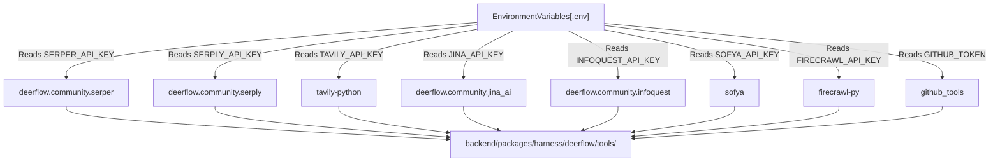
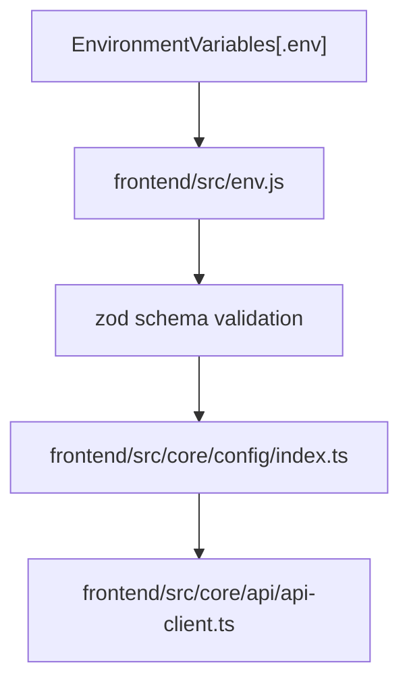
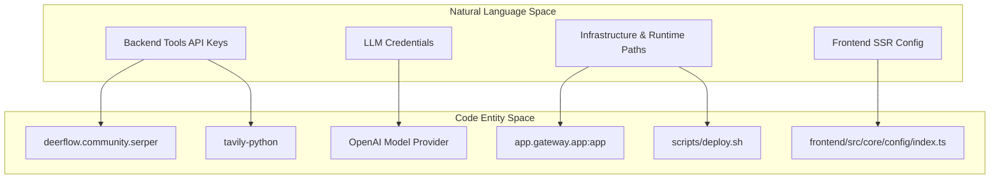
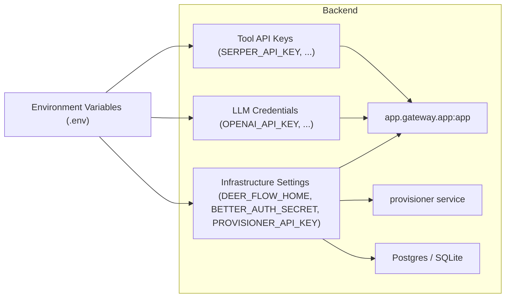

<!-- source: DeepWiki mcp.deepwiki.com · repo bytedance/deer-flow · page 7.8 Environment Variables · fetched 2026-10-29 -->

# Environment Variables

Relevant source files

The following files were used as context for generating this wiki page:

- [.env.example](.env.example)
- [CHANGELOG.md](CHANGELOG.md)
- [CHANGELOG_zh.md](CHANGELOG_zh.md)
- [README.md](README.md)
- [backend/AGENTS.md](backend/AGENTS.md)
- [backend/docs/CONFIGURATION.md](backend/docs/CONFIGURATION.md)
- [backend/packages/harness/deerflow/agents/middlewares/AGENTS.md](backend/packages/harness/deerflow/agents/middlewares/AGENTS.md)
- [backend/packages/harness/deerflow/agents/middlewares/llm_error_handling_middleware.py](backend/packages/harness/deerflow/agents/middlewares/llm_error_handling_middleware.py)
- [backend/tests/test_extensions_config_raw_writes.py](backend/tests/test_extensions_config_raw_writes.py)
- [backend/tests/test_llm_error_handling_middleware.py](backend/tests/test_llm_error_handling_middleware.py)
- [backend/tests/test_support_bundle.py](backend/tests/test_support_bundle.py)
- [config.example.yaml](config.example.yaml)
- [frontend/.env.example](frontend/.env.example)
- [frontend/README.md](frontend/README.md)
- [frontend/components.json](frontend/components.json)
- [frontend/src/AGENTS.md](frontend/src/AGENTS.md)
- [frontend/src/app/page.tsx](frontend/src/app/page.tsx)
- [frontend/src/components/theme-provider.tsx](frontend/src/components/theme-provider.tsx)
- [frontend/src/components/ui/aurora-text.tsx](frontend/src/components/ui/aurora-text.tsx)
- [frontend/src/components/ui/number-ticker.tsx](frontend/src/components/ui/number-ticker.tsx)
- [frontend/src/components/workspace/artifacts/artifact-file-preview.tsx](frontend/src/components/workspace/artifacts/artifact-file-preview.tsx)
- [frontend/src/core/api/api-client.ts](frontend/src/core/api/api-client.ts)
- [frontend/src/core/api/stream-mode.ts](frontend/src/core/api/stream-mode.ts)
- [frontend/src/core/artifacts/html-assets.ts](frontend/src/core/artifacts/html-assets.ts)
- [frontend/src/core/auth/gateway-config.ts](frontend/src/core/auth/gateway-config.ts)
- [frontend/src/core/config/index.ts](frontend/src/core/config/index.ts)
- [frontend/src/core/threads/stream-state.ts](frontend/src/core/threads/stream-state.ts)
- [frontend/src/env.js](frontend/src/env.js)
- [frontend/tests/e2e/artifact-preview.spec.ts](frontend/tests/e2e/artifact-preview.spec.ts)
- [frontend/tests/unit/components/workspace/artifacts/artifact-file-preview.dom.test.tsx](frontend/tests/unit/components/workspace/artifacts/artifact-file-preview.dom.test.tsx)
- [frontend/tests/unit/core/api/api-client.test.ts](frontend/tests/unit/core/api/api-client.test.ts)
- [frontend/tests/unit/core/api/stream-mode.test.ts](frontend/tests/unit/core/api/stream-mode.test.ts)
- [frontend/tests/unit/core/artifacts/html-assets-auth.dom.test.ts](frontend/tests/unit/core/artifacts/html-assets-auth.dom.test.ts)
- [frontend/tests/unit/core/auth/gateway-config.test.ts](frontend/tests/unit/core/auth/gateway-config.test.ts)
- [frontend/tests/unit/core/threads/incremental-stream-state.dom.test.tsx](frontend/tests/unit/core/threads/incremental-stream-state.dom.test.tsx)
- [scripts/AGENTS.md](scripts/AGENTS.md)
- [scripts/support_bundle.py](scripts/support_bundle.py)

This document describes the environment variables used to configure DeerFlow, covering external service API keys, LLM provider credentials, frontend endpoints, infrastructure controls, runtime paths, and deployment settings. Environment variables govern backend tool integrations, client/server configuration validation, sandbox security isolation, and multi-service wiring, providing flexible configuration without editing static configuration files [.env.example:1-134]().

---

## 1. Overview and Scope

DeerFlow organizes environment variables into four primary operational domains:

1. **Backend Tools and Search APIs**: API keys and tokens used by the backend to access external web search, crawling, and research services [.env.example:1-25]().
2. **LLM Providers and Subscription Credentials**: Provider API keys for language models and subscription-based CLI tokens for tools like Claude Code and Codex [.env.example:50-67](), [.env.example:121-134]().
3. **Frontend Client and SSR Wiring**: Variables consumed by the Next.js frontend during server-side rendering (SSR) and client runtime to locate the Gateway API and LangGraph SDK endpoints [.env.example:110-120](), [frontend/src/env.js:1-50]().
4. **Infrastructure, Security, and Deployment**: Settings governing network interface binding, reverse proxy trust (`AUTH_TRUSTED_PROXIES`), internal authentication tokens (`DEER_FLOW_INTERNAL_AUTH_TOKEN`, `BETTER_AUTH_SECRET`), sandbox provisioner keys (`PROVISIONER_API_KEY`), and runtime paths (`DEER_FLOW_HOME`, `DEER_FLOW_CONFIG_PATH`) [.env.example:26-108](), [scripts/deploy.sh:115-150]().

---

## 2. Backend Tool and Search API Keys

The backend relies on environment variables to inject credentials for external tool integrations invoked during agent execution. These tools supply web search, markdown extraction, and crawling capabilities critical for DeerFlow's super-agent orchestrations.

| Variable Name       | Description                                               | Associated Module / Package                 |
|---------------------|-----------------------------------------------------------|---------------------------------------------|
| `SERPER_API_KEY`    | Google Search via Serper API                              | `deerflow.community.serper`                  |
| `SERPLY_API_KEY`    | Google Search, News, and Scholar via Serply API           | `deerflow.community.serply`                  |
| `TAVILY_API_KEY`    | Structured web search provider                            | `tavily-python`                             |
| `JINA_API_KEY`      | Markdown content extraction                               | `deerflow.community.jina_ai`                 |
| `INFOQUEST_API_KEY` | Enterprise search and web crawling                        | `deerflow.community.infoquest`              |
| `SOFYA_API_KEY`     | Web search and fetch                                      | `sofya`                                     |
| `FIRECRAWL_API_KEY` | Advanced web crawling and scraping                        | `firecrawl-py`                              |
| `GITHUB_TOKEN`      | GitHub API access for repository interactions             | `github_tools`                              |

These environment variables feed directly into the tool assembly subsystem of the backend harness, allowing dynamic and secure credential injection without hardcoding secrets.

**Tool Environment Variable Flow**

Sources: [.env.example:1-25](), [.env.example:85-86]()

---

## 3. LLM Provider and CLI Subscription Credentials

DeerFlow supports multiple LLM providers and CLI subscription mechanisms through environment variables enabling flexible integration of language model APIs for agent reasoning and execution [.env.example:50-67](), [.env.example:121-134]().

| Variable Name                  | Provider / Tool       | Notes                                |
|-------------------------------|----------------------|-------------------------------------|
| `OPENAI_API_KEY`              | OpenAI               | GPT family models                   |
| `DEEPSEEK_API_KEY`            | DeepSeek             | DeepSeek V3 and R1                  |
| `ANTHROPIC_API_KEY`           | Anthropic            | Claude models                      |
| `GEMINI_API_KEY`              | Google Gemini        | Gemini family models               |
| `VOLCENGINE_API_KEY`          | Volcengine           | Doubao models                     |
| `NOVITA_API_KEY`              | Novita               | OpenAI-compatible provider         |
| `MINIMAX_API_KEY`             | MiniMax              | OpenAI-compatible provider         |
| `STEPFUN_API_KEY`             | StepFun              | OpenAI-compatible provider         |
| `VLLM_API_KEY`                | vLLM                 | Local/remote vLLM instances         |
| `OPENVIKING_API_KEY`          | OpenViking           | Alternative memory backend          |
| `CLAUDE_CODE_OAUTH_TOKEN`     | Claude Code CLI      | OAuth token for command-line usage  |
| `CLAUDE_CODE_CREDENTIALS_PATH`| Claude Code CLI      | File path to `.credentials.json`    |
| `CODEX_AUTH_PATH`             | Codex CLI            | File path to CLI auth JSON          |

These credentials are consumed by the backend middleware and credential loaders, enabling secure API call authentication without storing keys in code or config files.

Sources: [.env.example:50-67](), [.env.example:121-134]()

---

## 4. Messaging Channel Integration

To operate agents as bots on external chat or IM platforms, DeerFlow requires specific environment variables holding authentication tokens and secrets for each platform [.env.example:71-78](), [.env.example:91-95]().

| Variable Name                   | Platform        | Associated SDK / Module           |
|--------------------------------|-----------------|---------------------------------|
| `FEISHU_APP_ID` / `FEISHU_APP_SECRET` | Feishu / Lark  | `lark-oapi`                     |
| `SLACK_BOT_TOKEN` / `SLACK_APP_TOKEN`  | Slack         | `slack-sdk`                    |
| `TELEGRAM_BOT_TOKEN`            | Telegram        | `python-telegram-bot`           |
| `DISCORD_BOT_TOKEN`             | Discord         | `discord.py`                    |
| `WECOM_BOT_ID` / `WECOM_BOT_SECRET`  | WeCom          | `wecom-aibot-python-sdk`        |
| `DINGTALK_CLIENT_ID` / `DINGTALK_CLIENT_SECRET` | DingTalk  | `dingtalk-stream`               |

These tokens enable the Gateway API to authenticate and interact with IM providers for multi-channel deployments.

Sources: [.env.example:71-78](), [.env.example:91-95]()

---

## 5. Frontend Environment Variables and Validation

The Next.js frontend uses environment variables during build and runtime to connect to the backend Gateway API and LangGraph Server endpoints. Validation is performed at build time using `t3-oss/env-nextjs` (zod schema), ensuring consistent and type-safe config values [frontend/src/env.js:1-50](), [frontend/src/core/config/index.ts:1-40]().

### Key Frontend Variables

| Variable Name                      | Scope           | Description                                                  |
|----------------------------------|-----------------|--------------------------------------------------------------|
| `NEXT_PUBLIC_BACKEND_BASE_URL`   | Client / Server | Override of Gateway API base URL for SSR and client calls    |
| `NEXT_PUBLIC_LANGGRAPH_BASE_URL` | Client / Server | LangGraph SDK base URL override                              |
| `NEXT_PUBLIC_STATIC_WEBSITE_ONLY`| Client / Server | Enables static demo mode with read-only limitations          |
| `GITHUB_OAUTH_TOKEN`              | Server-only     | OAuth token used for GitHub-related frontend activities      |

**Frontend Environment Variable Validation Flow**

Sources: [frontend/src/env.js:1-50](), [frontend/src/core/config/index.ts:1-40](), [frontend/README.md:80-90]()

---

## 6. Infrastructure, Security, and Deployment Settings

DeerFlow deployment behavior and networking are governed by environment variables controlling network interface bindings, trusted proxies, internal authentication secrets, and runtime filesystem paths [.env.example:26-108](), [scripts/deploy.sh:115-189]().

| Variable Name                     | Default               | Description / Code Reference                                       |
|----------------------------------|-----------------------|--------------------------------------------------------------------|
| `BIND_HOST`                      | `127.0.0.1`           | Network interface IP for Nginx and Gateway binding                 |
| `PORT`                           | `2026`                | Port exposed by Nginx for external access                          |
| `GATEWAY_CORS_ORIGINS`           | None                  | Allowed origins for browser CORS, comma-separated                  |
| `AUTH_TRUSTED_PROXIES`           | `nginx`               | IPs or hostnames of trusted reverse proxies for login rate limits |
| `GATEWAY_ENABLE_DOCS`            | `true`                | Toggle Swagger UI and OpenAPI docs availability                    |
| `DEER_FLOW_INTERNAL_AUTH_TOKEN`  | Generated / Persisted | Internal auth token for inter-worker Gateway communication         |
| `BETTER_AUTH_SECRET`             | Required (high entropy)| Session encryption secret for Next.js frontend auth                |
| `PROVISIONER_API_KEY`            | None                  | Auth key for Kubernetes sandbox provisioner                        |
| `DATABASE_URL`                   | None                  | PostgreSQL database URL if using Postgres backend                  |
| `LANGSMITH_TRACING`              | `false`               | Enables LangSmith tracing for observability                        |
| `DEER_FLOW_HOME`                 | `backend/.deer-flow`  | Root directory for runtime data storage                            |
| `DEER_FLOW_CONFIG_PATH`          | `config.yaml`         | Path to the main configuration file for the Gateway and harness   |

These controls ensure security through trusted proxy validation, enable multi-instance coordination via shared tokens, and correctly bind service endpoints.

Sources: [.env.example:26-108](), [docker/docker-compose.yaml:60-97](), [scripts/deploy.sh:115-189]()

---

# Summary Diagram: Bridging Natural Language Space to Code Entity Space

Sources: [.env.example:1-134](), [scripts/deploy.sh:1-189](), [frontend/src/core/config/index.ts:1-40]()

---

# Detailed Data Flow Diagram: Environment Variables to Backend Components

Sources: [.env.example:1-134](), [docker/docker-compose.yaml:1-251](), [scripts/deploy.sh:1-189]()

---

## 7. Security Best Practices

1. **Exclude `.env` from Version Control**: `.env` files must never be committed to source control to avoid leaking API keys and secrets accidentally.
2. **Restrict CORS Origins**: Always configure explicit origins in `GATEWAY_CORS_ORIGINS` for deployments serving multiple domains or frontends, limiting exposure to cross-origin attacks [.env.example:28]().
3. **Disable Documentation in Production**: For security, disable swagger UI and OpenAPI documentation on production deployments with `GATEWAY_ENABLE_DOCS=false` [.env.example:96-97]().
4. **Use High-Entropy Provisioner Keys**: Generate and securely distribute `PROVISIONER_API_KEY` for Kubernetes sandbox isolation to prevent unauthorized sandbox access [.env.example:105-108]().

---

This comprehensive environment variable system enables secure, flexible, and modular configuration of DeerFlow across its services, empowering seamless integration with third-party APIs, enabling multi-channel messaging and frontend backends, and ensuring sound operational security guards.

Sources: [.env.example:1-134](), [scripts/deploy.sh:115-189](), [frontend/src/env.js:1-50](), [frontend/src/core/config/index.ts:1-40](), [docker/docker-compose.yaml:60-97]()

---

