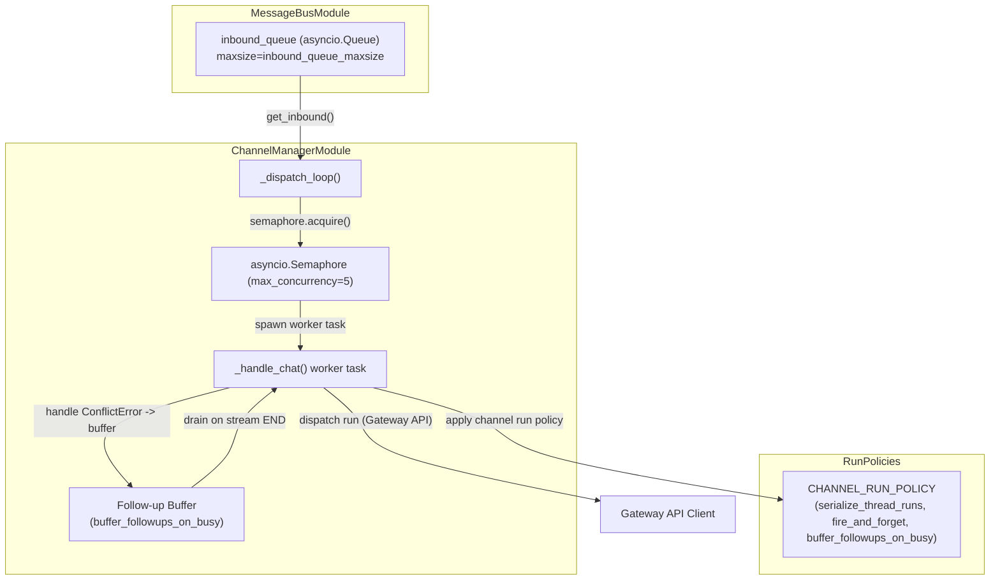

<!-- source: DeepWiki mcp.deepwiki.com · repo bytedance/deer-flow · page 8.1 IM Channels Architecture · fetched 2026-10-29 -->

# IM Channels Architecture

Relevant source files

The following files were used as context for generating this wiki page:

- [backend/app/channels/AGENTS.md](backend/app/channels/AGENTS.md)
- [backend/app/channels/base.py](backend/app/channels/base.py)
- [backend/app/channels/dingtalk.py](backend/app/channels/dingtalk.py)
- [backend/app/channels/feishu.py](backend/app/channels/feishu.py)
- [backend/app/channels/manager.py](backend/app/channels/manager.py)
- [backend/app/channels/service.py](backend/app/channels/service.py)
- [backend/app/channels/slack.py](backend/app/channels/slack.py)
- [backend/app/channels/telegram.py](backend/app/channels/telegram.py)
- [backend/docs/IM_CHANNEL_CONNECTIONS.md](backend/docs/IM_CHANNEL_CONNECTIONS.md)
- [backend/tests/blocking_io/test_channel_stop_offloop.py](backend/tests/blocking_io/test_channel_stop_offloop.py)
- [backend/tests/test_channel_service_start_stop_shutdown_generation_fence.py](backend/tests/test_channel_service_start_stop_shutdown_generation_fence.py)
- [backend/tests/test_channels.py](backend/tests/test_channels.py)
- [backend/tests/test_dingtalk_channel.py](backend/tests/test_dingtalk_channel.py)
- [backend/tests/test_feishu_parser.py](backend/tests/test_feishu_parser.py)
- [backend/tests/test_slack_channel_connections.py](backend/tests/test_slack_channel_connections.py)
- [backend/tests/test_slack_channel_lifecycle.py](backend/tests/test_slack_channel_lifecycle.py)
- [backend/tests/test_slack_file_share.py](backend/tests/test_slack_file_share.py)
- [backend/tests/test_telegram_channel_connections.py](backend/tests/test_telegram_channel_connections.py)
- [backend/tests/test_telegram_message_length.py](backend/tests/test_telegram_message_length.py)

## Purpose and Scope

This document details the architecture of the IM Channels system within DeerFlow (`backend/app/channels/`), which bridges external messaging platforms (Slack, Telegram, Feishu/Lark, WeCom, WeChat, DingTalk, Discord, and GitHub) to the core agent runtime. The system handles asynchronous message processing via a pub/sub message bus (`MessageBus`), state persistence for thread mapping (`ChannelStore`), backpressure control, concurrency limits, and strict message filtering to prevent internal context leaks.

Sources:  
[backend/app/channels/AGENTS.md:1-3](), [backend/app/channels/manager.py:1-3]()

---

## System Overview and Core Components

The IM Channels architecture is built around core infrastructure modules that manage ingestion, dispatch, persistence, and service lifecycle:

1.  **`MessageBus`** (`backend/app/channels/message_bus.py`):  
    Acts as an asynchronous publish-subscribe hub maintaining a buffered FIFO queue for inbound messages and a callback registry for outbound message deliveries. This decouples external concurrent input event streams from the internal dispatch loop, enabling asynchronous handling with built-in backpressure via queue limits.

2.  **`ChannelStore`** (`backend/app/channels/store.py`):  
    Implements thread-safe persistence mapping external channel conversation keys (`channel_name:chat_id[:topic_id]`) to DeerFlow LangGraph `thread_id`s. Supports both SQL-backed storage (`SqlChannelStore` using `channel_thread_bindings`) and process-local JSON files (`JsonChannelStore`) for memory backends. This ensures consistent conversation threading across application restarts and multi-replica deployments.

3.  **`ChannelManager`** (`backend/app/channels/manager.py`):  
    The central coordinator consuming inbound messages from the `MessageBus`, applying concurrency limits (via `asyncio.Semaphore`), deduplication (`InboundDedupeStore`), and per-channel run policies (`ChannelRunPolicy`) to serialize or buffer follow-ups on busy conversations. It interacts with the Gateway API to manage threads and runs, routing messages, commands, and streaming runtime responses back to IM channels while filtering streaming outputs to prevent leaking internal context.

4.  **`ChannelService`** (`backend/app/channels/service.py`):  
    Manages initialization, configuration, lifecycle, and graceful shutdown of all configured IM channels based on `config.yaml` and environment variables. It sets up the shared `MessageBus` and `ChannelStore`, handles concurrency settings, and instantiates channel adapters lazily.

Sources:  
[backend/app/channels/AGENTS.md:3-15](), [backend/app/channels/manager.py:1-49](), [backend/app/channels/message_bus.py](), [backend/app/channels/service.py:114-157](), [backend/app/channels/store.py:10-124]()

---

### End-to-End Routing & Message Flow

Title: "End-to-End Routing and Message Flow Across Transports and Core Entities"

```mermaid
graph TB
    subgraph "ExternalTransports"
        SlackChannel["SlackChannel (slack.py)"]
        TelegramChannel["TelegramChannel (telegram.py)"]
        FeishuChannel["FeishuChannel (feishu.py)"]
        WeComChannel["WeComChannel (wecom.py)"]
        DingTalkChannel["DingTalkChannel (dingtalk.py)"]
        DiscordChannel["DiscordChannel (discord.py)"]
        GitHubChannel["GitHubChannel (github.py)"]
    end

    subgraph "CoreMessagingLayer"
        Bus["MessageBus (message_bus.py)"]
        ChannelManager["ChannelManager (manager.py)"]
        Store["ChannelStore (store.py)"]
    end

    subgraph "RuntimeGateway"
        GatewayAPI["Gateway API client<br/>client.runs.stream(), client.runs.create()"]
    end

    SlackChannel -->|"InboundMessage"| Bus
    TelegramChannel -->|"InboundMessage"| Bus
    FeishuChannel -->|"InboundMessage"| Bus
    WeComChannel -->|"InboundMessage"| Bus
    DingTalkChannel -->|"InboundMessage"| Bus
    DiscordChannel -->|"InboundMessage"| Bus
    GitHubChannel -->|"InboundMessage"| Bus

    Bus -->|"get_inbound() async dequeue"| ChannelManager
    ChannelManager -->|"lookup/create thread ID"| Store
    ChannelManager -->|"Dispatch run/stream"| GatewayAPI
    GatewayAPI -->|"Stream SSE messages"| ChannelManager
    ChannelManager -->|"OutboundMessage publication"| Bus
    Bus -->|"callback to send message"| SlackChannel
    Bus -->|"callback to send message"| TelegramChannel
    Bus -->|"callback to send message"| FeishuChannel
    Bus -->|"callback to send message"| WeComChannel
    Bus -->|"callback to send message"| DingTalkChannel
    Bus -->|"callback to send message"| DiscordChannel
    Bus -->|"callback to send message"| GitHubChannel
```

Sources:  
[backend/app/channels/AGENTS.md:3-15](), [backend/app/channels/manager.py:1-49](), [backend/app/channels/message_bus.py](), [backend/app/channels/service.py:114-157](), [backend/app/channels/store.py:10-124]()

---

## Message Routing and State Store (`ChannelStore`)

The IM Channels system maintains conversation continuity by mapping external channel/platform conversation identifiers to internal DeerFlow thread IDs using the `ChannelStore` protocol (`backend/app/channels/store.py`).

-   **Conversation Key Format**:  
    -   `channel_name:chat_id` for root or simple chats  
    -   `channel_name:chat_id:topic_id` for threaded or multi-topic conversations (e.g., Slack threads, GitHub issues)  
    This enables precise thread tracking in platforms with nested or topic-based conversations.

-   **Storage Backends**:  
    -   `SqlChannelStore`: Backed by the shared `channel_thread_bindings` database table, enabling multi-replica deployments to share bindings.  
    -   `JsonChannelStore`: Backed by `{base_dir}/channels/store.json`, loaded once per process and guarded by threading locks.

| Method                                        | Description                                                                | Source                          |
| :-------------------------------------------- | :------------------------------------------------------------------------- | :------------------------------ |
| `get_thread_id(channel_name, chat_id, topic_id=None)` | Retrieves the LangGraph thread ID for a given external channel key, or None if not found. | [backend/app/channels/store.py:73-81]() |
| `set_thread_id(channel_name, chat_id, topic_id, thread_id)` | Persists the mapping along with timestamps and metadata for recovery and tracking. | [backend/app/channels/store.py:83-108]() |

Sources:  
[backend/app/channels/AGENTS.md:9](), [backend/app/channels/store.py:10-130]()

---

## Backpressure, Concurrency, and Queue Management

### 1. Inbound Queue Backpressure

The `MessageBus` exposes an asyncio FIFO queue (`inbound_queue`) with a configurable maximum size (`inbound_queue_maxsize`, default 1000). When this queue is full, producers publishing inbound messages are asynchronously blocked, providing natural backpressure to external platform event sources.

### 2. Concurrency Limiting via Semaphore

The `ChannelManager` enforces a maximum number of concurrent message processing workers (`max_concurrency`, default 5) using an `asyncio.Semaphore`. Each inbound message dequeued spawns a handler only if semaphore capacity is available.

### 3. Channel Run Policies and Thread Serialization

Channels configure policies (`ChannelRunPolicy`) controlling execution behavior:

-   **`serialize_thread_runs`**: If enabled, rapid inbound turns targeting the same thread are serialized in manager code, avoiding concurrent Gateway runs on the thread and preventing "thread busy" errors.
-   **`fire_and_forget`**: For long autonomous runs, the manager uses fire-and-forget calls to Gateway (`client.runs.create()`), avoiding HTTP client read timeouts.
-   **`buffer_followups_on_busy`**: When a thread is busy (triggering a `ConflictError` from Gateway), follow-up inbound messages may be buffered per thread (up to 20), then replayed once the prior run completes.

Sources:  
[backend/app/channels/AGENTS.md:10](), [backend/app/channels/manager.py:61-130](), [backend/app/channels/service.py:130-146]()

### Code-Level Dispatch and Concurrency Flow

Title: "Code-Level Dispatch, Semaphore Control, and Policy Enforcement in ChannelManager"

Sources:  
[backend/app/channels/AGENTS.md:10](), [backend/app/channels/manager.py:61-130](), [backend/app/channels/service.py:130-146]()

---

## Message Filtering and Security

To prevent accidental leakage of private or internal runtime context carried in LangGraph Gateway streaming responses, the IM Channels system filters outbound stream messages carefully within `_accumulate_stream_text`.

-   **Allowlist Enforcement**: Only assistant-originated messages are allowed through: those with types `"ai"`, `"AIMessageChunk"`, or `"assistant"` (matching OpenAI-style runtimes).
-   **Exclusion Rules**: Message types containing `"tool"` or internal `HumanMessage` objects (which wrap injected memory or durable context) are strictly excluded.
-   **Payload Validation**: Bare string payloads are rejected because they lack attribution and cannot be verified as assistant-originated.

Sources:  
[backend/app/channels/AGENTS.md:12]()

---

## Detailed Component Descriptions

### ChannelManager
-   **Role**: Core dispatcher (`backend/app/channels/manager.py`) that processes inbound messages from `MessageBus`, deduplicates events, applies per-channel concurrency and serialization policies, creates or looks up LangGraph threads via Gateway API, dispatches runs, and streams incremental assistant output.
-   **Key Implementation Points**: Inbound deduplication store (`InboundDedupeStore`), asyncio semaphore concurrency bounding, command routing (such as `/goal` and `/agent`), and strict message stream type filtering. It also handles special commands like `/new`, `/agent list`, `/agent use`, and `/model`. The `_apply_channel_policy` method [backend/tests/test_channels.py:84-84]() applies `ChannelRunPolicy` settings, including `interaction_mode` and `disable_clarification`.

Sources:  
[backend/app/channels/AGENTS.md:1-15](), [backend/app/channels/manager.py:1-134, 530-582](), [backend/tests/test_channels.py:33-50, 72-122]()

### MessageBus
-   **Role**: Asynchronous, thread-safe message broker (`backend/app/channels/message_bus.py`).
-   **Key Implementation Points**: Buffered inbound FIFO queue (`inbound_queue`) with backpressure and callback registry for outbound delivery. It defines `InboundMessage`, `OutboundMessage`, and `ResolvedAttachment` data structures.

Sources:  
[backend/app/channels/AGENTS.md:1-15](), [backend/app/channels/message_bus.py:20-80](), [backend/tests/test_channels.py:160-175]()

### ThreadStore (ChannelStore)
-   **Role**: Persistent mapping (`backend/app/channels/store.py`) from external channel conversation keys to internal LangGraph thread IDs.
-   **Key Implementation Points**: SQL-backed `SqlChannelStore` and file-backed `JsonChannelStore` protected by threading locks. The `resolve_channel_store` function [backend/app/channels/service.py:20]() selects the appropriate store based on configuration.

Sources:  
[backend/app/channels/AGENTS.md:1-15](), [backend/app/channels/service.py:20, 114-157](), [backend/app/channels/store.py:10-130]()

---

