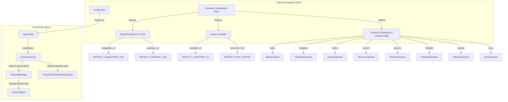
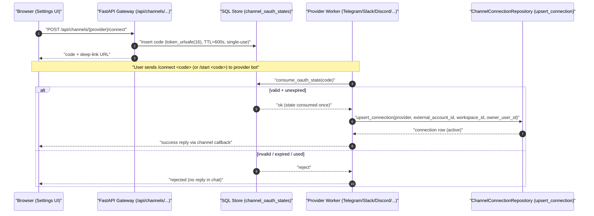

<!-- source: DeepWiki mcp.deepwiki.com · repo bytedance/deer-flow · page 8.2 Channel Configuration · fetched 2026-10-29 -->

# Channel Configuration

<details>
<summary>Relevant source files</summary>

The following files were used as context for generating this wiki page:

- [backend/app/channels/allowed_users.py](backend/app/channels/allowed_users.py)
- [backend/app/channels/buzz.py](backend/app/channels/buzz.py)
- [backend/app/channels/buzz_seen_events.py](backend/app/channels/buzz_seen_events.py)
- [backend/app/channels/capabilities.py](backend/app/channels/capabilities.py)
- [backend/app/channels/discord.py](backend/app/channels/discord.py)
- [backend/app/channels/inbound_files.py](backend/app/channels/inbound_files.py)
- [backend/app/channels/qq.py](backend/app/channels/qq.py)
- [backend/app/channels/wechat.py](backend/app/channels/wechat.py)
- [backend/app/channels/wechat_qr_login.py](backend/app/channels/wechat_qr_login.py)
- [backend/app/channels/wecom.py](backend/app/channels/wecom.py)
- [backend/app/gateway/routers/channel_connections.py](backend/app/gateway/routers/channel_connections.py)
- [backend/app/scheduler/notification_delivery.py](backend/app/scheduler/notification_delivery.py)
- [backend/packages/harness/deerflow/logging_config.py](backend/packages/harness/deerflow/logging_config.py)
- [backend/tests/blocking_io/test_buzz_seen_event_store.py](backend/tests/blocking_io/test_buzz_seen_event_store.py)
- [backend/tests/blocking_io/test_wechat_channel_state.py](backend/tests/blocking_io/test_wechat_channel_state.py)
- [backend/tests/test_allowed_users.py](backend/tests/test_allowed_users.py)
- [backend/tests/test_buzz_channel.py](backend/tests/test_buzz_channel.py)
- [backend/tests/test_buzz_seen_events.py](backend/tests/test_buzz_seen_events.py)
- [backend/tests/test_channel_capabilities.py](backend/tests/test_channel_capabilities.py)
- [backend/tests/test_channel_connections_router.py](backend/tests/test_channel_connections_router.py)
- [backend/tests/test_discord_channel.py](backend/tests/test_discord_channel.py)
- [backend/tests/test_discord_inbound_attachments.py](backend/tests/test_discord_inbound_attachments.py)
- [backend/tests/test_feishu_notifications.py](backend/tests/test_feishu_notifications.py)
- [backend/tests/test_logging_config.py](backend/tests/test_logging_config.py)
- [backend/tests/test_notification_delivery_worker.py](backend/tests/test_notification_delivery_worker.py)
- [backend/tests/test_qq_channel.py](backend/tests/test_qq_channel.py)
- [backend/tests/test_wechat_channel.py](backend/tests/test_wechat_channel.py)
- [backend/tests/test_wechat_qr_login.py](backend/tests/test_wechat_qr_login.py)
- [frontend/src/components/workspace/channels/wechat-qr-completion.tsx](frontend/src/components/workspace/channels/wechat-qr-completion.tsx)
- [frontend/src/components/workspace/channels/wechat-qr-login.tsx](frontend/src/components/workspace/channels/wechat-qr-login.tsx)

</details>


This page documents the configuration, setup, connection bindings, and streaming modes for all instant messaging (IM) channels supported by DeerFlow: Slack, Telegram, Feishu/Lark, WeCom, WeChat, DingTalk, Discord, and Buzz. For architectural details about message routing, backpressure, and the `MessageBus`, see [IM Channels Architecture](8.1).

---

## Configuration Overview and Hierarchy

IM channels are configured in `config.yaml` under the `channels` key. The system bridges external messaging platforms to the DeerFlow agent runtime via the LangGraph Server, creating threads server-side and routing messages bidirectionally.

The `ChannelManager` located in `backend/app/channels/manager.py` consumes inbound messages and dispatches them to the agent using the configured `assistant_id` and `run_config` [backend/app/channels/manager.py:53-79](). The configuration system follows a hierarchical override pattern where global settings are specialized by channel-specific blocks, which can further be overridden by per-user connection bindings managed via `ChannelConnectionRepository` [backend/app/gateway/routers/channel_connections.py:26]().

### Channel Configuration Hierarchy Bridge



Sources: [backend/app/channels/manager.py:53-79](), [backend/app/channels/service.py:113-157](), [backend/app/gateway/routers/channel_connections.py:26]()

---

## Global Channel Settings

These settings define the backend service endpoints and execution bounds used by all enabled channels to communicate with the agent harness and resolve file artifacts.

| Setting                          | Type    | Default                    | Description                                                      |
|---------------------------------|---------|----------------------------|------------------------------------------------------------------|
| `langgraph_url`                 | string  | `http://localhost:8001/api`| LangGraph Server endpoint for thread execution                   |
| `gateway_url`                   | string  | `http://localhost:8001`    | Gateway API endpoint for file/artifact resolution                |
| `session`                      | object  | -                          | Global session defaults for agent behavior                       |
| `inbound_queue_maxsize`         | integer | 1000                       | Max capacity for the inbound message bus                         |
| `max_concurrency`               | integer | 5                          | Max concurrent agent runs per channel                            |
| `shutdown_grace_period_seconds` | float   | 3.0                        | Grace period when stopping channel background loops             |

These global parameters appear in `ChannelManager` and `ChannelService` to govern resource allocation, queueing, and graceful shutdown behavior common to all channels.

Sources: [backend/app/channels/manager.py:58-62](), [backend/app/channels/service.py:129-155]()

---

## Channel-Specific Setup and Streaming Modes

---

### Slack Configuration

The **SlackChannel** connects via Socket Mode over WebSockets, eliminating the need for a public IP address and webhook exposure.

Key Implementation Points:
- Supports streaming outbound messages over WebSockets.
- Translates and escapes reserved characters (`&`, `<`, `>`) in message content.
- Converts Markdown syntax via `SlackMarkdownConverter` to Slack's `mrkdwn` format.
- Managed in `backend/app/channels/slack.py`.

Key Configuration Fields:

| Field          | Type         | Required | Description                                 |
|----------------|--------------|----------|---------------------------------------------|
| `enabled`      | boolean      | Yes      | Enable/disable Slack channel                |
| `bot_token`    | string       | Yes      | Slack Bot User OAuth Token (`xoxb-...`)    |
| `app_token`    | string       | Yes      | App-Level Token for Socket Mode (`xapp-...`) |
| `allowed_users`| array/string | No       | List of allowed Slack user IDs or single user ID |

Sources: [backend/app/channels/slack.py:1-167](), [backend/app/channels/manager.py:137]()

---

### Telegram Configuration

The **TelegramChannel** uses long-polling via `python-telegram-bot`.

Key Implementation Details:
- Streaming updates supported with in-place editing of messages.
- Throttles edits for rate limiting per chat type (1s private, 3s group).
- Inbound attachments are downloaded and synced with uploads.
- Rich message detection for markdown fences, tables, and links; publishes native rich messages optionally.
- Implemented in `backend/app/channels/telegram.py`.

Key Configuration Fields:

| Field          | Type    | Required | Description                               |
|----------------|---------|----------|-------------------------------------------|
| `enabled`      | boolean | Yes      | Enable/disable Telegram channel            |
| `bot_token`    | string  | Yes      | Telegram Bot API token from `@BotFather`  |
| `allowed_users`| array   | No       | List of allowed Telegram user IDs          |

Sources: [backend/app/channels/telegram.py:34-79](), [backend/app/channels/manager.py:138]()

---

### Feishu/Lark Configuration

The **FeishuChannel** connects via WebSocket with the `lark-oapi` client.

Key Features:
- Streaming by posting cards with "Working on it..." placeholder and patching it with incremental results.
- Batched inbound messages over 0.75 seconds to aggregate partial user inputs.
- Tracks running card message IDs to serialize rapid message updates per thread.
- Supports inbound file attachments syncing with sandbox.
- Detailed in `backend/app/channels/feishu.py`.

Key Configuration Fields:

| Field                | Type    | Required | Description                      |
|----------------------|---------|----------|---------------------------------|
| `enabled`            | boolean | Yes      | Enable/disable Feishu channel    |
| `app_id`             | string  | Yes      | Feishu App ID                    |
| `app_secret`         | string  | Yes      | Feishu App Secret                |
| `verification_token` | string  | No       | Event verification token         |

Sources: [backend/app/channels/feishu.py:33-131](), [backend/app/channels/manager.py:10]()

---

### WeCom Configuration

The **WeComChannel** uses the `wecom-aibot-python-sdk` WebSocket client.

Key Implementation Details:
- Replies clipped to a max of 20,480 UTF-8 bytes [backend/app/channels/wecom.py:56]().
- Large replies are split respecting Markdown boundaries into batches capped at 10 messages [backend/app/channels/wecom.py:58-60]().
- Supports in-place streaming updates.
- Operator-configurable `allowed_media_hosts` for inbound media download [backend/app/channels/wecom.py:131-147]().
- Implemented in `backend/app/channels/wecom.py`.

Key Configuration Fields:

| Field             | Type    | Required | Description                  |
|-------------------|---------|----------|------------------------------|
| `enabled`         | boolean | Yes      | Enable/disable WeCom channel |
| `bot_id`          | string  | Yes      | WeCom Bot ID                 |
| `bot_secret`      | string  | Yes      | WeCom Bot Secret             |
| `working_message` | string  | No       | Placeholder while processing |

Sources: [backend/app/channels/wecom.py:37-147](), [backend/app/channels/manager.py:140]()

---

### WeChat Configuration

The **WechatChannel** connects to the iLink IM backend via long-polling.

Key Features:
- Downloads voice and file attachments with AES-128-ECB decryption [backend/app/channels/wechat.py:98-114]().
- Requires `bot_token` for authentication.
- Configuration options in `channels.wechat` in `config.yaml`.
- Detailed implementation in `backend/app/channels/wechat.py`.

Key Configuration Fields:

| Field       | Type    | Required | Description                |
|-------------|---------|----------|----------------------------|
| `enabled`   | boolean | Yes      | Enable/disable WeChat channel |
| `bot_token` | string  | Yes      | iLink bot authentication token |

Sources: [backend/app/channels/wechat.py:161-290](), [backend/app/channels/manager.py:139]()

---

### DingTalk Configuration

The **DingTalkChannel** ingests events via the `dingtalk-stream` WebSocket SDK.

Key Characteristics:
- Supports AI Card streaming updates via the `card_template_id` for in-place card patching.
- Converts markdown tables and code blocks to DingTalk-compatible quote blocks.
- Inbound file attachments syncing like Feishu.
- OAuth token lifecycle management internally with cache and lock.
- Implemented in `backend/app/channels/dingtalk.py`.

Key Configuration Fields:

| Field              | Type    | Required | Description                         |
|--------------------|---------|----------|-----------------------------------|
| `enabled`          | boolean | Yes      | Enable/disable DingTalk channel     |
| `client_id`        | string  | Yes      | DingTalk Client ID                 |
| `client_secret`    | string  | Yes      | DingTalk Client Secret             |
| `allowed_users`    | array   | No       | List of allowed users              |
| `card_template_id` | string  | No       | Template ID for AI Card streaming |

Sources: [backend/app/channels/dingtalk.py:140-179](), [backend/app/channels/manager.py:133]()

---

### Discord Configuration

The **DiscordChannel** uses the `discord.py` library for integration.

Key Implementation Details:
- Maintains persistent mapping of Discord channel/thread IDs to DeerFlow thread IDs in `discord_threads.json` [backend/app/channels/discord.py:115-135]().
- Supports mention-only mode and optional thread grouping [backend/app/channels/discord.py:90-114]().
- Binds allowed guilds and channels for security [backend/app/channels/discord.py:38-88]().
- Manages typing indicator and reaction acknowledgment on a dedicated Discord event-loop thread.
- Inbound attachments are subject to a 25MB size limit [backend/app/channels/discord.py:51]().
- Implemented in `backend/app/channels/discord.py`.

Key Configuration Fields:

| Field            | Type    | Required | Description                         |
|------------------|---------|----------|-----------------------------------|
| `enabled`        | boolean | Yes      | Enable/disable Discord channel      |
| `bot_token`      | string  | Yes      | Discord Bot Token                  |
| `allowed_guilds` | array   | No       | Allowed Guild IDs                  |
| `mention_only`   | boolean | No       | Respond only on mention            |
| `thread_mode`    | boolean | No       | Group conversations into threads  |

Sources: [backend/app/channels/discord.py:36-152](), [backend/app/channels/manager.py:134]()

---

### Buzz Configuration

The **BuzzChannel** integrates with Buzz (Nostr) relay servers.

Key Implementation Details:
- Uses NIP-42 authentication over WebSockets to `relay_url` [backend/app/channels/buzz.py:2-3]().
- Inbound kind-9 chat events are gated by a pubkey allowlist, then mention/DM/thread-follow [backend/app/channels/buzz.py:3-4]().
- Outbound replies post one kind-9 message and then stream via kind-40003 in-place edits [backend/app/channels/buzz.py:5-6]().
- Subscriptions are channel-scoped, with one chat subscription per channel [backend/app/channels/buzz.py:7-12]().
- Handles relay `CLOSED` frames by attempting resubscription with backoff, up to `MAX_RESUBSCRIBE_ATTEMPTS` [backend/app/channels/buzz.py:100-106]().
- Manages a cache of channel metadata (kind-39000) with a `MAX_CACHED_CHANNELS` limit [backend/app/channels/buzz.py:77-82]().
- Limits concurrent channel subscriptions to `MAX_CHANNEL_SUBSCRIPTIONS` to prevent overwhelming the relay [backend/app/channels/buzz.py:83-89]().
- Implemented in `backend/app/channels/buzz.py`.

Key Configuration Fields:

| Field        | Type    | Required | Description                               |
|--------------|---------|----------|-------------------------------------------|
| `enabled`    | boolean | Yes      | Enable/disable Buzz channel               |
| `relay_url`  | string  | Yes      | WebSocket URL of the Buzz relay           |
| `private_key`| string  | Yes      | Private Key (hex or nsec) for authentication |
| `allowed_users`| array/string | No | List of allowed Buzz public keys (hex) or single key |
| `mention_only`| boolean | No       | If true, only respond when the bot is mentioned |
| `mention_free_channels`| array/string | No | List of channel IDs where messages are always accepted |

Sources: [backend/app/channels/buzz.py:1-128](), [backend/app/channels/manager.py:132](), [backend/tests/test_buzz_channel.py:40-99]()

---

## User-Owned Connection Bindings and Connect-Code Flow

DeerFlow supports user-owned IM channel bindings via the browser settings and Gateway API endpoints (`backend/app/gateway/routers/channel_connections.py`). No public IP, OAuth callback URL, or provider webhook is strictly required for individual users to link their accounts.

### Connect-Code Flow Bridge



Sources: [backend/app/gateway/routers/channel_connections.py:1-120](), [backend/docs/IM_CHANNEL_CONNECTIONS.md:28-60]()

---

## End-to-End Data Flow and Dispatch

The message flow bridges external IM platforms to internal DeerFlow thread/runs managed by LangGraph Server via the `ChannelManager` and `MessageBus` abstractions.

### Channel Message Routing and Execution Bridge

```mermaid
sequenceDiagram
    participant IM as "IM Platform Client"
    participant Bus as "MessageBus"
    participant Mgr as "ChannelManager"
    participant LG as "LangGraph Server SDK"
    
    IM->>Bus: "publish_inbound(InboundMessage)"
    Bus->>Mgr: "get_inbound()"
    Note over Mgr: "Deduplicate inbound messages by event_id/message_id"
    Mgr->>LG: "client.threads.create() / client.runs.stream()"
    LG-->>Mgr: "Stream 'messages-tuple' event updates"
    Note over Mgr: "Filter assistant output messages; accumulate text chunks"
    Mgr->>Bus: "publish_outbound(OutboundMessage)"
    Bus-->>IM: "Stream incremental updates or final reply"
```

- `ChannelManager` deduplicates inbound messages using event IDs or message IDs to avoid duplicate work on redelivered platform events.
- Runtime config per channel directs concurrency and firing modes (fire-and-forget or serialized).
- Streaming modes differ by channel:
  - `"messages-tuple"` mode streams partial messages and edits in place (used by Feishu, Telegram).
  - `"values"` mode streams value tuples for faster partial output flushing.
- Channels that do not support streaming (e.g., Slack, Discord) complete runs in a fire-and-wait fashion.
- `ChannelManager` enforces per-thread concurrency limits, buffering follow-up conversational inputs until prior run completion if concurrency is set to 1.

Sources: [backend/app/channels/manager.py:1-115](), [backend/app/channels/message_bus.py:1-35]()

---

## Authentication, Identity Binding, and Connection Repositories

DeerFlow channels secure the linkage between external IM user identities and internal DeerFlow users via the following mechanisms:

### 1. Identity Binding Requirement

- When `require_bound_identity` is enabled in a channel's `ChannelService`, inbound messages from unbound external identities receive the message `BOUND_IDENTITY_REQUIRED_MESSAGE`.
- Users must complete the in-channel binding flow before further queries are allowed.
- This check is performed during message handling inside `ChannelManager` [backend/app/channels/manager.py:81-88]().

### 2. Connection Repository

- Connection bindings are persisted in the `ChannelConnectionRepository` backed by SQL to store authorized `(provider, external_account_id, workspace)` tuples and their DeerFlow owner user IDs [backend/app/gateway/routers/channel_connections.py:26]().
- The repository supports strict ownership transfer and single-active-owner invariants via partial unique indexes (`uq_channel_connection_active_identity`) [backend/docs/IM_CHANNEL_CONNECTIONS.md:61-96]().
- Injected into `ChannelService` for managing connection mappings [backend/app/channels/service.py:95-110]().

### 3. Internal Authorization Injection

- Channel workers authenticate to the backend Gateway API using internally generated auth headers from `create_internal_auth_headers()`.
- This bypasses browser session cookies and injects CSRF tokens for state-changing APIs (thread creation, run streaming, artifacts).
- This allows channel workers to securely create and manipulate threads, runs, and file attachments without browser-session dependencies.
- Relevant functionality is in `backend/app/gateway/internal_auth.py` and explained in the channel operation manuals in `backend/app/channels/AGENTS.md`.

---

Sources:  
- [backend/app/channels/manager.py:1-115,53-88]()  
- [backend/app/channels/service.py:40-110,113-157]()  
- [backend/app/channels/slack.py:1-167]()  
- [backend/app/channels/telegram.py:1-161]()  
- [backend/app/channels/feishu.py:1-131]()  
- [backend/app/channels/wecom.py:37-147]()  
- [backend/app/channels/wechat.py:98-114,161-290]()  
- [backend/app/channels/dingtalk.py:140-179]()  
- [backend/app/channels/discord.py:36-152]()  
- [backend/app/channels/buzz.py:1-128]()
- [backend/app/gateway/routers/channel_connections.py:26]()  
- [backend/app/channels/message_bus.py:1-35]()  
- [backend/app/gateway/internal_auth.py:1-30]()  
- [backend/docs/IM_CHANNEL_CONNECTIONS.md:1-122]()

---

