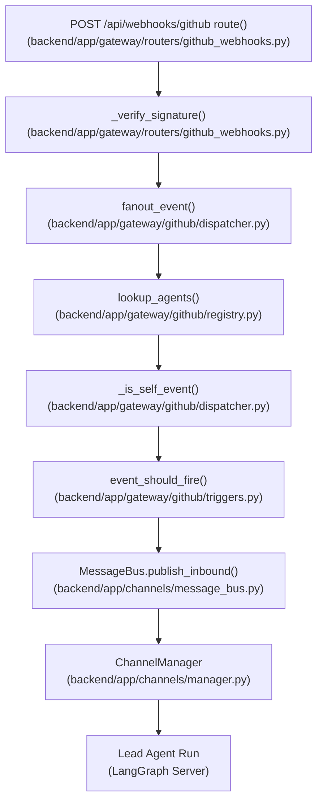
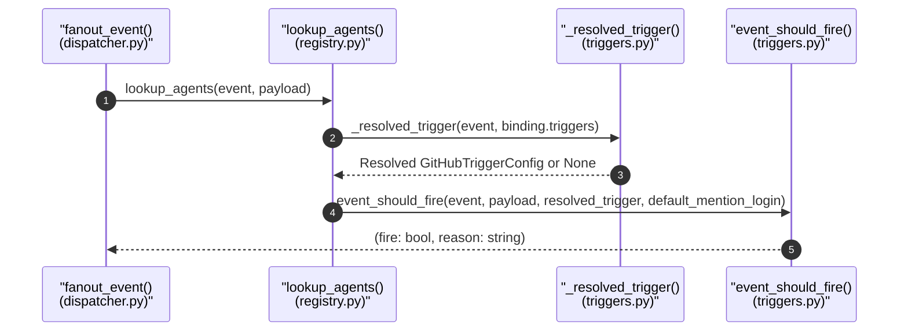
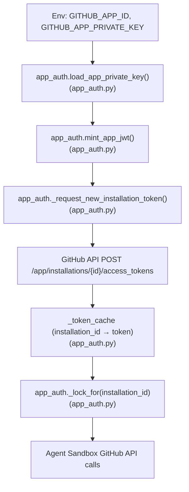

<!-- source: DeepWiki mcp.deepwiki.com · repo bytedance/deer-flow · page 8.3 GitHub Event-Driven Agents · fetched 2026-10-29 -->

# GitHub Event-Driven Agents

<details>
<summary>Relevant source files</summary>

The following files were used as context for generating this wiki page:

- [backend/app/channels/AGENTS.md](backend/app/channels/AGENTS.md)
- [backend/app/channels/base.py](backend/app/channels/base.py)
- [backend/app/channels/dingtalk.py](backend/app/channels/dingtalk.py)
- [backend/app/channels/feishu.py](backend/app/channels/feishu.py)
- [backend/app/channels/manager.py](backend/app/channels/manager.py)
- [backend/app/channels/service.py](backend/app/channels/service.py)
- [backend/app/channels/slack.py](backend/app/channels/slack.py)
- [backend/app/channels/telegram.py](backend/app/channels/telegram.py)
- [backend/app/gateway/routers/agents.py](backend/app/gateway/routers/agents.py)
- [backend/docs/IM_CHANNEL_CONNECTIONS.md](backend/docs/IM_CHANNEL_CONNECTIONS.md)
- [backend/packages/harness/deerflow/agents/memory/backends/deermem/deermem/core/paths.py](backend/packages/harness/deerflow/agents/memory/backends/deermem/deermem/core/paths.py)
- [backend/packages/harness/deerflow/config/agents_config.py](backend/packages/harness/deerflow/config/agents_config.py)
- [backend/packages/harness/deerflow/persistence/agents/__init__.py](backend/packages/harness/deerflow/persistence/agents/__init__.py)
- [backend/packages/harness/deerflow/tools/builtins/setup_agent_tool.py](backend/packages/harness/deerflow/tools/builtins/setup_agent_tool.py)
- [backend/packages/harness/deerflow/tools/builtins/update_agent_tool.py](backend/packages/harness/deerflow/tools/builtins/update_agent_tool.py)
- [backend/tests/blocking_io/test_agents_router.py](backend/tests/blocking_io/test_agents_router.py)
- [backend/tests/blocking_io/test_channel_stop_offloop.py](backend/tests/blocking_io/test_channel_stop_offloop.py)
- [backend/tests/test_agent_storage_backend.py](backend/tests/test_agent_storage_backend.py)
- [backend/tests/test_agents_router_write_drain.py](backend/tests/test_agents_router_write_drain.py)
- [backend/tests/test_channel_service_start_stop_shutdown_generation_fence.py](backend/tests/test_channel_service_start_stop_shutdown_generation_fence.py)
- [backend/tests/test_channels.py](backend/tests/test_channels.py)
- [backend/tests/test_custom_agent.py](backend/tests/test_custom_agent.py)
- [backend/tests/test_dingtalk_channel.py](backend/tests/test_dingtalk_channel.py)
- [backend/tests/test_feishu_parser.py](backend/tests/test_feishu_parser.py)
- [backend/tests/test_setup_agent_tool.py](backend/tests/test_setup_agent_tool.py)
- [backend/tests/test_slack_channel_connections.py](backend/tests/test_slack_channel_connections.py)
- [backend/tests/test_slack_channel_lifecycle.py](backend/tests/test_slack_channel_lifecycle.py)
- [backend/tests/test_slack_file_share.py](backend/tests/test_slack_file_share.py)
- [backend/tests/test_telegram_channel_connections.py](backend/tests/test_telegram_channel_connections.py)
- [backend/tests/test_telegram_message_length.py](backend/tests/test_telegram_message_length.py)
- [backend/tests/test_update_agent_tool.py](backend/tests/test_update_agent_tool.py)

</details>


## Purpose and Scope
This page details DeerFlow’s GitHub event-driven integration, enabling custom agents to handle asynchronous GitHub webhook events such as `pull_request` creation, `issue_comment`s, and `pull_request_review`s. The system comprises a webhook channel receiver, a dispatching framework with event trigger filtering, HMAC verification, per-agent repository bindings, dynamic prompt generation from event payloads, GitHub App token lifecycle management, and deterministic thread ID computation for consistent conversational threads.

The design establishes a push-based event pipeline where verified webhook requests are dispatched as messages to DeerFlow’s messaging infrastructure, activating lead agents that autonomously process each event in sandboxed environments.

Sources:  
`backend/app/channels/github.py` [42-115](),  
`backend/app/gateway/github/dispatcher.py` [1-490](),  
`backend/app/gateway/routers/github_webhooks.py` [1-169]()

---

## Architecture Overview and Event Dispatch
Upon receiving a GitHub webhook POST at `/api/webhooks/github` in `backend/app/gateway/routers/github_webhooks.py`, the system performs these key steps:

- **HMAC Signature Verification**: The route verifies the GitHub HMAC-SHA256 signature in `X-Hub-Signature-256` against the configured secret via `_verify_signature` in `backend/app/gateway/routers/github_webhooks.py`.
- **Agent Registry Lookup**: The dispatcher queries the agent registry via `lookup_agents()` in `backend/app/gateway/github/registry.py` for agents bound to the repository and event type.
- **Self-Event Detection**: Events generated by the agent’s own bot identity are detected via `_is_self_event()` in `backend/app/gateway/github/dispatcher.py` to prevent triggering loops.
- **Trigger Evaluation**: Each binding’s event triggers are resolved and evaluated via `event_should_fire()` in `backend/app/gateway/github/triggers.py` to decide if the event should activate the agent.
- **InboundMessage Publication**: Qualified events are converted to `InboundMessage` instances and published to the `MessageBus` in `backend/app/channels/message_bus.py` for downstream processing by the appropriate lead agent via `ChannelManager`.



Sources:  
`backend/app/gateway/routers/github_webhooks.py` [1-169](),  
`backend/app/gateway/github/dispatcher.py` [20-115](),  
`backend/app/gateway/github/registry.py` [1-138](),  
`backend/app/gateway/github/triggers.py` [1-129](),  
`backend/app/channels/message_bus.py` [30-100]()

---

## GitHub Webhook Channel Implementation
The `GitHubChannel` class (from `backend/app/channels/github.py`) implements the channel interface for inbound GitHub webhook events. Since GitHub delivers events via HTTP webhook POSTs rather than persistent connections or sockets, the channel operates as follows:

- Its `start()` method subscribes the channel to outbound messages on the shared `MessageBus`.
- The `stop()` method unsubscribes correspondingly.
- The `send()` method is a no-op (log-only) because DeerFlow agents perform all GitHub-side interactions (comments, reviews, labels) internally through sandboxed GitHub CLI invocations during runs, avoiding multiple redundant webhook replies.

Important `channels.github` config keys:

| Key                  | Description                                | Default                  |
|----------------------|--------------------------------------------|--------------------------|
| `enabled`            | Enable/disable the GitHub channel           | `false`                  |
| `default_mention_login` | Default bot username for mention checks   | `"deerflow-bot"`          |

Sources:  
`backend/app/channels/github.py` [42-115]()

---

## Event Triggers and Binding Resolution
Agent configuration files declare GitHub `bindings` which map GitHub repositories to one or more event triggers enabling fine-grained event activation control.

A single binding looks like:

```yaml
github:
  bindings:
    - repo: "owner/repo"
      mention_login: botuser
      triggers:
        pull_request:
          enabled: true
        issue_comment:
          enabled: false
```

### Trigger Resolution Flow
1. The dispatcher queries agents matching the incoming `(repo, event)` via `lookup_agents()` in `backend/app/gateway/github/registry.py`.
2. For each binding, the function `_resolved_trigger` in `backend/app/gateway/github/triggers.py` merges explicit trigger fields with defaults from `DEFAULT_TRIGGERS`.
3. `event_should_fire` in `backend/app/gateway/github/triggers.py` evaluates the merged trigger against event payload contextual data, returning `(fire: bool, reason: str)` for logging and dispatch.



Sources:  
`backend/app/gateway/github/triggers.py` [1-129](),  
`backend/app/gateway/github/dispatcher.py` [250-320](),  
`backend/app/gateway/github/registry.py` [50-120]()

---

## Bot-Loop Prevention by Self-Event Detection
To prevent infinite loops where an agent reacts to its own GitHub bot posts, `_is_self_event` in `backend/app/gateway/github/dispatcher.py` detects whether the webhook sender identity matches the agent's bot accounts. It uses priorities to build the bot login set for an agent:

- Explicit `github.bot_login` configured on the agent.
- All `mention_login`s associated with the agent's bindings.
- The directory name of the agent as a fallback.

The comparison strips trailing `[bot]` suffixes from the event sender login, comparing case-insensitively. If a sender matches any bot login identity, the event is ignored for that agent.

Sources:  
`backend/app/gateway/github/dispatcher.py` [41-101]()

---

## Prompt Generation from GitHub Payloads
The `build_prompt` function in `backend/app/gateway/github/prompts.py` converts JSON GitHub webhook payloads into a human-readable, structured user message passed as the `role: user` prompt input to the agent’s LangGraph run. Event-specific formatting functions extract salient entities:

- **pull_request**: Shows PR number, title, author, URL, and description snippet.
- **issue_comment**: Includes issue and comment context with author and links.
- **pull_request_review_comment**: Contains diff hunks, file paths, line numbers.
- **pull_request_review**: Summarizes review state and instructs agent to fetch inline comments via `gh` CLI.

Sources:  
`backend/app/gateway/github/prompts.py` [1-125]()

---

## GitHub App Token Lifecycle and Authentication
GitHub REST API calls that agents perform require installation access tokens tied to the specific installation of the GitHub App in the target repository. Managed via `backend/app/gateway/github/app_auth.py`:

- **App JWT Minting** (`mint_app_jwt()`): Generates a short-lived JWT signed with the GitHub App’s RSA private key.
- **Installation Token Minting** (`_request_new_installation_token()`): Calls GitHub API `POST /app/installations/{id}/access_tokens`.
- **Caching and Concurrency Control**: Cached in `_token_cache` with expiry timestamps refreshed 5 minutes before expiration, utilizing per-installation locks.



Sources:  
`backend/app/gateway/github/app_auth.py` [1-185](),  
`backend/app/channels/github.py` [70-115]()

---

## Deterministic Thread ID Generation for GitHub Events
DeerFlow generates deterministic Thread IDs per GitHub event based on repository full name, issue or pull request number, and event type in `backend/app/gateway/github/identity.py`, ensuring multi-turn dialog continuity.

The `get_github_thread_id` function in `backend/app/gateway/github/identity.py` constructs a unique thread ID using the format `github:{repo_full_name}:{event_type}:{identifier}`. For example, a pull request event might generate `github:owner/repo:pull_request:123`. This deterministic approach ensures that subsequent events related to the same GitHub entity (e.g., new comments on the same pull request) are routed to the same DeerFlow thread, maintaining conversational context.

Sources:  
`backend/app/gateway/github/identity.py` (general references),  
`backend/app/gateway/github/dispatcher.py` (message metadata preparation)

---

## Summary Table of Key GitHub Module Responsibilities

| Module/Component                            | Responsibility                                     | Key Classes/Functions                            |
|--------------------------------------------|---------------------------------------------------|-------------------------------------------------|
| `app.channels.github`                      | GitHub channel implementation, inbound ingestion, outbound logging (log-only) | `GitHubChannel`                                  |
| `app.gateway.github.dispatcher`            | Webhook event fan-out to matching agents, self-event filtering, inbound message publication | `fanout_event()`, `_is_self_event()`            |
| `app.gateway.github.triggers`               | Event trigger filtering, mention detection, event configuration merging | `event_should_fire()`, `_resolved_trigger()`    |
| `app.gateway.github.prompts`                 | GitHub webhook JSON → human-readable agent prompts | `build_prompt()`, per-event prompt templates    |
| `app.gateway.github.registry`                | Scan and index GitHub agents bindings by (repo, event) | `build_github_agent_registry()`, `lookup_agents()` |
| `app.gateway.github.app_auth`                 | GitHub App JWT and installation access token minting, caching, concurrency locks | `mint_app_jwt()`, `_request_new_installation_token()` |
| `app.gateway.github.identity`              | Deterministic thread ID generation for GitHub events | `get_github_thread_id()`                         |
| `app.channels.message_bus`                     | Messaging bus for inbound/outbound messages and channel routing | `MessageBus`, `InboundMessage`, `OutboundMessage` |

Sources: All above-cited files collectively

---

