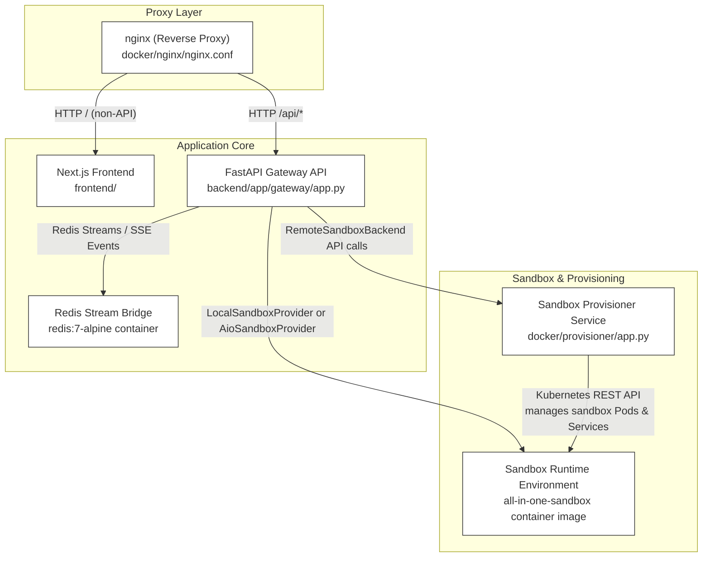
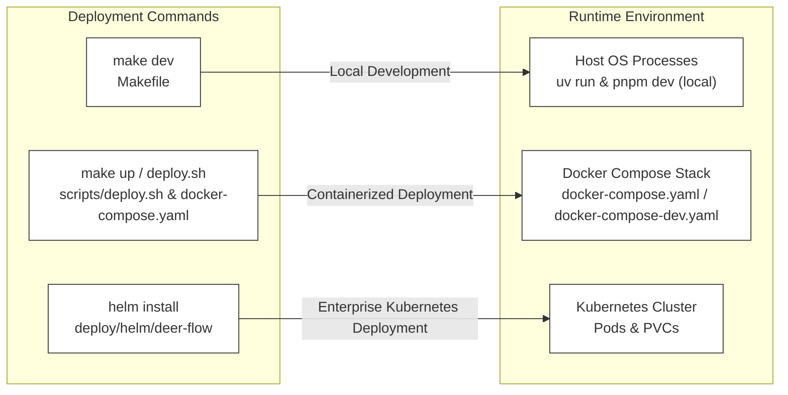

<!-- source: DeepWiki mcp.deepwiki.com · repo bytedance/deer-flow · page 9 Deployment · fetched 2026-10-29 -->

# Deployment

Relevant source files

The following files were used as context for generating this wiki page:

- [.github/workflows/chart.yaml](.github/workflows/chart.yaml)
- [.github/workflows/container.yaml](.github/workflows/container.yaml)
- [.github/workflows/nightly.yaml](.github/workflows/nightly.yaml)
- [.github/workflows/verify-versions.yml](.github/workflows/verify-versions.yml)
- [CONTRIBUTING.md](CONTRIBUTING.md)
- [Makefile](Makefile)
- [RELEASING.md](RELEASING.md)
- [backend/Dockerfile](backend/Dockerfile)
- [backend/tests/test_bump_version_lockfile_sync.py](backend/tests/test_bump_version_lockfile_sync.py)
- [backend/tests/test_docker_sandbox_mode_detection.py](backend/tests/test_docker_sandbox_mode_detection.py)
- [backend/tests/test_gateway_sigterm_delivery.py](backend/tests/test_gateway_sigterm_delivery.py)
- [backend/tests/test_gateway_startup.py](backend/tests/test_gateway_startup.py)
- [backend/tests/test_verify_versions_lockfile.py](backend/tests/test_verify_versions_lockfile.py)
- [docker/docker-compose-dev.yaml](docker/docker-compose-dev.yaml)
- [docker/docker-compose.yaml](docker/docker-compose.yaml)
- [frontend/Dockerfile](frontend/Dockerfile)
- [frontend/src/version.ts](frontend/src/version.ts)
- [frontend/tests/unit/components/workspace/settings/about-content.test.ts](frontend/tests/unit/components/workspace/settings/about-content.test.ts)
- [frontend/tests/unit/version.test.ts](frontend/tests/unit/version.test.ts)
- [scripts/check_config_version.sh](scripts/check_config_version.sh)
- [scripts/deploy.sh](scripts/deploy.sh)
- [scripts/docker.sh](scripts/docker.sh)
- [scripts/sandbox-mode.sh](scripts/sandbox-mode.sh)
- [scripts/verify_versions.sh](scripts/verify_versions.sh)

This page serves as the parent guide for deploying DeerFlow across various environments, ranging from local development workstations to containerized Docker stacks and enterprise-scale Kubernetes clusters. DeerFlow is architected as a multi-service system involving a Next.js frontend, a FastAPI Gateway API backend (`backend/app/gateway/app.py`), an optional Redis stream bridge [docker/docker-compose.yaml:35-48](), and isolated execution sandboxes [docker/docker-compose.yaml:27-107]().

As a parent page, this document provides a high-level overview of the main deployment methods available, linking to child pages for exhaustive technical configurations, step-by-step instructions, and troubleshooting guidance:

- **[Local Development Setup](#9.1)** — Step-by-step instructions to run DeerFlow services locally on your machine using `Makefile` targets, including dependency installation and hot-reloading development server commands [Makefile:45-48]().
- **[Docker Deployment](#9.2)** — Docker Compose orchestration of services via `docker/docker-compose.yaml` and `docker/docker-compose-dev.yaml`, managing nginx reverse proxy, container configurations [backend/Dockerfile:1-127](), [frontend/Dockerfile](), environment variable setup, and developer-friendly hot reloading [docker/docker-compose.yaml:27-143](), [docker/docker-compose-dev.yaml:1-155]().
- **[Kubernetes Sandbox Provisioner](#9.3)** — Deploying the sandbox provisioner service (`docker/provisioner/app.py`) in Kubernetes, which dynamically creates and destroys sandbox Pods via the K8s API, secured and configured for sandbox isolation [docker/docker-compose-dev.yaml:59-118]().
- **[Helm Chart Deployment](#9.4)** — Using the official Helm chart (`deploy/helm/deer-flow`) to deploy DeerFlow on Kubernetes clusters with persistent volumes, RBAC, ingress, and multi-replica considerations.

Sources: [docker/docker-compose.yaml:27-107](), [Makefile:45-48](), [docker/docker-compose-dev.yaml:59-118](), [backend/Dockerfile:1-127]()

---

## Service Deployment Architecture

The diagram below illustrates the core service components of DeerFlow and maps them to specific code entities, container images, and configuration files. This bridges conceptual system components to code entities for easier understanding and searchability in the codebase.

### Service Topology and Code Entity Mapping

Sources: [docker/docker-compose.yaml:35-143](), [docker/docker-compose-dev.yaml:40-118](), [backend/app/gateway/app.py]()

---

## 9.1 Local Development Setup

Local development mode enables running DeerFlow services natively on your development machine without Docker. This mode is useful for developers who want fine-grained debugging and direct code iteration.

Core points:

- The backend uses Python `uv` with `uvicorn` to run the FastAPI Gateway API (`backend/app/gateway/app.py`) and LangGraph runtime with live reload support [Makefile:6-7]().
- The frontend uses `pnpm` [Makefile:22]() (`scripts/pnpm.py`) to install dependencies and runs the Next.js development server with hot reloading.
- Nginx can be run separately as a reverse proxy during development [Makefile:49]().
- Necessary dependencies like Node.js (v22+), Python, `uv`, `pnpm`, and nginx must be installed on the host system [CONTRIBUTING.md:186-191]().
- Makefile targets facilitate development commands such as:
  - `make install` — installs backend (`uv sync --locked`) and frontend dependencies and pre-commit hooks [Makefile:97-105]().
  - `make dev` — launches the backend API and related services with hot reload enabled [Makefile:45]().

This mode offers developers maximum control and immediacy at the tradeoff of manual dependency management and environment setup.

For complete instructions, installation prerequisites, and recommended workflows, see [Local Development Setup](#9.1).

Sources: [Makefile:6-49](), [Makefile:97-105](), [CONTRIBUTING.md:186-191]()

---

## 9.2 Docker Deployment

Docker deployment encapsulates DeerFlow in containerized microservices orchestrated by Docker Compose [docker/docker-compose.yaml](), [docker/docker-compose-dev.yaml](). This approach isolates dependencies and provides a consistent runnable environment across machines and teams.

Key facts:

- Two main deployment Compose files exist:
  - `docker/docker-compose.yaml` for **production-oriented** settings via `scripts/deploy.sh` [docker/docker-compose.yaml:1-32](), [scripts/deploy.sh:1-51]().
  - `docker/docker-compose-dev.yaml` for a **development environment** via `scripts/docker.sh` (`make docker-start`) [docker/docker-compose-dev.yaml:1-37](), [scripts/docker.sh:1-25]().
- Core services:
  - **nginx:** Reverse proxy on port 2026, routing requests between frontend and API services [docker/docker-compose.yaml:51-84]().
  - **frontend:** Next.js app container (`frontend/Dockerfile`) running development or production servers [docker/docker-compose.yaml:86-105]().
  - **gateway:** FastAPI server (`backend/Dockerfile`) for backend API, agent runtime, and LangGraph server [docker/docker-compose.yaml:106-137]().
  - **redis:** Redis (`redis:7-alpine`) for the stream bridge backend used for event distribution among workers [docker/docker-compose.yaml:34-48]().
  - **provisioner:** Optional service for Kubernetes sandbox provisioning (`docker/provisioner/Dockerfile`) [docker/docker-compose-dev.yaml:59-118]().
- Service configurations use environment variable injection via `.env` files (`.env.example`) and deployment scripts to manage runtime options [docker/docker-compose.yaml:99-101](), [scripts/deploy.sh:45-50]().
- Volumes mount user configuration (`config.yaml`), skills (`/app/skills`), and runtime data (`DEER_FLOW_HOME`) enabling persistence [docker/docker-compose.yaml:138-146]().
- Makefile targets available:
  - `make docker-init` to pre-pull sandbox images [Makefile:59]().
  - `make docker-start` to launch the full dev Docker stack [Makefile:60]().
  - `make up` and `make down` for production Docker container management [Makefile:54-56]().

Docker deployment is highly recommended for most development workflows and review environments due to simplicity and replicability over manual local installs [CONTRIBUTING.md:9-12]().

For extensive usage notes and configuration details, see [Docker Deployment](#9.2).

Sources: [docker/docker-compose.yaml:1-146](), [docker/docker-compose-dev.yaml:1-155](), [scripts/deploy.sh:1-51](), [scripts/docker.sh:1-25]()

---

## 9.3 Kubernetes Sandbox Provisioner

For sandbox isolation in Kubernetes environments, DeerFlow includes a dedicated **sandbox provisioner** service (`docker/provisioner/app.py`) that interacts with the Kubernetes API to dynamically manage sandbox Pods and Services [docker/docker-compose-dev.yaml:59-118]().

Highlights:

- The provisioner runs as a container within the same Kubernetes cluster or via Docker Compose during dev testing [docker/docker-compose-dev.yaml:59-118]().
- It listens on port 8002 internally, exposing a REST API that backend Gateway calls to create, monitor, and destroy sandbox Pods [docker/docker-compose-dev.yaml:113]().
- Requires kubeconfig mounted inside the provisioner container (`~/.kube/config`) and namespace configuration (`K8S_NAMESPACE=deer-flow`) [docker/docker-compose-dev.yaml:66-69]().
- Environment variables specify sandbox container images (`SANDBOX_IMAGE`) and optional specialized runtime containers [docker/docker-compose-dev.yaml:70-74]().
- Communication between Gateway and provisioner uses API keys (`PROVISIONER_API_KEY`) for authentication [docker/docker-compose-dev.yaml:101-103]().
- Running the provisioner is optional and only enabled when sandbox mode is configured to use it, otherwise local or AIO sandbox modes are used [scripts/docker.sh:182-186]().
- Provisioner manages host-path volumes or can be configured to use PVCs (`USERDATA_PVC_NAME`, `SKILLS_PVC_NAME`) for production persistence [docker/docker-compose-dev.yaml:78-95]().

This approach supports scalable, secure sandbox management on Kubernetes deployments, with strong isolation and flexible resource allocation.

For detailed API usage, configuration, and deployment, see [Kubernetes Sandbox Provisioner](#9.3).

Sources: [docker/docker-compose-dev.yaml:59-118](), [scripts/docker.sh:182-186]()

---

## 9.4 Helm Chart Deployment

For robust production deployments on Kubernetes clusters, DeerFlow publishes an official Helm chart under `deploy/helm/deer-flow` that provides templated Kubernetes manifests and configuration manifests.

Features include:

- Deployments of the Gateway backend API, frontend Next.js server, and optionally Redis.
- The backend container image is built with the `postgres` extra to support PostgreSQL for multi-replica deployments [backend/Dockerfile:19-20](), [.github/workflows/container.yaml:55-58]().
- Support for persistent volumes with PVCs for thread state and user skill data.
- Fine-grained RBAC roles and service account configurations following security best practices.
- Security context enforcement to run containers with minimal privileges.
- Ingress resources for TLS-enabled external access.
- Configurable via `values.yaml` for adapting environment variables, resource requests, replica counts, and sandbox modes.
- Important notes on multi-replica Gateway instances requiring Redis stream bridge (`DEER_FLOW_STREAM_BRIDGE_REDIS_URL`) to correctly synchronize event streams.
- Integration with external PostgreSQL or Redis instances if preferred.
- Caveats for multi-replica service operation and sandbox persistence.

This Helm chart offers a production-ready path for deploying DeerFlow with K8s-native patterns and infrastructure.

Refer to [Helm Chart Deployment](#9.4) for full details on usage, configuration options, and architecture.

Sources: [.github/workflows/container.yaml:55-58](), [backend/Dockerfile:19-20]()

---

### Deployment Command Flow and Runtime Environment

The following diagram outlines the relationship between the main deployment commands or tools and the resulting runtime environments, mapping execution entrypoints to process, container, and cluster-level targets.

Sources: [Makefile:45-48](), [scripts/deploy.sh:1-51](), [docker/docker-compose.yaml:1-32]()

---

This overview page provides a high-level framework and pointers to detailed deployment instructions suitable for different environments and use cases. For best practices, configuration nuances, and troubleshooting, please consult the corresponding child pages listed at the top.

---

