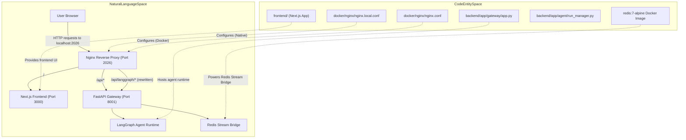
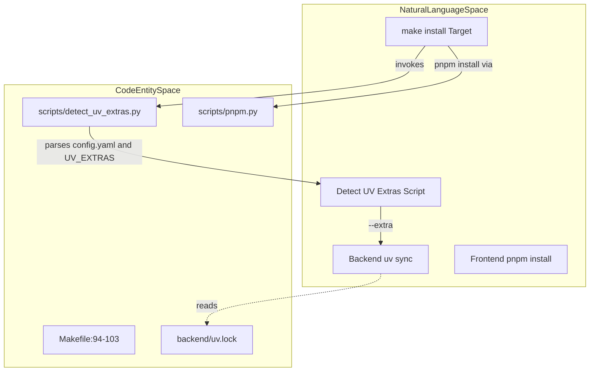

<!-- source: DeepWiki mcp.deepwiki.com · repo bytedance/deer-flow · page 9.1 Local Development Setup · fetched 2026-10-29 -->

# Local Development Setup

<details>
<summary>Relevant source files</summary>

The following files were used as context for generating this wiki page:

- [backend/.gitignore](backend/.gitignore)
- [backend/tests/support/nginx_conf.py](backend/tests/support/nginx_conf.py)
- [backend/tests/support/shell.py](backend/tests/support/shell.py)
- [backend/tests/test_check_script.py](backend/tests/test_check_script.py)
- [backend/tests/test_deploy_uv_extras.py](backend/tests/test_deploy_uv_extras.py)
- [backend/tests/test_detect_uv_extras.py](backend/tests/test_detect_uv_extras.py)
- [backend/tests/test_dev_entrypoint.py](backend/tests/test_dev_entrypoint.py)
- [backend/tests/test_gateway_runtime_cleanup.py](backend/tests/test_gateway_runtime_cleanup.py)
- [backend/tests/test_local_dev_loopback_bind.py](backend/tests/test_local_dev_loopback_bind.py)
- [backend/tests/test_make_install.py](backend/tests/test_make_install.py)
- [backend/tests/test_nginx_langgraph_body_size.py](backend/tests/test_nginx_langgraph_body_size.py)
- [backend/tests/test_nginx_loopback_canonical.py](backend/tests/test_nginx_loopback_canonical.py)
- [backend/tests/test_nginx_project_documents_body_size.py](backend/tests/test_nginx_project_documents_body_size.py)
- [backend/tests/test_pnpm_script.py](backend/tests/test_pnpm_script.py)
- [backend/tests/test_serve_pick_python.py](backend/tests/test_serve_pick_python.py)
- [backend/tests/test_support_shell.py](backend/tests/test_support_shell.py)
- [backend/tests/test_uvicorn_reload_exclude.py](backend/tests/test_uvicorn_reload_exclude.py)
- [deploy/helm/deer-flow/templates/configmap-nginx.yaml](deploy/helm/deer-flow/templates/configmap-nginx.yaml)
- [docker/dev-entrypoint.sh](docker/dev-entrypoint.sh)
- [docker/nginx/nginx.conf](docker/nginx/nginx.conf)
- [docker/nginx/nginx.local.conf](docker/nginx/nginx.local.conf)
- [scripts/check.py](scripts/check.py)
- [scripts/detect_uv_extras.py](scripts/detect_uv_extras.py)
- [scripts/nginx-local-conf.sh](scripts/nginx-local-conf.sh)
- [scripts/pnpm.py](scripts/pnpm.py)
- [scripts/serve.sh](scripts/serve.sh)

</details>


## Purpose and Scope

This page provides a comprehensive technical guide for setting up DeerFlow for local development. It details prerequisites, configuration management, automated dependency installation via `scripts/detect_uv_extras.py`, and service orchestration via `scripts/serve.sh` and Docker Compose.

Sources: [scripts/serve.sh:1-60](), [scripts/detect_uv_extras.py:1-40]()

---

## 1. Overview & Architecture

Local development supports two primary execution modes for running DeerFlow services:

- **Native Host Processes**: `make dev` runs the FastAPI Gateway backend and Next.js frontend with hot reload, orchestrated via `scripts/serve.sh`.
- **Docker Compose Containers**: `make docker-start` boots a containerized stack mimicking production with live code and configuration bind mounts.

### Service Topology & Code Entity Mapping

Title: "Development Service Topology and Code Entities"


The Nginx configuration for local development (`docker/nginx/nginx.local.conf`) and Docker deployments (`docker/nginx/nginx.conf`) handles routing. Specifically, it rewrites `/api/langgraph/*` requests to `/api/*` before proxying them to the Gateway API [docker/nginx/nginx.local.conf:97-98](), [docker/nginx/nginx.conf:107-108](). This ensures compatibility with LangGraph-style API calls while directing them to the unified Gateway.

Sources: [docker/docker-compose-dev.yaml:1-155](), [docker/nginx/nginx.local.conf:1-113](), [scripts/serve.sh:1-60](), [docker/nginx/nginx.conf:1-169]()

---

## 2. Prerequisites and Tool Validation

Before starting local development, verify system requirements using `make check`, which delegates to `scripts/check.py` [scripts/check.py:1-50]().

| Tool    | Minimum Version | Purpose                              | Source                           |
|---------|-----------------|------------------------------------|---------------------------------|
| Python  | 3.12+           | Backend runtime and scripting       | [scripts/check.py:42-58]()   |
| Node.js | 22+             | Frontend runtime                    | [scripts/check.py:98-122]()   |
| pnpm    | Latest          | Frontend package manager            | [scripts/check.py:125-135]() |
| uv      | Latest          | Python virtual environment & sync  | [scripts/check.py:138-154]()             |
| nginx   | Latest          | Reverse proxy for local dev routing | [scripts/check.py:157-171]() |

Run validation via:
```bash
make check
```

The `check.py` script dynamically determines the Python version, Node.js version (requiring 22+), pnpm availability, uv availability, and nginx availability. If any dependency is missing or below the required version, it provides actionable error messages and installation hints [scripts/check.py:98-171]().

Sources: [Makefile:86-90](), [scripts/check.py:1-197]()

---

## 3. Configuration System & Setup Wizard

DeerFlow expects core configuration files in the root directory: `config.yaml`, `extensions_config.json`, and `.env` [backend/tests/test_gateway_runtime_cleanup.py:76-84]().

- **Interactive Setup Wizard**: `make setup` runs `scripts/setup_wizard.py` and `scripts/wizard/providers.py` to configure LLM providers, search tools, and sandbox backends interactively [scripts/wizard/providers.py:1-50]().
- **Config Generation**: `make config` executes `scripts/configure.py`.
- **Config Upgrade**: `make config-upgrade` runs `scripts/config-upgrade.sh` to merge new fields from templates without overwriting custom parameters.

Sources: [scripts/wizard/providers.py:1-50](), [Makefile:65-85]()

---

## 4. Dependency Installation & Extra Detection

To install all backend Python dependencies, frontend Node.js packages, and pre-commit hooks, execute:
```bash
make install
```

Python optional dependencies ("extras") are dynamically resolved by `scripts/detect_uv_extras.py`, which inspects `config.yaml` and environment variables (`UV_EXTRAS`) to pass appropriate `--extra <name>` flags into `uv sync` [scripts/detect_uv_extras.py:1-40](). The script validates extra names against a regex `^[A-Za-z][A-Za-z0-9_-]*$` to prevent shell injection [scripts/detect_uv_extras.py:45-58]().

### Installation and Extra Detection Flow

Title: "Dependency Installation and UV Extras Resolution Flow"


The `detect_uv_extras.py` script identifies required extras based on configuration settings such as `database.backend` (e.g., `postgres`), `checkpointer.type` (e.g., `postgres`), `stream_bridge.type` (e.g., `redis`), `tools[].name` (e.g., `browser_navigate` for `browser` extra), `sandbox.ownership.type` (e.g., `redis`), `channels.<channel>.enabled` (e.g., `discord`, `buzz`), and `models[].use` (e.g., `langchain_ollama` for `ollama` extra) [scripts/detect_uv_extras.py:10-22](). It also considers environment variables like `DEER_FLOW_STREAM_BRIDGE_REDIS_URL` and `DEER_FLOW_SANDBOX_OWNERSHIP_REDIS_URL` [scripts/detect_uv_extras.py:23-24]().

Sources: [Makefile:94-103](), [scripts/detect_uv_extras.py:1-65](), [scripts/pnpm.py:1-50](), [backend/tests/test_detect_uv_extras.py:148-172]()

---

## 5. Service Orchestration & Launch

### Native Host Development Mode

Launch native services with hot-reload enabled via `scripts/serve.sh`:
```bash
make dev
```

This target invokes `scripts/serve.sh --dev`, which configures `DEER_FLOW_HOME`, `DEER_FLOW_PROJECT_ROOT`, and launches Uvicorn with reload excludes defined in `backend/Makefile` [scripts/serve.sh:1-60](), [backend/tests/test_gateway_runtime_cleanup.py:86-114](). The Gateway (`backend/app/gateway/app.py`) and Frontend (`frontend/`) are configured to bind to the loopback interface (`127.0.0.1`) by default, ensuring local accessibility [backend/tests/test_local_dev_loopback_bind.py:43-52](), [backend/tests/test_local_dev_loopback_bind.py:55-66](). Nginx also listens on loopback unless `BIND_HOST` is explicitly set [backend/tests/test_local_dev_loopback_bind.py:69-70]().

Key reload exclusion configuration tested in [backend/tests/test_gateway_runtime_cleanup.py:86-114]():
```python
--reload-exclude='$DEER_FLOW_HOME'
--reload-exclude='$BACKEND_RUNTIME_HOME'
```
These exclusions prevent Uvicorn from reloading when files within the runtime directories (`.deer-flow` and `sandbox`) change, which is crucial for stability during development [backend/tests/test_gateway_runtime_cleanup.py:92-93]().

### Docker Compose Development Mode

Run services containerized with live code reload:
```bash
make docker-start
```

This invokes `scripts/docker.sh`, starting containers defined in `docker/docker-compose-dev.yaml` with mutable configuration bind mounts [backend/tests/test_gateway_runtime_cleanup.py:76-84](). The Docker Compose setup ensures that `config.yaml` and `extensions_config.json` are mounted into the `/app/project` directory within the containers, allowing for live configuration changes [backend/tests/test_gateway_runtime_cleanup.py:76-84]().

Sources: [scripts/serve.sh:1-180](), [backend/tests/test_gateway_runtime_cleanup.py:59-114](), [docker/docker-compose-dev.yaml:1-155](), [backend/tests/test_local_dev_loopback_bind.py:43-70]()

---

## 6. Process Management and Cleanup

- **Stop native services**: `make stop` executes `scripts/serve.sh --stop`, which inspects PIDs on ports `8001`, `3000`, and `2026` across DeerFlow worktrees (`DEERFLOW_ROOTS`) and terminates them safely [scripts/serve.sh:88-180](). The `_is_deerflow_pid` function identifies processes belonging to a DeerFlow worktree by checking open files or current working directories [scripts/serve.sh:108-128](). It also reports if ports are being reclaimed from other worktrees [scripts/serve.sh:130-148]().
- **Stop Docker containers**: `make docker-stop` removes container instances [Makefile:110-120]().
- **Clean runtime caches**: `make clean` clears temporary runtime state, including the `.deer-flow` directory and the `sandbox` directory [Makefile:121-130](), [backend/.gitignore:27-31]().

Sources: [scripts/serve.sh:88-180](), [Makefile:105-135](), [backend/.gitignore:27-31]()

---

## 7. Diagnostics, Testing, and Verification

- **Health Checks**: `make doctor` runs `scripts/doctor.py` to validate environment integrity, configuration validity, and API key availability [scripts/doctor.py:1-50]().
- **Backend Testing**: Execute unit tests within the backend `uv` environment:
  ```bash
  cd backend && uv run pytest tests/test_gateway_runtime_cleanup.py -v
  ```
  The test suite includes checks for Nginx configuration, such as ensuring that `/api/langgraph/*` routes are correctly rewritten to `/api/*` and proxied to the Gateway API [backend/tests/test_gateway_runtime_cleanup.py:130-138](). It also verifies that Nginx defers CORS handling to the Gateway's allowlist [backend/tests/test_gateway_runtime_cleanup.py:141-151]().

Sources: [scripts/doctor.py:1-50](), [backend/tests/test_gateway_runtime_cleanup.py:1-60](), [backend/tests/test_gateway_runtime_cleanup.py:130-151]()

---

