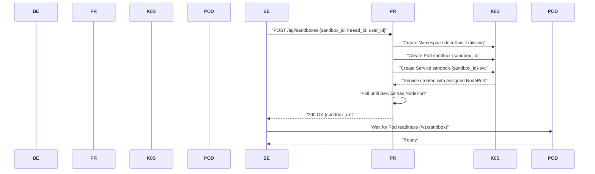
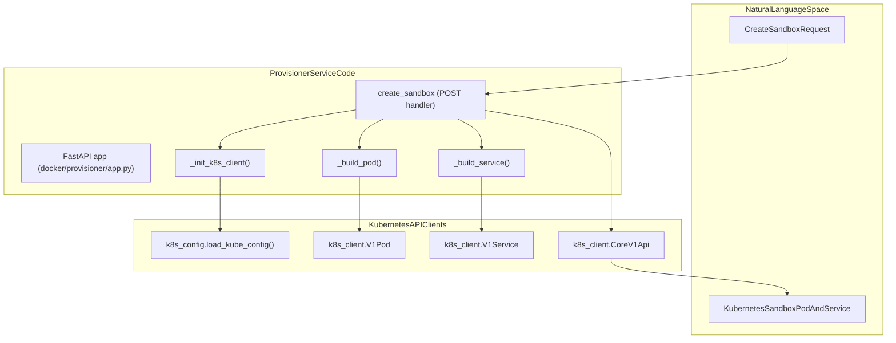
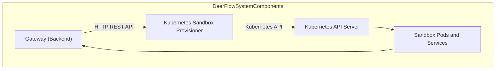

<!-- source: DeepWiki mcp.deepwiki.com · repo bytedance/deer-flow · page 9.3 Kubernetes Sandbox Provisioner · fetched 2026-10-29 -->

# Kubernetes Sandbox Provisioner

Relevant source files

The following files were used as context for generating this wiki page:

- [.github/workflows/sandbox-image-smoke.yml](.github/workflows/sandbox-image-smoke.yml)
- [backend/packages/harness/deerflow/community/aio_sandbox/aio_sandbox_provider.py](backend/packages/harness/deerflow/community/aio_sandbox/aio_sandbox_provider.py)
- [backend/packages/harness/deerflow/community/aio_sandbox/backend.py](backend/packages/harness/deerflow/community/aio_sandbox/backend.py)
- [backend/packages/harness/deerflow/community/aio_sandbox/local_backend.py](backend/packages/harness/deerflow/community/aio_sandbox/local_backend.py)
- [backend/packages/harness/deerflow/community/aio_sandbox/remote_backend.py](backend/packages/harness/deerflow/community/aio_sandbox/remote_backend.py)
- [backend/packages/harness/deerflow/config/sandbox_config.py](backend/packages/harness/deerflow/config/sandbox_config.py)
- [backend/packages/harness/deerflow/sandbox/AGENTS.md](backend/packages/harness/deerflow/sandbox/AGENTS.md)
- [backend/tests/blocking_io/test_aio_sandbox_get.py](backend/tests/blocking_io/test_aio_sandbox_get.py)
- [backend/tests/blocking_io/test_sandbox_release.py](backend/tests/blocking_io/test_sandbox_release.py)
- [backend/tests/test_aio_sandbox_local_backend.py](backend/tests/test_aio_sandbox_local_backend.py)
- [backend/tests/test_aio_sandbox_provider.py](backend/tests/test_aio_sandbox_provider.py)
- [backend/tests/test_aio_sandbox_readiness.py](backend/tests/test_aio_sandbox_readiness.py)
- [backend/tests/test_provisioner_pvc_volumes.py](backend/tests/test_provisioner_pvc_volumes.py)
- [backend/tests/test_provisioner_request_threading.py](backend/tests/test_provisioner_request_threading.py)
- [backend/tests/test_remote_sandbox_backend.py](backend/tests/test_remote_sandbox_backend.py)
- [backend/tests/test_sandbox_orphan_reconciliation.py](backend/tests/test_sandbox_orphan_reconciliation.py)
- [docker/provisioner/README.md](docker/provisioner/README.md)
- [docker/provisioner/app.py](docker/provisioner/app.py)

The **Sandbox Provisioner** is a specialized FastAPI-based microservice that dynamically manages the lifecycle of per-sandbox Kubernetes Pods and Services for DeerFlow. It provides an HTTP REST API through which the backend service (such as the Gateway or LangGraph Server) can request creation, status retrieval, listing, and deletion of isolated sandbox environments within a Kubernetes cluster. These sandboxes provide secure, resource-isolated execution contexts for running code or tools [docker/provisioner/app.py:1-28](), [docker/provisioner/README.md:1-40]().

---

## Role in the System

In the DeerFlow deployment, isolated sandboxes can either be managed locally using containers via `LocalContainerBackend` (using Docker or Apple Container) or remotely through Kubernetes-managed Pods using the Provisioner service.

- **`LocalContainerBackend`**: Manages sandbox containers on the same machine via Docker or Apple Container runtime; handles container lifecycle and networking [backend/packages/harness/deerflow/community/aio_sandbox/local_backend.py:1-201]().
- **`RemoteSandboxBackend` (Provisioner Client)**: Communicates over HTTP with the Kubernetes Sandbox Provisioner service, which actually creates and manages sandbox resources in K8s [backend/packages/harness/deerflow/community/aio_sandbox/remote_backend.py:1-170](). This setup is configured via the `provisioner_url` in `config.yaml` and the corresponding API key [backend/packages/harness/deerflow/community/aio_sandbox/remote_backend.py:131-170]().

The Provisioner service allows Kubernetes sandbox management to be offloaded from the backend, enabling dynamic, multi-tenant sandbox creation in a hosted Kubernetes environment.

Sources: [backend/packages/harness/deerflow/community/aio_sandbox/local_backend.py:1-201](), [backend/packages/harness/deerflow/community/aio_sandbox/remote_backend.py:1-170](), [docker/provisioner/README.md:1-40]()

---

## Architecture and Request Flow

The Provisioner runs as a standalone HTTP service, typically listening on port `8002`, inside the Kubernetes cluster or alongside it. It authenticates requests optionally via an API key and manages Kubernetes resources via the official Kubernetes Python client. The service performs synchronous Kubernetes API calls wrapped in FastAPI sync handlers, which are offloaded to worker threads to avoid blocking the ASGI event loop [docker/provisioner/app.py:42-55](), [docker/provisioner/README.md:40-45]().

### Sandbox Creation Sequence

The following sequence diagram illustrates key interactions when provisioning a sandbox Pod and Service:

Sources: [docker/provisioner/app.py:7-28](), [docker/provisioner/README.md:21-38]()

---

### Code Entity Space Mapping: Provisioning Pipeline

This diagram bridges natural language system components to the key code symbols responsible for handling sandbox creation and management within the provisioner service.

Sources: [docker/provisioner/app.py:55-140](), [docker/provisioner/app.py:200-340]()

---

## Provisioner Service Implementation Details

The Provisioner service is implemented with FastAPI and the Kubernetes Python client library. It manages sandbox Pods and Services in the configured Kubernetes namespace (`K8S_NAMESPACE`, defaulting to `deer-flow`).

### Configuration via Environment Variables

| Environment Variable        | Default                                                      | Description                                                                |
|----------------------------|--------------------------------------------------------------|----------------------------------------------------------------------------|
| `K8S_NAMESPACE`            | `"deer-flow"`                                                | Kubernetes namespace for sandbox Pods and Services [docker/provisioner/app.py:60]() |
| `SANDBOX_IMAGE`            | `"enterprise-public-cn-beijing.cr.volces.com/vefaas-public/all-in-one-sandbox:latest"` | Container image for sandbox Pods [docker/provisioner/app.py:61-64]()       |
| `LARK_CLI_INIT_IMAGE`      | `""`                                                         | Optional lark-cli init container image to provision the CLI runtime [docker/provisioner/app.py:65-71]() |
| `LARK_CLI_BROKER_IMAGE`    | `""`                                                         | Optional lark-cli broker sidecar image to isolate credentials [docker/provisioner/app.py:72-92]() |
| `THREADS_HOST_PATH`         | `"/.deer-flow/threads"`                                      | Host path to threads data directory (for hostPath volume mounts) [docker/provisioner/app.py:102]() |
| `DEER_FLOW_HOST_BASE_DIR`  | `"/.deer-flow"`                                              | Base directory on host for skills view [docker/provisioner/app.py:103]()    |
| `SKILLS_PVC_NAME`          | `""`                                                         | PVC name for mounting skills volume (if set) [docker/provisioner/app.py:104]() |
| `USERDATA_PVC_NAME`        | `""`                                                         | PVC name for user-data volume, supports subPath isolation [docker/provisioner/app.py:105]() |
| `SANDBOX_CONTAINER_PORT`   | `8080`                                                       | TCP port exposed by sandbox container [docker/provisioner/app.py:107-114]() |
| `SANDBOX_SERVICE_TYPE`     | `"NodePort"`                                                 | Kubernetes Service type to expose sandbox Pods (`NodePort` or `ClusterIP`) [docker/provisioner/app.py:115-117]() |
| `NODE_HOST`                | `"host.docker.internal"`                                     | Hostname/IP used by backend to contact NodePort services when outside K8s [docker/provisioner/app.py:141]() |
| `PROVISIONER_API_KEY`      | `""`                                                         | API key for authenticating client requests from backend [docker/provisioner/app.py:136]() |

Sources: [docker/provisioner/app.py:59-141](), [docker/provisioner/README.md:150-161]()

---

### Kubernetes Client Initialization

The provisioner loads Kubernetes configuration either from a mounted kubeconfig file (default: `/root/.kube/config`) or in-cluster config when running inside Kubernetes [docker/provisioner/app.py:142-144](). This client enables synchronous API calls to manage namespaces, pods, and services.

Sources: [docker/provisioner/app.py:142-144]()

---

### Pod and Service Construction

The provisioner builds detailed Kubernetes `V1Pod` and `V1Service` objects:

- **Pod Spec (`_build_pod`)** [docker/provisioner/app.py:200-308]() includes:
  - Container image (configured by `SANDBOX_IMAGE`)
  - Resource requests and limits (CPU, memory, ephemeral storage)
  - Environment variables such as `MAX_SHELL_SESSIONS`
  - Volume mounts for skills categories, integrations, and user data
  - Liveness and readiness probes targeting the `/v1/sandbox` health endpoint

- **Service Spec (`_build_service`)** [docker/provisioner/app.py:311-339]() exposes the Pod:
  - Supports `NodePort` and `ClusterIP` types
  - In `NodePort` mode, waits until a NodePort is allocated by Kubernetes,
    then constructs the sandbox URL as `http://{NODE_HOST}:{NodePort}`
  - In `ClusterIP` mode, returns an in-cluster DNS URL for the sandbox service

Sources: [docker/provisioner/app.py:200-308](), [docker/provisioner/app.py:311-339]()

---

### Sandbox URL and Status Reporting

- After Pod and Service creation, the provisioner returns a JSON response including:
  - `sandbox_id`
  - `sandbox_url`: URL to access sandbox API (depends on service type and NodePort)
  - `status`: Kubernetes Pod phase (`Pending`, `Running`, `Succeeded`, `Failed`, `Unknown`, or `NotFound`)

- The provisioner supports polling the sandbox's readiness by monitoring liveness and readiness probes and Pod phases before signaling readiness back to the Gateway.

Sources: [docker/provisioner/app.py:143-144](), [docker/provisioner/app.py:300-340](), [docker/provisioner/README.md:37-38]()

---

## Storage and Volume Management

The provisioner mounts volumes into sandbox Pods for skill code and per-thread data persistence with support for both hostPath volumes and PersistentVolumeClaims (PVCs):

| Container Mount Path            | Host Path or PVC Volume                               | Notes                                                |
|-------------------------------|------------------------------------------------------|------------------------------------------------------|
| `/mnt/skills`                  | HostPath or `SKILLS_PVC_NAME` PVC root               | Static skill categories: `public`, `custom`, `legacy`, `integrations` |
| `/mnt/user-data`               | HostPath or `USERDATA_PVC_NAME` PVC subpath          | Thread-specific writable data                         |
| Extra mounts (e.g., Lark CLI) | Selected host paths under allowed paths              | Controlled extensions of volume mounts                |

### PVC SubPath Isolation

- When `USERDATA_PVC_NAME` is specified, the provisioner mounts the PVC with a `subPath` equal to
  `deer-flow/users/{user_id}/threads/{thread_id}/user-data` to isolate user data between tenants [docker/provisioner/app.py:105]().
- If `user_id` is omitted, it defaults to `"default"` [docker/provisioner/app.py:119]().
- Skill mounts can also be pointed to PVCs or fall back to stable hostPath projections [backend/tests/test_provisioner_pvc_volumes.py:1-152]().

### HostPath Path Joining

- Provisioner includes utility to safely join Windows host paths for volume mounts, handling drive letters and backslash separators correctly [docker/provisioner/app.py:144-149]().

Sources: [docker/provisioner/app.py:102-105](), [docker/provisioner/app.py:119](), [backend/tests/test_provisioner_pvc_volumes.py:1-152]()

---

## Integration with Lark CLI Runtime Provisioning

The provisioner supports two patterns to integrate the Lark CLI tool environment securely:

- **Pattern A — Init Container Provisioning** [docker/provisioner/app.py:65-71]()
  An optional init container image `LARK_CLI_INIT_IMAGE` provisions the `lark-cli` binary into a shared emptyDir volume mounted into the sandbox container. This replaces mounting the runtime from the host.

- **Pattern B — Broker Sidecar** [docker/provisioner/app.py:72-92]()
  An optional broker image `LARK_CLI_BROKER_IMAGE` provides a shim init container and a long-running broker sidecar container that holds secrets and credentials isolated from the sandbox container. The plaintext config, locks, and data are mounted only into the broker sidecar, enhancing security. This pattern supersedes Pattern A if both are set.

These features enable secure credential management and optional runtime provisioning within sandbox Pods.

Sources: [docker/provisioner/app.py:65-92](), [backend/packages/harness/deerflow/community/aio_sandbox/remote_backend.py:35-108]()

---

## Provisioner API Endpoints

The REST API exposes the following synchronous endpoints [docker/provisioner/app.py:11-16](), [docker/provisioner/README.md:62-144]().

| Method | Path                        | Description                              | Request Body                  | Response                                                |
|--------|-----------------------------|--------------------------------------|------------------------------|---------------------------------------------------------|
| `GET`  | `/health`                   | Simple health check                   | None                         | `{ "status": "ok" }`                                     |
| `POST` | `/api/sandboxes`            | Create a new sandbox Pod + Service   | JSON `CreateSandboxRequest`   | `SandboxInfo`: sandbox URL, ID, status                   |
| `GET`  | `/api/sandboxes/{sandbox_id}` | Get status and URL of a sandbox    | None                         | `SandboxInfo`: status and access URL                     |
| `DELETE`| `/api/sandboxes/{sandbox_id}`| Destroy a sandbox Pod and Service  | None                         | `{ "ok": true, "sandbox_id": ... }`                      |
| `GET`  | `/api/sandboxes`            | List all sandboxes managed           | None                         | `{ sandboxes: [SandboxInfo], count: number }`            |

### `CreateSandboxRequest` Model Highlights

- Fields include required `sandbox_id` and `thread_id`.
- Optional `user_id` (defaults to `"default"`).
- `skills_container_path` defaults to `/mnt/skills`.
- Optional `max_shell_sessions` to specify shell session capacity inside sandbox pods.
- Request validation enforces safe character patterns on IDs [docker/provisioner/app.py:118-119]().

Sources: [docker/provisioner/app.py:11-16](), [docker/provisioner/app.py:118-119](), [docker/provisioner/README.md:62-144]()

---

## Relationship to Backend Sandbox Provider

The DeerFlow backend interacts with the Provisioner service remotely via the `RemoteSandboxBackend` class. This backend acts as a thin HTTP client forwarding sandbox lifecycle requests to the provisioner and receiving sandbox connection URLs and metadata [backend/packages/harness/deerflow/community/aio_sandbox/remote_backend.py:131-170]().

This separation enables the backend to be sandbox-runtime-agnostic and facilitates multi-tenant sandbox pool management at the Kubernetes cluster level by the provisioner.

Sources: [backend/packages/harness/deerflow/community/aio_sandbox/remote_backend.py:131-170]()

---

## Summary Diagram: System Component Interaction

Sources: [docker/provisioner/app.py:1-140](), [backend/packages/harness/deerflow/community/aio_sandbox/remote_backend.py:1-170](), [docker/provisioner/README.md:1-40]()

---

# References and Sources

- [docker/provisioner/app.py:1-1457]()
- [docker/provisioner/README.md:1-452]()
- [backend/packages/harness/deerflow/community/aio_sandbox/remote_backend.py:1-449]()
- [backend/packages/harness/deerflow/community/aio_sandbox/local_backend.py:1-2244]()
- [backend/packages/harness/deerflow/community/aio_sandbox/aio_sandbox_provider.py:1-2934]()
- [backend/tests/test_provisioner_pvc_volumes.py:1-955]()
- [backend/packages/harness/deerflow/community/aio_sandbox/backend.py:1-273]()
- [backend/packages/harness/deerflow/config/sandbox_config.py:1-347]()
- [backend/packages/harness/deerflow/sandbox/AGENTS.md:1-125]()
- [backend/tests/test_aio_sandbox_provider.py:1-3787]()
- [backend/tests/test_remote_sandbox_backend.py:1-826]()

---

