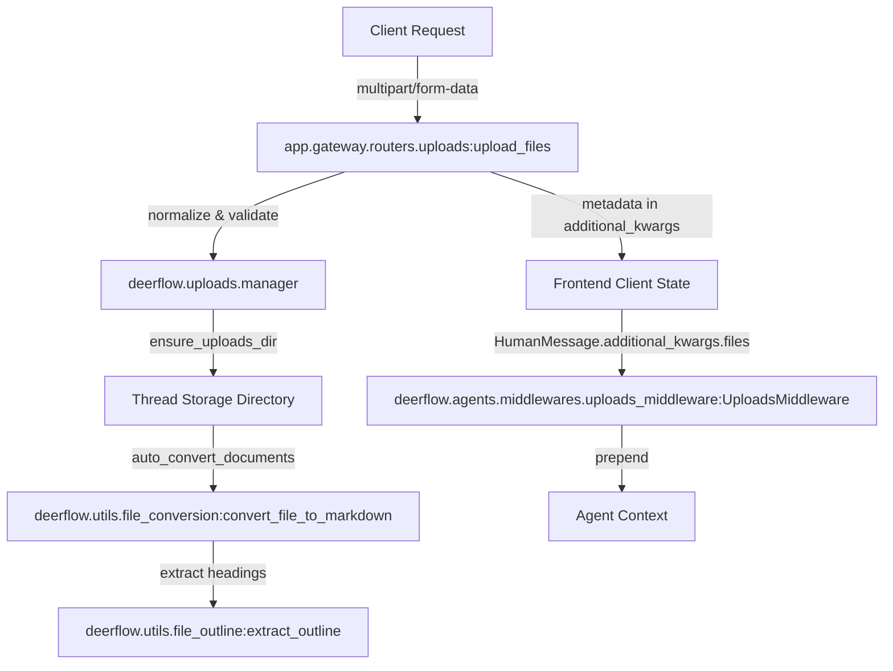

<!-- source: DeepWiki mcp.deepwiki.com · repo bytedance/deer-flow · extra page Uploads and File Ingestion · fetched 2026-10-29 -->

# Uploads and File Ingestion

<details>
<summary>Relevant source files</summary>

The following files were used as context for generating this wiki page:

- [backend/app/gateway/routers/uploads.py](backend/app/gateway/routers/uploads.py)
- [backend/app/gateway/upload_ingestion.py](backend/app/gateway/upload_ingestion.py)
- [backend/docs/FILE_UPLOAD.md](backend/docs/FILE_UPLOAD.md)
- [backend/packages/harness/deerflow/AGENTS.md](backend/packages/harness/deerflow/AGENTS.md)
- [backend/packages/harness/deerflow/agents/middlewares/uploads_middleware.py](backend/packages/harness/deerflow/agents/middlewares/uploads_middleware.py)
- [backend/packages/harness/deerflow/client.py](backend/packages/harness/deerflow/client.py)
- [backend/packages/harness/deerflow/sandbox/security.py](backend/packages/harness/deerflow/sandbox/security.py)
- [backend/packages/harness/deerflow/uploads/AGENTS.md](backend/packages/harness/deerflow/uploads/AGENTS.md)
- [backend/packages/harness/deerflow/uploads/manager.py](backend/packages/harness/deerflow/uploads/manager.py)
- [backend/packages/harness/deerflow/utils/file_conversion.py](backend/packages/harness/deerflow/utils/file_conversion.py)
- [backend/packages/harness/deerflow/utils/file_io.py](backend/packages/harness/deerflow/utils/file_io.py)
- [backend/tests/AGENTS.md](backend/tests/AGENTS.md)
- [backend/tests/blocking_io/test_file_conversion_offloop.py](backend/tests/blocking_io/test_file_conversion_offloop.py)
- [backend/tests/blocking_io/test_uploads_middleware.py](backend/tests/blocking_io/test_uploads_middleware.py)
- [backend/tests/test_channel_file_attachments.py](backend/tests/test_channel_file_attachments.py)
- [backend/tests/test_client.py](backend/tests/test_client.py)
- [backend/tests/test_file_conversion.py](backend/tests/test_file_conversion.py)
- [backend/tests/test_file_conversion_cancellation.py](backend/tests/test_file_conversion_cancellation.py)
- [backend/tests/test_lark_skill_manifest_atomic.py](backend/tests/test_lark_skill_manifest_atomic.py)
- [backend/tests/test_local_bash_tool_loading.py](backend/tests/test_local_bash_tool_loading.py)
- [backend/tests/test_upload_copy_publication.py](backend/tests/test_upload_copy_publication.py)
- [backend/tests/test_upload_metadata_admission.py](backend/tests/test_upload_metadata_admission.py)
- [backend/tests/test_uploads_manager.py](backend/tests/test_uploads_manager.py)
- [backend/tests/test_uploads_middleware_core_logic.py](backend/tests/test_uploads_middleware_core_logic.py)
- [backend/tests/test_uploads_router.py](backend/tests/test_uploads_router.py)

</details>


## Purpose and Scope
This document specifies the file upload, ingestion, conversion, storage, and agent context injection pipeline in DeerFlow. It details how the gateway handles multipart file uploads, secures paths against traversal and reserved name conflicts, performs optional background document-to-markdown conversion, indexes document outlines, and injects file metadata into active agent runs via middleware.

Sources: `backend/docs/FILE_UPLOAD.md`(), `backend/app/gateway/routers/uploads.py`()

---

## 1. System Architecture and End-to-End Data Flow
The file ingestion workflow spans client uploads, gateway validation, local storage synchronization, optional background document conversion, and runtime agent context injection.

### Diagram: End-to-End Upload Ingestion and Injection Pipeline

Sources: `backend/app/gateway/routers/uploads.py`(), `backend/packages/harness/deerflow/uploads/manager.py`(), `backend/packages/harness/deerflow/utils/file_conversion.py`(), `backend/packages/harness/deerflow/agents/middlewares/uploads_middleware.py`()

---

## 2. Uploads Manager & Security (`deerflow.uploads.manager`)
The pure business logic for handling safe file paths, names, and directories resides in `deerflow.uploads.manager`.

- **`normalize_filename`**: Sanitizes raw filenames by extracting basenames, rejecting path traversal, NUL bytes, backslashes, filenames exceeding `_MAX_FILENAME_BYTES` (255 bytes), reserved staging names (`.upload-*.part`), and Windows incompatible segments or console device names (`CON`, `NUL`, `COM1`, etc.) [backend/packages/harness/deerflow/uploads/manager.py:59-91]().
- **`claim_unique_filename`**: Generates case-insensitively unique filenames by appending `_N` counters on collision while preserving extensions and respecting the 255-byte UTF-8 limit [backend/packages/harness/deerflow/uploads/manager.py:102-140]().
- **`validate_path_traversal` / `validate_upload_destination`**: Ensures files resolve strictly inside permitted thread directories and checks regular file integrity (`os.lstat`) [backend/packages/harness/deerflow/uploads/manager.py:158-168]().
- **Sandbox Permits**: `apply_upload_sandbox_permits` sets file permissions using `O_NOFOLLOW` and `fchmod` to prevent symlink-following attacks when synchronizing permissions for local/Docker runtime backends [backend/tests/test_uploads_manager.py:32-42]().

### Table: Upload Security Validation Rules
| Validation Function | Target / Check | Failure Exception | Sources |
| :--- | :--- | :--- | :--- |
| `normalize_filename` | Path traversal, NUL, length > 255, Windows device names | `ValueError` | `[backend/packages/harness/deerflow/uploads/manager.py:59-91]()` |
| `validate_path_traversal` | Resolves target inside base directory | `PathTraversalError` | `[backend/packages/harness/deerflow/uploads/manager.py:158-168]()` |
| `validate_upload_destination` | Regular file check and hardlink counts | `UnsafeUploadPathError` | `[backend/packages/harness/deerflow/uploads/manager.py:31-33]()` |
| `is_reserved_upload_filename` | `.upload-*.part` staging namespace & Win32 aliases | Boolean | `[backend/packages/harness/deerflow/uploads/manager.py:148-155]()` |

Sources: `backend/packages/harness/deerflow/uploads/manager.py`(), `backend/tests/test_uploads_manager.py`()

---

## 3. Uploads Router and Endpoints (`app.gateway.routers.uploads`)
The FastAPI router exposes thread-scoped endpoints under `/api/threads/{thread_id}/uploads`:

### Diagram: Gateway Upload Router Operations
```mermaid
graph TD
    PostUpload["POST /api/threads/{thread_id}/uploads"] -->|UploadFile batch| ValBatch["Batch Validation & Limits Check"]
    ValBatch -->|Write File| WriteStore["ensure_uploads_dir() & write_upload_file"]
    WriteStore -->|Optional Conversion| ConvPipe["convert_file_to_markdown()"]
    GetLimits["GET /api/threads/{thread_id}/uploads/limits"] -->|UploadLimits| ClientConfig["Client Limits Display"]
    ListUploads["GET /api/threads/{thread_id}/uploads/list"] -->|list_files_in_dir()| FileListing["UploadListResponse"]
    DeleteUpload["DELETE /api/threads/{thread_id}/uploads/{filename}"] -->|delete_file_safe()| FileRemoval["Removal Response"]
```
Sources: `backend/app/gateway/routers/uploads.py`(), `backend/docs/FILE_UPLOAD.md`()

- **Limits**: Enforced per app configuration (`uploads.max_files` default 10, `uploads.max_file_size` default 50 MB, `uploads.max_total_size` default 100 MB). Exceeding these limits raises `413 Payload Too Large` [backend/docs/FILE_UPLOAD.md:25]().
- **Sandbox Synchronization**: For local sandboxes (`sandbox_id=local`), files write directly to thread storage. For remote/AIO container backends, files are synchronized and granted sandbox-readable permissions (`S_IRGRP | S_IROTH`) via `apply_upload_sandbox_permits` [backend/app/gateway/routers/uploads.py:135-146]().

Sources: `backend/app/gateway/routers/uploads.py`(), `backend/docs/FILE_UPLOAD.md`()

---

## 4. File Conversion Pipeline & Outline Extraction
When `uploads.auto_convert_documents` is enabled, convertible document types (`.pdf`, `.ppt`, `.pptx`, `.xls`, `.xlsx`, `.doc`, `.docx`) trigger automatic conversion to Markdown [backend/docs/FILE_UPLOAD.md:111-118]().

- **Conversion Strategy**:
  - PDFs attempt conversion using specialized markdown extraction engines.
  - Files are processed efficiently with thread-pool offloading to prevent event loop blockage.
- **Outline Extraction (`file_outline.py`)**:
  - Reads Markdown files using robust structural parsing to index headings and outline items.

Sources: `backend/packages/harness/deerflow/utils/file_conversion.py`(), `backend/packages/harness/deerflow/utils/file_outline.py`()

---

## 5. Uploads Middleware & Context Injection (`UploadsMiddleware`)
`UploadsMiddleware` intercepts agent runs to inject current-run uploaded files into the model context [backend/packages/harness/deerflow/agents/middlewares/uploads_middleware.py:49-58]().

- **Extraction**: Reads metadata from `HumanMessage.additional_kwargs.files` populated by the frontend [backend/packages/harness/deerflow/agents/middlewares/uploads_middleware.py:52-54]().
- **Sanitization & Formatting**:
  - Validates that files exist on disk within the thread uploads directory [backend/tests/test_uploads_middleware_core_logic.py:110-116]().
  - Sanitizes user-derived filenames and outline titles via `neutralize_untrusted_tags` to prevent prompt injection inside the `<current_uploads>` XML block [backend/packages/harness/deerflow/agents/middlewares/uploads_middleware.py:81-88]().
  - Limits injection to `_MAX_FILES_PER_CONTEXT_SECTION` (default 10), summarizing omitted file types [backend/packages/harness/deerflow/agents/middlewares/uploads_middleware.py:28-40,116-123]().
- **Historical Discoverability**: Historical uploads are not injected on every turn; agents discover them on demand using the `list_uploaded_files` tool [backend/packages/harness/deerflow/agents/middlewares/uploads_middleware.py:3-5]().

Sources: `backend/packages/harness/deerflow/agents/middlewares/uploads_middleware.py`(), `backend/tests/test_uploads_middleware_core_logic.py`()

---

## 6. Channel File Attachments (`ResolvedAttachment`)
Messaging channel integrations (Slack, Telegram, Feishu, etc.) handle file attachments originating from sandbox outputs via `ResolvedAttachment` and message bus routing [backend/tests/test_channel_file_attachments.py:1-16]().

- **`ResolvedAttachment`**: Encapsulates attachment metadata (`virtual_path`, `actual_path`, `filename`, `mime_type`, `size`, `is_image`) [backend/tests/test_channel_file_attachments.py:37-44]().
- **Resolution**: `_resolve_attachments` validates virtual paths against sandbox output directories (`sandbox_outputs_dir`), ensuring secure attachment dispatch while explicitly rejecting paths under `/mnt/user-data/uploads/` [backend/tests/test_channel_file_attachments.py:181-192]().

Sources: `backend/tests/test_channel_file_attachments.py`()

---

