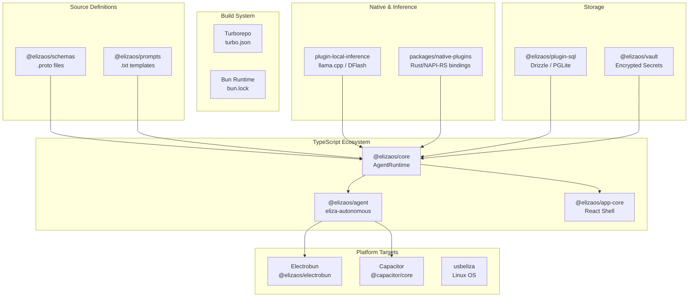
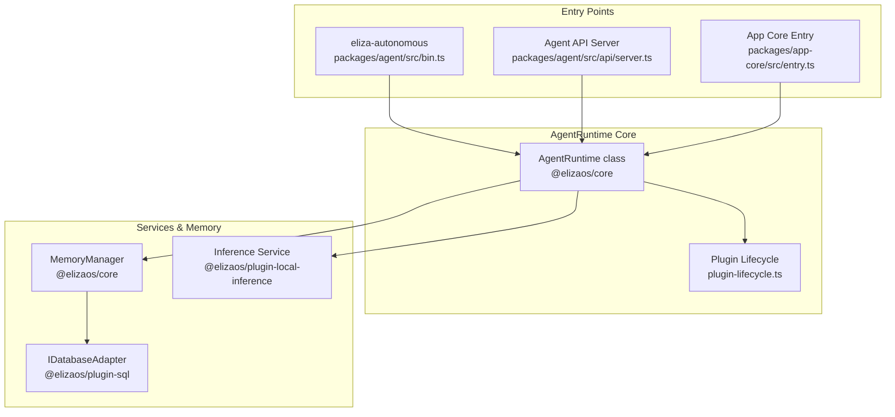

<!-- source: DeepWiki mcp.deepwiki.com · repo elizaOS/eliza · page 1 Overview · fetched 2026-10-29 -->

# Overview

<details>
<summary>Relevant source files</summary>

The following files were used as context for generating this wiki page:

- [.gitattributes](.gitattributes)
- [.gitignore](.gitignore)
- [bun.lock](bun.lock)
- [package.json](package.json)
- [packages/app-core/scripts/lib/orchestrator-desktop-dev-banner.mjs](packages/app-core/scripts/lib/orchestrator-desktop-dev-banner.mjs)
- [packages/app/test/ui-smoke/apps-utility-interactions.spec.ts](packages/app/test/ui-smoke/apps-utility-interactions.spec.ts)
- [packages/app/test/ui-smoke/remote-capability-view.spec.ts](packages/app/test/ui-smoke/remote-capability-view.spec.ts)
- [packages/cloud-frontend/tests/e2e/api-explorer-flow.spec.ts](packages/cloud-frontend/tests/e2e/api-explorer-flow.spec.ts)
- [packages/core/src/__tests__/action-structure-audit.test.ts](packages/core/src/__tests__/action-structure-audit.test.ts)
- [packages/core/src/generated/action-docs.ts](packages/core/src/generated/action-docs.ts)
- [packages/core/src/utils/context-catalog.ts](packages/core/src/utils/context-catalog.ts)
- [packages/elizaos/templates-manifest.json](packages/elizaos/templates-manifest.json)
- [packages/examples/a2a/tsconfig.json](packages/examples/a2a/tsconfig.json)
- [packages/examples/agent-console/tsconfig.json](packages/examples/agent-console/tsconfig.json)
- [packages/examples/aws/tsconfig.json](packages/examples/aws/tsconfig.json)
- [packages/examples/bluesky/tsconfig.json](packages/examples/bluesky/tsconfig.json)
- [packages/examples/setup-guide.html](packages/examples/setup-guide.html)
- [packages/prompts/scripts/generate-plugin-action-spec.js](packages/prompts/scripts/generate-plugin-action-spec.js)
- [packages/prompts/specs/actions/plugins.generated.json](packages/prompts/specs/actions/plugins.generated.json)
- [packages/shared/package.json](packages/shared/package.json)
- [packages/ui/package.json](packages/ui/package.json)
- [packages/ui/src/bridge/capacitor-bridge.ts](packages/ui/src/bridge/capacitor-bridge.ts)
- [packages/ui/src/bridge/plugin-bridge.ts](packages/ui/src/bridge/plugin-bridge.ts)
- [packages/ui/src/components/apps/GameView.tsx](packages/ui/src/components/apps/GameView.tsx)
- [packages/ui/src/components/apps/load-apps-catalog.ts](packages/ui/src/components/apps/load-apps-catalog.ts)
- [packages/ui/src/components/character/CharacterEditor.tsx](packages/ui/src/components/character/CharacterEditor.tsx)
- [packages/ui/src/components/pages/BrowserWorkspaceView.tsx](packages/ui/src/components/pages/BrowserWorkspaceView.tsx)
- [packages/ui/test/stubs/capacitor-app.ts](packages/ui/test/stubs/capacitor-app.ts)
- [packages/ui/test/stubs/elizaos-app-wallet.ts](packages/ui/test/stubs/elizaos-app-wallet.ts)
- [packages/ui/test/stubs/elizaos-capacitor-llama.ts](packages/ui/test/stubs/elizaos-capacitor-llama.ts)
- [packages/ui/test/stubs/node-llama-cpp.ts](packages/ui/test/stubs/node-llama-cpp.ts)
- [packages/ui/vitest.config.ts](packages/ui/vitest.config.ts)
- [plugins/plugin-browser/src/actions/browser.ts](plugins/plugin-browser/src/actions/browser.ts)
- [plugins/plugin-coding-tools/src/services/ripgrep-service.ts](plugins/plugin-coding-tools/src/services/ripgrep-service.ts)
- [tsconfig.dist-paths.json](tsconfig.dist-paths.json)
- [turbo.json](turbo.json)

</details>


elizaOS is a multi-agent AI framework designed for building, deploying, and managing autonomous AI agents. This page provides a technical introduction to the system architecture, core components, and how they interact across multiple languages. For detailed subsystem documentation, see [Architecture](#1.1) for design patterns and [Package Overview](#1.3) for per-package references.

---

## What is elizaOS?

elizaOS is an all-in-one, extensible platform published as a Turborepo-managed monorepo. [package.json:1-6](), [turbo.json:1-9](). The system provides a complete platform for AI agent development, including:

- **`AgentRuntime`**: Core agent execution engine with character state, memory management, and action pipeline. [packages/agent/package.json:85](), [packages/core/package.json:4]()
- **Plugin System**: Extensible architecture for model providers (OpenAI, Anthropic, Ollama, etc.), platform connectors (Discord, Telegram, Twitter), and custom actions. [bun.lock:10-17](), [package.json:186-215]()
- **Multi-Language Support**: TypeScript core with Rust (native + WASM) and Python runtimes via Protocol Buffer schemas. [tsconfig.dist-paths.json:77-80](), [package.json:73-74](), [packages/core/package.json:124]()
- **Server Infrastructure**: Elysia/Hono-based HTTP server for agent lifecycle management and API access. [bun.lock:32-36](), [package.json:145]()
- **Developer Tools**: CLI (`elizaos`), UI component library (`@elizaos/ui`), and application shell (`@elizaos/app-core`). [package.json:48-53](), [tsconfig.dist-paths.json:9-15](), [tsconfig.dist-paths.json:84]()

The framework follows a library-first approach. Developers instantiate `AgentRuntime` directly from `@elizaos/core` or use the `elizaos` CLI for scaffolding and process management. [packages/elizaos/templates-manifest.json:4-21](), [packages/core/package.json:2-4]()

**Current version:** `2.0.0-beta.0` [package.json:3]()

### Core Capabilities

| Capability | Implementation |
|---|---|
| **Agent Runtime** | `AgentRuntime` class in `@elizaos/core`. [packages/agent/package.json:85]() |
| **Model Integration** | Provider abstraction supporting OpenAI, Anthropic, Groq, and local inference via `llama.cpp`. [bun.lock:10-15](), [package.json:78]() |
| **Database & RAG** | `Drizzle ORM` with vector embeddings via PostgreSQL or PGLite. [bun.lock:8](), [bun.lock:140]() |
| **Multi-Language** | Protocol Buffer schemas generate TypeScript, Rust, Python types. [packages/core/package.json:124](), [tsconfig.dist-paths.json:80]() |
| **Local Inference** | Integrated `llama.cpp` and `DFlash` speculative decoding for on-device AI. [package.json:78-79](), [bun.lock:13]() |
| **UI Framework** | Shared React primitives and app shell for desktop/mobile/web. [tsconfig.dist-paths.json:9](), [tsconfig.dist-paths.json:84]() |

Sources: [package.json:1-87](), [bun.lock:1-160](), [packages/core/src/generated/action-docs.ts:77-150]()

---

## Repository Structure

The monorepo is organized as a Bun workspace managed by Turborepo. [package.json:1-7](), [turbo.json:1-9]()

**Directory Layout**

```
/
├── packages/
│   ├── core/                # @elizaos/core — AgentRuntime, core abstractions
│   ├── agent/               # @elizaos/agent — Default agent implementation & API server
│   ├── schemas/             # @elizaos/schemas — Protocol Buffer definitions
│   ├── prompts/             # @elizaos/prompts — Multi-language prompt templates
│   ├── shared/              # @elizaos/shared — Common utilities across packages
│   ├── app-core/            # @elizaos/app-core — Shared application shell
│   ├── ui/                  # @elizaos/ui — Component library
│   └── elizaos/             # @elizaos/elizaos — CLI and templates
├── apps/                    # End-user applications (Training, LifeOps, Feed, etc.)
├── plugins/                 # Official plugins (SQL, OpenAI, local-inference, etc.)
└── scripts/                 # Build and development utilities
```

**Package Resolution**: Workspace packages use `workspace:*` protocol for internal dependencies. [bun.lock:9-17](), [turbo.json:11]()

Sources: [package.json:1-87](), [turbo.json:1-240](), [tsconfig.dist-paths.json:1-183]()

---

## System Architecture

The architecture follows a layered design with Protocol Buffers providing type safety across language boundaries and a plugin-centric runtime.

**Overall System Architecture**



**Key Architecture Principles:**
1. **Single Source of Truth**: Protocol Buffer schemas (`@elizaos/schemas`) define data types across languages. [tsconfig.dist-paths.json:80]()
2. **Modular Extensibility**: Plugins add actions, providers, and evaluators. [package.json:186-215](), [packages/prompts/specs/actions/plugins.generated.json:1-109]()
3. **Multi-Platform Delivery**: The same agent logic runs on Desktop (Electrobun), Mobile (Capacitor), and Cloud (Cloudflare Workers). [package.json:74-75](), [bun.lock:45](), [turbo.json:178]()

Sources: [turbo.json:1-240](), [tsconfig.dist-paths.json:1-183](), [bun.lock:1-176]()

---

## AgentRuntime Architecture

The `AgentRuntime` class is the central execution environment. It orchestrates the message pipeline, model providers, and memory persistence.

**AgentRuntime Component Architecture**



**Key Code Entities:**
- **`AgentRuntime`**: The main class orchestrating the agent. [packages/agent/package.json:85](), [bun.lock:48]()
- **`eliza-autonomous`**: Binary entry point for the agent. [packages/agent/package.json:88]()
- **`localInferencePlugin`**: Provides on-device model execution and `DFlash` support. [bun.lock:13](), [package.json:78]()
- **`plugin-sql`**: Implements the database adapter layer using Drizzle and PGLite/Postgres. [bun.lock:16](), [bun.lock:140]()

Sources: [packages/agent/package.json:84-176](), [bun.lock:1-160](), [package.json:68-85]()

---

## Technology Stack

| Component | Technology | Package |
|---|---|---|
| **Runtime** | Bun | `bun@1.3.14` [bun.lock:55]() |
| **Orchestration** | Turbo | `turbo ^2.7.4` [bun.lock:78]() |
| **ORM** | Drizzle | `drizzle-orm 0.45.2` [bun.lock:140]() |
| **API Framework** | Elysia / Hono | `elysia ^1.4.21`, `hono ^4.12.18` [bun.lock:34-36]() |
| **Desktop Shell** | Electrobun | `@elizaos/electrobun` [turbo.json:178]() |
| **Mobile Shell** | Capacitor | `@capacitor/core 8.3.1` [bun.lock:45]() |
| **Database** | PGLite / Postgres | `@electric-sql/pglite ^0.4.5` [bun.lock:8]() |

---

## Where to Go Next

| Topic | Page |
|---|---|
| Detailed architectural design | [Architecture](#1.1) |
| All packages enumerated | [Package Overview](#1.3) |
| Message processing pipeline | [Message Processing Pipeline](#2.6) |
| Protocol Buffers and types | [Protocol Buffers and Schemas](#3) |
| Desktop and Mobile platforms | [Platform Targets](#8) |
| Managed hosting platform | [ElizaOS Cloud Platform](#14) |
| Local AI and Voice | [Local Inference](#15) |

---

