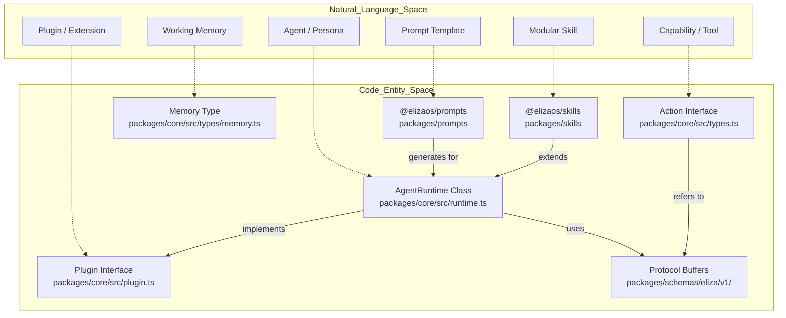
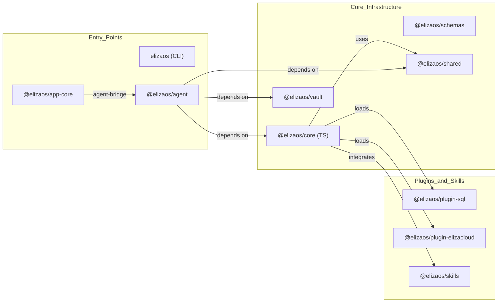
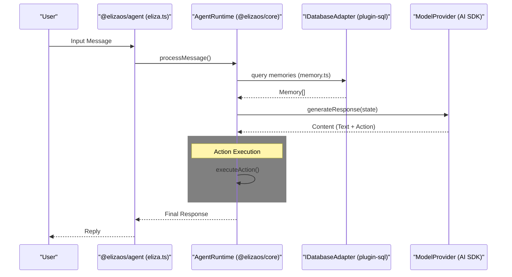

<!-- source: DeepWiki mcp.deepwiki.com · repo elizaOS/eliza · page 1.1 Architecture · fetched 2026-10-29 -->

# Architecture

Relevant source files

The following files were used as context for generating this wiki page:

- [.env.example](.env.example)
- [.github/workflows/sandbox-live-smoke.yml](.github/workflows/sandbox-live-smoke.yml)
- [bun.lock](bun.lock)
- [knip.json](knip.json)
- [package.json](package.json)
- [packages/agent/docs/e2b-capability-routing.md](packages/agent/docs/e2b-capability-routing.md)
- [packages/agent/scripts/live-sandbox-smoke.ts](packages/agent/scripts/live-sandbox-smoke.ts)
- [packages/agent/scripts/mobile-stubs/e2b-capability-router.cjs](packages/agent/scripts/mobile-stubs/e2b-capability-router.cjs)
- [packages/agent/src/runtime/eliza.ts](packages/agent/src/runtime/eliza.ts)
- [packages/agent/src/services/e2b-capability-router.test.ts](packages/agent/src/services/e2b-capability-router.test.ts)
- [packages/agent/src/services/e2b-capability-router.ts](packages/agent/src/services/e2b-capability-router.ts)
- [packages/app-core/platforms/electrobun/tsconfig.json](packages/app-core/platforms/electrobun/tsconfig.json)
- [packages/app-core/platforms/electrobun/vitest.electrobun.config.ts](packages/app-core/platforms/electrobun/vitest.electrobun.config.ts)
- [packages/app-core/scripts/lib/orchestrator-desktop-dev-banner.mjs](packages/app-core/scripts/lib/orchestrator-desktop-dev-banner.mjs)
- [packages/core/src/connectors/oauth-role.test.ts](packages/core/src/connectors/oauth-role.test.ts)
- [packages/core/src/connectors/oauth-role.ts](packages/core/src/connectors/oauth-role.ts)
- [packages/core/src/index.browser.ts](packages/core/src/index.browser.ts)
- [packages/core/src/index.edge.ts](packages/core/src/index.edge.ts)
- [packages/core/src/index.node.ts](packages/core/src/index.node.ts)
- [packages/core/src/services/runtime-capability-service.ts](packages/core/src/services/runtime-capability-service.ts)
- [packages/plugin-remote-manifest/examples/carrot-clock/plugin.json](packages/plugin-remote-manifest/examples/carrot-clock/plugin.json)
- [packages/plugin-remote-manifest/examples/hello-carrot/plugin.json](packages/plugin-remote-manifest/examples/hello-carrot/plugin.json)
- [packages/shared/package.json](packages/shared/package.json)
- [packages/ui/package.json](packages/ui/package.json)
- [packages/ui/src/components/pages/BrowserWorkspaceView.tsx](packages/ui/src/components/pages/BrowserWorkspaceView.tsx)
- [packages/ui/src/components/settings/CloudInstancePanel.tsx](packages/ui/src/components/settings/CloudInstancePanel.tsx)
- [packages/ui/src/onboarding/onboarding-config.ts](packages/ui/src/onboarding/onboarding-config.ts)
- [packages/ui/test/stubs/capacitor-app.ts](packages/ui/test/stubs/capacitor-app.ts)
- [packages/ui/test/stubs/elizaos-app-wallet.ts](packages/ui/test/stubs/elizaos-app-wallet.ts)
- [packages/ui/test/stubs/elizaos-capacitor-llama.ts](packages/ui/test/stubs/elizaos-capacitor-llama.ts)
- [packages/ui/test/stubs/node-llama-cpp.ts](packages/ui/test/stubs/node-llama-cpp.ts)
- [packages/ui/vitest.config.ts](packages/ui/vitest.config.ts)
- [plugins/plugin-calendly/src/connector-account-provider.ts](plugins/plugin-calendly/src/connector-account-provider.ts)
- [plugins/plugin-elizacloud/src/index.browser.ts](plugins/plugin-elizacloud/src/index.browser.ts)
- [plugins/plugin-linear/src/connector-account-provider.ts](plugins/plugin-linear/src/connector-account-provider.ts)
- [plugins/plugin-shopify/src/connector-account-provider.ts](plugins/plugin-shopify/src/connector-account-provider.ts)

This document describes the high-level architectural design of elizaOS: its modular package structure, multi-language runtimes, and the interaction between core subsystems. elizaOS is architected as a monorepo-based, polyglot AI agent framework where Protocol Buffers serve as the single source of truth for types across TypeScript, Python, and Rust.

## System Overview

The architecture follows a layered approach, ensuring that the core logic is model-agnostic and platform-independent while remaining highly extensible through a plugin system.

### Architectural Layers

| Layer | Description | Key Packages |
|-------|-------------|--------------|
| **Type Foundation** | Protocol Buffer schemas - single source of truth | `packages/schemas` |
| **Core Runtimes** | Language-specific runtime implementations | `@elizaos/core` (TS), `packages/rust`, `packages/python` |
| **Infrastructure** | Cross-language bridges, shared templates, and skills | `@elizaos/interop`, `@elizaos/prompts`, `@elizaos/skills` |
| **Specialized Capabilities** | Desktop automation and native bindings | `@elizaos/plugin-computeruse`, `@elizaos/native-plugins` |
| **Developer Tools** | CLI and terminal interfaces | `packages/elizaos` (CLI), `@elizaos/tui` |

### High-Level Component Interaction

The following diagram bridges the Natural Language Space (concepts like "Agent" or "Skill") to the Code Entity Space (specific classes and packages).

**System Component Map**

Sources: [packages/core/src/index.node.ts:157-157](), [packages/core/src/index.node.ts:147-147](), [packages/core/src/index.node.ts:142-142](), [packages/core/src/index.node.ts:149-149](), [bun.lock:130-131]()

## Monorepo Structure

elizaOS uses a monorepo managed by **Bun**, **Lerna**, and **Turbo**. The workspace is organized to support multi-language development and cross-platform native builds.

### Workspace Organization
The monorepo defines its workspace structure in the root configuration, using Bun for package management [bun.lock:4-83]().
- `packages/*`: Core framework, runtimes, and infrastructure (e.g., `@elizaos/core`, `@elizaos/agent`, `@elizaos/app-core`).
- `plugins/*`: Externalized capabilities managed as modular extensions like `@elizaos/plugin-sql` or `@elizaos/plugin-anthropic` [bun.lock:9-17]().
- `apps/*`: End-user applications like `app-lifeops` or `app-steward`.

**Package Relationship Diagram**

Sources: [bun.lock:4-132](), [packages/agent/src/runtime/eliza.ts:130-140](), [packages/agent/src/runtime/eliza.ts:76-92]()

## Multi-Language Runtime Design

elizaOS is a polyglot framework. While the TypeScript implementation is the primary runtime, the architecture ensures that logic and types are shared across targets via specialized entry points.

### TypeScript Runtime Targets (`@elizaos/core`)
The primary orchestrator supports multiple environments via environment-specific entry points:
- **Node.js**: Entry point via `packages/core/src/index.node.ts`, exporting the full API surface including Node-only path and provisioning helpers [packages/core/src/index.node.ts:1-7]().
- **Browser**: Entry point via `packages/core/src/index.browser.ts`, providing stubs for Node-specific functionality and exporting browser-safe modules [packages/core/src/index.browser.ts:1-7]().
- **Edge**: Entry point via `packages/core/src/index.edge.ts` for Vercel Edge, Cloudflare Workers, and Deno, excluding Node-only modules like `character-loader` [packages/core/src/index.edge.ts:1-9]().

### Unified Capability Routing
The system employs a `RuntimeCapabilityService` to manage capability dispatching across different environments. It implements the `ElizaCapabilityRouter` interface to handle `fs`, `pty`, `git`, and `model` invocations [packages/core/src/services/runtime-capability-service.ts:108-112]().

**Capability Dispatch Logic**
1.  **Strategies**: Decisions are made via a strategy table (e.g., `LocalPluginStrategy` vs `HttpEndpointStrategy`) [packages/core/src/services/runtime-capability-service.ts:48-57]().
2.  **Fallback**: If no strategy matches, it defaults to an `UnavailableCapabilityRouter` [packages/core/src/services/runtime-capability-service.ts:128-133]().

Sources: [packages/core/src/index.node.ts:1-157](), [packages/core/src/index.browser.ts:1-156](), [packages/core/src/index.edge.ts:1-99](), [packages/core/src/services/runtime-capability-service.ts:33-67]()

## Core Components and Data Flow

The `AgentRuntime` manages the lifecycle and interaction of agents. In the `@elizaos/agent` package, the runtime is initialized with a plugin configuration and environment resolution [packages/agent/src/runtime/eliza.ts:1-7]().

### Message Processing Pipeline
The runtime categorizes capabilities into functional blocks:
- **Basic Capabilities**: Core functions like `reply` and `followup` actions [packages/core/src/index.node.ts:98-99]().
- **Advanced Capabilities**: Features like `role` management and `secrets` handling [packages/core/src/index.node.ts:62-65](), [packages/core/src/index.node.ts:128-132]().

**Data Flow Diagram (Natural Language to Code)**

Sources: [packages/agent/src/runtime/eliza.ts:76-92](), [packages/core/src/index.node.ts:58-59](), [packages/core/src/index.node.ts:142-142](), [packages/core/src/index.node.ts:157-157]()

## Specialized Subsystems

### Application Shell (`@elizaos/app-core`)
A shared React core for building agent applications across platforms.
- **Platform Bridges**: Uses an `agent-bridge` to connect UI components to the agent runtime [packages/agent/src/runtime/eliza.ts:130-140]().
- **Mobile/Desktop**: Supports Capacitor for mobile and Electrobun for desktop targets [packages/ui/vitest.config.ts:125-131](), [packages/app-core/platforms/electrobun/tsconfig.json:1-18]().

### Vault and Secrets
The `@elizaos/vault` package provides secure storage, which is hydrated into the runtime during the bootstrap process [packages/agent/src/runtime/eliza.ts:114-120](). It handles sensitive keys like wallet credentials [packages/agent/src/runtime/eliza.ts:115-115]().

Sources: [packages/agent/src/runtime/eliza.ts:108-128](), [packages/ui/vitest.config.ts:62-112](), [packages/app-core/platforms/electrobun/tsconfig.json:102-103]()

---

