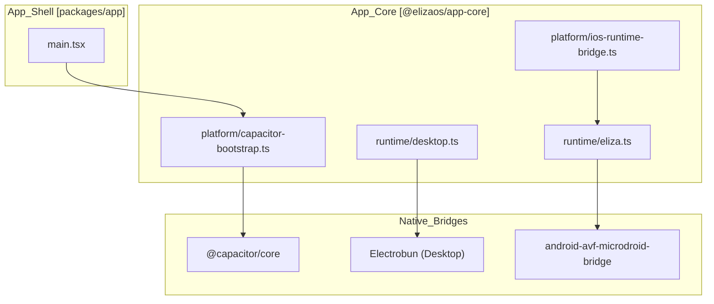
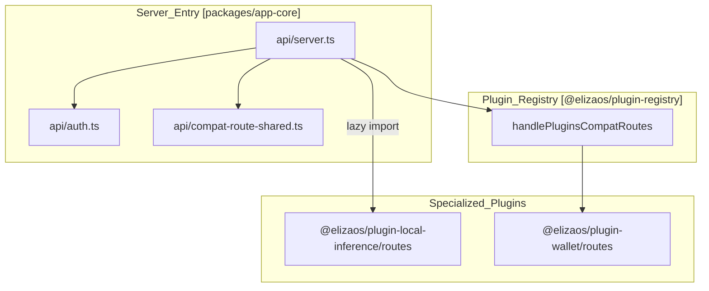
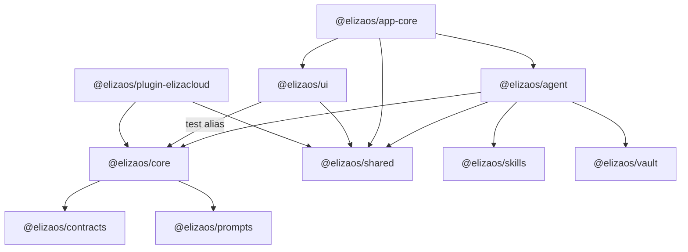

<!-- source: DeepWiki mcp.deepwiki.com · repo elizaOS/eliza · page 1.3 Package Overview · fetched 2026-10-29 -->

# Package Overview

Relevant source files

The following files were used as context for generating this wiki page:

- [.github/workflows/README.md](.github/workflows/README.md)
- [bun.lock](bun.lock)
- [package.json](package.json)
- [packages/app-core/package.json](packages/app-core/package.json)
- [packages/app-core/scripts/docker-ci-smoke.sh](packages/app-core/scripts/docker-ci-smoke.sh)
- [packages/app-core/scripts/lib/orchestrator-desktop-dev-banner.mjs](packages/app-core/scripts/lib/orchestrator-desktop-dev-banner.mjs)
- [packages/app-core/scripts/link-docker-local-app-packages.mjs](packages/app-core/scripts/link-docker-local-app-packages.mjs)
- [packages/app-core/src/api/auth-bootstrap-routes.ts](packages/app-core/src/api/auth-bootstrap-routes.ts)
- [packages/app-core/src/api/auth-session-routes.ts](packages/app-core/src/api/auth-session-routes.ts)
- [packages/app-core/src/api/catalog-routes.ts](packages/app-core/src/api/catalog-routes.ts)
- [packages/app-core/src/api/cloud-voice-routes.test.ts](packages/app-core/src/api/cloud-voice-routes.test.ts)
- [packages/app-core/src/api/cloud-voice-routes.ts](packages/app-core/src/api/cloud-voice-routes.ts)
- [packages/app-core/src/api/database-rows-compat-routes.ts](packages/app-core/src/api/database-rows-compat-routes.ts)
- [packages/app-core/src/api/dev-compat-routes.ts](packages/app-core/src/api/dev-compat-routes.ts)
- [packages/app-core/src/api/ios-local-agent-transport.ts](packages/app-core/src/api/ios-local-agent-transport.ts)
- [packages/app-core/src/api/onboarding-routes.ts](packages/app-core/src/api/onboarding-routes.ts)
- [packages/app-core/src/api/secrets-inventory-routes.ts](packages/app-core/src/api/secrets-inventory-routes.ts)
- [packages/app-core/src/api/server.ts](packages/app-core/src/api/server.ts)
- [packages/app-core/src/cli/doctor/checks.ts](packages/app-core/src/cli/doctor/checks.ts)
- [packages/app-core/src/index.ts](packages/app-core/src/index.ts)
- [packages/app-core/src/register-runtime-hooks.ts](packages/app-core/src/register-runtime-hooks.ts)
- [packages/app-core/src/runtime/eliza.ts](packages/app-core/src/runtime/eliza.ts)
- [packages/app-core/src/services/phrase-chunked-tts.ts](packages/app-core/src/services/phrase-chunked-tts.ts)
- [packages/app-core/src/services/steward-sidecar.ts](packages/app-core/src/services/steward-sidecar.ts)
- [packages/app-core/src/services/steward-sidecar/health-check.ts](packages/app-core/src/services/steward-sidecar/health-check.ts)
- [packages/app-core/src/services/steward-sidecar/wallet-setup.ts](packages/app-core/src/services/steward-sidecar/wallet-setup.ts)
- [packages/app-core/src/services/task-host-capabilities.ts](packages/app-core/src/services/task-host-capabilities.ts)
- [packages/core/package.json](packages/core/package.json)
- [packages/shared/package.json](packages/shared/package.json)
- [packages/ui/package.json](packages/ui/package.json)
- [packages/ui/src/components/pages/BrowserWorkspaceView.tsx](packages/ui/src/components/pages/BrowserWorkspaceView.tsx)
- [packages/ui/test/stubs/capacitor-app.ts](packages/ui/test/stubs/capacitor-app.ts)
- [packages/ui/test/stubs/elizaos-app-wallet.ts](packages/ui/test/stubs/elizaos-app-wallet.ts)
- [packages/ui/test/stubs/elizaos-capacitor-llama.ts](packages/ui/test/stubs/elizaos-capacitor-llama.ts)
- [packages/ui/test/stubs/node-llama-cpp.ts](packages/ui/test/stubs/node-llama-cpp.ts)
- [packages/ui/vitest.config.ts](packages/ui/vitest.config.ts)
- [plugins/plugin-app-control/package.json](plugins/plugin-app-control/package.json)
- [plugins/plugin-commands/package.json](plugins/plugin-commands/package.json)
- [plugins/plugin-discord/package.json](plugins/plugin-discord/package.json)
- [plugins/plugin-elizacloud/package.json](plugins/plugin-elizacloud/package.json)
- [plugins/plugin-farcaster/package.json](plugins/plugin-farcaster/package.json)
- [plugins/plugin-feishu/package.json](plugins/plugin-feishu/package.json)
- [plugins/plugin-google-chat/package.json](plugins/plugin-google-chat/package.json)
- [plugins/plugin-google-chat/src/actions/index.ts](plugins/plugin-google-chat/src/actions/index.ts)
- [plugins/plugin-google-chat/src/providers/index.ts](plugins/plugin-google-chat/src/providers/index.ts)
- [plugins/plugin-imessage/package.json](plugins/plugin-imessage/package.json)
- [plugins/plugin-line/package.json](plugins/plugin-line/package.json)
- [plugins/plugin-local-storage/src/services/local-storage.ts](plugins/plugin-local-storage/src/services/local-storage.ts)
- [plugins/plugin-matrix/package.json](plugins/plugin-matrix/package.json)
- [plugins/plugin-music/package.json](plugins/plugin-music/package.json)
- [plugins/plugin-nostr/package.json](plugins/plugin-nostr/package.json)
- [plugins/plugin-openrouter/package.json](plugins/plugin-openrouter/package.json)
- [plugins/plugin-roblox/package.json](plugins/plugin-roblox/package.json)
- [plugins/plugin-signal/package.json](plugins/plugin-signal/package.json)
- [plugins/plugin-slack/package.json](plugins/plugin-slack/package.json)
- [plugins/plugin-social-alpha/package.json](plugins/plugin-social-alpha/package.json)
- [plugins/plugin-suno/package.json](plugins/plugin-suno/package.json)
- [plugins/plugin-twitch/package.json](plugins/plugin-twitch/package.json)
- [plugins/plugin-web-search/package.json](plugins/plugin-web-search/package.json)
- [plugins/plugin-wechat/package.json](plugins/plugin-wechat/package.json)

This document catalogs the packages within the elizaOS monorepo, detailing their roles, technical implementations, and interdependencies. elizaOS is a polyglot framework designed for multi-agent AI systems, utilizing a monorepo structure managed by Lerna [bun.lock:72]() and orchestrated by Turbo [package.json:78]().

## Package Organization

The monorepo organizes code into functional domains, spanning core logic, infrastructure, specialized runtimes (TypeScript, Rust, Python), and developer tooling. All packages follow a synchronized versioning scheme managed by Lerna [package.json:3]().

### Foundation and Core Runtimes

#### @elizaos/core (TypeScript)
**Location:** `packages/core/`  
**Description:** The primary TypeScript implementation of the elizaOS runtime. It provides the foundation for agent lifecycles, memory management, and model abstraction [packages/core/package.json:4]().

**Key Technical Details:**
- **Environment-Specific Exports:** Provides optimized entry points for `node`, `browser`, and `bun` environments [packages/core/package.json:28-58]().
- **Persistence:** Uses `drizzle-orm` for database abstraction [packages/core/package.json:138]() and supports PGLite for local-first execution.
- **Model Integration:** Relies on the Vercel `ai` SDK [packages/core/package.json:135]() and provides native support for Anthropic, Google, and OpenAI providers [packages/core/package.json:121-124]().
- **Templating:** Uses `handlebars` for dynamic prompt construction [packages/core/package.json:142]().

**Sources:** [packages/core/package.json:1-151]()

---

#### @elizaos/rust
**Location:** `packages/rust/`  
**Description:** High-performance Rust implementation of the elizaOS core and types. It is designed for native execution and WASM compilation to support polyglot plugin environments.

---

#### @elizaos/python
**Location:** `packages/python/`  
**Description:** Python implementation of the elizaOS runtime, enabling agent development in Python with full interoperability. It is frequently used for robotics (AiNex) and reinforcement learning (Brax-PPO) workflows.

---

#### @elizaos/interop
**Location:** `packages/interop/`  
**Description:** The bridge for cross-language plugin interoperability, enabling plugins written in Python or Rust to communicate with the TypeScript core via Protocol Buffer serialization and IPC/FFI bridges.

### Specialized Infrastructure

#### @elizaos/schemas
**Location:** `packages/schemas/`  
**Description:** The single source of truth for all types in elizaOS using Protocol Buffers. It defines the structure for agents, memory, events, and messaging that all language runtimes consume.

---

#### @elizaos/prompts
**Location:** `packages/prompts/`  
**Description:** Shared prompt templates used across TypeScript, Python, and Rust runtimes. Referenced as a workspace dependency by `@elizaos/core` [packages/core/package.json:129]().

**Sources:** [packages/core/package.json:129]()

### User Interfaces and CLI

#### elizaos (CLI)
**Location:** `packages/elizaos/`  
**Description:** The primary command-line tool for project scaffolding, upgrading, and deployment.

#### @elizaos/ui & @elizaos/app-core
**Location:** `packages/ui/` & `packages/app-core/`  
**Description:** `app-core` provides the shared React application shell [packages/app-core/package.json:4](), while `ui` contains the reusable component library [packages/ui/package.json:4]().

**Key Technical Details:**
- **App Core:** Manages platform-specific logic for Electrobun (Desktop) and Capacitor (Mobile) [packages/app-core/src/index.ts:34-42](). It exports the `startApiServer` [packages/app-core/src/api/server.ts:32]() and `bootElizaRuntime` [packages/app-core/src/runtime/eliza.ts:19]() logic.
- **UI Components:** Provides Radix-based primitives [bun.lock:19-30]() and specialized chat views like `BrowserWorkspaceView` [packages/ui/src/components/pages/BrowserWorkspaceView.tsx:24]().
- **Platform Bridging:** `app-core` includes `ios-local-agent-transport` [packages/app-core/src/index.ts:9]() and `android-avf-microdroid-bridge` [packages/app-core/src/index.ts:48]() for mobile native agent execution.

**Sources:** [packages/app-core/package.json:1-12](), [packages/ui/package.json:1-12](), [packages/app-core/src/index.ts:1-82]()

### Shared Resources and Utilities

| Package | Purpose | Key Exports/Dependencies |
|---------|---------|-----------|
| `@elizaos/shared` | Common utilities, environment handling, and brand aliasing [packages/shared/package.json:4](). | `drizzle-orm`, `zod`, `chalk` [packages/shared/package.json:114-123]() |
| `@elizaos/agent` | High-level agent implementation and REST API server [bun.lock:85](). | `@elizaos/app-core`, `@elizaos/core`, `@elizaos/skills` [bun.lock:93-130]() |
| `@elizaos/skills` | Modular agent capabilities and skill discovery [bun.lock:130](). | Referenced by `@elizaos/agent` and CLI. |
| `@elizaos/vault` | Secure credential storage with AES-256-GCM encryption [bun.lock:132](). | Used by `agent` and `app-core`. |
| `@elizaos/plugin-elizacloud` | Managed cloud platform integration [bun.lock:11](). | `@elizaos/core`, `@elizaos/shared` [bun.lock:108, 129]() |

## Code Entity Mapping

### Mobile and Desktop Runtime Bootstrap
This diagram maps the platform-specific bootstrap entities in `app-core` to the native bridges they utilize.

**Sources:** [packages/app-core/src/index.ts:32-56](), [packages/app-core/src/runtime/eliza.ts:48-55]()

### API Server and Plugin Integration
This diagram illustrates the data flow from the `app-core` API server through to specialized plugin routes.

**Sources:** [packages/app-core/src/api/server.ts:1-157](), [packages/app-core/src/api/server.ts:114-124]()

## Dependency Graph

The following graph visualizes the build-time and runtime dependencies between primary workspace packages.

**Sources:** [bun.lock:90-132](), [packages/core/package.json:128-129](), [packages/ui/vitest.config.ts:82-88]()

---

