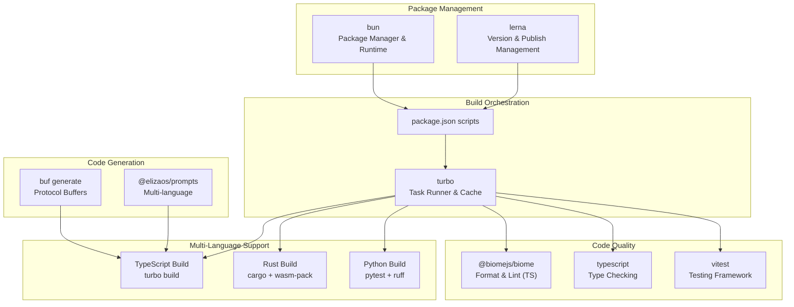
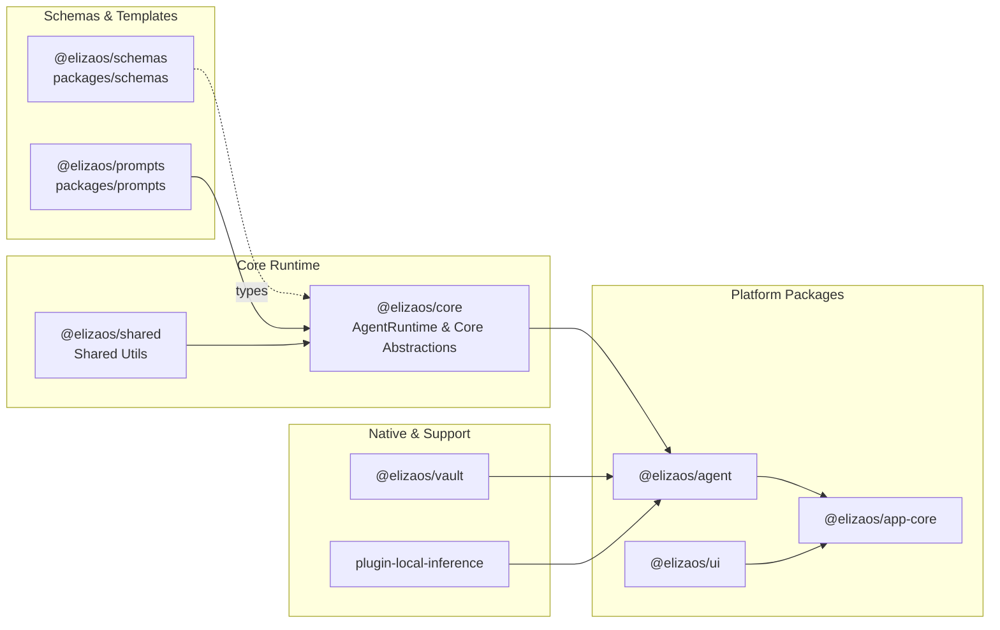
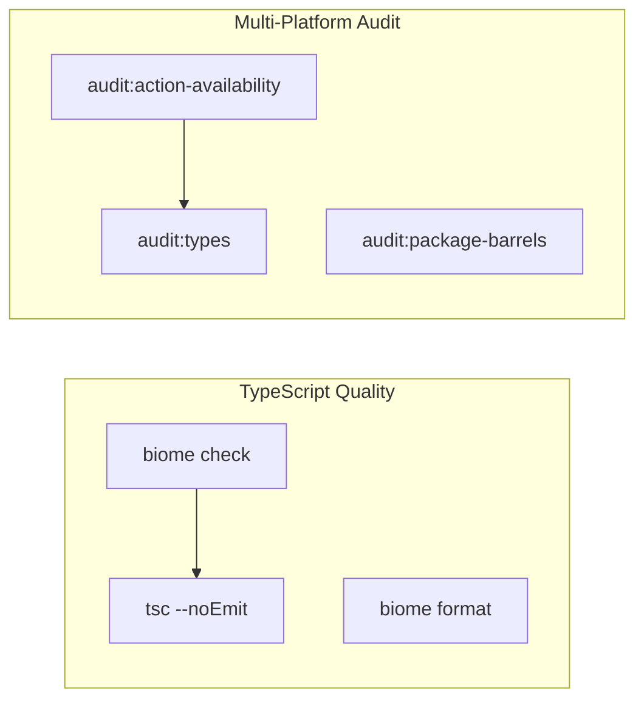

<!-- source: DeepWiki mcp.deepwiki.com · repo elizaOS/eliza · page 10 Development · fetched 2026-10-29 -->

# Development

Relevant source files

The following files were used as context for generating this wiki page:

- [.gitattributes](.gitattributes)
- [.gitignore](.gitignore)
- [bun.lock](bun.lock)
- [package.json](package.json)
- [packages/app-core/scripts/lib/orchestrator-desktop-dev-banner.mjs](packages/app-core/scripts/lib/orchestrator-desktop-dev-banner.mjs)
- [packages/app/test/ui-smoke/apps-utility-interactions.spec.ts](packages/app/test/ui-smoke/apps-utility-interactions.spec.ts)
- [packages/app/test/ui-smoke/remote-capability-view.spec.ts](packages/app/test/ui-smoke/remote-capability-view.spec.ts)
- [packages/cloud-frontend/tests/e2e/api-explorer-flow.spec.ts](packages/cloud-frontend/tests/e2e/api-explorer-flow.spec.ts)
- [packages/core/src/__tests__/action-structure-audit.test.ts](packages/core/src/__tests__/action-structure-audit.test.ts)
- [packages/core/src/generated/action-docs.ts](packages/core/src/generated/action-docs.ts)
- [packages/core/src/utils/context-catalog.ts](packages/core/src/utils/context-catalog.ts)
- [packages/elizaos/templates-manifest.json](packages/elizaos/templates-manifest.json)
- [packages/examples/a2a/tsconfig.json](packages/examples/a2a/tsconfig.json)
- [packages/examples/agent-console/tsconfig.json](packages/examples/agent-console/tsconfig.json)
- [packages/examples/aws/tsconfig.json](packages/examples/aws/tsconfig.json)
- [packages/examples/bluesky/tsconfig.json](packages/examples/bluesky/tsconfig.json)
- [packages/examples/setup-guide.html](packages/examples/setup-guide.html)
- [packages/prompts/scripts/generate-plugin-action-spec.js](packages/prompts/scripts/generate-plugin-action-spec.js)
- [packages/prompts/specs/actions/plugins.generated.json](packages/prompts/specs/actions/plugins.generated.json)
- [packages/shared/package.json](packages/shared/package.json)
- [packages/ui/package.json](packages/ui/package.json)
- [packages/ui/src/bridge/capacitor-bridge.ts](packages/ui/src/bridge/capacitor-bridge.ts)
- [packages/ui/src/bridge/plugin-bridge.ts](packages/ui/src/bridge/plugin-bridge.ts)
- [packages/ui/src/components/apps/GameView.tsx](packages/ui/src/components/apps/GameView.tsx)
- [packages/ui/src/components/apps/load-apps-catalog.ts](packages/ui/src/components/apps/load-apps-catalog.ts)
- [packages/ui/src/components/character/CharacterEditor.tsx](packages/ui/src/components/character/CharacterEditor.tsx)
- [packages/ui/src/components/pages/BrowserWorkspaceView.tsx](packages/ui/src/components/pages/BrowserWorkspaceView.tsx)
- [packages/ui/test/stubs/capacitor-app.ts](packages/ui/test/stubs/capacitor-app.ts)
- [packages/ui/test/stubs/elizaos-app-wallet.ts](packages/ui/test/stubs/elizaos-app-wallet.ts)
- [packages/ui/test/stubs/elizaos-capacitor-llama.ts](packages/ui/test/stubs/elizaos-capacitor-llama.ts)
- [packages/ui/test/stubs/node-llama-cpp.ts](packages/ui/test/stubs/node-llama-cpp.ts)
- [packages/ui/vitest.config.ts](packages/ui/vitest.config.ts)
- [plugins/plugin-browser/src/actions/browser.ts](plugins/plugin-browser/src/actions/browser.ts)
- [plugins/plugin-coding-tools/src/services/ripgrep-service.ts](plugins/plugin-coding-tools/src/services/ripgrep-service.ts)
- [tsconfig.dist-paths.json](tsconfig.dist-paths.json)
- [turbo.json](turbo.json)

This page provides a comprehensive guide for developers contributing to elizaOS. It covers the monorepo structure, build system, testing infrastructure, code quality tools, Bun configuration, and development workflows. The document aims to help contributors understand the technical tooling, package organization, multi-language support, and daily development tasks.

For information on deployment, see [Deployment](#12). For CI/CD pipelines and release management, see [CI/CD Pipeline](#11).

---

## Overview

elizaOS is developed in a monorepo managed by **Lerna** for versioning and publishing [bun.lock:72](), **Turbo** for build orchestration and caching [turbo.json:1-9](), and **Bun** as the primary runtime and package manager [package.json:21](). The monorepo integrates TypeScript, Python, and Rust codebases with unified workflows for formatting, linting, type checking, and testing.

### Development Tools Stack

**Sources:** [package.json:20-88](), [turbo.json:1-10](), [bun.lock:43-82]()

---

## Workspace Organization

The monorepo leverages **Bun workspaces** combined with **Lerna** for managing dependencies and versioning [bun.lock:4-83]().

### Workspace Patterns

The workspace configuration defines multiple package types across the repository. Type checking and resolution are managed via `tsconfig.dist-paths.json` paths:

| Workspace Path | Purpose | Key Package |
|----------------|---------|-------------|
| `packages/core` | Core TypeScript Runtime | `@elizaos/core` [tsconfig.dist-paths.json:10]() |
| `packages/schemas` | Protocol Buffer Definitions | `@elizaos/schemas` [tsconfig.dist-paths.json:80]() |
| `packages/agent` | Agent Runner & API | `@elizaos/agent` [tsconfig.dist-paths.json:15]() |
| `packages/app-core` | UI & Platform Shell | `@elizaos/app-core` [tsconfig.dist-paths.json:84]() |
| `packages/shared` | Shared Utils & I18n | `@elizaos/shared` [tsconfig.dist-paths.json:16]() |
| `packages/ui` | Component Library | `@elizaos/ui` [tsconfig.dist-paths.json:9]() |

**Sources:** [tsconfig.dist-paths.json:8-183](), [bun.lock:84-176](), [packages/ui/package.json:2-5]()

### Package Interdependencies Overview

**Sources:** [turbo.json:10-52](), [packages/shared/package.json:114-116](), [bun.lock:84-132]()

For details, see [Monorepo Structure](#10.1).

---

## Build System Architecture

The elizaOS build system is orchestrated by **Turbo** which provides parallel task execution and intelligent caching across packages [turbo.json:1-8]().

### Build Targets and Task Graph

The build system defines strict dependencies between packages to ensure stable builds:
- `@elizaos/core#build` is the foundational task for most TypeScript packages [turbo.json:168-173]().
- `@elizaos/agent#build` depends on `core`, `shared`, `skills`, and various plugins [turbo.json:15-32]().
- `@elizaos/app-core#build` aggregates `core`, `agent`, `shared`, and `ui` [turbo.json:33-42]().
- UI builds include CSS generation and asset flattening [packages/ui/package.json:39]().

For details, see [Build System](#10.2).

**Sources:** [turbo.json:9-224](), [packages/ui/package.json:29-39]()

---

## Testing Infrastructure

elizaOS uses language-specific test runners coordinated through the monorepo root via Turbo and specialized configuration files.

| Language | Runner | Configuration |
|----------|--------|---------------|
| TypeScript | **Vitest** | `vitest run` [packages/ui/package.json:32]() |
| UI/E2E | **Playwright** | `test:ui:playwright` [package.json:66]() |
| Python | **Pytest** | `python3 -m pytest` [package.json:87]() |

The testing suite includes specialized smoke tests for UI interactions and companion app controls [packages/app/test/ui-smoke/apps-utility-interactions.spec.ts:1-125]().

For details, see [Testing](#10.3).

---

## Code Quality Tools

Code quality is enforced using **Biome** for TypeScript and native toolchains for Rust and Python.

### Quality Pipeline

- **Type Checking**: Performed using `tsc` with package-specific configs [packages/ui/package.json:31]().
- **Linting/Formatting**: Handled by Biome for high-performance TS processing [packages/ui/package.json:35-38]().
- **Path Aliasing**: Extensive use of `paths` in `tsconfig.dist-paths.json` ensures consistent imports across the monorepo [tsconfig.dist-paths.json:8-183]().

For details, see [Code Quality](#10.4).

**Sources:** [package.json:34-62](), [packages/ui/package.json:31-38]()

---

## Bun Configuration

**Bun** is the primary runtime and package manager for the elizaOS ecosystem.

- **Lockfile Management**: Handled via `bun.lock` [bun.lock:1-3]().
- **Post-install Hooks**: Bun executes critical patches for `llama-cpp`, `tsup`, and workspace symlinks [package.json:21]().
- **Dependency Management**: Workspace dependencies are strictly managed via `workspace:*` protocols [bun.lock:9-17]().

For details, see [Bun Configuration](#10.5).

---

## Development Workflow

Daily tasks involve starting the development environment, using watch modes, and managing the agent lifecycle.

### Common Developer Commands

- **Local Development**: `bun run dev` starts the UI and agent with platform-specific preparations [package.json:71]().
- **Desktop Dev**: `bun run dev:desktop` launches the Electrobun-based desktop environment [package.json:74]().
- **Voice Dev**: Specialized scripts for interactive voice testing and profile creation [package.json:83-85]().
- **Scaffolding**: The CLI provides templates for new projects and plugins [packages/elizaos/templates-manifest.json:4-22]().

For details, see [Development Workflow](#10.6).

---

**Sources:**
- [package.json:21-88]()
- [turbo.json:1-224]()
- [bun.lock:1-176]()
- [tsconfig.dist-paths.json:1-183]()
- [packages/ui/package.json:26-43]()
- [packages/elizaos/templates-manifest.json:1-24]()

---

