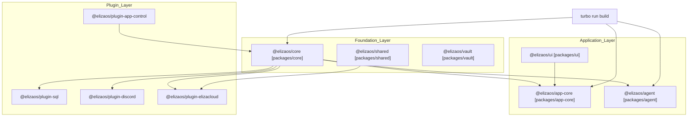
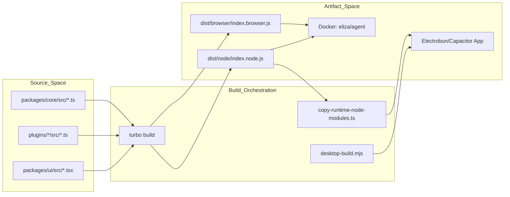

<!-- source: DeepWiki mcp.deepwiki.com · repo elizaOS/eliza · page 10.2 Build System · fetched 2026-10-29 -->

# Build System

Relevant source files

The following files were used as context for generating this wiki page:

- [.github/workflows/README.md](.github/workflows/README.md)
- [packages/agent/src/runtime/release-plugin-policy.test.ts](packages/agent/src/runtime/release-plugin-policy.test.ts)
- [packages/agent/src/runtime/release-plugin-policy.ts](packages/agent/src/runtime/release-plugin-policy.ts)
- [packages/app-core/platforms/electrobun/electrobun.config.ts](packages/app-core/platforms/electrobun/electrobun.config.ts)
- [packages/app-core/platforms/electrobun/src/electrobun-config.test.ts](packages/app-core/platforms/electrobun/src/electrobun-config.test.ts)
- [packages/app-core/scripts/assert-required-bundled-packages.test.ts](packages/app-core/scripts/assert-required-bundled-packages.test.ts)
- [packages/app-core/scripts/copy-runtime-node-modules.ts](packages/app-core/scripts/copy-runtime-node-modules.ts)
- [packages/app-core/scripts/desktop-build.mjs](packages/app-core/scripts/desktop-build.mjs)
- [packages/app-core/scripts/dev-platform.mjs](packages/app-core/scripts/dev-platform.mjs)
- [packages/app-core/scripts/docker-ci-smoke.sh](packages/app-core/scripts/docker-ci-smoke.sh)
- [packages/app-core/scripts/lib/read-app-identity.mjs](packages/app-core/scripts/lib/read-app-identity.mjs)
- [packages/app-core/scripts/link-docker-local-app-packages.mjs](packages/app-core/scripts/link-docker-local-app-packages.mjs)
- [packages/app-core/src/api/ios-local-agent-transport.ts](packages/app-core/src/api/ios-local-agent-transport.ts)
- [packages/app-core/vitest.config.ts](packages/app-core/vitest.config.ts)
- [packages/core/package.json](packages/core/package.json)
- [packages/elizaos/templates/project/apps/app/electrobun/electrobun.config.ts](packages/elizaos/templates/project/apps/app/electrobun/electrobun.config.ts)
- [packages/ui/src/backgrounds/BackgroundHost.tsx](packages/ui/src/backgrounds/BackgroundHost.tsx)
- [packages/ui/src/backgrounds/__tests__/BackgroundHost.test.ts](packages/ui/src/backgrounds/__tests__/BackgroundHost.test.ts)
- [packages/ui/src/components/onboarding/states/onboarding.css](packages/ui/src/components/onboarding/states/onboarding.css)
- [packages/ui/src/components/shell/RuntimeGate.cloud-provisioning.test.tsx](packages/ui/src/components/shell/RuntimeGate.cloud-provisioning.test.tsx)
- [packages/ui/src/components/shell/RuntimeGate.tsx](packages/ui/src/components/shell/RuntimeGate.tsx)
- [packages/ui/src/components/shell/StartupShell.tsx](packages/ui/src/components/shell/StartupShell.tsx)
- [packages/ui/src/components/shell/startup-shell-assets.test.ts](packages/ui/src/components/shell/startup-shell-assets.test.ts)
- [plugins/plugin-app-control/package.json](plugins/plugin-app-control/package.json)
- [plugins/plugin-commands/package.json](plugins/plugin-commands/package.json)
- [plugins/plugin-discord/package.json](plugins/plugin-discord/package.json)
- [plugins/plugin-elizacloud/__tests__/cloud-route-plugin.test.ts](plugins/plugin-elizacloud/__tests__/cloud-route-plugin.test.ts)
- [plugins/plugin-elizacloud/package.json](plugins/plugin-elizacloud/package.json)
- [plugins/plugin-elizacloud/src/plugin.ts](plugins/plugin-elizacloud/src/plugin.ts)
- [plugins/plugin-elizacloud/src/routes/cloud-routes.ts](plugins/plugin-elizacloud/src/routes/cloud-routes.ts)
- [plugins/plugin-farcaster/package.json](plugins/plugin-farcaster/package.json)
- [plugins/plugin-feishu/package.json](plugins/plugin-feishu/package.json)
- [plugins/plugin-google-chat/package.json](plugins/plugin-google-chat/package.json)
- [plugins/plugin-google-chat/src/actions/index.ts](plugins/plugin-google-chat/src/actions/index.ts)
- [plugins/plugin-google-chat/src/providers/index.ts](plugins/plugin-google-chat/src/providers/index.ts)
- [plugins/plugin-imessage/package.json](plugins/plugin-imessage/package.json)
- [plugins/plugin-line/package.json](plugins/plugin-line/package.json)
- [plugins/plugin-local-storage/src/services/local-storage.ts](plugins/plugin-local-storage/src/services/local-storage.ts)
- [plugins/plugin-matrix/package.json](plugins/plugin-matrix/package.json)
- [plugins/plugin-music/package.json](plugins/plugin-music/package.json)
- [plugins/plugin-nostr/package.json](plugins/plugin-nostr/package.json)
- [plugins/plugin-openrouter/package.json](plugins/plugin-openrouter/package.json)
- [plugins/plugin-roblox/package.json](plugins/plugin-roblox/package.json)
- [plugins/plugin-signal/package.json](plugins/plugin-signal/package.json)
- [plugins/plugin-slack/package.json](plugins/plugin-slack/package.json)
- [plugins/plugin-social-alpha/package.json](plugins/plugin-social-alpha/package.json)
- [plugins/plugin-suno/package.json](plugins/plugin-suno/package.json)
- [plugins/plugin-twitch/package.json](plugins/plugin-twitch/package.json)
- [plugins/plugin-web-search/package.json](plugins/plugin-web-search/package.json)
- [plugins/plugin-wechat/package.json](plugins/plugin-wechat/package.json)

The elizaOS build system orchestrates the compilation, testing, and packaging of a multi-language monorepo. It ensures that foundational components like the core TypeScript runtime and shared utilities are built before dependent plugins, clients, and servers.

The system is built on three primary pillars:
- **Bun**: The primary package manager, runtime, and test runner for the JavaScript/TypeScript ecosystem [packages/core/package.json:21](), [packages/core/package.json:84-87]().
- **Turbo**: A high-performance build system that manages the task dependency graph, parallel execution, and caching [packages/core/package.json:91]().
- **Lerna**: Handles monorepo versioning and synchronized publishing of packages to registries.

Sources: [packages/core/package.json:21-91]()

---

## Build Orchestration with Turbo

Turbo uses a task graph to define relationships between packages. This ensures that if `@elizaos/app-core` depends on `@elizaos/core`, the core is built first.

### Task Dependency Graph

The build system follows a strict hierarchy where core packages are built before plugins, and plugins are built before application shells.

| Task | Source Packages | Dependencies | Outputs |
| :--- | :--- | :--- | :--- |
| `@elizaos/core#build` | `packages/core` | `@elizaos/contracts`, `@elizaos/prompts` [packages/core/package.json:128-129]() | `dist/` |
| `plugin#build` | `plugins/*` | `@elizaos/core`, `@elizaos/shared` [plugins/plugin-elizacloud/package.json:61-63]() | `dist/` |
| `@elizaos/app-core#build`| `packages/app-core` | `@elizaos/core`, `@elizaos/ui`, `@elizaos/shared` [packages/app-core/vitest.config.ts:8-19]() | `dist/` |

### Build Pipeline Visualization
The following diagram maps the Natural Language concepts of "Layers" to the specific code entities and folders managed by the build system.

Sources: [packages/core/package.json:120-151](), [plugins/plugin-discord/package.json:48-74](), [plugins/plugin-elizacloud/package.json:56-78]()

---

## Desktop and Mobile Build Toolchains

elizaOS utilizes specialized scripts for platform-specific builds, particularly for the Electrobun-based desktop app and Capacitor-based mobile apps.

### Desktop Build (`desktop-build.mjs`)
The desktop build process handles environment-specific configurations and artifact staging:
- **Profiles**: Supports different build profiles like `full` or `no-streaming` [packages/app-core/scripts/desktop-build.mjs:30-33]().
- **Variants**: Manages `store` (app store) vs `direct` (website download) build variants [packages/app-core/scripts/desktop-build.mjs:108-112]().
- **Runtime Embedding**: Conditionally embeds the agent runtime bundle based on API base configuration [packages/app-core/platforms/electrobun/electrobun.config.ts:47-56]().

### Runtime Copy Utility (`copy-runtime-node-modules.ts`)
This utility is critical for packaging the agent runtime into standalone applications:
- **Pruning**: Removes non-essential files like `.git`, `tests`, and documentation to minimize bundle size [packages/app-core/scripts/copy-runtime-node-modules.ts:67-90]().
- **Platform Aliasing**: Maps OS and architecture strings to canonical Node.js platform identifiers [packages/app-core/scripts/copy-runtime-node-modules.ts:99-136]().
- **Verification**: Includes a defense-in-depth check, `assertRequiredBundledPackagesLanded`, to ensure essential packages like `@elizaos/core` are not accidentally pruned [packages/app-core/scripts/assert-required-bundled-packages.test.ts:4-12]().

Sources: [packages/app-core/scripts/desktop-build.mjs:30-112](), [packages/app-core/scripts/copy-runtime-node-modules.ts:67-136](), [packages/app-core/platforms/electrobun/electrobun.config.ts:47-56]()

---

## Docker Build and Smoke Testing

The system includes a production-grade Docker pipeline verified by smoke tests.

### Docker CI Smoke Test (`docker-ci-smoke.sh`)
This script simulates the production Docker build path used in GitHub Actions:
1. **Dependency Sync**: Installs dependencies using the frozen lockfile [packages/app-core/scripts/docker-ci-smoke.sh:7-8]().
2. **Artifact Generation**: Builds the required runtime and UI artifacts [packages/app-core/scripts/docker-ci-smoke.sh:8]().
3. **Image Building**: Builds the local production image using `Dockerfile.ci` [packages/app-core/scripts/docker-ci-smoke.sh:9]().
4. **Health Probing**: Boots the container and probes `/api/health` to verify runtime integrity [packages/app-core/scripts/docker-ci-smoke.sh:10]().

### Local Linker (`link-docker-local-app-packages.mjs`)
For local development within Docker, this script symlinks over 50 local packages and plugins into the container environment to avoid constant re-building [packages/app-core/scripts/link-docker-local-app-packages.mjs:16-53](). It also rewrites `package.json` exports from `./dist/` to `./src/` to allow live-reloading from source [packages/app-core/scripts/link-docker-local-app-packages.mjs:83-116]().

Sources: [packages/app-core/scripts/docker-ci-smoke.sh:1-50](), [packages/app-core/scripts/link-docker-local-app-packages.mjs:16-116]()

---

## Data Flow: Code to Artifacts

This diagram illustrates how source code entities are transformed into deployable artifacts across different platforms.

Sources: [packages/core/package.json:23-48](), [packages/app-core/scripts/desktop-build.mjs:22-47](), [packages/app-core/scripts/copy-runtime-node-modules.ts:16-18]()

---

## Build Scripts and Utilities

The `packages/app-core/scripts/` directory contains over 100 scripts managing the build lifecycle.

| Script | Purpose |
| :--- | :--- |
| `init-submodules.mjs` | Ensures git submodules are initialized before build [packages/app-core/scripts/docker-ci-smoke.sh:208](). |
| `link-docker-local-app-packages.mjs` | Manages symlinks for local development in Docker [packages/app-core/scripts/link-docker-local-app-packages.mjs:1-15](). |
| `desktop-build.mjs` | Orchestrates the Electrobun build process for MacOS/Windows [packages/app-core/scripts/desktop-build.mjs:1-25](). |
| `copy-runtime-node-modules.ts` | Prunes and copies `node_modules` for standalone distribution [packages/app-core/scripts/copy-runtime-node-modules.ts:1-15](). |
| `runtime-package-manifest.ts` | Defines which packages are always bundled in the runtime [packages/app-core/scripts/copy-runtime-node-modules.ts:10-14](). |

Sources: [packages/app-core/scripts/link-docker-local-app-packages.mjs:1-15](), [packages/app-core/scripts/desktop-build.mjs:1-25](), [packages/app-core/scripts/copy-runtime-node-modules.ts:1-15]()

---

