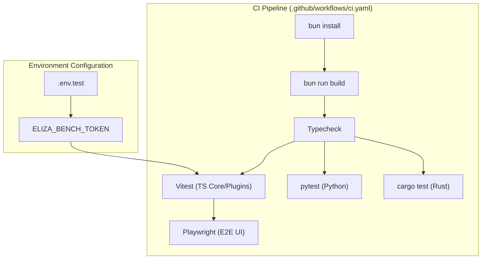
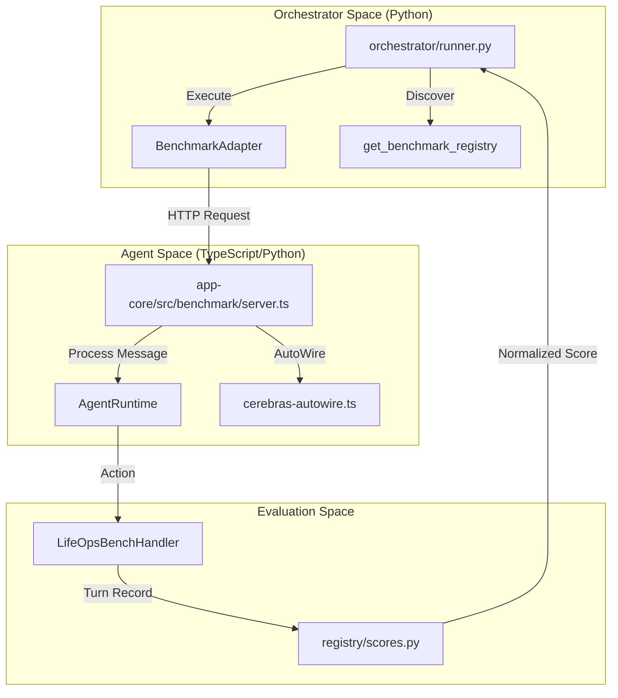

<!-- source: DeepWiki mcp.deepwiki.com · repo elizaOS/eliza · page 10.3 Testing · fetched 2026-10-29 -->

# Testing

<details>
<summary>Relevant source files</summary>

The following files were used as context for generating this wiki page:

- [packages/agent/vitest.config.ts](packages/agent/vitest.config.ts)
- [packages/app-core/src/benchmark/__tests__/lifeops-bench-handler.test.ts](packages/app-core/src/benchmark/__tests__/lifeops-bench-handler.test.ts)
- [packages/app-core/src/benchmark/lifeops-bench-handler.ts](packages/app-core/src/benchmark/lifeops-bench-handler.ts)
- [packages/app-core/src/benchmark/lifeops-fake-backend.ts](packages/app-core/src/benchmark/lifeops-fake-backend.ts)
- [packages/app-core/src/benchmark/server.ts](packages/app-core/src/benchmark/server.ts)
- [packages/app/test/ui-smoke/all-pages-clicksafe.spec.ts](packages/app/test/ui-smoke/all-pages-clicksafe.spec.ts)
- [packages/app/test/ui-smoke/helpers.ts](packages/app/test/ui-smoke/helpers.ts)
- [packages/benchmarks/eliza-adapter/eliza_adapter/lifeops_bench.py](packages/benchmarks/eliza-adapter/eliza_adapter/lifeops_bench.py)
- [packages/benchmarks/eliza-adapter/eliza_adapter/vending_bench.py](packages/benchmarks/eliza-adapter/eliza_adapter/vending_bench.py)
- [packages/benchmarks/eliza-adapter/tests/test_lifeops_bench_adapter.py](packages/benchmarks/eliza-adapter/tests/test_lifeops_bench_adapter.py)
- [packages/benchmarks/eliza-adapter/tests/test_vending_adapter.py](packages/benchmarks/eliza-adapter/tests/test_vending_adapter.py)
- [packages/benchmarks/orchestrator/adapters.py](packages/benchmarks/orchestrator/adapters.py)
- [packages/benchmarks/orchestrator/calibration_report.py](packages/benchmarks/orchestrator/calibration_report.py)
- [packages/benchmarks/orchestrator/runner.py](packages/benchmarks/orchestrator/runner.py)
- [packages/benchmarks/orchestrator/tests/test_adapter_discovery.py](packages/benchmarks/orchestrator/tests/test_adapter_discovery.py)
- [packages/benchmarks/orchestrator/tests/test_calibration_report.py](packages/benchmarks/orchestrator/tests/test_calibration_report.py)
- [packages/benchmarks/orchestrator/tests/test_latest_snapshots.py](packages/benchmarks/orchestrator/tests/test_latest_snapshots.py)
- [packages/benchmarks/registry/__init__.py](packages/benchmarks/registry/__init__.py)
- [packages/benchmarks/registry/commands.py](packages/benchmarks/registry/commands.py)
- [packages/benchmarks/registry/scores.py](packages/benchmarks/registry/scores.py)
- [packages/benchmarks/vending-bench/elizaos_vending_bench/cli.py](packages/benchmarks/vending-bench/elizaos_vending_bench/cli.py)
- [packages/chip/scripts/ai_eda/check_aieda_idata_conversion.py](packages/chip/scripts/ai_eda/check_aieda_idata_conversion.py)
- [packages/chip/scripts/ai_eda/check_verification_target_captures.py](packages/chip/scripts/ai_eda/check_verification_target_captures.py)
- [packages/chip/scripts/ai_eda/convert_aieda_idata_to_internal_records.py](packages/chip/scripts/ai_eda/convert_aieda_idata_to_internal_records.py)
- [packages/cloud-frontend/src/pages/login/wallet-buttons.tsx](packages/cloud-frontend/src/pages/login/wallet-buttons.tsx)
- [packages/homepage/package.json](packages/homepage/package.json)
- [packages/homepage/tests/e2e/contact-sheet-capture.spec.ts](packages/homepage/tests/e2e/contact-sheet-capture.spec.ts)
- [packages/os-homepage/tsconfig.app.json](packages/os-homepage/tsconfig.app.json)
- [packages/os-homepage/vite.config.ts](packages/os-homepage/vite.config.ts)
- [packages/ui/src/components/config-ui/config-renderer.tsx](packages/ui/src/components/config-ui/config-renderer.tsx)
- [vitest.config.ts](vitest.config.ts)

</details>


The elizaOS testing infrastructure is a multi-language, multi-layered suite designed to ensure the reliability of a polyglot agent framework. It spans unit and integration testing for TypeScript, Python, and Rust, end-to-end (E2E) UI testing, and specialized agent scenario testing via the `scenario-runner` and a comprehensive `benchmarks` suite.

## Multi-Language Test Infrastructure

ElizaOS utilizes language-specific test runners orchestrated by a centralized CI pipeline. The primary test entry points are defined in the root `package.json` and executed via Bun or GitHub Actions.

### TypeScript (Vitest)
The core logic and the majority of plugins are tested using **Vitest**. 

*   **Core and Plugin Tests**: Each package and plugin contains its own `*.test.ts` files. The `packages/agent` package uses a custom Vitest configuration that includes specific aliases for `@elizaos` workspace packages to ensure tests run against source code [packages/agent/vitest.config.ts:16-59]().
*   **Environment Setup**: Tests utilize `vmForks` for isolation and a dedicated `test/setup.ts` file for environment initialization [packages/agent/vitest.config.ts:128-129]().
*   **Exclusion Patterns**: Integration, live, and E2E tests are explicitly excluded from the standard unit test run to maintain speed [packages/agent/vitest.config.ts:138-147]().

### Python (pytest)
The Python runtime, interoperability layers, and the benchmark orchestrator are tested using **pytest**.
*   **Orchestrator Tests**: The orchestrator includes tests for adapter discovery, ensuring that all benchmark directories (like `OSWorld`, `HyperliquidBench`, and `voicebench`) are correctly detected and mapped [packages/benchmarks/orchestrator/tests/test_adapter_discovery.py:77-101]().
*   **Snapshot Validation**: Tests verify that result snapshots are correctly rebuilt from the SQLite database, ensuring leaderboard integrity [packages/benchmarks/orchestrator/tests/test_latest_snapshots.py:18-21]().

### Rust (cargo test)
Rust components, including the native runtime and the SQL plugin's Rust implementation, use the standard `cargo test` suite.

### Testing Execution Flow



Sources: [packages/agent/vitest.config.ts:125-149](), [packages/benchmarks/orchestrator/tests/test_adapter_discovery.py:15-31](), [packages/benchmarks/orchestrator/tests/test_latest_snapshots.py:7-22]()

---

## Scenario Runner

The **Scenario Runner** (`packages/scenario-runner/`) is a framework designed to execute `.scenario.ts` files against a real `@elizaos/core` `AgentRuntime` using live LLMs.

### Key Components
*   **Execution**: Loads scenarios and emits a JSON report after running them against a live LLM.
*   **CLI**: Provides a binary for running tests from the terminal.

---

## Benchmarks Suite

The `packages/benchmarks/` suite is a standardized framework for evaluating agent performance across multiple domains. It includes an **Orchestrator** that normalizes execution across different agent harnesses (Eliza, Hermes, OpenClaw) [packages/benchmarks/orchestrator/adapters.py:101-101]().

### Orchestrator and Adapters
The orchestrator uses `BenchmarkAdapter` objects to define how to run a specific benchmark and extract its score [packages/benchmarks/orchestrator/types.py:21-21](). 
*   **Discovery**: Automatically finds benchmarks in the workspace while ignoring non-benchmark directories like `__pycache__` or `scripts` [packages/benchmarks/orchestrator/adapters.py:53-95]().
*   **Harness Compatibility**: The system tracks compatibility for various harnesses. For example, `hyperliquid_bench` requires a live backend (HL_PRIVATE_KEY) to run [packages/benchmarks/orchestrator/adapters.py:144-145]().
*   **Result Locators**: Each adapter provides a `result_locator` to find the JSON output of a benchmark run [packages/benchmarks/orchestrator/tests/test_latest_snapshots.py:33-38]().

### Benchmark Registry and Scores
The registry (`packages/benchmarks/registry/`) maps benchmark IDs to execution commands and scoring logic.
*   **BFCL (Berkeley Function Calling Leaderboard)**: Extracts AST accuracy and execution accuracy from result JSONs [packages/benchmarks/registry/scores.py:27-75]().
*   **Vending-Bench**: A 30-day simulation where the agent manages a business. The `eliza-adapter` resets the bridge session before every `generate` call to keep conversation history bounded [packages/benchmarks/eliza-adapter/eliza_adapter/vending_bench.py:12-26]().
*   **LifeOpsBench**: A specialized tool-use benchmark that uses a fake backend to simulate calendar and email interactions [packages/app-core/src/benchmark/lifeops-fake-backend.ts:1-10]().

### Benchmark Execution Flow



Sources: [packages/benchmarks/orchestrator/adapters.py:98-170](), [packages/benchmarks/registry/scores.py:27-75](), [packages/app-core/src/benchmark/server.ts:18-55](), [packages/benchmarks/eliza-adapter/eliza_adapter/vending_bench.py:1-26]()

---

## UI and E2E Testing

End-to-End (E2E) testing for the application shell uses **Playwright** to validate routes and component interactions.

### Playwright Smoke Tests
The `ui-smoke` suite (`packages/app/test/ui-smoke/`) performs "click-safe" validation of all major application routes [packages/app/test/ui-smoke/all-pages-clicksafe.spec.ts:76-215]().
*   **Ready Checks**: Tests verify that specific UI markers (e.g., `[data-testid="chat-composer-textarea"]`) appear after navigation [packages/app/test/ui-smoke/all-pages-clicksafe.spec.ts:80-84]().
*   **Render Telemetry**: A custom telemetry guard detects excessive re-renders or React errors during smoke tests [packages/app/test/ui-smoke/helpers.ts:115-143]().
*   **Storage Seeding**: Tests initialize `localStorage` to bypass onboarding or set specific active servers [packages/app/test/ui-smoke/helpers.ts:96-113]().

### Data Flow for E2E Tests

```mermaid
graph LR
    subgraph "Code Entity Space"
        PR["Playwright Runner"]
        APP["@elizaos/app-core"]
        RT["AgentRuntime"]
        RTM["render-telemetry-guard"]
    end

    subgraph "Natural Language Space"
        USER["User Navigation (e.g., /chat)"]
        ASSERT["UI Component Visible"]
    end

    USER -.->|page.goto| PR
    PR -->|Init Script| RTM
    PR -->|Navigate| APP
    APP -->|State Change| RT
    RTM -->|Check Errors| PR
    PR -.->|expect(selector)| ASSERT
```

Sources: [packages/app/test/ui-smoke/all-pages-clicksafe.spec.ts:76-118](), [packages/app/test/ui-smoke/helpers.ts:115-163](), [packages/app/test/ui-smoke/helpers.ts:96-113]()

---

## Trajectory and Token Analysis

The system tracks "trajectories"—the sequence of steps an agent takes to solve a task—to enable performance auditing.

*   **Token Metrics**: The benchmark server calculates `total_tokens`, `input_tokens`, and `llm_call_count`. If telemetry is missing, it estimates tokens based on character counts [packages/benchmarks/orchestrator/tests/test_latest_snapshots.py:111-137]().
*   **Trajectory Steps**: The `BenchmarkTrajectoryStep` records the agent's thoughts, chosen actions, and tool parameters [packages/app-core/src/benchmark/server.ts:31-35]().
*   **Retry Logic**: The benchmark server implements exponential backoff for OpenAI-compatible providers (like Cerebras) to handle rate limits during intensive runs [packages/app-core/src/benchmark/server.ts:94-146]().

Sources: [packages/benchmarks/orchestrator/tests/test_latest_snapshots.py:111-137](), [packages/app-core/src/benchmark/server.ts:31-55](), [packages/app-core/src/benchmark/server.ts:118-146]()

---

