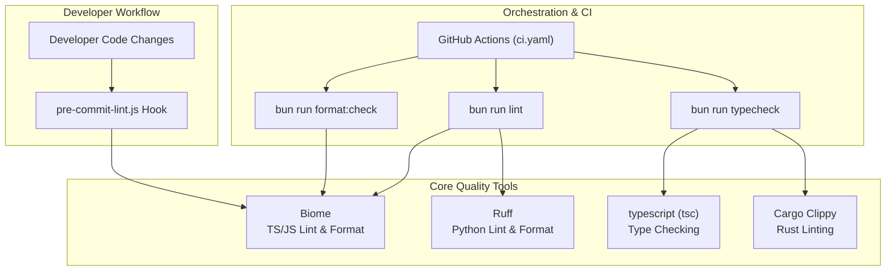
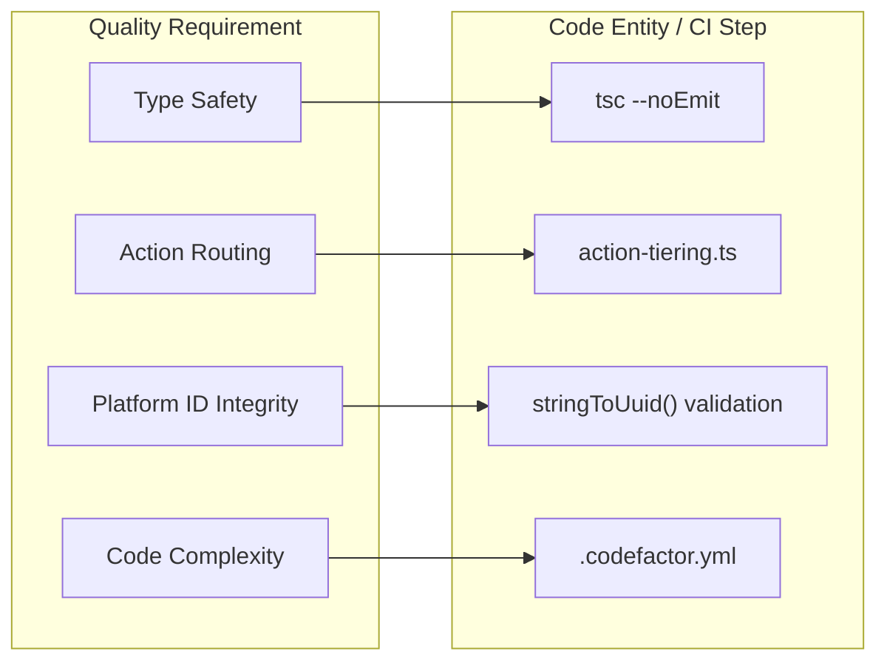

<!-- source: DeepWiki mcp.deepwiki.com · repo elizaOS/eliza · page 10.4 Code Quality · fetched 2026-10-29 -->

# Code Quality

Relevant source files

The following files were used as context for generating this wiki page:

- [.codefactor.yml](.codefactor.yml)
- [biome.json](biome.json)
- [packages/agent/src/runtime/plugin-role-gating.test.ts](packages/agent/src/runtime/plugin-role-gating.test.ts)
- [packages/agent/src/runtime/plugin-role-gating.ts](packages/agent/src/runtime/plugin-role-gating.ts)
- [packages/app-core/platforms/electrobun/docs/capability-collapse-matrix.json](packages/app-core/platforms/electrobun/docs/capability-collapse-matrix.json)
- [packages/app-core/platforms/electrobun/docs/capability-collapse-matrix.md](packages/app-core/platforms/electrobun/docs/capability-collapse-matrix.md)
- [packages/app-core/platforms/electrobun/docs/capability-routing.md](packages/app-core/platforms/electrobun/docs/capability-routing.md)
- [packages/app-core/platforms/electrobun/docs/ui-boundary-audit.json](packages/app-core/platforms/electrobun/docs/ui-boundary-audit.json)
- [packages/app-core/platforms/electrobun/docs/ui-boundary-audit.md](packages/app-core/platforms/electrobun/docs/ui-boundary-audit.md)
- [packages/app-core/platforms/electrobun/src/voice/voice-live-validation.test.ts](packages/app-core/platforms/electrobun/src/voice/voice-live-validation.test.ts)
- [packages/core/build.ts](packages/core/build.ts)
- [packages/core/src/__tests__/message-routing-live-regression.test.ts](packages/core/src/__tests__/message-routing-live-regression.test.ts)
- [packages/core/src/__tests__/tiered-action-surface.test.ts](packages/core/src/__tests__/tiered-action-surface.test.ts)
- [packages/core/src/capabilities/index.test.ts](packages/core/src/capabilities/index.test.ts)
- [packages/core/src/capabilities/index.ts](packages/core/src/capabilities/index.ts)
- [packages/core/src/features/advanced-capabilities/actions/generateMedia.test.ts](packages/core/src/features/advanced-capabilities/actions/generateMedia.test.ts)
- [packages/core/src/features/messaging/triage/__tests__/list-inbox-action.test.ts](packages/core/src/features/messaging/triage/__tests__/list-inbox-action.test.ts)
- [packages/core/src/features/plugin-manager/plugin-manager-umbrella.test.ts](packages/core/src/features/plugin-manager/plugin-manager-umbrella.test.ts)
- [packages/core/src/network/ssrf.test.ts](packages/core/src/network/ssrf.test.ts)
- [packages/core/src/runtime/__tests__/action-tiering.test.ts](packages/core/src/runtime/__tests__/action-tiering.test.ts)
- [packages/core/src/runtime/action-tiering.ts](packages/core/src/runtime/action-tiering.ts)
- [plugins/plugin-agent-orchestrator/__tests__/unit/task-agent-frameworks.test.ts](plugins/plugin-agent-orchestrator/__tests__/unit/task-agent-frameworks.test.ts)
- [plugins/plugin-coding-tools/src/actions/enter-worktree.test.ts](plugins/plugin-coding-tools/src/actions/enter-worktree.test.ts)
- [plugins/plugin-coding-tools/src/actions/exit-worktree.test.ts](plugins/plugin-coding-tools/src/actions/exit-worktree.test.ts)
- [plugins/plugin-coding-tools/src/actions/ls.test.ts](plugins/plugin-coding-tools/src/actions/ls.test.ts)
- [plugins/plugin-coding-tools/src/actions/ls.ts](plugins/plugin-coding-tools/src/actions/ls.ts)
- [plugins/plugin-coding-tools/src/actions/read.test.ts](plugins/plugin-coding-tools/src/actions/read.test.ts)
- [plugins/plugin-coding-tools/src/actions/write.test.ts](plugins/plugin-coding-tools/src/actions/write.test.ts)
- [plugins/plugin-coding-tools/src/lib/run-shell.test.ts](plugins/plugin-coding-tools/src/lib/run-shell.test.ts)
- [plugins/plugin-discord/__tests__/message-coalesce.test.ts](plugins/plugin-discord/__tests__/message-coalesce.test.ts)
- [plugins/plugin-discord/__tests__/messages-url.test.ts](plugins/plugin-discord/__tests__/messages-url.test.ts)
- [plugins/plugin-discord/__tests__/staleness.test.ts](plugins/plugin-discord/__tests__/staleness.test.ts)
- [plugins/plugin-discord/attachments.ts](plugins/plugin-discord/attachments.ts)
- [plugins/plugin-discord/debouncer.ts](plugins/plugin-discord/debouncer.ts)
- [plugins/plugin-discord/discord-events.ts](plugins/plugin-discord/discord-events.ts)
- [plugins/plugin-discord/discord-history.ts](plugins/plugin-discord/discord-history.ts)
- [plugins/plugin-discord/message-coalesce.ts](plugins/plugin-discord/message-coalesce.ts)
- [plugins/plugin-discord/messages.ts](plugins/plugin-discord/messages.ts)
- [plugins/plugin-discord/service.ts](plugins/plugin-discord/service.ts)
- [plugins/plugin-discord/slash-commands.ts](plugins/plugin-discord/slash-commands.ts)
- [plugins/plugin-discord/staleness.ts](plugins/plugin-discord/staleness.ts)
- [plugins/plugin-discord/status-reactions.ts](plugins/plugin-discord/status-reactions.ts)

This document describes the code quality tools, configuration, and workflows used in the elizaOS monorepo. Code quality encompasses linting, formatting, type checking, and automated security scanning across TypeScript, Python, and Rust codebases.

For information about testing infrastructure, see **10.3 Testing**. For build system orchestration, see **10.2 Build System**. For CI/CD automation of quality checks, see **11.1 Continuous Integration**.

## Overview

The elizaOS monorepo enforces code quality through language-specific tools orchestrated by the root task runner. The system maintains consistent standards across the following platforms:

- **TypeScript/JavaScript**: Biome for linting and formatting, TypeScript compiler (`tsc`) for type checking.
- **Rust**: Cargo with `clippy` for linting and `rustfmt` for formatting.
- **Python**: `ruff` for linting and formatting, `pytest` for validation.
- **Multi-Language Integration**: Automated CI workflows that validate the entire polyglot stack.

All quality checks run locally during development and are enforced in GitHub Actions before code merges.

Sources: [biome.json:1-134](), [.codefactor.yml:1-21]()

## Code Quality Tool Chain

The project uses a unified toolchain to manage quality across the monorepo. The following diagram maps the relationship between developer actions, orchestration scripts, and the underlying quality tools.

### Quality Orchestration Flow

Sources: [biome.json:5-9](), [packages/core/build.ts:1-20]()

## TypeScript Configuration and Type Checking

The project uses a hierarchical `tsconfig.json` structure to manage type checking across the monorepo. Individual packages extend a base configuration and often maintain separate configs for specific build environments.

### Capability Routing Quality
Type safety is strictly enforced for cross-platform capabilities via the `CapabilityRouter`.
- **Environment Contexts**: Types like `CapabilityEnvironment` (desktop, node, server, browser, mobile) ensure environment-aware code execution [packages/core/src/capabilities/index.ts:5-11]().
- **Error Handling**: The `CapabilityError` class provides structured error payloads for failed capability requests [packages/core/src/capabilities/index.ts:39-63]().
- **Validation**: Capability routers are validated via fixtures like `CAPABILITY_ROUTER_PROTOCOL_FIXTURE` to ensure protocol compliance [packages/core/src/capabilities/index.test.ts:248-272]().

### Action Surface Quality
The system manages action visibility through a tiered surface system to prevent model confusion:
- **Action Tiering**: Actions are categorized into `tier0` (protocol), `tierA` (high confidence), `tierB` (available), and `tierC` (omitted) [packages/core/src/runtime/action-tiering.ts:17]().
- **Catalog Management**: The `ActionCatalog` organizes actions into parent/child relationships to manage complexity [packages/core/src/runtime/action-tiering.ts:2-5]().

Sources: [packages/core/src/capabilities/index.ts:1-63](), [packages/core/src/runtime/action-tiering.ts:1-61]()

## Biome: TypeScript/JavaScript Linting and Formatting

Biome is the primary tool for TypeScript/JavaScript, replacing Prettier and ESLint with a high-performance integrated tool.

### Biome Configuration and Rules
The `biome.json` file at the root enables the linter and formatter with specific rule overrides:
- **VCS Integration**: Biome is aware of Git and uses `.gitignore` [biome.json:5-9]().
- **Formatting**: Uses a 2-space indent style [biome.json:123-127]().
- **Linter Rules**: 
    - `noExplicitAny`: Set to `warn` [biome.json:66]().
    - `noNonNullAssertion`: Set to `warn` [biome.json:63]().
    - `useHookAtTopLevel`: Disabled for `**/*.ts` to accommodate utility patterns [biome.json:83]().

### Exclusions and Ignores
Biome ignores specific paths to prevent processing build artifacts or large datasets:
- **Build Folders**: `**/dist`, `**/build`, `**/.next` [biome.json:15-17]().
- **External Dependencies**: `**/node_modules`, `**/vendor` [biome.json:18-19]().
- **Specialized Data**: `packages/inference/llama.cpp` and various benchmark metrics [biome.json:22, 39-41]().

Sources: [biome.json:1-134]()

## Multi-Language Quality Matrix

elizaOS maintains unified quality approaches across its polyglot codebase.

### Language Quality Tools
| Language | Lint/Format Tool | Type Check / Validation | Source Path |
|----------|-----------|-----------------|-------------|
| **TypeScript** | Biome | `tsc` | `packages/typescript` |
| **Rust** | `cargo clippy` | `cargo test` | `packages/rust` |
| **Python** | `ruff` | `pytest` | `packages/python` |

### Platform-Specific Quality
Quality is also maintained at the plugin level, particularly for complex integrations like Discord:
- **ID Handling**: Explicit documentation and validation for Discord "snowflake" IDs using `stringToUuid()` to avoid invalid UUID errors [plugins/plugin-discord/service.ts:29-59]().
- **Staleness Guards**: The `applyDiscordStalenessGuard` function ensures messages are processed in sequence and prevents duplicate processing [plugins/plugin-discord/messages.ts:48-52]().

Sources: [plugins/plugin-discord/service.ts:29-59](), [plugins/plugin-discord/messages.ts:42-52]()

## Automated Quality Gates

The project uses several automated gates to ensure code remains stable and secure.

### CodeFactor Integration
`.codefactor.yml` excludes long-lived runtime surfaces and specific complex adapters from standard complexity analysis to focus on maintainable core logic:
- `packages/agent/src/api/server.ts` [.codefactor.yml:5]().
- `packages/agent/src/runtime/eliza.ts` [.codefactor.yml:8]().
- `packages/ui/src/api/client-chat.ts` [.codefactor.yml:20]().

### Regression and Logic Mapping
The following diagram bridges the natural language requirements to the specific code entities and quality gates that enforce them.

Sources: [packages/core/src/runtime/action-tiering.ts:63-98](), [plugins/plugin-discord/service.ts:43-52](), [.codefactor.yml:1-21]()

## Git Hooks and Local Development

To maintain high standards before code reaches CI, elizaOS utilizes linting hooks.

- **Hook Implementation**: Orchestrated via `pre-commit-lint.js`.
- **Capability Verification**: Local development tests like `ls.test.ts` verify that coding tools respect blocked paths and capability router availability [plugins/plugin-coding-tools/src/actions/ls.test.ts:164-189]().
- **Sandbox Validation**: Coding tools use `SandboxService` to validate paths and ensure operations stay within allowed directories [plugins/plugin-coding-tools/src/actions/ls.ts:161-167]().

Sources: [plugins/plugin-coding-tools/src/actions/ls.test.ts:164-189](), [plugins/plugin-coding-tools/src/actions/ls.ts:144-167]()

---

