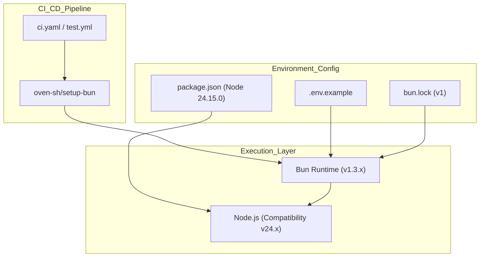
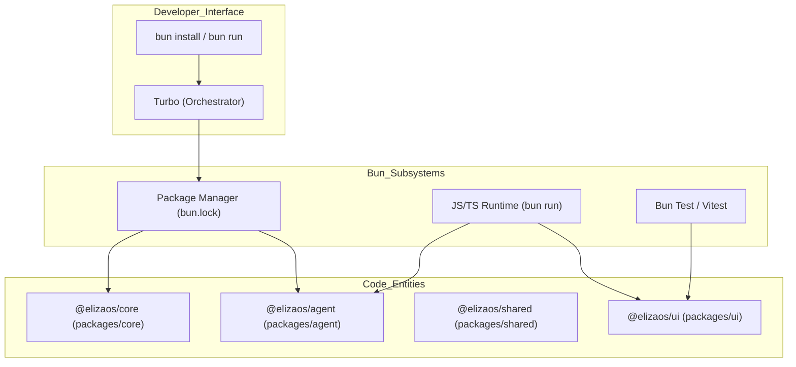
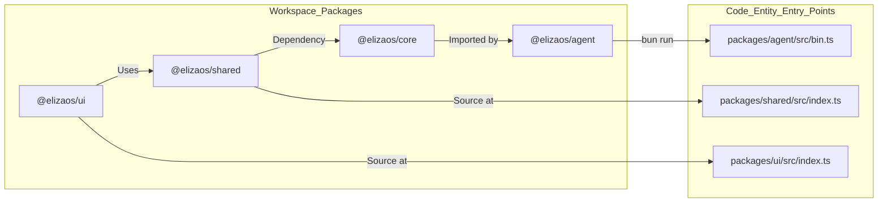

<!-- source: DeepWiki mcp.deepwiki.com · repo elizaOS/eliza · page 10.5 Bun Configuration · fetched 2026-10-29 -->

# Bun Configuration

Relevant source files

The following files were used as context for generating this wiki page:

- [bun.lock](bun.lock)
- [package.json](package.json)
- [packages/app-core/scripts/lib/orchestrator-desktop-dev-banner.mjs](packages/app-core/scripts/lib/orchestrator-desktop-dev-banner.mjs)
- [packages/shared/package.json](packages/shared/package.json)
- [packages/ui/package.json](packages/ui/package.json)
- [packages/ui/src/components/pages/BrowserWorkspaceView.tsx](packages/ui/src/components/pages/BrowserWorkspaceView.tsx)
- [packages/ui/test/stubs/capacitor-app.ts](packages/ui/test/stubs/capacitor-app.ts)
- [packages/ui/test/stubs/elizaos-app-wallet.ts](packages/ui/test/stubs/elizaos-app-wallet.ts)
- [packages/ui/test/stubs/elizaos-capacitor-llama.ts](packages/ui/test/stubs/elizaos-capacitor-llama.ts)
- [packages/ui/test/stubs/node-llama-cpp.ts](packages/ui/test/stubs/node-llama-cpp.ts)
- [packages/ui/vitest.config.ts](packages/ui/vitest.config.ts)

This document explains the role of Bun as the primary runtime and package manager for elizaOS. It covers workspace orchestration, lockfile management, and Bun-specific features utilized across the monorepo to ensure high-performance execution and dependency resolution.

## Purpose and Scope

elizaOS utilizes Bun for its high-speed JavaScript runtime, built-in test runner, and efficient package management. Bun is the standard for script execution and dependency handling across all packages, including `@elizaos/core`, `@elizaos/agent`, and various plugins. The project strictly enforces the use of Bun to maintain environment consistency. The root `package.json` specifies the engines for compatibility [package.json:17-19]() and utilizes Bun for core lifecycle scripts such as `postinstall` [package.json:21-21]().

Sources: [package.json:17-21](), [bun.lock:1-42]()

## Runtime and Environment Configuration

The monorepo includes specific configuration files to ensure consistent Node.js and Bun behavior across developer environments and CI/CD pipelines.

### Node.js and Bun Versioning
The project specifies Node.js version `24.15.0` in the root `package.json` engines field [package.json:18-18](). The `bun.lock` file indicates a `lockfileVersion: 1` [bun.lock:2-2](). Packages like `@elizaos/agent` and `@elizaos/shared` include `bun-types` version `1.3.12` or higher to provide type safety for Bun-specific APIs [packages/agent:171-171](), [packages/shared/package.json:129-129]().

### Registry Authentication and Lockfile
While `.npmrc` handles registry settings, Bun handles the actual resolution and installation of dependencies via the `bun.lock` binary lockfile [bun.lock:1-3](). This lockfile manages the entire workspace dependency graph, including complex relationships between core packages and plugins [bun.lock:4-17]().

**Diagram: Runtime and Environment Setup**

Sources: [package.json:17-19](), [bun.lock:1-17](), [packages/agent:163-171](), [packages/shared/package.json:25-27]()

## Workspace Management

Bun manages a complex workspace where internal packages reference each other using the `workspace:*` protocol. The `bun.lock` file tracks these dependencies for the root and all sub-packages [bun.lock:4-17]().

### Core Scripts and Orchestration
Bun is used to execute critical maintenance and development scripts:
- **Dependency Patching**: The `postinstall` script uses `bun` to run several patch scripts, including `patch-nested-core-dist.mjs` and `patch-tsup-dts.mjs` [package.json:21-21]().
- **Dependency Repair**: `bun run fix-deps` executes `packages/scripts/fix-workspace-deps.mjs` to manage workspace-wide dependency health [package.json:24-24]().
- **Trajectory Inspection**: `bun packages/scripts/trajectory.ts` allows for inspecting agent trajectories [package.json:30-30]().

### Build and Test Execution
While `turbo` is used for high-level task orchestration [package.json:70-70](), Bun serves as the underlying runner:
- **Agent Startup**: `bun run --cwd packages/agent start` launches the main agent process [package.json:68-68]().
- **UI Development**: `bun run dev` orchestrates a build for `@elizaos/app` and starts the UI development server [package.json:71-71]().
- **Platform Development**: `bun packages/app-core/scripts/dev-platform.mjs` manages the desktop platform build [package.json:74-75]().

**Diagram: Bun Runtime & Package Flow**

Sources: [package.json:21-75](), [bun.lock:4-51](), [packages/ui/package.json:26-39]()

## Lockfile and Version Management

The repository uses a single `bun.lock` file at the root to ensure deterministic installations across the monorepo [bun.lock:1-2](). 

### Maintenance Scripts
| Command | Action | Source |
|---------|--------|--------|
| `bun run clean` | Removes build artifacts and cleans the workspace | [packages/ui/package.json:27-27]() |
| `bun run fix-deps` | Executes the workspace dependency fixer | [package.json:24-24]() |
| `bun run typecheck` | Runs `tsc` via Bun to validate types across packages | [packages/shared/package.json:33-33]() |

### Path Resolution
The workspace configuration allows packages to reference each other's source during development and testing. For example, `packages/ui/vitest.config.ts` uses aliases to map `@elizaos/shared` and `@elizaos/core` to their respective source directories [packages/ui/vitest.config.ts:62-88]().

**Diagram: Workspace Dependency Mapping**

Sources: [bun.lock:4-132](), [package.json:24-24](), [packages/ui/vitest.config.ts:62-112](), [packages/agent:84-88]()

## Bun-Specific Features in elizaOS

### Native Plugin Integration
Bun is used to build and link native plugins. The `postinstall` script runs `bun packages/scripts/ensure-workspace-symlinks.mjs` and `node packages/scripts/ensure-native-plugins-linked.mjs` to prepare the environment for native modules [package.json:21-21]().

### Local Inference and Voice
Specific Bun scripts are provided for local inference and voice tasks:
- **Voice Profile**: `bun packages/app-core/scripts/voice-create-profile.mjs` [package.json:85-85]().
- **Interactive Voice**: `bun packages/app-core/scripts/voice-interactive.mjs` [package.json:83-83]().
- **Duet Mode**: `bun packages/app-core/scripts/voice-duet.mjs` [package.json:84-84]().

### Testing Infrastructure
While many packages use Vitest, Bun is often used as the runner for these tests. In `packages/ui`, the test script invokes `vitest` with specific `NODE_OPTIONS` to handle experimental features [packages/ui/package.json:32-34](). Bun's performance is leveraged during the `prepublishOnly` phase to run builds and clean tasks [packages/ui/package.json:28-29]().

Sources: [package.json:21-21](), [package.json:83-85](), [packages/ui/package.json:28-34]()

---

