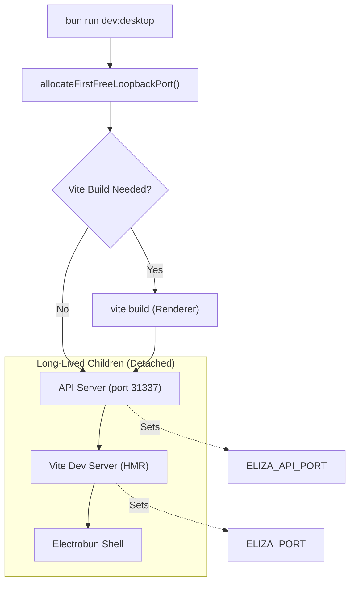
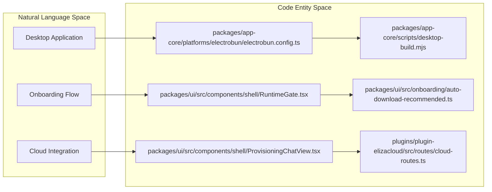
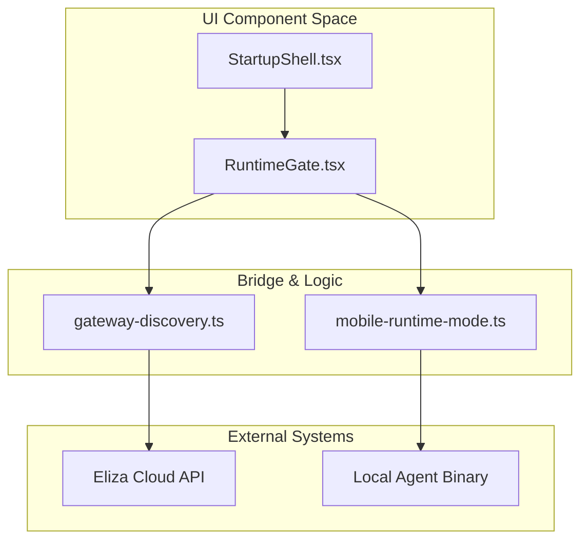

<!-- source: DeepWiki mcp.deepwiki.com · repo elizaOS/eliza · page 10.6 Development Workflow · fetched 2026-10-29 -->

# Development Workflow

Relevant source files

The following files were used as context for generating this wiki page:

- [packages/agent/src/runtime/release-plugin-policy.test.ts](packages/agent/src/runtime/release-plugin-policy.test.ts)
- [packages/agent/src/runtime/release-plugin-policy.ts](packages/agent/src/runtime/release-plugin-policy.ts)
- [packages/agent/vitest.config.ts](packages/agent/vitest.config.ts)
- [packages/app-core/platforms/electrobun/electrobun.config.ts](packages/app-core/platforms/electrobun/electrobun.config.ts)
- [packages/app-core/platforms/electrobun/src/electrobun-config.test.ts](packages/app-core/platforms/electrobun/src/electrobun-config.test.ts)
- [packages/app-core/scripts/assert-required-bundled-packages.test.ts](packages/app-core/scripts/assert-required-bundled-packages.test.ts)
- [packages/app-core/scripts/copy-runtime-node-modules.ts](packages/app-core/scripts/copy-runtime-node-modules.ts)
- [packages/app-core/scripts/desktop-build.mjs](packages/app-core/scripts/desktop-build.mjs)
- [packages/app-core/scripts/dev-platform.mjs](packages/app-core/scripts/dev-platform.mjs)
- [packages/app-core/scripts/lib/read-app-identity.mjs](packages/app-core/scripts/lib/read-app-identity.mjs)
- [packages/app-core/vitest.config.ts](packages/app-core/vitest.config.ts)
- [packages/chip/scripts/ai_eda/check_aieda_idata_conversion.py](packages/chip/scripts/ai_eda/check_aieda_idata_conversion.py)
- [packages/chip/scripts/ai_eda/check_verification_target_captures.py](packages/chip/scripts/ai_eda/check_verification_target_captures.py)
- [packages/chip/scripts/ai_eda/convert_aieda_idata_to_internal_records.py](packages/chip/scripts/ai_eda/convert_aieda_idata_to_internal_records.py)
- [packages/cloud-frontend/src/pages/login/wallet-buttons.tsx](packages/cloud-frontend/src/pages/login/wallet-buttons.tsx)
- [packages/elizaos/templates/project/apps/app/electrobun/electrobun.config.ts](packages/elizaos/templates/project/apps/app/electrobun/electrobun.config.ts)
- [packages/homepage/package.json](packages/homepage/package.json)
- [packages/homepage/tests/e2e/contact-sheet-capture.spec.ts](packages/homepage/tests/e2e/contact-sheet-capture.spec.ts)
- [packages/os-homepage/tsconfig.app.json](packages/os-homepage/tsconfig.app.json)
- [packages/os-homepage/vite.config.ts](packages/os-homepage/vite.config.ts)
- [packages/ui/src/backgrounds/BackgroundHost.tsx](packages/ui/src/backgrounds/BackgroundHost.tsx)
- [packages/ui/src/backgrounds/__tests__/BackgroundHost.test.ts](packages/ui/src/backgrounds/__tests__/BackgroundHost.test.ts)
- [packages/ui/src/components/config-ui/config-renderer.tsx](packages/ui/src/components/config-ui/config-renderer.tsx)
- [packages/ui/src/components/onboarding/states/onboarding.css](packages/ui/src/components/onboarding/states/onboarding.css)
- [packages/ui/src/components/shell/RuntimeGate.cloud-provisioning.test.tsx](packages/ui/src/components/shell/RuntimeGate.cloud-provisioning.test.tsx)
- [packages/ui/src/components/shell/RuntimeGate.tsx](packages/ui/src/components/shell/RuntimeGate.tsx)
- [packages/ui/src/components/shell/StartupShell.tsx](packages/ui/src/components/shell/StartupShell.tsx)
- [packages/ui/src/components/shell/startup-shell-assets.test.ts](packages/ui/src/components/shell/startup-shell-assets.test.ts)
- [plugins/plugin-elizacloud/__tests__/cloud-route-plugin.test.ts](plugins/plugin-elizacloud/__tests__/cloud-route-plugin.test.ts)
- [plugins/plugin-elizacloud/src/plugin.ts](plugins/plugin-elizacloud/src/plugin.ts)
- [plugins/plugin-elizacloud/src/routes/cloud-routes.ts](plugins/plugin-elizacloud/src/routes/cloud-routes.ts)
- [vitest.config.ts](vitest.config.ts)

This page documents the daily development workflow for contributors to the elizaOS monorepo. It covers starting the development environment, using the platform orchestrators, managing plugin submodules, and debugging across the multi-language stack.

## Overview of Development Commands

The elizaOS monorepo uses Bun as the primary runtime and package manager. The root `package.json` and `packages/app-core/scripts/` provide scripts to orchestrate the TypeScript, Rust, and Python environments.

| Command | Purpose | Usage |
|---------|---------|-------|
| `bun run dev` | Start full development environment | Starts the UI and agent server in watch mode. |
| `bun run dev:desktop` | Run Electrobun desktop | Orchestrates Vite, API, and Electrobun shells [packages/app-core/scripts/dev-platform.mjs:3-8](). |
| `bun run dev:agent` | Run agent in dev mode | Starts the `@elizaos/agent` with watch mode enabled. |
| `bun run test` | Run Vitest suite | Executes unit and integration tests [packages/app-core/vitest.config.ts:127-130](). |
| `bun run build:desktop` | Build desktop binary | Runs the multi-stage build and packaging script [packages/app-core/scripts/desktop-build.mjs:94-96](). |

Sources: [packages/app-core/scripts/dev-platform.mjs:1-53](), [packages/app-core/scripts/desktop-build.mjs:93-107](), [packages/app-core/vitest.config.ts:126-150]()

## Starting the Development Environment

The development environment can be started in several modes depending on the target platform. The primary orchestrator for local development is `dev-platform.mjs`.

### Desktop Development Orchestration
The `dev-platform.mjs` script manages the complex startup sequence required for the desktop application. It ensures that the API server and the Vite renderer agree on port allocations before spawning children.

Sources: [packages/app-core/scripts/dev-platform.mjs:10-30](), [packages/app-core/platforms/electrobun/electrobun.config.ts:121-131]()

## Testing and Quality Assurance

The workflow integrates a heavy testing suite using Vitest for TypeScript logic and Playwright for UI regression.

### Test Environment Configuration
The `vitest.config.ts` files across the repo (root, `packages/agent`, `packages/app-core`) define how the test runner interacts with the monorepo structure.

*   **Isolation**: In `packages/app-core/vitest.config.ts`, tests are run with `isolate: false` and `maxWorkers: 1` [packages/app-core/vitest.config.ts:130-136](). This is a defense against worker fork crashes when spinning up PGlite databases and jose-signed key material [packages/app-core/vitest.config.ts:131-134]().
*   **Aliases**: The config uses `path.join` to map package imports like `@elizaos/core` directly to their source files (e.g., `packages/core/src/index.node.ts`) [vitest.config.ts:44-46](). This allows developers to test changes in the core engine without a build step.
*   **React Pinning**: To prevent hook dispatcher mismatches, `packages/agent/vitest.config.ts` explicitly pins `react` and `react-dom` to the workspace versions in `.bun/node_modules` [packages/agent/vitest.config.ts:68-74]().

### UI and E2E Testing
For frontend components, the workflow includes "aesthetic audits" and contact-sheet generation using Playwright.
*   **Contact Sheets**: The script `packages/homepage/tests/e2e/contact-sheet-capture.spec.ts` captures full-page renderings across multiple viewports [packages/homepage/tests/e2e/contact-sheet-capture.spec.ts:31-34]().
*   **Mocking**: It uses `page.route` to mock Eliza Cloud API responses, such as `/api/eliza-app/user/me`, to ensure deterministic visual states [packages/homepage/tests/e2e/contact-sheet-capture.spec.ts:61-78]().

Sources: [packages/app-core/vitest.config.ts:126-174](), [packages/agent/vitest.config.ts:60-95](), [vitest.config.ts:25-101](), [packages/homepage/tests/e2e/contact-sheet-capture.spec.ts:1-59]()

## Multi-Platform Build Workflow

The repository supports multiple "variants" and "profiles" for deployment, managed via `desktop-build.mjs`.

| Concept | Code Entity / Flag | Description |
|---------|--------------------|-------------|
| **Profile** | `--profile` | Controls inclusion of optional packs like `streaming` [packages/app-core/scripts/desktop-build.mjs:98-99](). |
| **Variant** | `--variant` | Selects application branding (default: `base`) [packages/app-core/scripts/desktop-build.mjs:100-101](). |
| **Build Variant**| `--build-variant`| Configures for `store` (MAS) or `direct` distribution [packages/app-core/scripts/desktop-build.mjs:102-104](). |

### Runtime Module Copying
A critical part of the build workflow is `copy-runtime-node-modules.ts`. This script scans the `dist` directory and copies necessary `node_modules` for the bundled agent.
*   **Pruning**: It removes non-essential files like `.git`, `tests`, and `.md` to reduce bundle size [packages/app-core/scripts/copy-runtime-node-modules.ts:67-90]().
*   **Safety Net**: The `assertRequiredBundledPackagesLanded` function ensures that critical packages like `@elizaos/core` and `react` actually exist in the target directory after pruning [packages/app-core/scripts/assert-required-bundled-packages.test.ts:1-12]().

### Code Entity to Platform Mapping

Sources: [packages/app-core/scripts/desktop-build.mjs:30-47](), [packages/app-core/scripts/copy-runtime-node-modules.ts:10-66](), [packages/app-core/scripts/assert-required-bundled-packages.test.ts:56-67](), [packages/ui/src/components/shell/RuntimeGate.tsx:1-20]()

## Debugging and Observability

The development workflow provides several hooks for debugging the agent and shell:

*   **Runtime Gate Picker**: Developers can force the runtime selection screen to appear by adding `?runtime=picker` to the URL [packages/ui/src/components/shell/RuntimeGate.tsx:176-177]().
*   **On-Device Auth**: Branded native shells (like ElizaOS) expose `window.ElizaNative.getLocalAgentToken()` to allow the UI to authenticate with the local agent immediately [packages/ui/src/components/shell/RuntimeGate.tsx:146-160]().
*   **Local Agent Probing**: The UI uses `resolveLocalAgentApiBase()` to dynamically find the agent port, which might shift if the default `31337` is occupied [packages/ui/src/components/shell/RuntimeGate.tsx:129-131]().

### System Component Association

Sources: [packages/ui/src/components/shell/RuntimeGate.tsx:121-160](), [packages/ui/src/components/shell/RuntimeGate.tsx:179-192](), [packages/app-core/scripts/dev-platform.mjs:44-53]()

---

