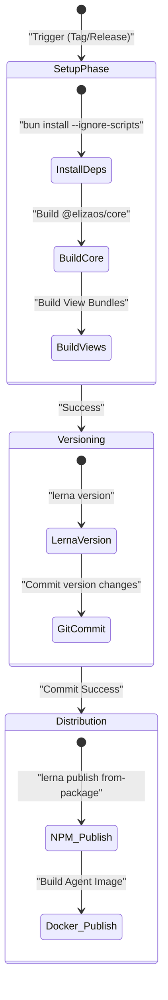

<!-- source: DeepWiki mcp.deepwiki.com · repo elizaOS/eliza · page 11 CI/CD Pipeline · fetched 2026-10-29 -->

# CI/CD Pipeline

<details>
<summary>Relevant source files</summary>

The following files were used as context for generating this wiki page:

- [.github/workflows/build-agent-image.yml](.github/workflows/build-agent-image.yml)
- [.github/workflows/docker-ci-smoke.yml](.github/workflows/docker-ci-smoke.yml)
- [.github/workflows/nightly.yml](.github/workflows/nightly.yml)
- [.github/workflows/release.yaml](.github/workflows/release.yaml)
- [.github/workflows/test.yml](.github/workflows/test.yml)
- [lerna.json](lerna.json)
- [packages/agent/docs/capability-router-remote-plugins.md](packages/agent/docs/capability-router-remote-plugins.md)
- [packages/agent/src/__tests__/agent-terminal-tui.test.ts](packages/agent/src/__tests__/agent-terminal-tui.test.ts)
- [packages/agent/src/services/remote-capability-endpoint-conformance.test.ts](packages/agent/src/services/remote-capability-endpoint-conformance.test.ts)
- [packages/agent/src/services/remote-capability-endpoint-conformance.ts](packages/agent/src/services/remote-capability-endpoint-conformance.ts)
- [packages/agent/src/services/remote-capability-endpoint-provider.test.ts](packages/agent/src/services/remote-capability-endpoint-provider.test.ts)
- [packages/agent/src/services/remote-capability-live-report.test.ts](packages/agent/src/services/remote-capability-live-report.test.ts)
- [packages/agent/src/services/remote-capability-live-report.ts](packages/agent/src/services/remote-capability-live-report.ts)
- [packages/agent/src/services/remote-capability-url-endpoint-providers.provider-smoke.test.ts](packages/agent/src/services/remote-capability-url-endpoint-providers.provider-smoke.test.ts)
- [packages/agent/src/services/remote-capability-url-endpoint-providers.ts](packages/agent/src/services/remote-capability-url-endpoint-providers.ts)
- [packages/app-core/platforms/electrobun/README.md](packages/app-core/platforms/electrobun/README.md)
- [packages/app-core/platforms/electrobun/assets/brand-config.json](packages/app-core/platforms/electrobun/assets/brand-config.json)
- [packages/app-core/platforms/electrobun/package.json](packages/app-core/platforms/electrobun/package.json)
- [packages/app-core/src/cli/program/register.capability-router.test.ts](packages/app-core/src/cli/program/register.capability-router.test.ts)
- [packages/app-core/src/cli/program/register.capability-router.ts](packages/app-core/src/cli/program/register.capability-router.ts)
- [packages/benchmarks/orchestrator_lifecycle/evaluator.py](packages/benchmarks/orchestrator_lifecycle/evaluator.py)
- [packages/benchmarks/orchestrator_lifecycle/runner.py](packages/benchmarks/orchestrator_lifecycle/runner.py)
- [packages/benchmarks/orchestrator_lifecycle/tests/test_evaluator.py](packages/benchmarks/orchestrator_lifecycle/tests/test_evaluator.py)
- [packages/benchmarks/orchestrator_lifecycle/tests/test_runner_smoke.py](packages/benchmarks/orchestrator_lifecycle/tests/test_runner_smoke.py)
- [packages/benchmarks/terminal-bench/elizaos_terminal_bench/cli.py](packages/benchmarks/terminal-bench/elizaos_terminal_bench/cli.py)
- [packages/benchmarks/terminal-bench/elizaos_terminal_bench/runner.py](packages/benchmarks/terminal-bench/elizaos_terminal_bench/runner.py)
- [packages/benchmarks/terminal-bench/elizaos_terminal_bench/types.py](packages/benchmarks/terminal-bench/elizaos_terminal_bench/types.py)
- [packages/benchmarks/terminal-bench/tests/test_cli.py](packages/benchmarks/terminal-bench/tests/test_cli.py)
- [packages/elizaos/templates/project/apps/app/electrobun/package.json](packages/elizaos/templates/project/apps/app/electrobun/package.json)
- [packages/elizaos/templates/project/apps/app/package.json](packages/elizaos/templates/project/apps/app/package.json)
- [packages/elizaos/templates/project/package.json](packages/elizaos/templates/project/package.json)
- [packages/elizaos/templates/project/scripts/eliza-source-mode.mjs](packages/elizaos/templates/project/scripts/eliza-source-mode.mjs)
- [packages/os-homepage/tests/checkout-controls.spec.ts](packages/os-homepage/tests/checkout-controls.spec.ts)
- [packages/os/setup/src/main/electrobun-bun.d.ts](packages/os/setup/src/main/electrobun-bun.d.ts)
- [packages/scripts/audit-capability-router-live-ci.self-test.ts](packages/scripts/audit-capability-router-live-ci.self-test.ts)
- [packages/scripts/audit-capability-router-live-ci.ts](packages/scripts/audit-capability-router-live-ci.ts)
- [packages/scripts/validate-capability-router-github-live-artifacts.ts](packages/scripts/validate-capability-router-github-live-artifacts.ts)
- [packages/scripts/validate-capability-router-live-reports.self-test.ts](packages/scripts/validate-capability-router-live-reports.self-test.ts)
- [packages/scripts/validate-capability-router-live-reports.ts](packages/scripts/validate-capability-router-live-reports.ts)
- [packages/training/scripts/manifest/audit_hf_eliza1_release.py](packages/training/scripts/manifest/audit_hf_eliza1_release.py)
- [packages/training/scripts/manifest/test_audit_hf_eliza1_release.py](packages/training/scripts/manifest/test_audit_hf_eliza1_release.py)
- [plugins/plugin-device-filesystem/package.json](plugins/plugin-device-filesystem/package.json)

</details>


This page provides an overview of the GitHub Actions workflows, automated testing, and deployment pipelines used in the elizaOS monorepo. It describes how the codebase ensures quality through Continuous Integration (CI) and manages the lifecycle of packages through automated releases and Docker image publishing.

For deep dives into specific areas, see the following child pages:
- **[Continuous Integration](#11.1)** — Detailed documentation of CI workflows, including test suites for TypeScript, Python, and Rust, linting with Biome, and security scanning.
- **[Release Process](#11.2)** — Explanation of the version management system (alpha, beta, production), multi-language publishing (NPM, PyPI, Crates.io), and branch synchronization.
- **[Docker Image Publishing](#11.3)** — Documentation on automated Docker builds, GitHub Container Registry (GHCR) integration, and image attestation.

---

## Overview

The CI/CD infrastructure is built on GitHub Actions and centered around workflows that validate code changes and automate the distribution of the framework across multiple package registries and container environments [.github/workflows/build-agent-image.yml:1-9](). The system leverages `bun` for dependency management and `turbo` for task orchestration to optimize build and test times across the monorepo [.github/workflows/test.yml:80-88]().

| Workflow File | Name | Purpose |
|---|---|---|
| `test.yml` | `Tests` | Comprehensive orchestrator for server, client, and plugin integration tests [.github/workflows/test.yml:1-6](). |
| `build-agent-image.yml` | `Build Agent Image` | Single source of truth for the `cloud-agent` container image used by the cloud sandbox provisioner [.github/workflows/build-agent-image.yml:3-4](). |
| `release.yaml` | `NPM Release` | Consolidated workflow for managing NPM releases (Beta and Production) and Git versioning [.github/workflows/release.yaml:1-9](). |

Sources: [.github/workflows/test.yml:1-6](), [.github/workflows/build-agent-image.yml:1-9](), [.github/workflows/release.yaml:1-9]()

---

## CI Workflow (`test.yml`)

The `test.yml` workflow acts as a comprehensive test orchestrator, running the full elizaOS test suite plus focused server/client/plugin slices [.github/workflows/test.yml:1-6]().

### Workflow Orchestration

**CI Pipeline Execution Flow**

```mermaid
flowchart TD
    subgraph "Triggers"
        PR["\"pull_request (main/develop)\""]
        PUSH["\"push (main/develop)\""]
        CRON["\"Nightly (cron)\""]
    end

    PR --> JOBS
    PUSH --> JOBS
    CRON --> JOBS

    subgraph JOBS ["\"Parallel Jobs\""]
        SERVER["\"Server Tests\""]
        CLIENT["\"Client Tests\""]
        PLUGIN["\"Plugin Tests\""]
    end

    SERVER --> S1["\"Setup Bun Workspace\""]
    S1 --> S2["\"Build view bundles\""]
    S2 --> S3["\"Remote capability audit\""]
    S3 --> S4["\"vitest run server\""]

    CLIENT --> C1["\"Setup Bun Workspace\""]
    C1 --> C2["\"Install Playwright\""]
    C2 --> C3["\"test:client\""]

    PLUGIN --> P1["\"Setup Cargo Shared Target\""]
    P1 --> P2["\"test:plugins\""]
```

Sources: [.github/workflows/test.yml:8-194]()

### Cross-Language and Integration Validation
Because elizaOS is a polyglot framework, the CI pipeline orchestrates multiple environments:
- **TypeScript**: Uses `vitest` for standard tests and specialized configurations for `node:sqlite` in `packages/app-core` [.github/workflows/test.yml:134-142]().
- **Rust**: Shares compiled artifacts across plugin crates using `CARGO_TARGET_DIR` to prevent redundant heavy builds [.github/workflows/test.yml:187-192]().
- **Remote Capabilities**: A specialized audit suite validates the "Capability Router" protocol, ensuring remote plugins conform to RPC expectations [.github/workflows/test.yml:95-130]().
- **Integration Surface**: Validates the `RemoteCapabilityRouterService` through endpoint conformance reports [.github/agent/src/services/remote-capability-endpoint-conformance.ts:62-113]().

For details, see [Continuous Integration](#11.1).

---

## Release & Distribution

The release pipeline automates versioning and distribution across NPM and container registries.

### Distribution Strategy
The framework utilizes `lerna` to version packages and publish to NPM, using a "git-first" approach where version changes are committed before publication [.github/workflows/release.yaml:7-11]().

**Release Workflow State Machine**



Sources: [.github/workflows/release.yaml:56-140](), [.github/workflows/build-agent-image.yml:109-135]()

### Multi-Language Publishing
1. **NPM**: Handles releases for the `@elizaos/*` workspace packages, including `beta` tags for prereleases [.github/workflows/release.yaml:142-174]().
2. **Docker**: Consolidates image building into `build-agent-image.yml`, which produces the `cloud-agent` image for GHCR [.github/workflows/build-agent-image.yml:3-9]().
3. **Capability Audits**: Automated scripts like `validate-capability-router-live-reports.ts` ensure that released remote modules maintain protocol integrity [.github/packages/scripts/validate-capability-router-live-reports.ts:127-173]().

For details, see [Release Process](#11.2) and [Docker Image Publishing](#11.3).

---

## Required Infrastructure

To function correctly, the CI/CD pipeline requires several secrets and environment configurations to handle live testing and remote caching:

| Secret / Env | Scope | Purpose |
|---|---|---|
| `TURBO_TOKEN` | Turborepo | Enables remote caching for builds across CI jobs [.github/workflows/test.yml:66](). |
| `CEREBRAS_API_KEY` | Testing | Default LLM provider for live E2E and integration suites [.github/workflows/test.yml:50](). |
| `PGLITE_WASM_MODE` | Testing | Configures PGLite to run in Node.js environment for server tests [.github/workflows/test.yml:69](). |
| `BUN_VERSION` | Workspace | Standardizes the Bun runtime version (e.g., `1.3.13`) [.github/workflows/test.yml:42](). |
| `CARGO_TARGET_DIR` | Rust | Shares compiled artifacts across all plugin crates to prevent step timeouts [.github/workflows/test.yml:192](). |

Sources: [.github/workflows/test.yml:40-70](), [.github/workflows/build-agent-image.yml:60-64](), [.github/workflows/release.yaml:86-90]()

---

