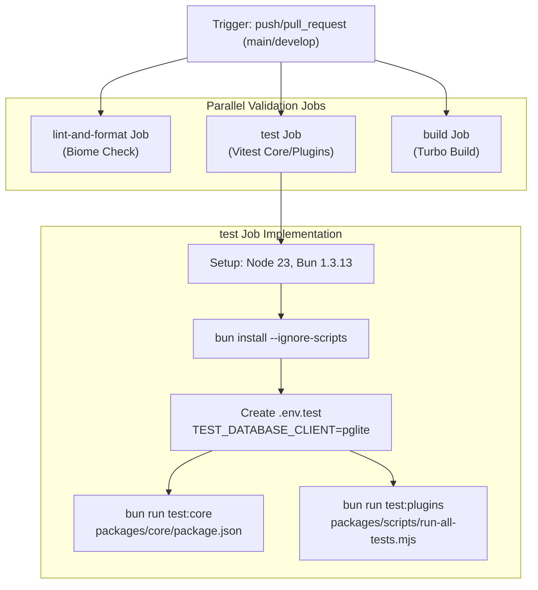
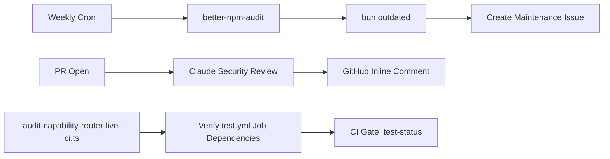

<!-- source: DeepWiki mcp.deepwiki.com · repo elizaOS/eliza · page 11.1 Continuous Integration · fetched 2026-10-29 -->

# Continuous Integration

Relevant source files

The following files were used as context for generating this wiki page:

- [.github/workflows/apple-store-release.yml](.github/workflows/apple-store-release.yml)
- [.github/workflows/benchmark-weekly.yml](.github/workflows/benchmark-weekly.yml)
- [.github/workflows/build-agent-image.yml](.github/workflows/build-agent-image.yml)
- [.github/workflows/ci.yaml](.github/workflows/ci.yaml)
- [.github/workflows/docker-ci-smoke.yml](.github/workflows/docker-ci-smoke.yml)
- [.github/workflows/live-scenarios.yml](.github/workflows/live-scenarios.yml)
- [.github/workflows/test.yml](.github/workflows/test.yml)
- [packages/agent/docs/capability-router-remote-plugins.md](packages/agent/docs/capability-router-remote-plugins.md)
- [packages/agent/src/__tests__/agent-terminal-tui.test.ts](packages/agent/src/__tests__/agent-terminal-tui.test.ts)
- [packages/agent/src/services/remote-capability-endpoint-conformance.test.ts](packages/agent/src/services/remote-capability-endpoint-conformance.test.ts)
- [packages/agent/src/services/remote-capability-endpoint-conformance.ts](packages/agent/src/services/remote-capability-endpoint-conformance.ts)
- [packages/agent/src/services/remote-capability-endpoint-provider.test.ts](packages/agent/src/services/remote-capability-endpoint-provider.test.ts)
- [packages/agent/src/services/remote-capability-live-report.test.ts](packages/agent/src/services/remote-capability-live-report.test.ts)
- [packages/agent/src/services/remote-capability-live-report.ts](packages/agent/src/services/remote-capability-live-report.ts)
- [packages/agent/src/services/remote-capability-url-endpoint-providers.provider-smoke.test.ts](packages/agent/src/services/remote-capability-url-endpoint-providers.provider-smoke.test.ts)
- [packages/agent/src/services/remote-capability-url-endpoint-providers.ts](packages/agent/src/services/remote-capability-url-endpoint-providers.ts)
- [packages/app-core/src/cli/program/register.capability-router.test.ts](packages/app-core/src/cli/program/register.capability-router.test.ts)
- [packages/app-core/src/cli/program/register.capability-router.ts](packages/app-core/src/cli/program/register.capability-router.ts)
- [packages/benchmarks/eliza-adapter/tests/test_woobench_adapter.py](packages/benchmarks/eliza-adapter/tests/test_woobench_adapter.py)
- [packages/benchmarks/orchestrator_lifecycle/evaluator.py](packages/benchmarks/orchestrator_lifecycle/evaluator.py)
- [packages/benchmarks/orchestrator_lifecycle/runner.py](packages/benchmarks/orchestrator_lifecycle/runner.py)
- [packages/benchmarks/orchestrator_lifecycle/tests/test_evaluator.py](packages/benchmarks/orchestrator_lifecycle/tests/test_evaluator.py)
- [packages/benchmarks/orchestrator_lifecycle/tests/test_runner_smoke.py](packages/benchmarks/orchestrator_lifecycle/tests/test_runner_smoke.py)
- [packages/examples/cloud/clone-ur-crush/.gitignore](packages/examples/cloud/clone-ur-crush/.gitignore)
- [packages/examples/cloud/clone-ur-crush/next.config.ts](packages/examples/cloud/clone-ur-crush/next.config.ts)
- [packages/examples/cloud/clone-ur-crush/package.json](packages/examples/cloud/clone-ur-crush/package.json)
- [packages/examples/cloud/clone-ur-crush/scripts/build.mjs](packages/examples/cloud/clone-ur-crush/scripts/build.mjs)
- [packages/examples/cloud/clone-ur-crush/tsconfig.json](packages/examples/cloud/clone-ur-crush/tsconfig.json)
- [packages/examples/trader/vite.config.ts](packages/examples/trader/vite.config.ts)
- [packages/os-homepage/tests/checkout-controls.spec.ts](packages/os-homepage/tests/checkout-controls.spec.ts)
- [packages/os/setup/src/main/electrobun-bun.d.ts](packages/os/setup/src/main/electrobun-bun.d.ts)
- [packages/scripts/audit-capability-router-live-ci.self-test.ts](packages/scripts/audit-capability-router-live-ci.self-test.ts)
- [packages/scripts/audit-capability-router-live-ci.ts](packages/scripts/audit-capability-router-live-ci.ts)
- [packages/scripts/validate-capability-router-live-reports.self-test.ts](packages/scripts/validate-capability-router-live-reports.self-test.ts)
- [packages/scripts/validate-capability-router-live-reports.ts](packages/scripts/validate-capability-router-live-reports.ts)
- [packages/training/scripts/manifest/audit_hf_eliza1_release.py](packages/training/scripts/manifest/audit_hf_eliza1_release.py)
- [packages/training/scripts/manifest/test_audit_hf_eliza1_release.py](packages/training/scripts/manifest/test_audit_hf_eliza1_release.py)

The Continuous Integration (CI) system in elizaOS ensures code quality, security, and correctness through automated testing, linting, builds, and AI-driven code reviews. The CI pipeline runs on every pull request and push to the main branch, validating changes across the TypeScript, Python, and Rust codebases.

## CI Workflow Architecture

The primary CI system is orchestrated via GitHub Actions, utilizing Bun as the primary task runner and Turborepo for build optimization. The system is designed to handle a polyglot monorepo with strict gating for core logic and local inference capabilities.

### Primary CI Flow (`ci.yaml`)

The `ci.yaml` workflow serves as the canonical gate for code changes. It performs linting, type checking, and executes core tests.

Sources: [.github/workflows/ci.yaml:1-158](), [package.json:20-100](), [packages/core/package.json:93-94]()

## Specialized Testing Suites

Beyond the standard CI gate, elizaOS employs specialized workflows for complex subsystems like remote capability routing and multi-platform support.

### Capability Router Audit
The `test.yml` workflow includes a sophisticated audit for the **Capability Router** system, which allows agents to use plugins served from remote processes or cloud sandboxes [[packages/agent/docs/capability-router-remote-plugins.md:1-10]]().

The CI executes several audit scripts to ensure the integrity of the remote plugin surface:
- **Live CI Audit:** `audit-capability-router-live-ci.ts` ensures that the `test-status` job depends on `cloud-live-e2e` and that all required self-tests are active gates [[packages/scripts/audit-capability-router-live-ci.ts:112-142]]().
- **Live Report Validation:** `validate-capability-router-live-reports.ts` checks that remote modules conform to the required protocol version and expose the necessary RPC methods like `plugin.action.invoke` and `plugin.provider.get` [[packages/scripts/validate-capability-router-live-reports.ts:4-64]]().
- **Conformance Tests:** `assertRemoteCapabilityEndpointConformance` exercises the remote endpoint by invoking actions and providers to verify protocol compliance [[packages/agent/src/services/remote-capability-endpoint-conformance.ts:131-219]]().

### Comprehensive Integration (`test.yml`)
The `test.yml` workflow acts as a peer to `ci.yaml`, adding broader integration surface testing:
- **Server Tests:** Validates `packages/agent` views system and registry [[.github/workflows/test.yml:61-94]]().
- **Remote Capability UI:** Uses Playwright to run smoke tests on remote capability UI components [[.github/workflows/test.yml:173-178]]().
- **Node SQLite Tests:** Specifically runs `training-benchmarks.test.ts` using `vitest.node-sqlite.config.ts` to ensure compatibility with Node's native SQLite driver [[.github/workflows/test.yml:134-142]]().
- **Plugin Rust Tests:** Shares compiled artifacts across plugin crates using a shared `CARGO_TARGET_DIR` to optimize build times [[.github/workflows/test.yml:179-193]]().

Sources: [.github/workflows/test.yml:1-193](), [packages/scripts/audit-capability-router-live-ci.ts:1-172](), [packages/scripts/validate-capability-router-live-reports.ts:1-173]()

## AI-Driven Code Quality and Security

ElizaOS leverages AI agents to perform deep semantic analysis of contributions.

### Claude Code Review
The `claude-code-review.yml` workflow utilizes Claude to audit pull requests. It specifically enforces:
- Security audits for SQL injection and sensitive data leaks [[.github/workflows/claude-code-review.yml:44-60]]().
- Enforcement of `vitest` usage and `@elizaos/core` import standards [[.github/workflows/claude-code-review.yml:61-80]]().

### Automated Maintenance
- **Weekly Maintenance:** Scans for outdated dependencies via `bun outdated` and vulnerabilities via `better-npm-audit` [[.github/workflows/weekly-maintenance.yml:1-62]]().
- **Skill Review:** `skill-review.yml` specifically audits new skill contributions in `packages/skills` for prompt compliance and schema accuracy.

**Maintenance and Validation Data Flow**

Sources: [.github/workflows/claude-code-review.yml:1-89](), [.github/workflows/weekly-maintenance.yml:1-62](), [packages/scripts/audit-capability-router-live-ci.ts:113-118]()

## Code Quality and Linting Standards

Linting is enforced at the root level using Biome, covering TypeScript, JSON, and configuration files.

| Tool | Purpose | Configuration |
| :--- | :--- | :--- |
| **Biome** | Linting and Formatting | `biome.json` |
| **CodeFactor** | Automated Code Review | `.codefactor.yml` |
| **Tsc** | Type Checking | `tsconfig.json`, `tsconfig.dist-paths.json` |
| **Vitest** | Unit/Integration Testing | `vitest.config.ts` |

The `CodeFactor` configuration explicitly excludes long-lived runtime surfaces like `packages/agent/src/runtime/eliza.ts` to focus on new logic [[.codefactor.yml:1-20]]().

Sources: [.codefactor.yml:1-20](), [package.json:84-86](), [tsconfig.dist-paths.json:1-183]()

## Container Build and Supply Chain Security

### Agent Image Publishing (`build-agent-image.yml`)
The `build-agent-image.yml` workflow is the single source of truth for the `cloud-agent` container image. It consolidates previous image build logic into a single high-performance pipeline [[.github/workflows/build-agent-image.yml:1-9]]().

**Build Pipeline Detail:**
1. **Workspace Preparation:** Installs dependencies using `bun install --no-frozen-lockfile` to ensure postinstall patches are applied [[.github/workflows/build-agent-image.yml:73-88]]().
2. **Postinstall Patches:** Explicitly runs `patch-tsup-dts.mjs` to rewire `tsup` for WASM/Node compatibility and `ensure-type-package-aliases.mjs` for TSC resolution [[.github/workflows/build-agent-image.yml:89-108]]().
3. **Core Build:** Builds `@elizaos/core`, `shared`, and `ui` packages. It ensures `packages/contracts` is built first as it is a dependency for core's declaration generation [[.github/workflows/build-agent-image.yml:109-135]]().
4. **Plugin Build Loop:** Iterates through workspace plugins (e.g., `plugin-sql`, `plugin-elizacloud`) and runs `bun run build` in each [[.github/workflows/build-agent-image.yml:136-160]]().
5. **Docker Push:** Pushes the final image to `ghcr.io` with short-sha and branch tags [[.github/workflows/build-agent-image.yml:30-41]]().

### TEE and Native Builds
- **TEE Deployment:** `tee-build-deploy.yml` automates the build of TEE-compatible images for Phala Cloud [[.github/workflows/tee-build-deploy.yml:1-126]]().
- **Native Dependencies:** CI build steps often skip heavy native downloads using `NODE_LLAMA_CPP_SKIP_DOWNLOAD=true` to optimize runner performance [[.github/workflows/build-agent-image.yml:120-121]]().

Sources: [.github/workflows/build-agent-image.yml:1-160](), [.github/workflows/tee-build-deploy.yml:1-126](), [packages/agent/docs/capability-router-remote-plugins.md:1-133]()

---

