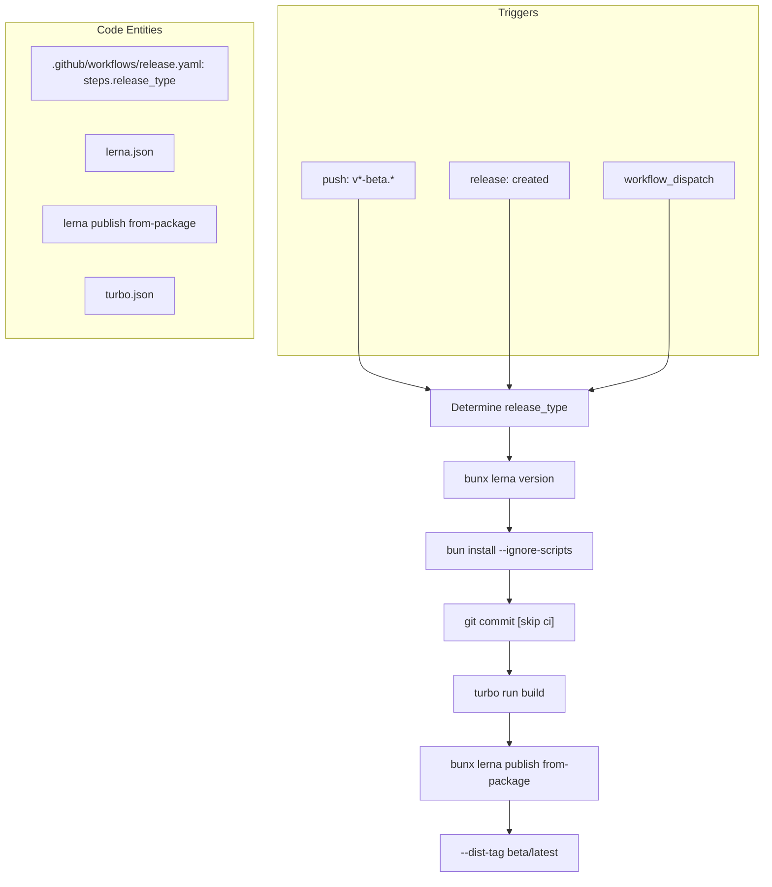
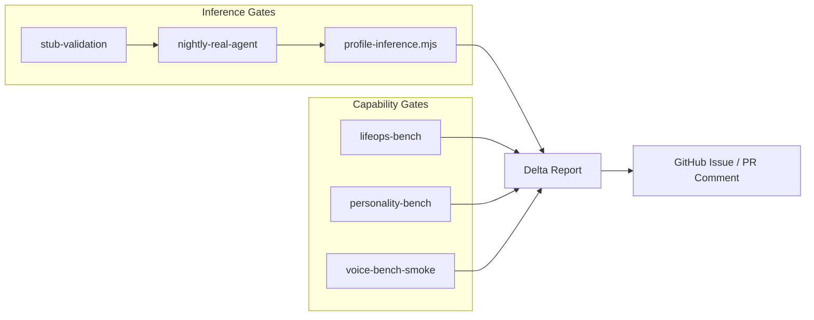

<!-- source: DeepWiki mcp.deepwiki.com · repo elizaOS/eliza · page 11.2 Release Process · fetched 2026-10-29 -->

# Release Process

Relevant source files

The following files were used as context for generating this wiki page:

- [.github/workflows/cerebras-nightly.yml](.github/workflows/cerebras-nightly.yml)
- [.github/workflows/convert-omnivoice-singing.yml](.github/workflows/convert-omnivoice-singing.yml)
- [.github/workflows/feed-daily-dataset-upload.yml](.github/workflows/feed-daily-dataset-upload.yml)
- [.github/workflows/feed-rl-training.yml](.github/workflows/feed-rl-training.yml)
- [.github/workflows/jsdoc-automation.yml](.github/workflows/jsdoc-automation.yml)
- [.github/workflows/lifeops-bench-manifest.yml](.github/workflows/lifeops-bench-manifest.yml)
- [.github/workflows/lifeops-bench.yml](.github/workflows/lifeops-bench.yml)
- [.github/workflows/local-inference-bench.yml](.github/workflows/local-inference-bench.yml)
- [.github/workflows/nightly.yml](.github/workflows/nightly.yml)
- [.github/workflows/publish-packages.yml](.github/workflows/publish-packages.yml)
- [.github/workflows/release.yaml](.github/workflows/release.yaml)
- [.github/workflows/test-packaging.yml](.github/workflows/test-packaging.yml)
- [.github/workflows/voice-bench-smoke.yml](.github/workflows/voice-bench-smoke.yml)
- [lerna.json](lerna.json)
- [packages/app-core/packaging/test-packaging.sh](packages/app-core/packaging/test-packaging.sh)
- [packages/app-core/platforms/electrobun/README.md](packages/app-core/platforms/electrobun/README.md)
- [packages/app-core/platforms/electrobun/assets/brand-config.json](packages/app-core/platforms/electrobun/assets/brand-config.json)
- [packages/app-core/platforms/electrobun/package.json](packages/app-core/platforms/electrobun/package.json)
- [packages/app-core/scripts/build-flatpak.mjs](packages/app-core/scripts/build-flatpak.mjs)
- [packages/benchmarks/terminal-bench/elizaos_terminal_bench/cli.py](packages/benchmarks/terminal-bench/elizaos_terminal_bench/cli.py)
- [packages/benchmarks/terminal-bench/elizaos_terminal_bench/runner.py](packages/benchmarks/terminal-bench/elizaos_terminal_bench/runner.py)
- [packages/benchmarks/terminal-bench/elizaos_terminal_bench/types.py](packages/benchmarks/terminal-bench/elizaos_terminal_bench/types.py)
- [packages/benchmarks/terminal-bench/tests/test_cli.py](packages/benchmarks/terminal-bench/tests/test_cli.py)
- [packages/elizaos/templates/project/apps/app/electrobun/package.json](packages/elizaos/templates/project/apps/app/electrobun/package.json)
- [packages/elizaos/templates/project/apps/app/package.json](packages/elizaos/templates/project/apps/app/package.json)
- [packages/elizaos/templates/project/package.json](packages/elizaos/templates/project/package.json)
- [packages/elizaos/templates/project/scripts/eliza-source-mode.mjs](packages/elizaos/templates/project/scripts/eliza-source-mode.mjs)
- [packages/scripts/validate-capability-router-github-live-artifacts.ts](packages/scripts/validate-capability-router-github-live-artifacts.ts)
- [plugins/plugin-device-filesystem/package.json](plugins/plugin-device-filesystem/package.json)

This page documents the full release pipeline for the elizaOS monorepo: how versions are managed across TypeScript, Python, and Rust, how packages are built and tagged, and how they are published to their respective registries (NPM, PyPI, and Snap Store). The process follows a "git-first" approach where version changes are committed and tagged in the repository before any artifacts are published. [`.github/workflows/release.yaml:8-12`]()

---

## Release Channels and Strategy

The release system operates on three distinct distribution channels, each triggered by different Git events or manual dispatch. [`.github/workflows/release.yaml:14-31`]()

| Channel | NPM dist-tag | Trigger | Branch |
|---|---|---|---|
| **Beta** | `beta` | Push to `v*-beta.*` tag | `main` |
| **Production** | `latest` | GitHub Release created | any tag matching `v*.*.*` |
| **Manual** | `beta` | `workflow_dispatch` | — |

> **Note:** Production (`latest`) releases **must** be triggered through the GitHub Releases UI using a version tag. Manual `workflow_dispatch` is reserved for prerelease testing; the `latest` option is intentionally removed from manual triggers to enforce stability. [`.github/workflows/release.yaml:20-28`]()

### Versioning Logic
Version strings follow semantic versioning with prerelease suffixes: `MAJOR.MINOR.PATCH-CHANNEL.N` (e.g., `2.0.1-beta.0`). [`packages/app-core/platforms/electrobun/package.json:3`](). The release workflow uses helper functions like `get_base_version` and `get_prerelease_type` to parse the current version from `lerna.json` and determine the next increment. [`.github/workflows/release.yaml:185-195`]()

Sources: [`.github/workflows/release.yaml:1-41`](), [`.github/workflows/release.yaml:143-175`](), [`packages/app-core/platforms/electrobun/package.json:1-5`]()

---

## NPM Release Workflow (TypeScript)

The consolidated `NPM Release` workflow handles the orchestration of versioning, building, and publishing for all TypeScript packages and plugins. [`.github/workflows/release.yaml:1-7`]()

**Release Workflow: Trigger to Publication**

### Key Implementation Details
- **Concurrency**: Release runs are serialized per branch using `group: npm-release-${{ github.ref }}` to prevent non-fast-forward push failures. [`.github/workflows/release.yaml:29-35`]()
- **System Dependencies**: Compilation requires `protobuf-compiler` for schemas and various system libraries (e.g., `libpq-dev`, `libwayland-dev`, `libpipewire-0.3-dev`) for native bindings. [`.github/workflows/release.yaml:76-79`]()
- **Optional Workspaces**: The workflow dynamically updates `package.json` to include optional plugin workspaces (e.g., `plugins/plugin-sql`, `plugins/plugin-ollama`) if they exist on disk before running `bun install`. [`.github/workflows/release.yaml:104-131`]()
- **Binary Installation**: Since `--ignore-scripts` is used, the workflow explicitly triggers `esbuild` and `bun` binary installations. [`.github/workflows/release.yaml:138-139`]()

Sources: [`.github/workflows/release.yaml:29-141`](), [`.github/workflows/release.yaml:76-79`]()

---

## Multi-Language and Multi-Platform Releases

elizaOS is a polyglot framework, and the release process includes dedicated workflows for Python, Rust, and platform-specific artifacts.

### Python Release (PyPI)
The Python release process manages the `@elizaos/python` runtime and the `elizaos-app` package.
- **Version Mapping**: PEP 440 conversion is applied (e.g., `2.0.0-beta.0` → `2.0.0b0`). [`.github/workflows/publish-packages.yml:90-92`]()
- **Validation**: The build pipeline runs `twine check` and performs module import tests to ensure the runtime is functional. [`.github/workflows/publish-packages.yml:182-198`]()
- **Multi-Version Testing**: Pushes to `main` trigger a full matrix test across Python 3.9 through 3.13. [`.github/workflows/test-packaging.yml:153-157`]()

### Platform-Specific Distribution
The release process extends beyond NPM to include desktop and system-level packaging:
- **Snap Store**: Automates publishing to the Snap Store using `SNAP_STORE_CREDENTIALS`. [`.github/workflows/publish-packages.yml:115-132`]()
- **Debian/APT**: Builds `.deb` packages with version mapping (e.g., `2.0.0-beta.0` → `2.0.0~beta0-1`). [`.github/workflows/publish-packages.yml:94-96`]()
- **Homebrew**: Manages formulas and casks for macOS distribution. [`.github/workflows/test-packaging.sh:152-170`]()

### Desktop and App Core
The `@elizaos/electrobun` package manages the desktop application release.
- **Electrobun**: Includes scripts for building macOS effects and preloading assets via `build-electrobun-preload.mjs`. [`packages/app-core/platforms/electrobun/package.json:15-26`]()
- **Packaging Validation**: A dedicated shell script `test-packaging.sh` validates syntax and structure for PyPI, Homebrew, Debian, and Snap configurations. [`packages/app-core/packaging/test-packaging.sh:1-200`]()

Sources: [`.github/workflows/publish-packages.yml:82-140`](), [`.github/workflows/test-packaging.yml:150-160`](), [`packages/app-core/platforms/electrobun/package.json:1-26`]()

---

## Benchmarking and Quality Gates

Release readiness is enforced through automated benchmarking workflows that run nightly or on specific path changes.

### Local Inference Benchmarks
Nightly benchmarks evaluate the on-device chat agent.
- **Harness Smoke**: Validates the benchmark harness by booting a `stub-agent-server.mjs`. [`.github/workflows/local-inference-bench.yml:75-121`]()
- **Real-Agent Profile**: Boots the actual dev server (`bun run dev`) and runs a host-cpu profile, uploading results to tracking issues. [`.github/workflows/local-inference-bench.yml:122-187`]()

### LifeOps and Personality Benchmarks
Dedicated gates for high-level agent capabilities:
- **Cerebras Nightly**: Runs `lifeops-bench` and `personality-bench` against agents (eliza, hermes, openclaw) using Cerebras `gpt-oss-120b` as a judge. [`.github/workflows/cerebras-nightly.yml:1-68`]()
- **Voice Smoke**: Runs 30-second variants of voice benchmarks (quality, emotion, agent) to ensure no regressions in audio processing. [`.github/workflows/voice-bench-smoke.yml:1-14`]()

**Release Benchmarking Pipeline**

### Model and Asset Pipelines
- **Eliza-1 Models**: Automated publishing and catalog syncing from Hugging Face. [`.github/workflows/local-inference-bench.yml:34-35`]()
- **OmniVoice Conversion**: Heavy-duty workflow for converting singing models to GGUF format and uploading to HF mirrors. [`.github/workflows/convert-omnivoice-singing.yml:1-31`]()
- **RL Training**: Automated daily training for the Feed model based on trajectory data readiness (minimum 100 bundles). [`.github/workflows/feed-rl-training.yml:106-118`]()

Sources: [`.github/workflows/local-inference-bench.yml:1-187`](), [`.github/workflows/cerebras-nightly.yml:1-68`](), [`.github/workflows/voice-bench-smoke.yml:1-14`](), [`.github/workflows/feed-rl-training.yml:1-133`]()

---

