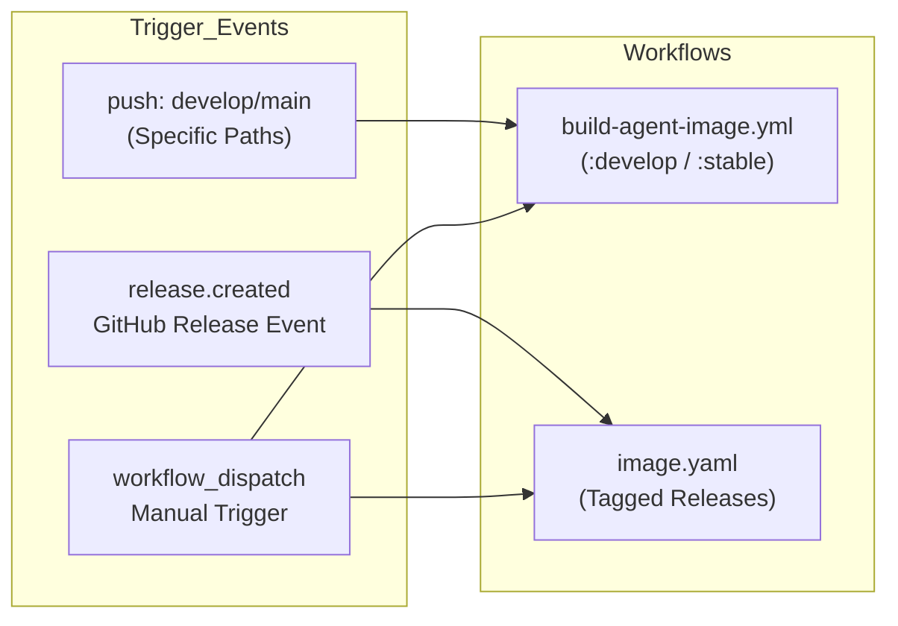
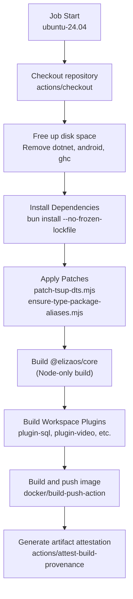
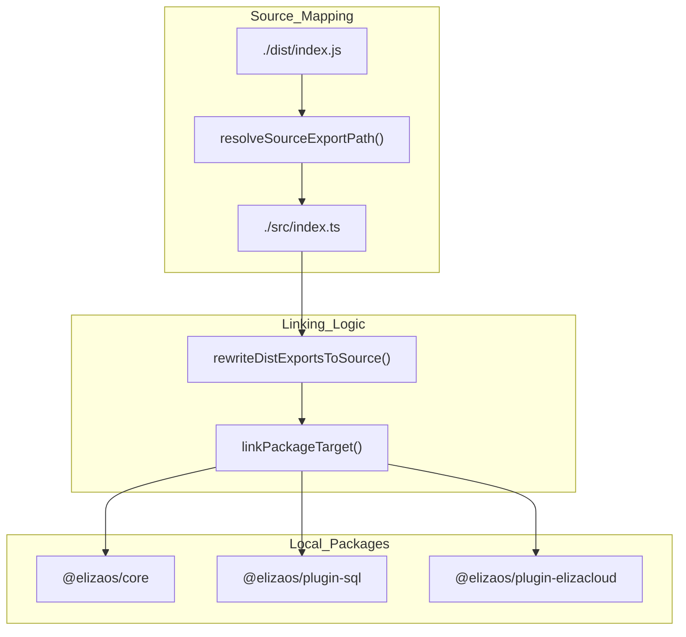
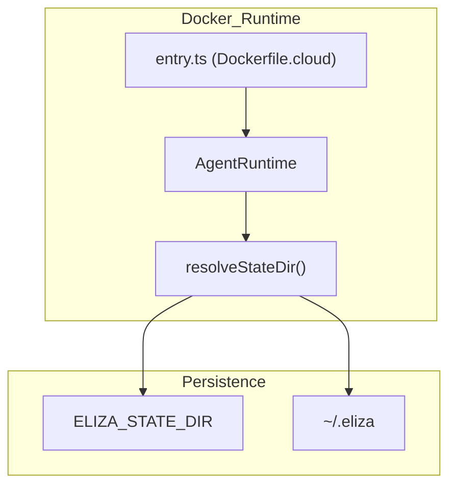

<!-- source: DeepWiki mcp.deepwiki.com · repo elizaOS/eliza · page 11.3 Docker Image Publishing · fetched 2026-10-29 -->

# Docker Image Publishing

Relevant source files

The following files were used as context for generating this wiki page:

- [.github/workflows/README.md](.github/workflows/README.md)
- [packages/agent/src/config/paths.ts](packages/agent/src/config/paths.ts)
- [packages/app-core/deploy/Dockerfile.cloud](packages/app-core/deploy/Dockerfile.cloud)
- [packages/app-core/deploy/Dockerfile.cloud.dockerignore](packages/app-core/deploy/Dockerfile.cloud.dockerignore)
- [packages/app-core/scripts/docker-ci-smoke.sh](packages/app-core/scripts/docker-ci-smoke.sh)
- [packages/app-core/scripts/link-docker-local-app-packages.mjs](packages/app-core/scripts/link-docker-local-app-packages.mjs)
- [packages/app-core/src/api/ios-local-agent-transport.ts](packages/app-core/src/api/ios-local-agent-transport.ts)
- [packages/app-core/src/runtime/build-variant.ts](packages/app-core/src/runtime/build-variant.ts)
- [packages/app-core/src/runtime/sandbox-policy.ts](packages/app-core/src/runtime/sandbox-policy.ts)
- [packages/benchmarks/lifeops-bench/eliza_lifeops_bench/lifeworld/entities.py](packages/benchmarks/lifeops-bench/eliza_lifeops_bench/lifeworld/entities.py)
- [packages/benchmarks/lifeops-bench/eliza_lifeops_bench/lifeworld/world.py](packages/benchmarks/lifeops-bench/eliza_lifeops_bench/lifeworld/world.py)
- [packages/core/package.json](packages/core/package.json)
- [packages/core/src/build-variant.ts](packages/core/src/build-variant.ts)
- [packages/core/src/sandbox-policy.ts](packages/core/src/sandbox-policy.ts)
- [packages/core/src/utils/read-env.test.ts](packages/core/src/utils/read-env.test.ts)
- [packages/core/src/utils/read-env.ts](packages/core/src/utils/read-env.ts)
- [packages/core/src/utils/state-dir.test.ts](packages/core/src/utils/state-dir.test.ts)
- [packages/core/src/utils/state-dir.ts](packages/core/src/utils/state-dir.ts)
- [packages/ui/src/build-variant.ts](packages/ui/src/build-variant.ts)
- [plugins.json](plugins.json)
- [plugins/plugin-app-control/package.json](plugins/plugin-app-control/package.json)
- [plugins/plugin-commands/package.json](plugins/plugin-commands/package.json)
- [plugins/plugin-discord/package.json](plugins/plugin-discord/package.json)
- [plugins/plugin-elizacloud/package.json](plugins/plugin-elizacloud/package.json)
- [plugins/plugin-farcaster/package.json](plugins/plugin-farcaster/package.json)
- [plugins/plugin-feishu/package.json](plugins/plugin-feishu/package.json)
- [plugins/plugin-google-chat/package.json](plugins/plugin-google-chat/package.json)
- [plugins/plugin-google-chat/src/actions/index.ts](plugins/plugin-google-chat/src/actions/index.ts)
- [plugins/plugin-google-chat/src/providers/index.ts](plugins/plugin-google-chat/src/providers/index.ts)
- [plugins/plugin-imessage/package.json](plugins/plugin-imessage/package.json)
- [plugins/plugin-line/package.json](plugins/plugin-line/package.json)
- [plugins/plugin-local-storage/src/services/local-storage.ts](plugins/plugin-local-storage/src/services/local-storage.ts)
- [plugins/plugin-matrix/package.json](plugins/plugin-matrix/package.json)
- [plugins/plugin-music/package.json](plugins/plugin-music/package.json)
- [plugins/plugin-nostr/package.json](plugins/plugin-nostr/package.json)
- [plugins/plugin-openrouter/package.json](plugins/plugin-openrouter/package.json)
- [plugins/plugin-roblox/package.json](plugins/plugin-roblox/package.json)
- [plugins/plugin-signal/package.json](plugins/plugin-signal/package.json)
- [plugins/plugin-slack/package.json](plugins/plugin-slack/package.json)
- [plugins/plugin-social-alpha/package.json](plugins/plugin-social-alpha/package.json)
- [plugins/plugin-suno/package.json](plugins/plugin-suno/package.json)
- [plugins/plugin-twitch/package.json](plugins/plugin-twitch/package.json)
- [plugins/plugin-web-search/package.json](plugins/plugin-web-search/package.json)
- [plugins/plugin-wechat/package.json](plugins/plugin-wechat/package.json)

This document describes the automated Docker image publishing workflows in elizaOS. The system publishes container images to GitHub Container Registry (GHCR) for general use and specialized packages for the agent runtime, cloud services, and sandbox environments.

## Overview

elizaOS provides several distinct Docker and package publishing pipelines:

1.  **GHCR Publication Workflow**: Publishes official release images and branch-head images (`:develop`, `:latest`) to GitHub Container Registry with build attestation.
2.  **CI/Smoke Workflow**: Validates production-ready images locally using `docker-ci-smoke.sh` [packages/app-core/scripts/docker-ci-smoke.sh:4-10]() before deployment.
3.  **Specialized Variants**: Multi-stage Dockerfiles for cloud-optimized runtimes, agent-specific containers, and sandboxes.
4.  **ComputerUse Workflows**: Specific release pipelines for computer-use plugins via `release-computeruse-crates.yaml` and `release-computeruse-npm.yaml`.

## GHCR Publication Workflow

### Workflow Triggers

The GitHub Container Registry publication is handled by primary workflows:
- `image.yaml`: Handles tagged releases and manual dispatches.
- `build-agent-image.yml`: Continuous publication for `develop` and `main` branches to keep provisioners updated with the latest head builds.

Title: GHCR Image Workflow Triggers

### Build Pipeline and Attestation

The build process utilizes `docker/build-push-action` and implements artifact attestation to ensure supply chain security.

Title: GHCR Build Pipeline Flow

## Docker Image Variants

The repository maintains specialized Dockerfiles in `packages/app-core/deploy/` to support various runtime constraints.

### Dockerfile.cloud (Cloud Optimized)
This image is designed to keep the runtime under ~2GB by performing a production-only install and flattening Bun's store-backed `node_modules` [packages/app-core/deploy/Dockerfile.cloud:3-4]().

- **Workspace Pruning**: A custom script `prune-workspace.mjs` is executed during the build to remove non-essential local packages and strip `workspace:` references from `package.json` [packages/app-core/deploy/Dockerfile.cloud:57-181]().
- **Dependency Materialization**: The `materializeWorkspaceDeps` function converts `workspace:*` specs into concrete versions collected from the monorepo [packages/app-core/deploy/Dockerfile.cloud:128-140]().
- **Multi-Stage Build**:
    1. `deps`: Resolves the production dependency graph using Bun [packages/app-core/deploy/Dockerfile.cloud:28-188]().
    2. `tsx`: Installs the `tsx` loader to allow execution of TypeScript entrypoints [packages/app-core/deploy/Dockerfile.cloud:189-191]().
    3. `prep`: Prepares the final runtime artifacts [packages/app-core/deploy/Dockerfile.cloud:193-203]().

**Sources:** [packages/app-core/deploy/Dockerfile.cloud:1-210]()

### Dockerfile.ci (CI Validation)
Used for smoke testing. It relies on pre-built artifacts from the host environment to ensure fast container construction.
- **GPU Binary Pruning**: Specifically removes GPU-related binaries (CUDA/Vulkan) to minimize size.
- **Versioning**: Patches package versions to match the CI build version.

## Build Utilities and Automation

### Smoke Testing
The `docker-ci-smoke.sh` script provides a local validation path. It:
1. Installs dependencies using `bun install` [packages/app-core/scripts/docker-ci-smoke.sh:211]().
2. Disables local eliza workspaces to ensure registry/dist resolution [packages/app-core/scripts/docker-ci-smoke.sh:209]().
3. Builds the production image locally [packages/app-core/scripts/docker-ci-smoke.sh:9]().
4. Boots the container and probes `/api/health` [packages/app-core/scripts/docker-ci-smoke.sh:10]().

### Workspace Linking and Mapping
During Docker builds, workspace packages are re-linked to ensure the container uses the correct source or distribution files.
- `link-docker-local-app-packages.mjs`: Resolves and links local packages (e.g., `plugin-lifeops`, `plugin-sql`, `plugin-elizacloud`) into the `node_modules` structure [packages/app-core/scripts/link-docker-local-app-packages.mjs:16-53]().
- `rewriteDistExportsToSource`: A function that intercepts `package.json` exports and redirects them from `./dist/` to `./src/` if the distribution files are missing [packages/app-core/scripts/link-docker-local-app-packages.mjs:83-116]().
- `resolveSourceExportPath`: Maps `.js` or `.d.ts` dist paths back to their `.ts` source equivalents [packages/app-core/scripts/link-docker-local-app-packages.mjs:55-81]().

Title: Docker Workspace Resolution

**Sources:** [packages/app-core/scripts/link-docker-local-app-packages.mjs:55-156](), [packages/app-core/scripts/docker-ci-smoke.sh:106-134]()

## Security and Supply Chain

### State Directory Management
The publishing process considers how the containerized agent handles persistence. The `resolveStateDir` function in `@elizaos/core` ensures that the agent uses a consistent path (defaulting to `~/.eliza`) regardless of whether it is running in a Docker sandbox or locally [packages/core/src/utils/state-dir.ts:58-65]().

### Permission Model
The publishing workflows operate with elevated permissions for registry writes and attestation:
- `packages: write`: To upload to GHCR.
- `attestations: write`: To sign the build provenance.
- `id-token: write`: For OIDC-based attestation signing.

Title: Container Data Flow

**Sources:** [packages/app-core/deploy/Dockerfile.cloud:7](), [packages/core/src/utils/state-dir.ts:58-65](), [packages/app-core/scripts/docker-ci-smoke.sh:142-150]()

---

