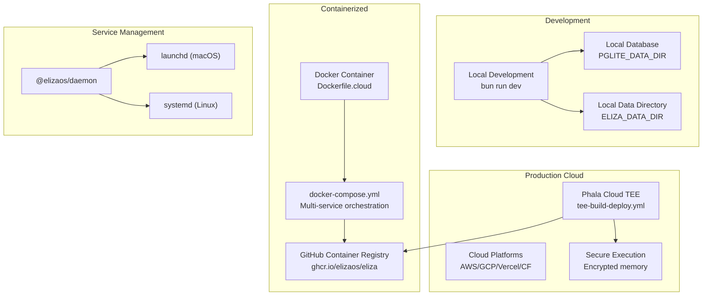
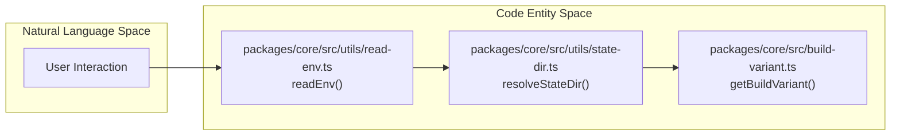

<!-- source: DeepWiki mcp.deepwiki.com · repo elizaOS/eliza · page 12 Deployment · fetched 2026-10-29 -->

# Deployment

Relevant source files

The following files were used as context for generating this wiki page:

- [packages/agent/src/config/paths.ts](packages/agent/src/config/paths.ts)
- [packages/app-core/deploy/Dockerfile.cloud](packages/app-core/deploy/Dockerfile.cloud)
- [packages/app-core/deploy/Dockerfile.cloud.dockerignore](packages/app-core/deploy/Dockerfile.cloud.dockerignore)
- [packages/app-core/src/runtime/build-variant.ts](packages/app-core/src/runtime/build-variant.ts)
- [packages/app-core/src/runtime/sandbox-policy.ts](packages/app-core/src/runtime/sandbox-policy.ts)
- [packages/benchmarks/lifeops-bench/eliza_lifeops_bench/lifeworld/entities.py](packages/benchmarks/lifeops-bench/eliza_lifeops_bench/lifeworld/entities.py)
- [packages/benchmarks/lifeops-bench/eliza_lifeops_bench/lifeworld/world.py](packages/benchmarks/lifeops-bench/eliza_lifeops_bench/lifeworld/world.py)
- [packages/core/src/build-variant.ts](packages/core/src/build-variant.ts)
- [packages/core/src/sandbox-policy.ts](packages/core/src/sandbox-policy.ts)
- [packages/core/src/utils/read-env.test.ts](packages/core/src/utils/read-env.test.ts)
- [packages/core/src/utils/read-env.ts](packages/core/src/utils/read-env.ts)
- [packages/core/src/utils/state-dir.test.ts](packages/core/src/utils/state-dir.test.ts)
- [packages/core/src/utils/state-dir.ts](packages/core/src/utils/state-dir.ts)
- [packages/ui/src/build-variant.ts](packages/ui/src/build-variant.ts)
- [plugins.json](plugins.json)

This page covers deploying elizaOS agents across different environments, from local development to production cloud deployments. It documents environment configuration, Docker containerization, cloud platform integrations, and service management.

For information about building the project, see [Build System](#10.2). For server configuration and API details, see [Agent API Server](#16.2). For database setup, see [Data and Storage](#6).

## Deployment Architecture Overview

elizaOS supports multiple deployment targets with varying levels of security and infrastructure requirements. The framework provides consistent configuration management across all deployment modes through environment variables and hierarchical data directories.

### Deployment Options

**Sources:** [packages/app-core/deploy/Dockerfile.cloud:1-26](), [packages/core/src/utils/state-dir.ts:1-21]()

The deployment architecture provides three primary modes:

1.  **Local Development**: Direct execution using `bun` within the workspace. The `@elizaos/agent` package provides the primary entry point. For details, see [Local Development](#12.1).
2.  **Docker Deployment**: Containerized deployment using Docker. The `Dockerfile.cloud` variant is optimized for runtime efficiency by flattening Bun's store-backed `node_modules` [packages/app-core/deploy/Dockerfile.cloud:1-15](). For details, see [Docker Deployment](#12.2).
3.  **Cloud Platform Deployment**: Deployment to various cloud providers, including serverless environments and Trusted Execution Environments (TEE). For details, see [Cloud Platform Deployment](#12.3).

## Environment Configuration

elizaOS uses environment variables for all configuration, managed via `.env` files and validated through a centralized configuration system in `@elizaos/core`.

### Build Variants
The framework distinguishes between `store` and `direct` builds. `store` builds (e.g., App Store) run in an OS sandbox that restricts filesystem access, while `direct` builds are unrestricted [packages/core/src/build-variant.ts:1-13]().

| Variable | Role | Code Reference |
| :--- | :--- | :--- |
| `ELIZA_BUILD_VARIANT` | Selects 'store' or 'direct' mode | [packages/core/src/build-variant.ts:28-36]() |
| `ELIZA_STATE_DIR` | Primary persistence directory | [packages/core/src/utils/state-dir.ts:58-65]() |
| `ELIZA_NAMESPACE` | Derives `~/.<namespace>` default | [packages/core/src/utils/state-dir.ts:48-52]() |
| `ELIZA_CONFIG_PATH` | Explicit path to agent JSON config | [packages/agent/src/config/paths.ts:12-20]() |

**Sources:** [packages/core/src/build-variant.ts:1-13](), [packages/core/src/utils/state-dir.ts:1-12](), [packages/agent/src/config/paths.ts:12-20]()

## Local Development Deployment

Local development utilizes `PGLite` or local file persistence within the user's home directory.

*   **Persistence**: Managed via `resolveStateDir`, which defaults to `~/.eliza` [packages/core/src/utils/state-dir.ts:58-65]().
*   **Migration**: On first run, elizaOS automatically migrates legacy `~/.milady` directories to `~/.eliza` [packages/core/src/utils/state-dir.ts:109-117]().
*   **OAuth**: Credentials are isolated in a specific sub-directory, typically `<state-dir>/credentials` [packages/core/src/utils/state-dir.ts:68-79]().

For details, see [Local Development](#12.1).

## Docker Deployment

Docker deployment provides consistent environments. The `Dockerfile.cloud` uses a multi-stage build to minimize image size by pruning non-essential workspace packages [packages/app-core/deploy/Dockerfile.cloud:55-107]().

### Container Management

*   **Pruning**: The build process removes heavy development dependencies and unused plugins (e.g., `plugin-imessage`, `plugin-wechat`) to keep the runtime under ~2GB [packages/app-core/deploy/Dockerfile.cloud:92-107]().
*   **Context Optimization**: The `.dockerignore` excludes host `node_modules` and heavy application directories like `android` or `ios` platforms [packages/app-core/deploy/Dockerfile.cloud.dockerignore:17-36]().
*   **Entrypoint**: The cloud image typically starts the agent using `tsx` to execute the entry point at `packages/app-core/src/entry.ts` [packages/app-core/deploy/Dockerfile.cloud:7-9]().

For details, see [Docker Deployment](#12.2).

## Cloud Platform Deployment

elizaOS is designed for multi-platform delivery, bridging local agent logic with cloud-scale infrastructure.

### Bridge and State Resolution

**Sources:** [packages/core/src/utils/state-dir.ts:58-65](), [packages/core/src/utils/read-env.ts:52-57](), [packages/core/src/build-variant.ts:38-43]()

For details on platform-specific setups, see [Cloud Platform Deployment](#12.3).

## Service Management with Daemon

The `@elizaos/daemon` package provides cross-platform service management. It allows agents to run as background services using native OS process managers like `systemd` or `launchd`.

*   **Sandbox Awareness**: The runtime detects if it is running in a `store` build and adjusts filesystem reach accordingly [packages/core/src/build-variant.ts:49-55]().
*   **State Migration**: Includes utilities like `migrateStateDir` to move data between different deployment paths, such as from a direct build to a sandboxed store-build [packages/core/src/utils/state-dir.ts:87-106]().

For details, see [Service Management with Daemon](#12.4).

## Configuration Management

Effective deployment requires robust configuration management across environments.

### Data Directory Hierarchy
The framework uses a structured data directory resolved at runtime:
*   **State**: `resolveStateDir()` handles the persistence of agent state, honoring `ELIZA_STATE_DIR` [packages/core/src/utils/state-dir.ts:58-65]().
*   **Config**: `resolveConfigPath()` looks for `<namespace>.json` within the state directory [packages/agent/src/config/paths.ts:43-61]().
*   **Models**: `resolveModelsCacheDir()` manages the storage of provider-specific model cache files [packages/agent/src/config/paths.ts:84-89]().
*   **Credentials**: Steward and OAuth credentials are saved in specific JSON files within the state or OAuth directories [packages/agent/src/config/paths.ts:91-110]().

For details, see [Configuration Management](#12.5).

**Sources:** [packages/core/src/utils/state-dir.ts:58-79](), [packages/agent/src/config/paths.ts:43-110]()

---

