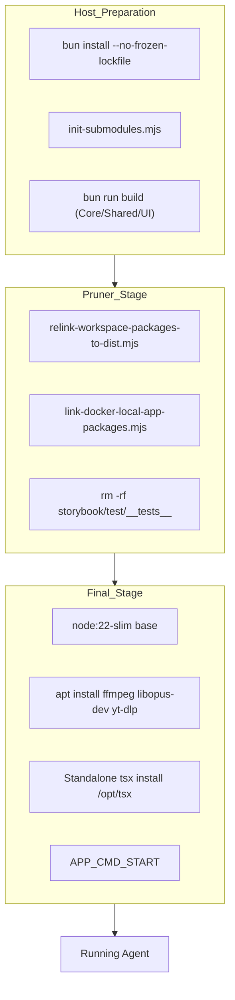
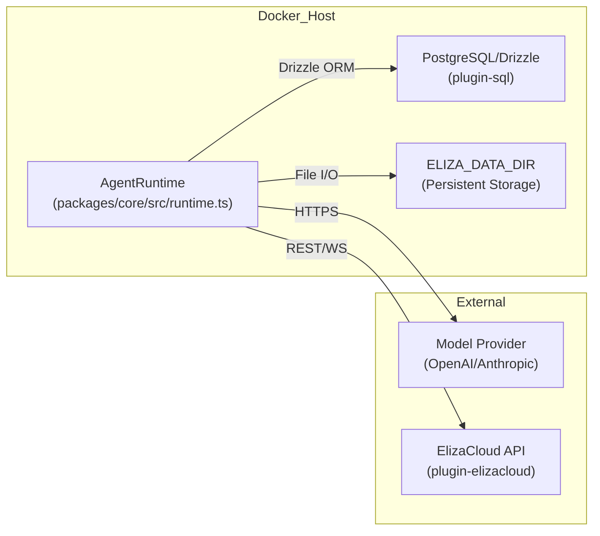

<!-- source: DeepWiki mcp.deepwiki.com · repo elizaOS/eliza · page 12.2 Docker Deployment · fetched 2026-10-29 -->

# Docker Deployment

Relevant source files

The following files were used as context for generating this wiki page:

- [.github/workflows/README.md](.github/workflows/README.md)
- [packages/app-core/deploy/Dockerfile.ci](packages/app-core/deploy/Dockerfile.ci)
- [packages/app-core/deploy/deploy.defaults.env](packages/app-core/deploy/deploy.defaults.env)
- [packages/app-core/packaging/snap/snapcraft.yaml](packages/app-core/packaging/snap/snapcraft.yaml)
- [packages/app-core/scripts/docker-ci-smoke.sh](packages/app-core/scripts/docker-ci-smoke.sh)
- [packages/app-core/scripts/link-docker-local-app-packages.mjs](packages/app-core/scripts/link-docker-local-app-packages.mjs)
- [packages/app-core/src/api/dev-voice-latency-route.test.ts](packages/app-core/src/api/dev-voice-latency-route.test.ts)
- [packages/app-core/src/api/ios-local-agent-transport.ts](packages/app-core/src/api/ios-local-agent-transport.ts)
- [packages/app-core/src/services/phrase-chunked-tts.test.ts](packages/app-core/src/services/phrase-chunked-tts.test.ts)
- [packages/cloud-services/operator/capabilities/__tests__/redis-mock.test.ts](packages/cloud-services/operator/capabilities/__tests__/redis-mock.test.ts)
- [packages/core/package.json](packages/core/package.json)
- [packages/core/src/action-docs.ts](packages/core/src/action-docs.ts)
- [packages/core/src/connectors/account-manager.ts](packages/core/src/connectors/account-manager.ts)
- [packages/core/src/features/advanced-capabilities/actions/room.ts](packages/core/src/features/advanced-capabilities/actions/room.ts)
- [packages/core/src/features/advanced-capabilities/experience/utils/experienceText.ts](packages/core/src/features/advanced-capabilities/experience/utils/experienceText.ts)
- [packages/core/src/features/advanced-memory/types.ts](packages/core/src/features/advanced-memory/types.ts)
- [packages/core/src/features/documents/actions.ts](packages/core/src/features/documents/actions.ts)
- [packages/core/src/features/documents/document-processor.ts](packages/core/src/features/documents/document-processor.ts)
- [packages/core/src/features/documents/service.ts](packages/core/src/features/documents/service.ts)
- [packages/core/src/features/documents/url-ingest.ts](packages/core/src/features/documents/url-ingest.ts)
- [packages/core/src/features/trust/services/CredentialProtector.ts](packages/core/src/features/trust/services/CredentialProtector.ts)
- [packages/core/src/services/relationships.ts](packages/core/src/services/relationships.ts)
- [packages/core/src/utils/synthetic-conversation-artifact.ts](packages/core/src/utils/synthetic-conversation-artifact.ts)
- [packages/core/test/live/orchestrator-live-failover.ts](packages/core/test/live/orchestrator-live-failover.ts)
- [packages/core/test/live/orchestrator-task-thread-integration.ts](packages/core/test/live/orchestrator-task-thread-integration.ts)
- [packages/core/test/live/orchestrator-task-thread-restart.ts](packages/core/test/live/orchestrator-task-thread-restart.ts)
- [packages/core/test/live/research-task-thread-live.ts](packages/core/test/live/research-task-thread-live.ts)
- [packages/scripts/cloud/admin/migrate-with-diagnostics.ts](packages/scripts/cloud/admin/migrate-with-diagnostics.ts)
- [packages/scripts/cloud/admin/run-integration-tests.mjs](packages/scripts/cloud/admin/run-integration-tests.mjs)
- [packages/scripts/run-live-scenarios.mjs](packages/scripts/run-live-scenarios.mjs)
- [plugins/plugin-app-control/package.json](plugins/plugin-app-control/package.json)
- [plugins/plugin-commands/package.json](plugins/plugin-commands/package.json)
- [plugins/plugin-discord/package.json](plugins/plugin-discord/package.json)
- [plugins/plugin-elizacloud/package.json](plugins/plugin-elizacloud/package.json)
- [plugins/plugin-farcaster/package.json](plugins/plugin-farcaster/package.json)
- [plugins/plugin-feishu/package.json](plugins/plugin-feishu/package.json)
- [plugins/plugin-google-chat/package.json](plugins/plugin-google-chat/package.json)
- [plugins/plugin-google-chat/src/actions/index.ts](plugins/plugin-google-chat/src/actions/index.ts)
- [plugins/plugin-google-chat/src/providers/index.ts](plugins/plugin-google-chat/src/providers/index.ts)
- [plugins/plugin-imessage/package.json](plugins/plugin-imessage/package.json)
- [plugins/plugin-line/package.json](plugins/plugin-line/package.json)
- [plugins/plugin-local-inference/src/services/dflash-server.p3.test.ts](plugins/plugin-local-inference/src/services/dflash-server.p3.test.ts)
- [plugins/plugin-local-storage/src/services/local-storage.ts](plugins/plugin-local-storage/src/services/local-storage.ts)
- [plugins/plugin-matrix/package.json](plugins/plugin-matrix/package.json)
- [plugins/plugin-music/package.json](plugins/plugin-music/package.json)
- [plugins/plugin-nostr/package.json](plugins/plugin-nostr/package.json)
- [plugins/plugin-openrouter/package.json](plugins/plugin-openrouter/package.json)
- [plugins/plugin-roblox/package.json](plugins/plugin-roblox/package.json)
- [plugins/plugin-signal/package.json](plugins/plugin-signal/package.json)
- [plugins/plugin-slack/package.json](plugins/plugin-slack/package.json)
- [plugins/plugin-social-alpha/package.json](plugins/plugin-social-alpha/package.json)
- [plugins/plugin-suno/package.json](plugins/plugin-suno/package.json)
- [plugins/plugin-twitch/package.json](plugins/plugin-twitch/package.json)
- [plugins/plugin-web-search/package.json](plugins/plugin-web-search/package.json)
- [plugins/plugin-wechat/package.json](plugins/plugin-wechat/package.json)

This page covers deploying elizaOS agents using Docker and Docker Compose. It explains the multi-variant Dockerfile structure, building custom images, and orchestrating multi-container deployments with Docker Compose.

For local development without Docker, see [Local Development](#12.1). For environment variable management across all deployment types, see [Configuration Management](#12.5).

## Docker Image Variants

elizaOS uses several specialized Dockerfiles optimized for different environments, including cloud-native deployments and CI/CD smoke testing.

| Dockerfile | Purpose | Key Features |
|------------|---------|--------------|
| `Dockerfile.ci` | Production image for CI/CD | Pre-built artifacts, uses `node-slim`, includes `ffmpeg`, `libopus-dev`, and `yt-dlp` [packages/app-core/deploy/Dockerfile.ci:144-158](). |
| `Dockerfile.cloud` | Cloud-optimized image | Minimal footprint, uses Bun for dependency resolution, flattens `node_modules`. |
| `Dockerfile.cloud-agent` | Standalone agent image | Uses a materialized template with exact version pins. |

**Sources:** [packages/app-core/deploy/Dockerfile.ci:1-183]()

## CI Docker Build Process (`Dockerfile.ci`)

The CI Docker build assumes that build artifacts (TypeScript transpilation and UI bundling) are generated on the host before the image is built. This is orchestrated by the `build-agent-image.yml` workflow and smoke-tested via `docker-ci-smoke.sh`.

### Image Construction Pipeline

**Sources:** [packages/app-core/deploy/Dockerfile.ci:23-166](), [packages/app-core/scripts/docker-ci-smoke.sh:207-230]()

### Dependency Linking Logic
During the Docker build, local workspace packages are re-linked to ensure the container uses the correct internal dependency graph.
1. `relink-workspace-packages-to-dist.mjs` points workspace references to their built `dist` folders [packages/app-core/deploy/Dockerfile.ci:30-31]().
2. `link-docker-local-app-packages.mjs` maps `@elizaos/*` package names to their physical locations within the container's `node_modules` and rewrites `package.json` exports to point to source files if `dist` is missing [packages/app-core/scripts/link-docker-local-app-packages.mjs:16-53](), [packages/app-core/scripts/link-docker-local-app-packages.mjs:83-116]().

## Deployment Scripts

### Docker Smoke Testing
The `docker-ci-smoke.sh` script validates the production Docker path by simulating the GitHub Actions environment locally. It performs dependency installation, artifact building, and image verification.

| Function | Role |
|----------|------|
| `find_docker_bin` | Locates the Docker executable across common OS paths [packages/app-core/scripts/docker-ci-smoke.sh:52-63](). |
| `load_env_file` | Sources `deploy.defaults.env` and `deploy.env` [packages/app-core/scripts/docker-ci-smoke.sh:65-73](). |
| `cleanup` | Traps exit to remove containers and restore `.dockerignore` [packages/app-core/scripts/docker-ci-smoke.sh:185-205](). |

**Sources:** [packages/app-core/scripts/docker-ci-smoke.sh:1-212]()

## Container Configuration

### Environment Variables
Docker deployments rely on environment variables passed via `docker-compose.yml` or the `--env-file` flag.

| Variable | Description | Default |
|----------|-------------|---------|
| `APP_PORT` | The port the agent listens on | `2138` [packages/app-core/deploy/Dockerfile.ci:13]() |
| `APP_API_BIND` | Network interface for the API | `127.0.0.1` [packages/app-core/deploy/Dockerfile.ci:14]() |
| `ELIZA_BUNDLED_VERSION` | Version string baked into the image | Passed during build [packages/app-core/deploy/Dockerfile.ci:181]() |
| `TSX_TSCONFIG_PATH` | Path to runtime tsconfig for tsx loader | `deploy/tsx-runtime-tsconfig.json` [packages/app-core/deploy/Dockerfile.ci:171]() |

**Sources:** [packages/app-core/deploy/Dockerfile.ci:4-21](), [packages/app-core/deploy/Dockerfile.ci:168-183]()

### Healthchecks
The container is configured to use the `APP_CMD_START` command which typically invokes `node --import /opt/tsx/node_modules/tsx/dist/loader.mjs packages/agent/dist/bin.js start` [packages/app-core/deploy/Dockerfile.ci:12]().

## Docker Compose Orchestration

### Multi-Container Data Flow

**Sources:** [packages/app-core/deploy/Dockerfile.ci:160-183](), [plugins/plugin-elizacloud/package.json:121-124](), [packages/core/package.json:138]()

### Build Context and .dockerignore
The build context is managed by excluding source code and artifacts that increase image size unnecessarily.
- `node_modules` are pruned of source maps and test directories [packages/app-core/deploy/Dockerfile.ci:106-109]().
- Specific desktop-only or GPU-heavy plugins like `plugin-agent-orchestrator` and `node-llama-cpp` CUDA/Vulkan binaries are removed to maintain a slim production image [packages/app-core/deploy/Dockerfile.ci:85-99]().

**Sources:** [packages/app-core/deploy/Dockerfile.ci:85-110]()

---

