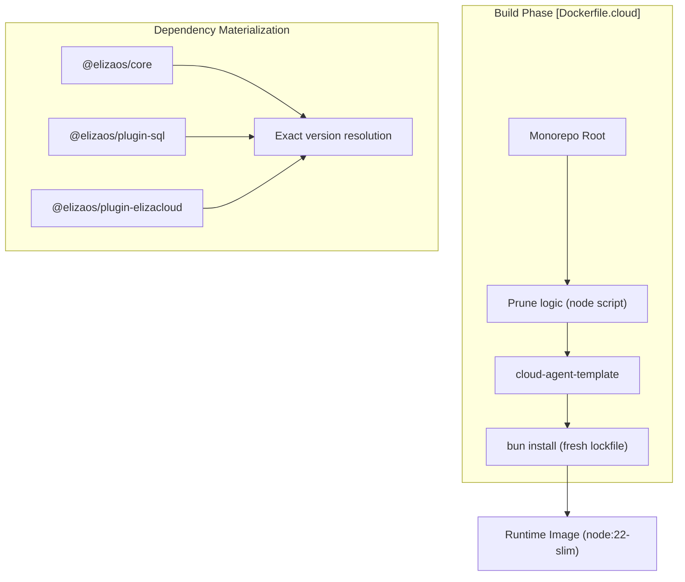
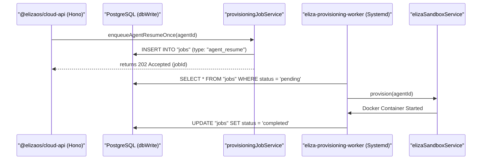
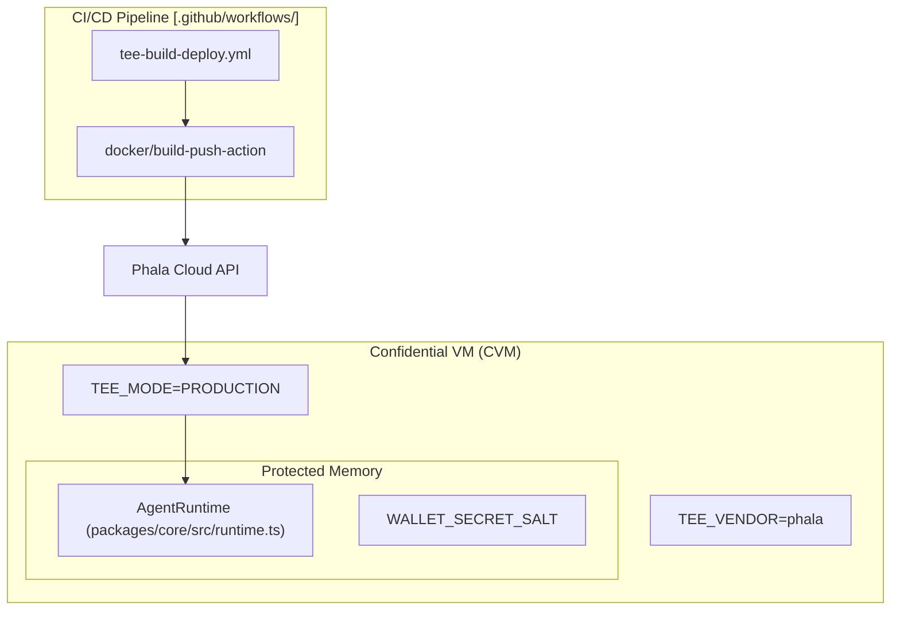

<!-- source: DeepWiki mcp.deepwiki.com · repo elizaOS/eliza · page 12.3 Cloud Platform Deployment · fetched 2026-10-29 -->

# Cloud Platform Deployment

Relevant source files

The following files were used as context for generating this wiki page:

- [.github/workflows/cloud-deploy-backend.yml](.github/workflows/cloud-deploy-backend.yml)
- [.github/workflows/deploy-eliza-provisioning-worker.yml](.github/workflows/deploy-eliza-provisioning-worker.yml)
- [packages/agent/tsconfig.json](packages/agent/tsconfig.json)
- [packages/app-core/scripts/voice-vad-smoke.ts](packages/app-core/scripts/voice-vad-smoke.ts)
- [packages/app-core/src/services/account-pool.ts](packages/app-core/src/services/account-pool.ts)
- [packages/app-core/tsconfig.json](packages/app-core/tsconfig.json)
- [packages/benchmarks/mmau-audio/fixtures/smoke.jsonl](packages/benchmarks/mmau-audio/fixtures/smoke.jsonl)
- [packages/benchmarks/visualwebbench/fixtures/smoke.jsonl](packages/benchmarks/visualwebbench/fixtures/smoke.jsonl)
- [packages/cloud-api/v1/agents/[agentId]/logs/route.ts](packages/cloud-api/v1/agents/[agentId]/logs/route.ts)
- [packages/cloud-api/v1/agents/[agentId]/restart/route.ts](packages/cloud-api/v1/agents/[agentId]/restart/route.ts)
- [packages/cloud-api/v1/agents/[agentId]/suspend/route.ts](packages/cloud-api/v1/agents/[agentId]/suspend/route.ts)
- [packages/cloud-api/v1/eliza/agents/[agentId]/resume/route.ts](packages/cloud-api/v1/eliza/agents/[agentId]/resume/route.ts)
- [packages/cloud-api/v1/eliza/agents/[agentId]/route.ts](packages/cloud-api/v1/eliza/agents/[agentId]/route.ts)
- [packages/cloud-api/v1/eliza/agents/[agentId]/snapshot/route.ts](packages/cloud-api/v1/eliza/agents/[agentId]/snapshot/route.ts)
- [packages/cloud-api/v1/eliza/agents/[agentId]/suspend/route.ts](packages/cloud-api/v1/eliza/agents/[agentId]/suspend/route.ts)
- [packages/cloud-frontend/content/index.mdx](packages/cloud-frontend/content/index.mdx)
- [packages/cloud-shared/src/db/schemas/agent-sandboxes.ts](packages/cloud-shared/src/db/schemas/agent-sandboxes.ts)
- [packages/cloud-shared/src/lib/services/__tests__/provisioning-job-types.test.ts](packages/cloud-shared/src/lib/services/__tests__/provisioning-job-types.test.ts)
- [packages/cloud-shared/src/lib/services/provisioning-job-types.ts](packages/cloud-shared/src/lib/services/provisioning-job-types.ts)
- [packages/cloud-shared/src/lib/services/provisioning-jobs.ts](packages/cloud-shared/src/lib/services/provisioning-jobs.ts)
- [packages/cloud-shared/src/lib/types/cloud-api.ts](packages/cloud-shared/src/lib/types/cloud-api.ts)
- [packages/scenario-runner/tsconfig.json](packages/scenario-runner/tsconfig.json)
- [packages/training/scripts/voice/eot/RUNBOOK.md](packages/training/scripts/voice/eot/RUNBOOK.md)
- [plugins/plugin-coding-tools/tsconfig.json](plugins/plugin-coding-tools/tsconfig.json)
- [plugins/plugin-local-inference/__tests__/dflash-backend-select.test.ts](plugins/plugin-local-inference/__tests__/dflash-backend-select.test.ts)
- [plugins/plugin-local-inference/__tests__/embedding-handler.test.ts](plugins/plugin-local-inference/__tests__/embedding-handler.test.ts)
- [plugins/plugin-local-inference/__tests__/text-handler.test.ts](plugins/plugin-local-inference/__tests__/text-handler.test.ts)
- [plugins/plugin-local-inference/src/services/engine.ts](plugins/plugin-local-inference/src/services/engine.ts)
- [plugins/plugin-local-inference/src/services/voice-prewarm.ts](plugins/plugin-local-inference/src/services/voice-prewarm.ts)
- [plugins/plugin-local-inference/src/services/voice/engine-bridge.ts](plugins/plugin-local-inference/src/services/voice/engine-bridge.ts)
- [plugins/plugin-local-inference/src/services/voice/eot-classifier-ggml.ts](plugins/plugin-local-inference/src/services/voice/eot-classifier-ggml.ts)
- [plugins/plugin-local-inference/src/services/voice/index.ts](plugins/plugin-local-inference/src/services/voice/index.ts)
- [plugins/plugin-local-inference/src/services/voice/samantha-preset-regenerator.ts](plugins/plugin-local-inference/src/services/voice/samantha-preset-regenerator.ts)
- [plugins/plugin-screenshare/src/ui/ScreenshareOperatorSurface.tsx](plugins/plugin-screenshare/src/ui/ScreenshareOperatorSurface.tsx)

This page provides technical details for deploying elizaOS agents to cloud platforms, including serverless environments (AWS Lambda, GCP Cloud Run, Cloudflare Workers), edge platforms (Vercel), and specialized **Phala Cloud Confidential Virtual Machines (CVMs)** using **Trusted Execution Environments (TEE)**. It also covers the internal infrastructure for the managed **ElizaOS Cloud** platform.

## Overview

elizaOS supports high-security cloud deployments through hardware-based isolation and cloud-optimized containerization. The deployment infrastructure is designed to handle the monorepo's complexity by materializing standalone templates for cloud targets, reducing image sizes, and ensuring environment compatibility.

The deployment process is automated via GitHub Actions, which builds hardened Docker images and orchestrates the provisioning of secure cloud resources across various providers.

Sources: [packages/app-core/deploy/Dockerfile.cloud:1-13](), [packages/app-core/deploy/cloud-agent-template/package.json:1-14](), [.github/workflows/deploy-eliza-provisioning-worker.yml:1-30]()

## Cloud-Optimized Containerization

For standard cloud providers (AWS, GCP, DigitalOcean), elizaOS uses a specialized `Dockerfile.cloud`. This image is designed to keep the runtime under ~2GB by flattening Bun's store-backed `node_modules` and copying only the necessary cloud runtime components.

### Standalone Template Materialization
To avoid shipping the entire monorepo, the build process materializes a standalone `cloud-agent-template`. This template acts as the deployment boundary.

**Key Implementation Details:**
- **Pruning**: A Node.js script inside the Dockerfile prunes `devDependencies` and non-essential workspace packages [packages/app-core/deploy/Dockerfile.cloud:44-131]().
- **Version Pinning**: Workspace dependencies like `@elizaos/core` are converted from `workspace:*` to exact registry versions during the image build to ensure stability [packages/app-core/deploy/Dockerfile.cloud:101-113]().
- **Entrypoint**: The image defaults to `app.mjs` and binds to port `2138` [packages/app-core/deploy/Dockerfile.cloud:7-9]().

Sources: [packages/app-core/deploy/Dockerfile.cloud:1-156](), [packages/app-core/deploy/cloud-agent-template/package.json:1-14]()

## Multi-Cloud Deployment Targets

### Cloudflare Workers
The managed ElizaOS Cloud utilizes Cloudflare Workers for its API layer (`@elizaos/cloud-api`).
- **Implementation**: Uses `Hono` for routing and `Drizzle ORM` for database interactions [packages/cloud-api/v1/eliza/agents/[agentId]/resume/route.ts:1-15]().
- **Configuration**: `packages/app-core/deploy/cloudflare/` contains `wrangler.json` for worker definitions [packages/app-core/deploy/cloudflare/wrangler.json:1-20]().
- **Vite Integration**: The frontend (`@elizaos/cloud-frontend`) uses Vite with MDX support and environment variable whitelisting for client-side safety [packages/cloud-frontend/vite.config.ts:58-78]().

### AWS Lambda & GCP
- **AWS**: Targeted via examples in `packages/examples/aws`. Rust-based Lambda functions are supported via `aws_lambda_events` [packages/examples/aws/rust/Cargo.lock:125-138]().
- **GCP**: Containerized deployment via Cloud Run using the `Dockerfile.cloud` configuration.

### Snap & Linux Packages
For Linux cloud instances (e.g., Ubuntu on EC2/Hetzner), elizaOS provides a Snapcraft configuration to package the application with strict confinement.
- **Snapcraft**: Defines `elizaos-app` with access to `network`, `network-bind`, and `password-manager-service` [packages/app-core/packaging/snap/snapcraft.yaml:39-47]().
- **Environment**: Configures `ELIZAOS_APP_DATA_DIR` within the snap user data space [packages/app-core/packaging/snap/snapcraft.yaml:52]().

Sources: [packages/app-core/deploy/cloudflare/wrangler.json:1-20](), [packages/cloud-frontend/vite.config.ts:58-105](), [packages/app-core/packaging/snap/snapcraft.yaml:1-60]()

## Managed Cloud Infrastructure

elizaOS includes a provisioning worker for managing agent containers on dedicated hosts (e.g., Hetzner).

### Data Flow: Provisioning Lifecycle

### Provisioning Worker
The `eliza-provisioning-worker` is a systemd-managed daemon that handles the lifecycle of agent containers.
- **Deployment**: Automated via `.github/workflows/deploy-eliza-provisioning-worker.yml` [.github/workflows/deploy-eliza-provisioning-worker.yml:1-10]().
- **Logic**: It fetches the latest code from the `develop` branch, installs dependencies using Bun, and restarts the `eliza-provisioning-worker` and `eliza-agent-router` services [.github/workflows/deploy-eliza-provisioning-worker.yml:78-160]().
- **Linked Packages**: The worker explicitly builds workspace packages to ensure linked exports are refreshed before the daemon starts [.github/workflows/deploy-eliza-provisioning-worker.yml:155-160]().

### Job System
Provisioning operations are handled asynchronously via the `provisioningJobService` to avoid blocking HTTP requests.
- **Job Types**: Supported types include `agent_provision`, `agent_delete`, `agent_suspend`, `agent_resume`, `agent_restart`, `agent_logs`, and `agent_snapshot` [packages/cloud-shared/src/lib/services/provisioning-job-types.ts:18-24]().
- **Hydration**: Jobs use `hydrateJob` to load offloaded data from object storage if necessary [packages/cloud-shared/src/lib/services/provisioning-jobs.ts:20-25]().

Sources: [.github/workflows/deploy-eliza-provisioning-worker.yml:1-160](), [packages/cloud-shared/src/lib/services/provisioning-jobs.ts:1-32](), [packages/cloud-api/v1/eliza/agents/[agentId]/resume/route.ts:176-218]()

## TEE (Trusted Execution Environment) Deployment

Phala Cloud CVMs provide hardware-level isolation (Intel TDX) for agents handling sensitive financial data or private keys.

**TEE Entity Mapping:**
- **`TEE_MODE`**: Determines if the agent runs in `DEVELOPMENT` or `PRODUCTION` (enforced hardware isolation) [.github/workflows/tee-build-deploy.yml:48]().
- **`WALLET_SECRET_SALT`**: A critical secret used for deterministic key generation within the TEE [.github/workflows/tee-build-deploy.yml:50]().

Sources: [.github/workflows/tee-build-deploy.yml:48-125](), [packages/app-core/deploy/Dockerfile.cloud:1-13]()

## Health and Validation

### Eliza Doctor
The `eliza doctor` command provides health checks for cloud and local environments.
- **Runtime Check**: Validates Bun (>=1.0) or Node.js (>=22) versions [packages/app-core/src/cli/doctor/checks.ts:81-124]().
- **Config Check**: Verifies the existence and JSON validity of the character config file [packages/app-core/src/cli/doctor/checks.ts:179-213]().
- **API Keys**: Scans for essential model provider keys, including `ELIZAOS_CLOUD_API_KEY` [packages/app-core/src/cli/doctor/checks.ts:215-241]().

### E2E Testing
The cloud API is validated using an E2E test suite that orchestrates a test database and a development server.
- **`run-e2e-batches.mjs`**: Migrates the database using Drizzle, starts the Hono API server, and runs Vitest batches [packages/cloud-api/test/e2e/run-e2e-batches.mjs:86-120]().

Sources: [packages/app-core/src/cli/doctor/checks.ts:1-247](), [packages/cloud-api/test/e2e/run-e2e-batches.mjs:1-142]()

---

