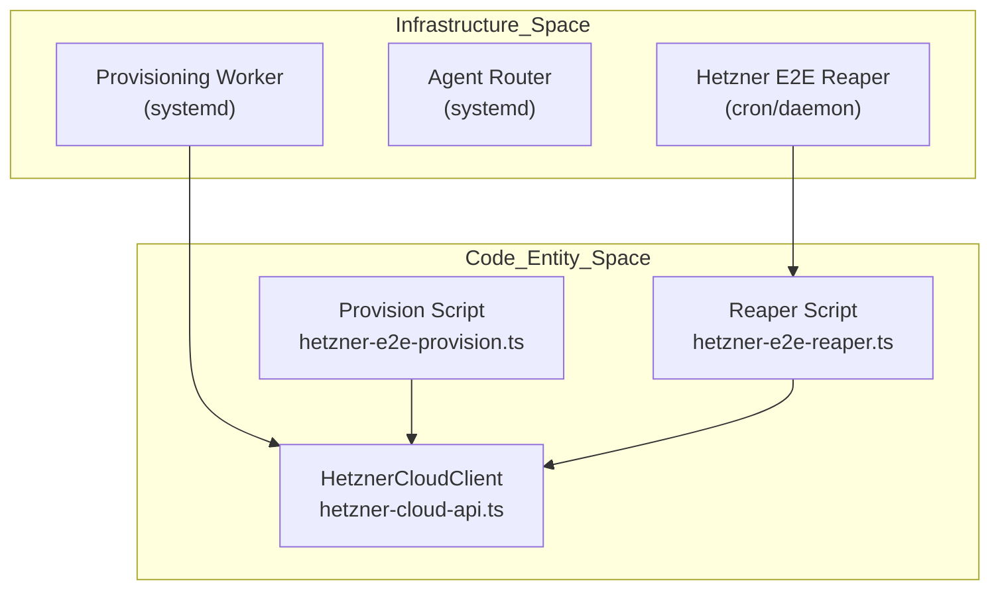
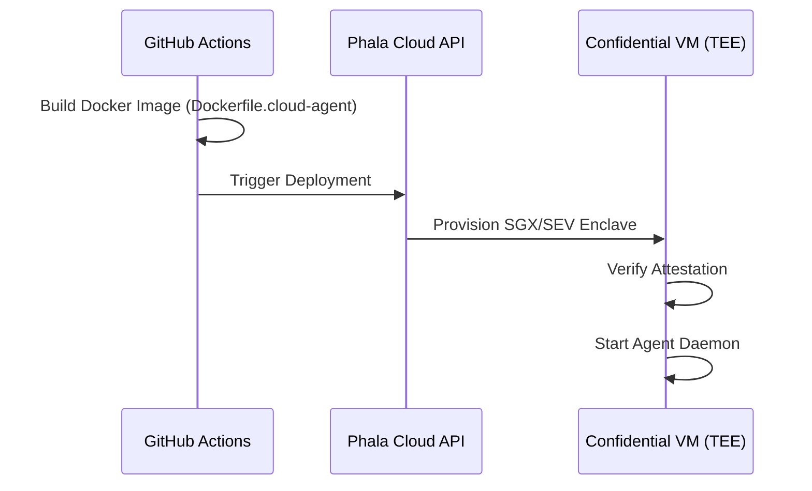

<!-- source: DeepWiki mcp.deepwiki.com · repo elizaOS/eliza · page 12.4 Service Management with Daemon · fetched 2026-10-29 -->

# Service Management with Daemon

Relevant source files

The following files were used as context for generating this wiki page:

- [.github/workflows/android-release.yml](.github/workflows/android-release.yml)
- [.github/workflows/elizaos-os-full-release.yml](.github/workflows/elizaos-os-full-release.yml)
- [.github/workflows/hetzner-e2e-reaper.yml](.github/workflows/hetzner-e2e-reaper.yml)
- [.github/workflows/hetzner-e2e.yml](.github/workflows/hetzner-e2e.yml)
- [.github/workflows/publish-apt-repo.yml](.github/workflows/publish-apt-repo.yml)
- [.github/workflows/release-all.yml](.github/workflows/release-all.yml)
- [.github/workflows/scenario-matrix.yml](.github/workflows/scenario-matrix.yml)
- [.github/workflows/windows-store-release.yml](.github/workflows/windows-store-release.yml)
- [packages/cloud-shared/src/lib/services/containers/hetzner-cloud-api.ts](packages/cloud-shared/src/lib/services/containers/hetzner-cloud-api.ts)
- [packages/scripts/cloud/admin/hetzner-e2e/README.md](packages/scripts/cloud/admin/hetzner-e2e/README.md)
- [packages/scripts/cloud/admin/hetzner-e2e/hetzner-e2e-deploy-agent.ts](packages/scripts/cloud/admin/hetzner-e2e/hetzner-e2e-deploy-agent.ts)
- [packages/scripts/cloud/admin/hetzner-e2e/hetzner-e2e-healthcheck.ts](packages/scripts/cloud/admin/hetzner-e2e/hetzner-e2e-healthcheck.ts)
- [packages/scripts/cloud/admin/hetzner-e2e/hetzner-e2e-provision.ts](packages/scripts/cloud/admin/hetzner-e2e/hetzner-e2e-provision.ts)
- [packages/scripts/cloud/admin/hetzner-e2e/hetzner-e2e-reaper.ts](packages/scripts/cloud/admin/hetzner-e2e/hetzner-e2e-reaper.ts)
- [packages/scripts/cloud/admin/hetzner-e2e/hetzner-e2e-teardown.ts](packages/scripts/cloud/admin/hetzner-e2e/hetzner-e2e-teardown.ts)
- [packages/scripts/cloud/admin/hetzner-e2e/hetzner-e2e-wait-ready.ts](packages/scripts/cloud/admin/hetzner-e2e/hetzner-e2e-wait-ready.ts)
- [packages/scripts/cloud/admin/hetzner-e2e/state-file.ts](packages/scripts/cloud/admin/hetzner-e2e/state-file.ts)
- [packages/scripts/restore-workspace-refs.js](packages/scripts/restore-workspace-refs.js)

The `@elizaos/daemon` package and associated infrastructure provide cross-platform service management capabilities for running Eliza agents as persistent background services. This system abstracts platform-specific service managers (launchd on macOS, systemd on Linux) behind a unified interface, ensuring agents remain active across reboots and system restarts.

For information about local development, see [Local Development](12.1). For containerized deployments, see [Docker Deployment](12.2).

## Purpose and Scope

The daemon system ensures that Eliza agents:
- Start automatically on system boot.
- Restart automatically on failure.
- Integrate with platform-specific service management tools (systemd, launchd).
- Provide consistent lifecycle management for infrastructure components like the `provisioning-worker`.

This approach is suitable for production deployments on bare metal or virtual machines where the agent must behave as a first-class system service rather than a transient process.

Sources: [.github/workflows/hetzner-e2e.yml:29-30](), [.github/workflows/deploy-eliza-provisioning-worker.yml:15-18]()

## Infrastructure Service Architecture

The elizaOS ecosystem utilizes several specialized daemons to manage agent fleets, particularly within the Eliza Cloud infrastructure. These are typically managed via `systemd` on Linux.

### Core Daemons
- **Provisioning Worker**: A background service responsible for orchestrating the creation and configuration of new agent instances [.github/workflows/deploy-eliza-provisioning-worker.yml:17]().
- **Agent Router**: Manages the routing of incoming requests to the appropriate agent process [.github/workflows/deploy-eliza-provisioning-worker.yml:18]().
- **Hetzner E2E Provisioner**: A transient daemon used in CI to provision throwaway servers for nightly smoke tests [packages/scripts/cloud/admin/hetzner-e2e/hetzner-e2e-provision.ts:1-16]().

**Diagram: Infrastructure to Code Mapping**

Sources: [packages/scripts/cloud/admin/hetzner-e2e/hetzner-e2e-provision.ts:18-21](), [.github/workflows/hetzner-e2e.yml:25-30](), [.github/workflows/hetzner-e2e-reaper.yml:3-7]()

## Cross-Platform Service Management

### Linux Integration: systemd
The primary service manager for Linux is `systemd`. Deployment workflows automate the installation of `.service` units to `/etc/systemd/system/` [.github/workflows/deploy-eliza-provisioning-worker.yml:153-157]().

**Example Deployment Flow:**
1. **SSH Connection**: Establish a secure connection to the target host [.github/workflows/deploy-eliza-provisioning-worker.yml:71-75]().
2. **Environment Setup**: Install dependencies using `bun install` [.github/workflows/deploy-eliza-provisioning-worker.yml:134]().
3. **Service Refresh**: Trigger `systemctl daemon-reload` and `systemctl restart` to apply unit changes [.github/workflows/deploy-eliza-provisioning-worker.yml:158-160]().

### Cloud-Specific Provisioning
For elastic scaling, elizaOS uses the `HetznerCloudClient` to manage VPS nodes that host agent daemons [packages/cloud-shared/src/lib/services/containers/hetzner-cloud-api.ts:1-8]().

| Function | Description |
|----------|-------------|
| `createServer()` | Provisions a new VPS with `cloud-init` user data [packages/cloud-shared/src/lib/services/containers/hetzner-cloud-api.ts:211-230]() |
| `deleteServer()` | Decommissions a node [packages/cloud-shared/src/lib/services/containers/hetzner-cloud-api.ts:245]() |
| `listServers()` | Filters nodes by labels like `ci=true` or `workflow=hetzner-e2e` [packages/cloud-shared/src/lib/services/containers/hetzner-cloud-api.ts:195-199]() |

Sources: [packages/cloud-shared/src/lib/services/containers/hetzner-cloud-api.ts:159-211](), [packages/scripts/cloud/admin/hetzner-e2e/hetzner-e2e-provision.ts:153-154]()

## TEE Deployment via Phala Cloud

Deployment to Trusted Execution Environments (TEE) is handled via specialized CI/CD workflows. This ensures agents run within hardware-encrypted enclaves on Phala Cloud.

### TEE Build and Deploy Flow
The `tee-build-deploy.yml` workflow (referenced in deployment strategy) manages:
1. Building the agent image using `Dockerfile.cloud-agent`.
2. Pushing to a secure registry.
3. Triggering Phala's Confidential Virtual Machine (CVM) provisioning.

**Diagram: TEE Service Deployment Sequence**

Sources: [.github/workflows/deploy-eliza-provisioning-worker.yml:1-25](), [packages/scripts/cloud/admin/hetzner-e2e/README.md:3-7]()

## Automated Service Maintenance

To prevent "zombie" services or leaked cloud resources, elizaOS implements a **Reaper** pattern.

### The Reaper Daemon
The `hetzner-e2e-reaper.ts` script runs on a schedule (every 30 minutes) to sweep and delete stale CI servers older than 60 minutes [.github/workflows/hetzner-e2e-reaper.yml:3-11]().

**Reaper Logic:**
- **Label Selection**: Only targets servers with `ci=true` and `workflow=hetzner-e2e` [packages/scripts/cloud/admin/hetzner-e2e/hetzner-e2e-provision.ts:97]().
- **Age Threshold**: Deletes any server exceeding the `PRE_REAP_AGE_MS` (default 20 minutes for fast-lane reaping) [packages/scripts/cloud/admin/hetzner-e2e/hetzner-e2e-provision.ts:91-111]().
- **Atomic State**: Uses a `state-file.json` to track server IDs across workflow steps to ensure idempotent teardown [packages/scripts/cloud/admin/hetzner-e2e/hetzner-e2e-teardown.ts:41-45]().

Sources: [packages/scripts/cloud/admin/hetzner-e2e/hetzner-e2e-reaper.ts:1-10](), [.github/workflows/hetzner-e2e-reaper.yml:38-39](), [packages/scripts/cloud/admin/hetzner-e2e/hetzner-e2e-provision.ts:154]()

## Environment Configuration

Daemons require specific environment variables to interact with cloud providers and the local OS:

| Variable | Role |
|----------|------|
| `HCLOUD_TOKEN_CI` | API token for Hetzner Cloud provisioning [packages/scripts/cloud/admin/hetzner-e2e/hetzner-e2e-provision.ts:123]() |
| `CI_SSH_PUBLIC_KEY_ID` | Numeric ID of the SSH key to inject into new nodes [packages/scripts/cloud/admin/hetzner-e2e/hetzner-e2e-provision.ts:124]() |
| `HETZNER_E2E_SERVER_TYPE` | Defines hardware specs (e.g., `cx22`) [packages/scripts/cloud/admin/hetzner-e2e/hetzner-e2e-provision.ts:136]() |
| `ELIZA_PROVISIONING_HOST` | Target host for service deployment [.github/workflows/deploy-eliza-provisioning-worker.yml:40]() |

Sources: [packages/scripts/cloud/admin/hetzner-e2e/hetzner-e2e-provision.ts:24-31](), [.github/workflows/deploy-eliza-provisioning-worker.yml:38-42]()

---

