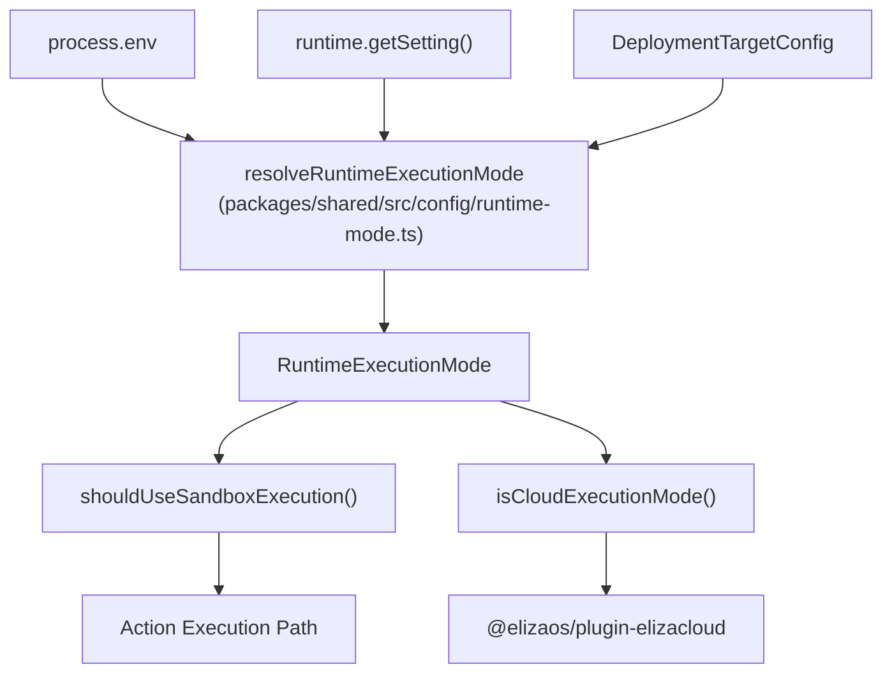
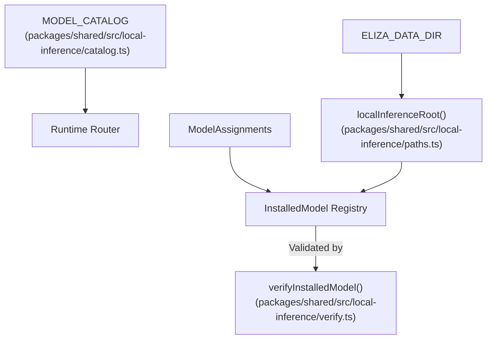

<!-- source: DeepWiki mcp.deepwiki.com · repo elizaOS/eliza · page 12.5 Configuration Management · fetched 2026-10-29 -->

# Configuration Management

Relevant source files

The following files were used as context for generating this wiki page:

- [packages/agent/src/config/paths.ts](packages/agent/src/config/paths.ts)
- [packages/agent/src/runtime/restart.ts](packages/agent/src/runtime/restart.ts)
- [packages/agent/src/services/relationships-graph.ts](packages/agent/src/services/relationships-graph.ts)
- [packages/app-core/deploy/Dockerfile.cloud](packages/app-core/deploy/Dockerfile.cloud)
- [packages/app-core/deploy/Dockerfile.cloud.dockerignore](packages/app-core/deploy/Dockerfile.cloud.dockerignore)
- [packages/app-core/src/runtime/build-variant.ts](packages/app-core/src/runtime/build-variant.ts)
- [packages/app-core/src/runtime/sandbox-policy.ts](packages/app-core/src/runtime/sandbox-policy.ts)
- [packages/benchmarks/lifeops-bench/eliza_lifeops_bench/lifeworld/entities.py](packages/benchmarks/lifeops-bench/eliza_lifeops_bench/lifeworld/entities.py)
- [packages/benchmarks/lifeops-bench/eliza_lifeops_bench/lifeworld/world.py](packages/benchmarks/lifeops-bench/eliza_lifeops_bench/lifeworld/world.py)
- [packages/core/src/build-variant.ts](packages/core/src/build-variant.ts)
- [packages/core/src/features/secrets/actions/get-secret.ts](packages/core/src/features/secrets/actions/get-secret.ts)
- [packages/core/src/sandbox-policy.ts](packages/core/src/sandbox-policy.ts)
- [packages/core/src/utils/read-env.test.ts](packages/core/src/utils/read-env.test.ts)
- [packages/core/src/utils/read-env.ts](packages/core/src/utils/read-env.ts)
- [packages/core/src/utils/state-dir.test.ts](packages/core/src/utils/state-dir.test.ts)
- [packages/core/src/utils/state-dir.ts](packages/core/src/utils/state-dir.ts)
- [packages/scenario-runner/src/cerebras-judge.d.ts](packages/scenario-runner/src/cerebras-judge.d.ts)
- [packages/scenario-runner/src/cerebras-judge.d.ts.map](packages/scenario-runner/src/cerebras-judge.d.ts.map)
- [packages/shared/src/awareness/registry.ts](packages/shared/src/awareness/registry.ts)
- [packages/shared/src/config/runtime-mode.ts](packages/shared/src/config/runtime-mode.ts)
- [packages/shared/src/index.ts](packages/shared/src/index.ts)
- [packages/shared/src/local-inference/catalog.test.ts](packages/shared/src/local-inference/catalog.test.ts)
- [packages/shared/src/local-inference/index.ts](packages/shared/src/local-inference/index.ts)
- [packages/shared/src/local-inference/kokoro-execution-provider.test.ts](packages/shared/src/local-inference/kokoro-execution-provider.test.ts)
- [packages/shared/src/local-inference/kokoro-execution-provider.ts](packages/shared/src/local-inference/kokoro-execution-provider.ts)
- [packages/shared/src/local-inference/providers-types.ts](packages/shared/src/local-inference/providers-types.ts)
- [packages/shared/src/local-inference/types.ts](packages/shared/src/local-inference/types.ts)
- [packages/shared/src/local-inference/voice-models.ts](packages/shared/src/local-inference/voice-models.ts)
- [packages/ui/src/api/client-local-inference.ts](packages/ui/src/api/client-local-inference.ts)
- [packages/ui/src/build-variant.ts](packages/ui/src/build-variant.ts)
- [packages/ui/src/services/local-inference/catalog.ts](packages/ui/src/services/local-inference/catalog.ts)
- [packages/ui/src/services/local-inference/types.ts](packages/ui/src/services/local-inference/types.ts)
- [plugins.json](plugins.json)
- [plugins/plugin-local-inference/src/services/dflash-doctor.ts](plugins/plugin-local-inference/src/services/dflash-doctor.ts)
- [plugins/plugin-sql/package.json](plugins/plugin-sql/package.json)
- [plugins/plugin-workflow/README.md](plugins/plugin-workflow/README.md)

This page provides a technical reference for managing environment variables, secrets, and configuration across elizaOS environments. It covers the resolution logic in `@elizaos/shared`, the directory structure management in `@elizaos/core`, and the runtime execution modes that dictate security posture.

---

## Runtime Execution Modes

elizaOS uses a tiered execution mode system to determine the security constraints and sandbox requirements for the agent. This is resolved via `resolveRuntimeExecutionMode` in `@elizaos/shared`.

| Mode | Local | Cloud | Safe | Description |
|---|---|---|---|---|
| `cloud` | No | Yes | Yes | Managed execution in elizaOS Cloud [packages/shared/src/config/runtime-mode.ts:34-40]() |
| `local-safe` | Yes | No | Yes | Local execution with sandbox enforcement [packages/shared/src/config/runtime-mode.ts:41-47]() |
| `local-yolo` | Yes | No | No | Local execution without sandboxing (Default) [packages/shared/src/config/runtime-mode.ts:48-54]() |

The mode is resolved by checking `ELIZA_RUNTIME_MODE`, `RUNTIME_MODE`, or `LOCAL_RUNTIME_MODE` in that order [packages/shared/src/config/runtime-mode.ts:116-120](). If running on iOS, `local-yolo` is automatically clamped to `local-safe` [packages/shared/src/config/runtime-mode.ts:138-141]().

**Sources:** [packages/shared/src/config/runtime-mode.ts:5-55](), [packages/shared/src/config/runtime-mode.ts:116-154]()

---

## Configuration Resolution Flow

Configuration is gathered from environment variables, settings, and deployment targets. The `AgentRuntime` consumes these through the `resolveRuntimeExecutionMode` utility.

**Diagram: Configuration Resolution and Code Entities**

**Sources:** [packages/shared/src/config/runtime-mode.ts:132-181]()

---

## State Directory and Namespace Management

The system uses a standardized approach to resolve where persistent data (credentials, models, logs) is stored. This is handled by `resolveStateDir` in `@elizaos/core`.

### Precedence Logic
1.  **Explicit Override**: `ELIZA_STATE_DIR` (or legacy `MILADY_STATE_DIR`) [packages/core/src/utils/state-dir.ts:62]().
2.  **Namespace Default**: Derived as `<homedir>/.${ELIZA_NAMESPACE}`. The default namespace is `eliza` [packages/core/src/utils/state-dir.ts:51-64]().

### Directory Migration
On boot, elizaOS checks for legacy directory structures. If `~/.eliza` does not exist but `~/.milady` does, `migrateLegacyStateDir` performs a recursive copy to ensure backward compatibility [packages/core/src/utils/state-dir.ts:118-143]().

| Function | File | Purpose |
|---|---|---|
| `resolveStateDir` | `packages/core/src/utils/state-dir.ts` | Resolves the absolute path for user state [packages/core/src/utils/state-dir.ts:58-65]() |
| `resolveOAuthDir` | `packages/core/src/utils/state-dir.ts` | Resolves the credential store path, honoring `ELIZA_OAUTH_DIR` [packages/core/src/utils/state-dir.ts:71-79]() |
| `getElizaNamespace`| `packages/core/src/utils/state-dir.ts` | Determines the app namespace (default: "eliza") [packages/core/src/utils/state-dir.ts:48-52]() |

**Sources:** [packages/core/src/utils/state-dir.ts:1-80](), [packages/core/src/utils/state-dir.ts:108-153]()

---

## Local Inference Configuration

Configuration for local models (Eliza-1) is managed through a curated catalog and model assignments.

**Diagram: Local Model Configuration Flow**

### Model Tiers and Quants
The system supports multiple tiers (0.8B to 27B) with specific quantization ladders for voice and text [packages/shared/src/local-inference/catalog.ts:32-60]().

- **Text Tiers**: `eliza-1-0_8b`, `eliza-1-2b`, `eliza-1-4b`, `eliza-1-9b`, `eliza-1-27b` [packages/shared/src/local-inference/catalog.test.ts:15-22]().
- **Voice Quants**: Managed via `VOICE_MODEL_VERSIONS` which tracks GGUF assets, SHA256 hashes, and minimum compatible bundle versions [packages/shared/src/local-inference/voice-models.ts:126-164]().

**Sources:** [packages/shared/src/local-inference/types.ts:12-44](), [packages/shared/src/local-inference/voice-models.ts:26-164](), [packages/shared/src/local-inference/catalog.test.ts:12-60]()

---

## Deployment Configuration (Docker)

The `Dockerfile.cloud` provides a reference for production-grade configuration. It utilizes a pruned workspace to keep the image size minimal while ensuring all core dependencies are included [packages/app-core/deploy/Dockerfile.cloud:60-84]().

### Build-time Variables
- `APP_PORT`: Default 2138 [packages/app-core/deploy/Dockerfile.cloud:8]().
- `BUN_VERSION`: Default 1.3.13 [packages/app-core/deploy/Dockerfile.cloud:6]().
- `NODE_LLAMA_CPP_SKIP_DOWNLOAD`: Set to `true` to prevent binary downloads during build [packages/app-core/deploy/Dockerfile.cloud:49]().

**Sources:** [packages/app-core/deploy/Dockerfile.cloud:1-107]()

---

## Security Best Practices

1.  **State Isolation**: Always use `resolveStateDir()` to ensure that data is stored in the correct per-user or per-environment directory [packages/core/src/utils/state-dir.ts:9-12]().
2.  **Environment Validation**: Use `readEnv()` with the `silent` flag during boot checks to avoid polluting logs before the logger is fully initialized [packages/core/src/utils/state-dir.ts:123]().
3.  **Mode Alignment**: Ensure `ELIZA_RUNTIME_MODE` is set to `local-safe` when running in environments where the agent should not have full host access [packages/shared/src/config/runtime-mode.ts:41-47]().
4.  **Verification**: Locally installed models should be re-verified against the `manifestSha256` to ensure supply chain integrity [packages/shared/src/local-inference/types.ts:88-91]().

**Sources:** [packages/core/src/utils/state-dir.ts:122-125](), [packages/shared/src/config/runtime-mode.ts:170-174](), [packages/shared/src/local-inference/types.ts:49-102]()

---

