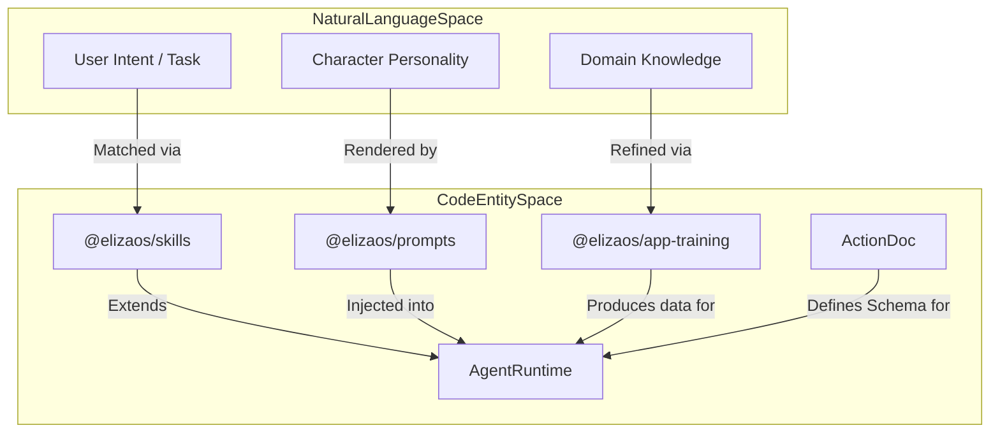
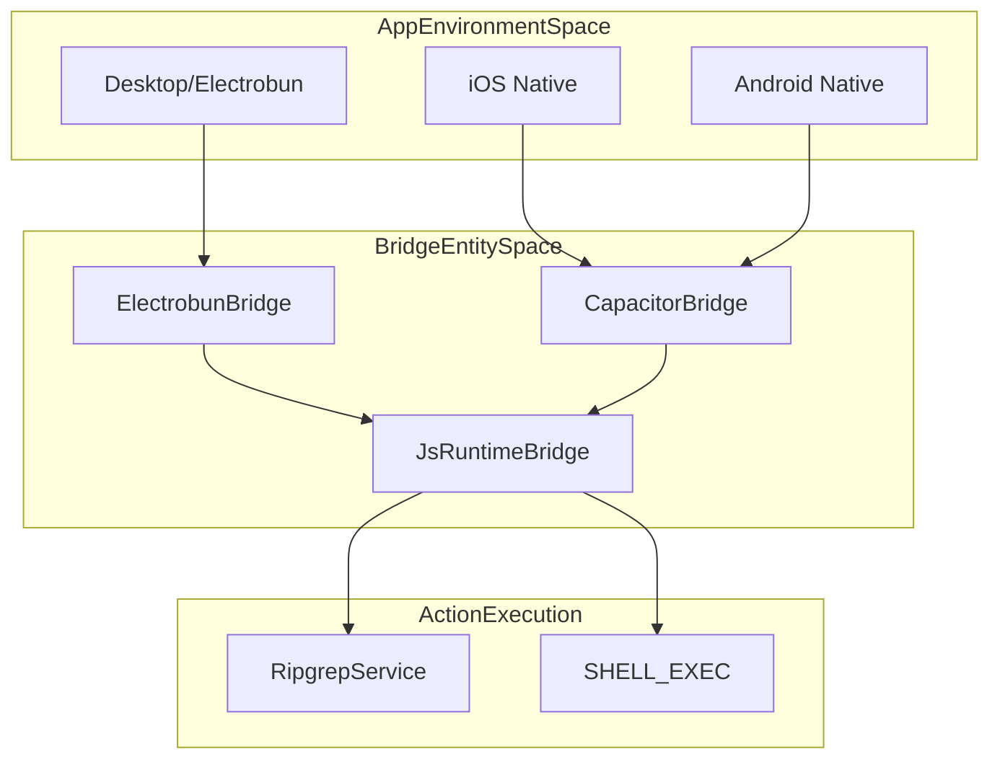
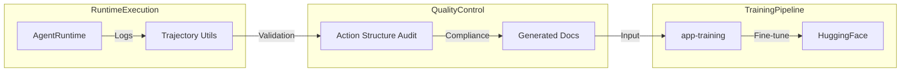

<!-- source: DeepWiki mcp.deepwiki.com · repo elizaOS/eliza · page 13 Agent Capabilities and Apps · fetched 2026-10-29 -->

# Agent Capabilities and Apps

Relevant source files

The following files were used as context for generating this wiki page:

- [.gitattributes](.gitattributes)
- [.gitignore](.gitignore)
- [packages/app/test/ui-smoke/apps-utility-interactions.spec.ts](packages/app/test/ui-smoke/apps-utility-interactions.spec.ts)
- [packages/app/test/ui-smoke/remote-capability-view.spec.ts](packages/app/test/ui-smoke/remote-capability-view.spec.ts)
- [packages/cloud-frontend/tests/e2e/api-explorer-flow.spec.ts](packages/cloud-frontend/tests/e2e/api-explorer-flow.spec.ts)
- [packages/core/src/__tests__/action-structure-audit.test.ts](packages/core/src/__tests__/action-structure-audit.test.ts)
- [packages/core/src/generated/action-docs.ts](packages/core/src/generated/action-docs.ts)
- [packages/core/src/utils/context-catalog.ts](packages/core/src/utils/context-catalog.ts)
- [packages/elizaos/templates-manifest.json](packages/elizaos/templates-manifest.json)
- [packages/examples/a2a/tsconfig.json](packages/examples/a2a/tsconfig.json)
- [packages/examples/agent-console/tsconfig.json](packages/examples/agent-console/tsconfig.json)
- [packages/examples/aws/tsconfig.json](packages/examples/aws/tsconfig.json)
- [packages/examples/bluesky/tsconfig.json](packages/examples/bluesky/tsconfig.json)
- [packages/examples/setup-guide.html](packages/examples/setup-guide.html)
- [packages/prompts/scripts/generate-plugin-action-spec.js](packages/prompts/scripts/generate-plugin-action-spec.js)
- [packages/prompts/specs/actions/plugins.generated.json](packages/prompts/specs/actions/plugins.generated.json)
- [packages/ui/src/bridge/capacitor-bridge.ts](packages/ui/src/bridge/capacitor-bridge.ts)
- [packages/ui/src/bridge/plugin-bridge.ts](packages/ui/src/bridge/plugin-bridge.ts)
- [packages/ui/src/components/apps/GameView.tsx](packages/ui/src/components/apps/GameView.tsx)
- [packages/ui/src/components/apps/load-apps-catalog.ts](packages/ui/src/components/apps/load-apps-catalog.ts)
- [packages/ui/src/components/character/CharacterEditor.tsx](packages/ui/src/components/character/CharacterEditor.tsx)
- [plugins/plugin-browser/src/actions/browser.ts](plugins/plugin-browser/src/actions/browser.ts)
- [plugins/plugin-coding-tools/src/services/ripgrep-service.ts](plugins/plugin-coding-tools/src/services/ripgrep-service.ts)
- [tsconfig.dist-paths.json](tsconfig.dist-paths.json)
- [turbo.json](turbo.json)

This page provides a high-level overview of the advanced capability systems and the application ecosystem within elizaOS. While the core runtime handles message processing and state management, the systems described here—**Skills**, **Prompts**, and **Training**—provide the specialized intelligence and modular functionality that allow agents to perform complex tasks. Additionally, elizaOS includes a diverse set of example applications demonstrating these capabilities in real-world scenarios.

## Ecosystem Overview

The elizaOS architecture separates core logic from domain-specific capabilities. This modularity is achieved through a combination of structured skill definitions, a template-based prompt system, and a robust training pipeline. Capabilities are often exposed to the model via `ActionDoc` structures that define parameters and examples.

### Conceptual Bridge: Capabilities to Code

The following diagram illustrates how high-level agent "capabilities" map to specific code entities and packages within the monorepo.

**Capability Mapping Diagram**

Sources: [packages/core/src/generated/action-docs.ts:52-61](), [packages/prompts/scripts/generate-plugin-action-spec.js:10-25](), [packages/core/src/runtime.ts:1-50]()

---

## Example Applications
The `apps/` and `packages/examples/` directories contain a rich ecosystem of reference implementations. These applications demonstrate how to build specialized interfaces and logic on top of the elizaOS core. The framework supports diverse execution environments, including specialized native integrations for mobile and desktop.

**Runtime Execution Bridge**

Sources: [packages/ui/src/bridge/capacitor-bridge.ts:1-20](), [plugins/plugin-coding-tools/src/services/ripgrep-service.ts:41-45](), [packages/core/src/utils/context-catalog.ts:149-149]()

Key examples include:
*   **Gaming**: `app-2004scape` (OSRS bot), `app-scape`, and `app-babylon` (3D).
*   **Productivity**: `app-lifeops` (personal assistant) and `app-task-coordinator` (coding agent).
*   **Infrastructure**: `app-training` for fine-tuning and `app-elizamaker` for agent generation.
*   **Financial**: `app-steward` (blockchain wallet) and `app-shopify`.
*   **Robotics**: `plugin-ainex` for driving Hiwonder AiNex robots via action groups and RL policies.

For details, see [Example Applications](#13.1).

---

## Skills System
The Skills system, located in `packages/skills/`, allows for modular agent capabilities that can be discovered and loaded dynamically. Unlike standard plugins, skills focus on high-level "actions" defined via markdown files with YAML frontmatter.

Key components include:
*   **Skill Discovery**: Mechanisms to find skills in bundled, managed, or project-specific locations.
*   **Command Specs**: Functions like `buildSkillCommandSpecs()` convert skill definitions into formats the LLM can understand.
*   **Prompt Integration**: `formatSkillsForPrompt()` ensures available skills are correctly injected into the model's context.

For details, see [Skills System](#13.2).

---

## Prompt Engineering and Templates
The `@elizaos/prompts` package manages the "voice" and logic of the agent. It uses a multi-language prompt generation system that sources from `.txt` files and utilizes **Handlebars** template syntax.

This system handles:
*   **Scaffolding**: Project templates defined in `packages/elizaos/templates-manifest.json` (e.g., `plugin` and `project` kinds) for rapid development.
*   **Action Specifications**: Automated generation of specs from `packages/prompts/specs/actions/` into `action-docs.ts`.
*   **Context Mapping**: The `ACTION_CONTEXT_MAP` in `context-catalog.ts` associates actions like `WALLET`, `BROWSER`, or `SHELL_EXEC` with specific agent contexts.

For details, see [Prompt Engineering and Templates](#13.3).
Sources: [packages/elizaos/templates-manifest.json:1-24](), [packages/core/src/utils/context-catalog.ts:3-162](), [packages/core/src/generated/action-docs.ts:77-85]()

---

## Training and Benchmarks
To improve agent performance over time, elizaOS provides a comprehensive training infrastructure and benchmarking suite.

*   **Training Infrastructure**: The `apps/app-training/` package facilitates fine-tuning through HuggingFace integration. It utilizes a specific "trajectory" data format to capture agent decision-making paths for Reinforcement Learning (RL).
*   **Benchmarks**: The `packages/benchmarks/` suite includes over 25+ benchmarks such as **GAIA**, **SWE-bench**, and **OSWorld** to measure agent capabilities.
*   **Audit Guards**: Structural tests in `action-structure-audit.test.ts` ensure that retired actions are kept out of generated docs while canonical owner surfaces remain present.

**Training and Data Integrity**

Sources: [packages/core/src/__tests__/action-structure-audit.test.ts:151-157](), [packages/core/src/generated/action-docs.ts:1-4]()

For details, see [Training Infrastructure](#13.4).

---

## LifeOps Application
The `app-lifeops` application is a flagship implementation of a personal productivity agent. It leverages the full stack of elizaOS capabilities, including a dedicated plugin architecture and service mixins for calendar, email, and messaging integrations. It features a specialized UI for activity tracking, dossier management, and inbox triage.

For details, see [LifeOps Application](#13.5).
Sources: [packages/prompts/specs/actions/plugins.generated.json:150-160](), [packages/core/src/utils/context-catalog.ts:134-136]()

---

