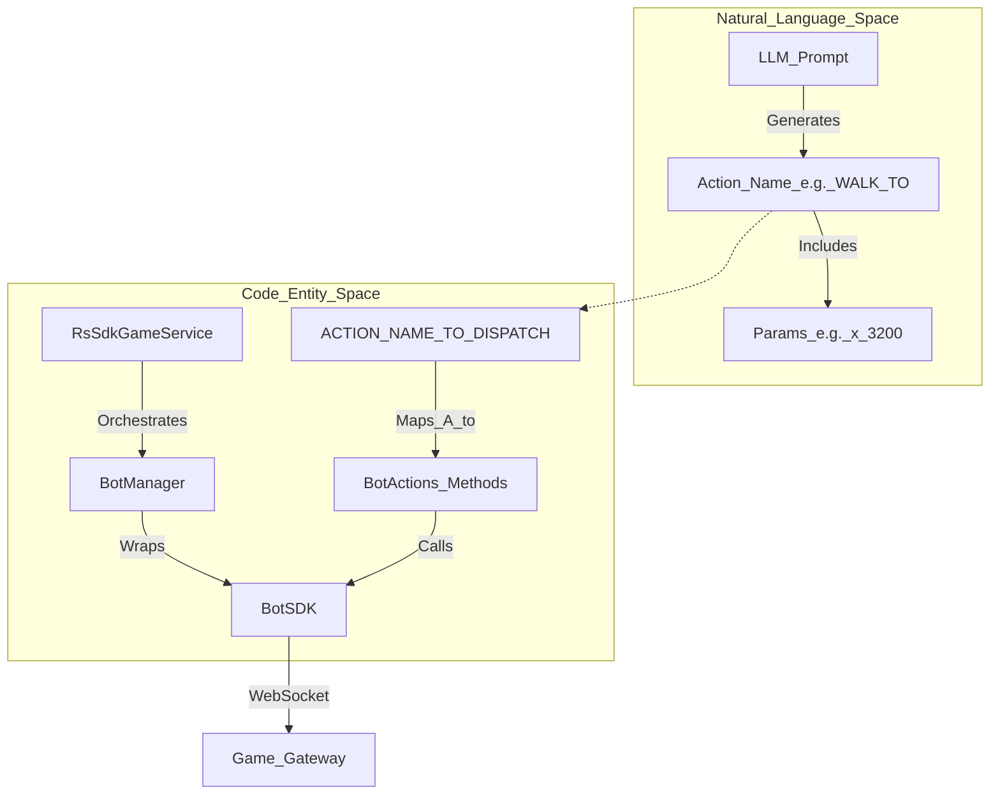
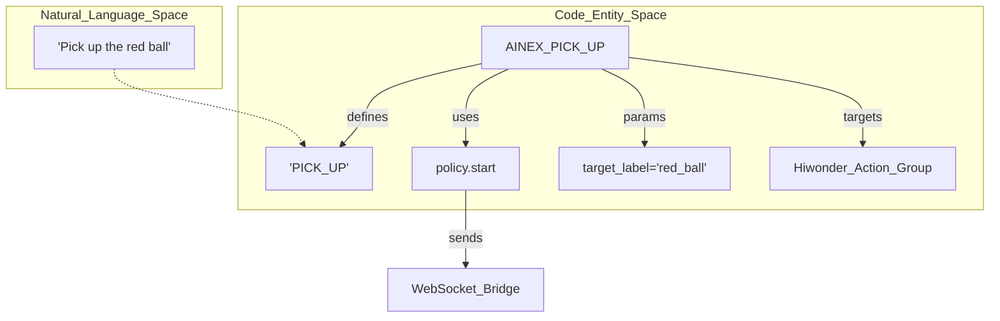
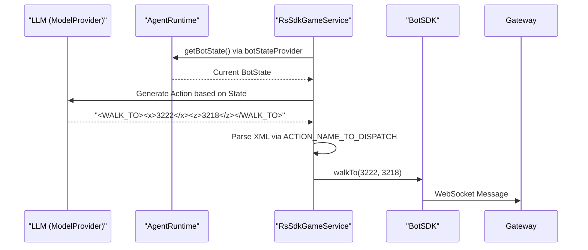

<!-- source: DeepWiki mcp.deepwiki.com · repo elizaOS/eliza · page 13.1 Example Applications · fetched 2026-10-29 -->

# Example Applications

Relevant source files

The following files were used as context for generating this wiki page:

- [.codex/brand-review-screenshots/app-browser.png](.codex/brand-review-screenshots/app-browser.png)
- [.codex/brand-review-screenshots/cloud-browser.png](.codex/brand-review-screenshots/cloud-browser.png)
- [.gitattributes](.gitattributes)
- [.gitignore](.gitignore)
- [packages/app/test/ui-smoke/apps-utility-interactions.spec.ts](packages/app/test/ui-smoke/apps-utility-interactions.spec.ts)
- [packages/app/test/ui-smoke/remote-capability-view.spec.ts](packages/app/test/ui-smoke/remote-capability-view.spec.ts)
- [packages/cloud-frontend/index.html](packages/cloud-frontend/index.html)
- [packages/cloud-frontend/src/RootLayout.tsx](packages/cloud-frontend/src/RootLayout.tsx)
- [packages/cloud-frontend/src/components/landing/Footer.tsx](packages/cloud-frontend/src/components/landing/Footer.tsx)
- [packages/cloud-frontend/src/components/landing/hero-section.tsx](packages/cloud-frontend/src/components/landing/hero-section.tsx)
- [packages/cloud-frontend/src/components/landing/landing-page-new.tsx](packages/cloud-frontend/src/components/landing/landing-page-new.tsx)
- [packages/cloud-frontend/src/components/layout/header.tsx](packages/cloud-frontend/src/components/layout/header.tsx)
- [packages/cloud-frontend/src/components/layout/landing-header.tsx](packages/cloud-frontend/src/components/layout/landing-header.tsx)
- [packages/cloud-frontend/src/components/layout/sidebar-data.ts](packages/cloud-frontend/src/components/layout/sidebar-data.ts)
- [packages/cloud-frontend/src/components/layout/sidebar.tsx](packages/cloud-frontend/src/components/layout/sidebar.tsx)
- [packages/cloud-frontend/src/components/layout/user-menu.tsx](packages/cloud-frontend/src/components/layout/user-menu.tsx)
- [packages/cloud-frontend/src/entry-server.tsx](packages/cloud-frontend/src/entry-server.tsx)
- [packages/cloud-frontend/src/pages/login/page.tsx](packages/cloud-frontend/src/pages/login/page.tsx)
- [packages/cloud-frontend/tests/e2e/api-explorer-flow.spec.ts](packages/cloud-frontend/tests/e2e/api-explorer-flow.spec.ts)
- [packages/core/src/__tests__/action-structure-audit.test.ts](packages/core/src/__tests__/action-structure-audit.test.ts)
- [packages/core/src/generated/action-docs.ts](packages/core/src/generated/action-docs.ts)
- [packages/core/src/utils/context-catalog.ts](packages/core/src/utils/context-catalog.ts)
- [packages/elizaos/templates-manifest.json](packages/elizaos/templates-manifest.json)
- [packages/examples/a2a/tsconfig.json](packages/examples/a2a/tsconfig.json)
- [packages/examples/agent-console/tsconfig.json](packages/examples/agent-console/tsconfig.json)
- [packages/examples/aws/tsconfig.json](packages/examples/aws/tsconfig.json)
- [packages/examples/bluesky/tsconfig.json](packages/examples/bluesky/tsconfig.json)
- [packages/examples/chat/chat.ts](packages/examples/chat/chat.ts)
- [packages/examples/setup-guide.html](packages/examples/setup-guide.html)
- [packages/homepage/index.html](packages/homepage/index.html)
- [packages/homepage/src/App.tsx](packages/homepage/src/App.tsx)
- [packages/homepage/src/components/BlobButton.tsx](packages/homepage/src/components/BlobButton.tsx)
- [packages/homepage/src/components/authed-shell.tsx](packages/homepage/src/components/authed-shell.tsx)
- [packages/homepage/src/index.css](packages/homepage/src/index.css)
- [packages/homepage/src/pages/connected.tsx](packages/homepage/src/pages/connected.tsx)
- [packages/homepage/src/pages/get-started.tsx](packages/homepage/src/pages/get-started.tsx)
- [packages/homepage/src/pages/leaderboard.tsx](packages/homepage/src/pages/leaderboard.tsx)
- [packages/homepage/src/pages/marketing.tsx](packages/homepage/src/pages/marketing.tsx)
- [packages/homepage/tsconfig.app.json](packages/homepage/tsconfig.app.json)
- [packages/homepage/vite.config.ts](packages/homepage/vite.config.ts)
- [packages/os-homepage/src/App.tsx](packages/os-homepage/src/App.tsx)
- [packages/os-homepage/src/index.css](packages/os-homepage/src/index.css)
- [packages/os-homepage/tests/contact-sheet.spec.ts](packages/os-homepage/tests/contact-sheet.spec.ts)
- [packages/prompts/scripts/generate-plugin-action-spec.js](packages/prompts/scripts/generate-plugin-action-spec.js)
- [packages/prompts/specs/actions/plugins.generated.json](packages/prompts/specs/actions/plugins.generated.json)
- [packages/ui/src/backgrounds/CloudVideoBackground.tsx](packages/ui/src/backgrounds/CloudVideoBackground.tsx)
- [packages/ui/src/bridge/capacitor-bridge.ts](packages/ui/src/bridge/capacitor-bridge.ts)
- [packages/ui/src/bridge/plugin-bridge.ts](packages/ui/src/bridge/plugin-bridge.ts)
- [packages/ui/src/components/apps/GameView.tsx](packages/ui/src/components/apps/GameView.tsx)
- [packages/ui/src/components/apps/load-apps-catalog.ts](packages/ui/src/components/apps/load-apps-catalog.ts)
- [packages/ui/src/components/character/CharacterEditor.tsx](packages/ui/src/components/character/CharacterEditor.tsx)
- [plugins/plugin-browser/src/actions/browser.ts](plugins/plugin-browser/src/actions/browser.ts)
- [plugins/plugin-coding-tools/src/services/ripgrep-service.ts](plugins/plugin-coding-tools/src/services/ripgrep-service.ts)
- [plugins/plugin-native-agent/package.json](plugins/plugin-native-agent/package.json)
- [plugins/plugin-native-appblocker/package.json](plugins/plugin-native-appblocker/package.json)
- [plugins/plugin-native-bun-runtime/package.json](plugins/plugin-native-bun-runtime/package.json)
- [plugins/plugin-workflow/src/types/index.ts](plugins/plugin-workflow/src/types/index.ts)
- [tsconfig.dist-paths.json](tsconfig.dist-paths.json)
- [turbo.json](turbo.json)

elizaOS provides a rich ecosystem of example applications and plugins that demonstrate the framework's versatility across gaming, productivity, e-commerce, and autonomous desktop control. These applications are primarily located in the `apps/` and `packages/examples/` directories, serving as both production-ready tools and reference implementations for developers.

## 2004Scape Bot (app-2004scape)

The `app-2004scape` is an autonomous game agent designed for Old School RuneScape (OSRS) private servers (2004-era). It implements a complete LLM-driven game loop that perceives world state and executes complex in-game actions.

### Architecture and Implementation
The application is structured as a plugin that registers a `RsSdkGameService` to the `AgentRuntime`. It uses a WebSocket-based SDK to communicate with a game gateway.

*   **Service**: `RsSdkGameService` manages the autonomous loop and connection lifecycle [apps/app-2004scape/src/services/game-service.ts:104-118]().
*   **Bot Manager**: `BotManager` handles the `BotSDK` instance, maintaining the connection and computing "alerts" (e.g., low HP, full inventory) [apps/app-2004scape/src/services/bot-manager.ts:9-13]().
*   **Action System**: The agent has access to 32 discrete game actions (e.g., `WALK_TO`, `ATTACK_NPC`, `MINE_ROCK`) mapped from LLM responses to SDK calls [apps/app-2004scape/src/services/game-service.ts:31-102]().

### Game Loop Data Flow
The `RsSdkGameService` runs an interval-based loop (default 15s) that performs the following steps:
1.  **Sense**: Retrieves the current `BotWorldState` via the `BotManager` [apps/app-2004scape/src/services/bot-manager.ts:40-42]().
2.  **Think**: Feeds the state, event logs, and available actions into the LLM.
3.  **Act**: Dispatches the chosen action through `BotActions` [apps/app-2004scape/src/services/game-service.ts:162-164]().

**OSRS Bot System Mapping**

Sources: `apps/app-2004scape/src/services/game-service.ts`, `apps/app-2004scape/src/services/bot-manager.ts`, `apps/app-2004scape/src/index.ts`

---

## Application Ecosystem

The `apps/` directory contains specialized agents and interfaces that leverage the `@elizaos/app-core` shell.

### Core Applications
| App Name | Description | Implementation Details |
| :--- | :--- | :--- |
| `app-companion` | Personal avatar agent | Uses `@pixiv/three-vrm` for 3D character rendering and `VrmEngine` [apps/app-companion/package.json:54-57](). |
| `app-steward` | Blockchain wallet | Integrates `@stwd/sdk`, `ethers`, and `viem` for on-chain operations [apps/app-steward/package.json:22-29](). |
| `app-task-coordinator` | Coding agent | Uses `@xterm/xterm` for terminal interaction and coordinates multi-agent tasks [apps/app-task-coordinator/package.json:17-22](). |
| `app-form` | Conversational forms | Implements guided user journeys for structured data collection [apps/app-form/package.json:6-7](). |
| `app-lifeops` | Personal productivity | Manages calendars, Gmail, and system blocking [plugins/plugin-coding-tools/src/actions/bash.ts:212-220](). |
| `app-shopify` | E-commerce management | Plugin-based management of products, orders, and inventory [plugins/plugin-shopify/src/index.ts:12-18](). |
| `app-training` | Fine-tuning infra | RL trajectory data output and HuggingFace integration [packages/core/src/generated/action-docs.ts:1-5](). |

### Computer Use and Robotics
The `plugin-computeruse` and `plugin-ainex` represent the "Physical/Native Action Space" for agentic applications.

*   **Computer Use**: Enables screenshots, mouse/keyboard control, and window management [plugins/plugin-computeruse/src/index.ts:66-73]().
*   **Robotics (AiNex)**: Provides actions like `AINEX_WALK_FORWARD`, `AINEX_PICK_UP`, and `AINEX_STOP` to drive Hiwonder robots via a WebSocket bridge [packages/prompts/specs/actions/plugins.generated.json:5-106]().
*   **Native Alarms**: `ALARM` action manages macOS notifications via `UNUserNotificationCenter` [packages/prompts/specs/actions/plugins.generated.json:108-170]().

**Action Execution Mapping**

Sources: `packages/prompts/specs/actions/plugins.generated.json:11-15()`, `plugins/plugin-computeruse/src/index.ts:80-90()`.

---

## Example Packages

The `packages/examples/` directory contains over 40 integration examples demonstrating how to deploy elizaOS across various platforms.

### Cloud and Serverless Deployments
*   **AWS/GCP**: Deployment patterns for cloud environments [packages/examples/aws/tsconfig.json](), [packages/examples/gcp/dist/index.d.ts]().
*   **Cloudflare/Vercel**: Deployment patterns for edge environments [packages/examples/cloudflare/src/index.ts](), [packages/examples/vercel/dist/index.d.ts]().

### Integration Examples
*   **Social Platforms**: Discord, Farcaster, Bluesky, and Telegram agent implementations [tsconfig.dist-paths.json:94-154]().
*   **Specialized Bots**: `example-autonomous` [tsconfig.dist-paths.json:155-157]() and `game-of-life` [tsconfig.dist-paths.json:159-161]().
*   **Browser Extensions**: Multi-provider (OpenAI, Anthropic, Groq) extensions for Chrome and Safari [turbo.json:157-167]().

**Data Flow: From Prompt to Action Execution**

Sources: `apps/app-2004scape/src/services/game-service.ts:68-102`, `apps/app-2004scape/src/services/bot-manager.ts:44-87`

## UI and OS Homepages
The ecosystem includes specialized landing pages for platform delivery.
*   **OS Homepage**: A React-based landing page for the ElizaOS Linux distribution, providing downloads for bare-metal images, VM bundles, and Android APKs [packages/os-homepage/src/App.tsx:46-92]().
*   **Marketing Page**: The main elizaOS app marketing site featuring `CloudVideoBackground` and multi-platform download links [packages/homepage/src/pages/marketing.tsx:77-124]().
*   **Provisioning Chat**: A specialized onboarding flow that uses `useElizaAppProvisioningChat` to guide users through setting up their AI space via SMS, Telegram, or Discord [packages/homepage/src/pages/get-started.tsx:130-166]().

Sources: `packages/os-homepage/src/App.tsx`, `packages/homepage/src/pages/marketing.tsx`, `packages/homepage/src/pages/get-started.tsx`.

---

