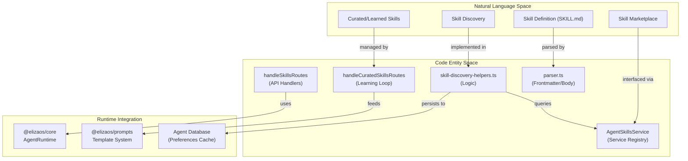
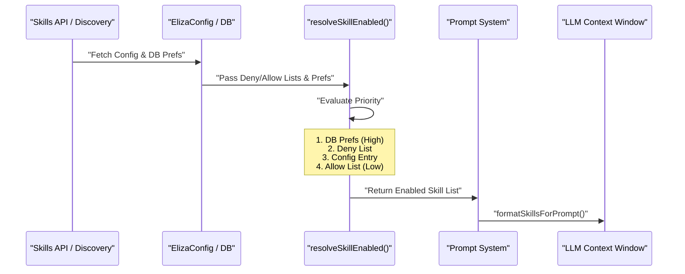

<!-- source: DeepWiki mcp.deepwiki.com · repo elizaOS/eliza · page 13.2 Skills System · fetched 2026-10-29 -->

# Skills System

Relevant source files

The following files were used as context for generating this wiki page:

- [packages/agent/package.json](packages/agent/package.json)
- [packages/agent/src/api/index.ts](packages/agent/src/api/index.ts)
- [packages/agent/src/api/server.ts](packages/agent/src/api/server.ts)
- [packages/agent/src/services/index.ts](packages/agent/src/services/index.ts)
- [packages/app-core/platforms/electrobun/scripts/smoke-test-windows.ps1](packages/app-core/platforms/electrobun/scripts/smoke-test-windows.ps1)
- [packages/app-core/src/ui-compat.ts](packages/app-core/src/ui-compat.ts)
- [packages/core/src/features/advanced-capabilities/evaluators/reflection-items.ts](packages/core/src/features/advanced-capabilities/evaluators/reflection-items.ts)
- [packages/core/src/features/advanced-capabilities/evaluators/skill-items.ts](packages/core/src/features/advanced-capabilities/evaluators/skill-items.ts)
- [packages/shared/src/cli/parse-duration.ts](packages/shared/src/cli/parse-duration.ts)
- [packages/shared/src/contracts/app-permissions-routes.test.ts](packages/shared/src/contracts/app-permissions-routes.test.ts)
- [packages/shared/src/contracts/app-permissions-routes.ts](packages/shared/src/contracts/app-permissions-routes.ts)
- [packages/shared/src/contracts/apps.test.ts](packages/shared/src/contracts/apps.test.ts)
- [packages/shared/src/contracts/apps.ts](packages/shared/src/contracts/apps.ts)
- [packages/ui/src/api/client-skills.ts](packages/ui/src/api/client-skills.ts)
- [plugins/plugin-agent-skills/src/index.ts](plugins/plugin-agent-skills/src/index.ts)
- [plugins/plugin-anthropic/README.md](plugins/plugin-anthropic/README.md)
- [plugins/plugin-anthropic/index.ts](plugins/plugin-anthropic/index.ts)
- [plugins/plugin-anthropic/models/index.ts](plugins/plugin-anthropic/models/index.ts)
- [plugins/plugin-anthropic/models/text.ts](plugins/plugin-anthropic/models/text.ts)
- [plugins/plugin-benchmarks/src/actions/tau-bench.ts](plugins/plugin-benchmarks/src/actions/tau-bench.ts)
- [plugins/plugin-capacitor-bridge/src/android/bridge.ts](plugins/plugin-capacitor-bridge/src/android/bridge.ts)
- [plugins/plugin-capacitor-bridge/src/ios/bridge.ts](plugins/plugin-capacitor-bridge/src/ios/bridge.ts)
- [plugins/plugin-capacitor-bridge/src/shared/fs-promises-proxy.ts](plugins/plugin-capacitor-bridge/src/shared/fs-promises-proxy.ts)
- [plugins/plugin-capacitor-bridge/src/shared/fs-proxy.ts](plugins/plugin-capacitor-bridge/src/shared/fs-proxy.ts)
- [plugins/plugin-capacitor-bridge/src/shared/fs-sandbox.ts](plugins/plugin-capacitor-bridge/src/shared/fs-sandbox.ts)
- [plugins/plugin-capacitor-bridge/src/shared/fs-shim.ts](plugins/plugin-capacitor-bridge/src/shared/fs-shim.ts)
- [plugins/plugin-discord/discord-commands.ts](plugins/plugin-discord/discord-commands.ts)
- [plugins/plugin-openai/__tests__/reasoning-effort.shape.test.ts](plugins/plugin-openai/__tests__/reasoning-effort.shape.test.ts)
- [plugins/plugin-openai/index.ts](plugins/plugin-openai/index.ts)
- [plugins/plugin-openai/models/text.ts](plugins/plugin-openai/models/text.ts)
- [plugins/plugin-wallet/package.json](plugins/plugin-wallet/package.json)
- [plugins/plugin-wallet/src/api/wallet-routes.ts](plugins/plugin-wallet/src/api/wallet-routes.ts)
- [plugins/plugin-wallet/src/index.ts](plugins/plugin-wallet/src/index.ts)

The Skills System provides a modular framework for defining and loading reusable agent capabilities in elizaOS. It enables developers to package agent behaviors as declarative skill definitions that can be dynamically loaded and composed, extending agent functionality beyond the core action system.

---

## Overview and Purpose

The Skills System is primarily implemented via the `@elizaos/plugin-agent-skills` package (located in `plugins/plugin-agent-skills/`). It serves to modularize agent logic into portable units that include metadata, instructions, and resource requirements.

Skills differ from standard actions in that they are often declarative, file-based capability definitions rather than purely programmatic action handlers. They allow for a "closed learning loop" where agents can derive or refine skills based on trajectory data and store them for future use [plugins/plugin-agent-skills/src/api/curated-skills-routes.ts:4-8]().

**Key Features:**
*   **Spec-compliant parsing**: Validates `SKILL.md` files against the [agentskills.io](https://agentskills.io) specification [plugins/plugin-agent-skills/src/index.ts:4-12]().
*   **Progressive Disclosure**: Manages the flow of metadata to instructions to resources to minimize prompt bloat [plugins/plugin-agent-skills/src/index.ts:6-6]().
*   **Multi-mode Storage**: Supports both memory-backed and filesystem-backed skill storage [plugins/plugin-agent-skills/src/index.ts:9-9]().
*   **Dependency Management**: Automates the installation of skill requirements using `apt`, `pip`, `homebrew`, or `cargo` [plugins/plugin-agent-skills/src/index.ts:51-62]().

**Sources:** [plugins/plugin-agent-skills/src/index.ts:1-12](), [plugins/plugin-agent-skills/src/api/curated-skills-routes.ts:1-12]()

---

## System Architecture: Code Entity Mapping

The following diagram maps the natural language concepts of "Skills" to the specific code entities and file structures found in the elizaOS ecosystem.

**Diagram: Mapping Skills Concepts to Code Entities**

**Sources:** [plugins/plugin-agent-skills/src/index.ts:14-99](), [plugins/plugin-agent-skills/src/api/skills-routes.ts:1-32](), [plugins/plugin-agent-skills/src/api/skill-discovery-helpers.ts:1-7](), [plugins/plugin-agent-skills/src/api/curated-skills-routes.ts:1-12]()

---

## Skill Definition and Format

Skills are primarily defined using a markdown format (`SKILL.md`) that combines metadata and instructions.

### Format Specifications
*   **YAML Frontmatter**: Contains structured metadata such as `name`, `description`, and `provenance` (tracking if the skill was human-written or agent-generated) [plugins/plugin-agent-skills/src/api/curated-skills-routes.ts:32-50]().
*   **Markdown Body**: Contains the natural language instructions or "tool guidance" for the agent [plugins/plugin-agent-skills/src/api/curated-skills-routes.ts:111-116]().
*   **Validation**: The system includes a `validateSkillDirectory` utility to ensure all required assets (markdown, icons, code) are present and correctly formatted [plugins/plugin-agent-skills/src/index.ts:40-40]().

### Skill Discovery and Management
The system discovers skills from multiple locations:
1.  **Bundled**: Reference skills included in the core package.
2.  **Marketplace**: Remote skills indexed via the ClawHub registry or Otto metadata [plugins/plugin-agent-skills/src/index.ts:7-8]().
3.  **Workspace**: Local skills defined within the specific agent project directory [plugins/plugin-agent-skills/src/api/skill-discovery-helpers.ts:129-130]().
4.  **Curated/Proposed**: Agent-refined skills stored in the state directory under `skills/curated/active` or `proposed` [plugins/plugin-agent-skills/src/api/curated-skills-routes.ts:52-58]().

**Sources:** [plugins/plugin-agent-skills/src/api/skill-discovery-helpers.ts:110-120](), [plugins/plugin-agent-skills/src/api/curated-skills-routes.ts:52-62](), [plugins/plugin-agent-skills/src/index.ts:15-41]()

---

## Data Flow: From Discovery to Prompt

The transformation of raw skill files into active agent capabilities involves a discovery and resolution pipeline.

**Diagram: Skill Resolution and Context Injection**

### Key Implementation Functions
*   **`resolveSkillEnabled()`**: Implements the priority logic for enabling skills. Database preferences (per-agent) take the highest priority, followed by config-level `denyBundled` lists, then per-skill `entries`, and finally `allowBundled` whitelists [plugins/plugin-agent-skills/src/api/skill-discovery-helpers.ts:192-216]().
*   **`loadSkillPreferences()` / `saveSkillPreferences()`**: Persists user-defined skill states (enabled/disabled) into the agent's cache/database using the key `eliza:skill-preferences` [plugins/plugin-agent-skills/src/api/skill-discovery-helpers.ts:43-71]().
*   **`enabledSkillsProvider`**: A core provider that injects the list of currently active skills into the agent's context [plugins/plugin-agent-skills/src/index.ts:44-44]().
*   **`skillInstructionsProvider`**: Extracts and formats the instruction blocks from active skills for inclusion in the system prompt [plugins/plugin-agent-skills/src/index.ts:47-47]().

**Sources:** [plugins/plugin-agent-skills/src/api/skill-discovery-helpers.ts:15-18](), [plugins/plugin-agent-skills/src/api/skill-discovery-helpers.ts:192-216](), [plugins/plugin-agent-skills/src/index.ts:44-49]()

---

## Skill Scanning and Security

Skills undergo a security scan process, with results stored in `.scan-results.json` within the skill directory [plugins/plugin-agent-skills/src/api/skill-discovery-helpers.ts:111-120]().

*   **Scan Status**: Skills are categorized as `clean`, `warning`, `critical`, `blocked`, or `null` [plugins/plugin-agent-skills/src/api/skills-routes.ts:129-130]().
*   **Acknowledgments**: Users must acknowledge security findings for non-clean skills. These acknowledgments are persisted in the agent's database [plugins/plugin-agent-skills/src/api/skill-discovery-helpers.ts:77-108]().

**Sources:** [plugins/plugin-agent-skills/src/api/skill-discovery-helpers.ts:77-108](), [plugins/plugin-agent-skills/src/api/skills-routes.ts:124-130]()

---

## Curated Learning Loop

The "Learned Skills" surface allows the agent to improve its own capabilities over time by observing successful task completions [plugins/plugin-agent-skills/src/api/curated-skills-routes.ts:1-8]().

| Feature | Description |
|---------|-------------|
| **Provenance** | Tracks if a skill was `human`, `agent-generated`, or `agent-refined` [plugins/plugin-agent-skills/src/api/curated-skills-routes.ts:32-38](). |
| **Trajectories** | Skills can be derived from specific execution trajectories (`derivedFromTrajectory`) [plugins/plugin-agent-skills/src/api/curated-skills-routes.ts:34-34](). |
| **Status Management** | Skills move between `active`, `proposed`, and `disabled` directories on disk [plugins/plugin-agent-skills/src/api/curated-skills-routes.ts:52-62](). |
| **Scaffolding** | The `skillScaffoldMarkdown` utility provides a template for generating new skills [plugins/plugin-agent-skills/src/index.ts:25-25](). |

**Sources:** [plugins/plugin-agent-skills/src/api/curated-skills-routes.ts:32-50](), [plugins/plugin-agent-skills/src/index.ts:19-32]()

---

