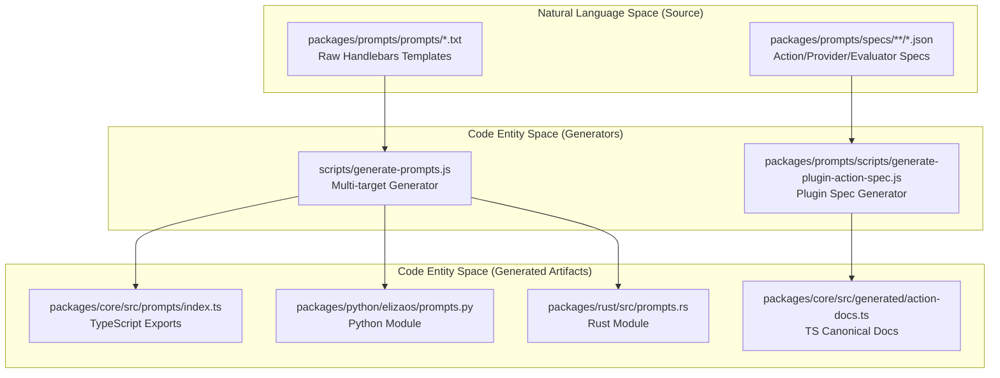
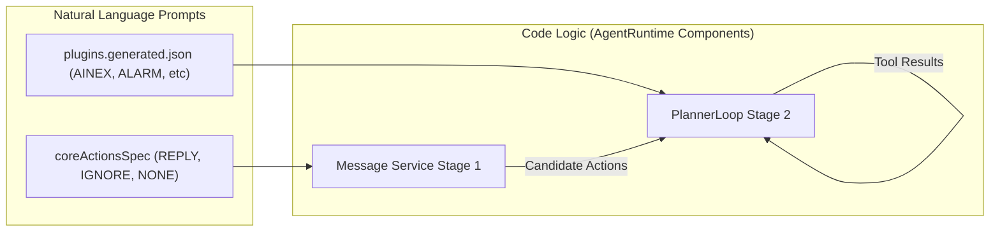

<!-- source: DeepWiki mcp.deepwiki.com · repo elizaOS/eliza · page 13.3 Prompt Engineering and Templates · fetched 2026-10-29 -->

# Prompt Engineering and Templates

Relevant source files

The following files were used as context for generating this wiki page:

- [.gitattributes](.gitattributes)
- [.gitignore](.gitignore)
- [packages/app/test/ui-smoke/apps-utility-interactions.spec.ts](packages/app/test/ui-smoke/apps-utility-interactions.spec.ts)
- [packages/app/test/ui-smoke/remote-capability-view.spec.ts](packages/app/test/ui-smoke/remote-capability-view.spec.ts)
- [packages/cloud-frontend/tests/e2e/api-explorer-flow.spec.ts](packages/cloud-frontend/tests/e2e/api-explorer-flow.spec.ts)
- [packages/core/src/__tests__/action-structure-audit.test.ts](packages/core/src/__tests__/action-structure-audit.test.ts)
- [packages/core/src/generated/action-docs.ts](packages/core/src/generated/action-docs.ts)
- [packages/core/src/utils/context-catalog.ts](packages/core/src/utils/context-catalog.ts)
- [packages/elizaos/templates-manifest.json](packages/elizaos/templates-manifest.json)
- [packages/examples/a2a/tsconfig.json](packages/examples/a2a/tsconfig.json)
- [packages/examples/agent-console/tsconfig.json](packages/examples/agent-console/tsconfig.json)
- [packages/examples/aws/tsconfig.json](packages/examples/aws/tsconfig.json)
- [packages/examples/bluesky/tsconfig.json](packages/examples/bluesky/tsconfig.json)
- [packages/examples/setup-guide.html](packages/examples/setup-guide.html)
- [packages/prompts/scripts/generate-plugin-action-spec.js](packages/prompts/scripts/generate-plugin-action-spec.js)
- [packages/prompts/specs/actions/plugins.generated.json](packages/prompts/specs/actions/plugins.generated.json)
- [packages/ui/src/bridge/capacitor-bridge.ts](packages/ui/src/bridge/capacitor-bridge.ts)
- [packages/ui/src/bridge/plugin-bridge.ts](packages/ui/src/bridge/plugin-bridge.ts)
- [packages/ui/src/components/apps/GameView.tsx](packages/ui/src/components/apps/GameView.tsx)
- [packages/ui/src/components/apps/load-apps-catalog.ts](packages/ui/src/components/apps/load-apps-catalog.ts)
- [packages/ui/src/components/character/CharacterEditor.tsx](packages/ui/src/components/character/CharacterEditor.tsx)
- [plugins/plugin-browser/src/actions/browser.ts](plugins/plugin-browser/src/actions/browser.ts)
- [plugins/plugin-coding-tools/src/services/ripgrep-service.ts](plugins/plugin-coding-tools/src/services/ripgrep-service.ts)
- [tsconfig.dist-paths.json](tsconfig.dist-paths.json)
- [turbo.json](turbo.json)

## Purpose and Scope

This page documents the `@elizaos/prompts` system and the associated template infrastructure within elizaOS. The framework provides a centralized system for defining, generating, and distributing prompt templates across all language runtimes (TypeScript, Python, and Rust). It serves as the **single source of truth** for LLM interaction templates, character definitions, and system instructions.

The system bridges "Natural Language Space" (raw `.txt` and `.json` specs) to "Code Entity Space" (generated source code and runtime objects) to ensure that every agent, regardless of its host language, uses identical logic for prompt construction.

---

## Architecture Overview

The prompt system implements a **build-time code generation strategy** where source prompt definitions are transformed into language-specific implementations. During runtime, the `AgentRuntime` (or `IAgentRuntime`) uses these templates to compose final strings sent to Model Providers.

### Data Flow: Template to Runtime

**Sources:** [packages/core/src/generated/action-docs.ts:1-4](), [packages/prompts/scripts/generate-plugin-action-spec.js:1-25](), [packages/core/src/utils/context-catalog.ts:3-162]()

---

## Core Components

### 1. Canonical Action and Provider Docs
The system generates "Canonical Docs" from JSON specifications. These provide the LLM with structured descriptions of available capabilities. The `generate-plugin-action-spec.js` script scans plugin directories to aggregate actions like `AINEX_BOW` or `ALARM` into a unified manifest.

| Entity Type | Description | Key Code Symbols |
| :--- | :--- | :--- |
| **ActionDoc** | Defines action name, description, similes, and examples. | `ActionDoc`, `ActionDocParameter` [packages/core/src/generated/action-docs.ts:28-61]() |
| **ProviderDoc** | Defines context providers available to the prompt. | `ProviderDoc` [packages/core/src/generated/action-docs.ts:63-70]() |
| **Action Schema** | JSON schema for validating tool parameters. | `ActionDocParameterSchema` [packages/core/src/generated/action-docs.ts:14-26]() |

**Sources:** [packages/core/src/generated/action-docs.ts:1-75](), [packages/prompts/specs/actions/plugins.generated.json:1-109](), [packages/prompts/scripts/generate-plugin-action-spec.js:159-186]()

### 2. Context Mapping
To prevent prompt bloat, elizaOS uses a mapping system to determine which actions and providers are relevant to specific agent contexts (e.g., `wallet`, `browser`, `automation`).

| Registry | Purpose | Source |
| :--- | :--- | :--- |
| `ACTION_CONTEXT_MAP` | Maps actions like `SEND_TOKEN` to `wallet` context. | [packages/core/src/utils/context-catalog.ts:3-162]() |
| `PROVIDER_CONTEXT_MAP` | Maps providers like `tokenPrices` to `wallet` context. | [packages/core/src/utils/context-catalog.ts:164-203]() |

---

## Prompt Engineering for Multi-Stage Runtimes

The `v5` message runtime splits prompt engineering into distinct stages to improve reliability.

### Stage 1: Message Handler
The system uses core actions defined in `coreActionsSpec` (REPLY, IGNORE, NONE) to guide the initial response logic. This stage determines if the agent should engage and what the immediate textual output should be.

### Stage 2: Planner Loop
The planner uses specialized templates to execute complex multi-step workflows. It monitors resource usage, such as `cumulativePromptTokens`, to prevent infinite loops during tool execution.

**Sources:** [packages/core/src/generated/action-docs.ts:77-254](), [packages/prompts/specs/actions/plugins.generated.json:5-109](), [packages/core/src/utils/context-catalog.ts:3-162]()

---

## Action Structure and Retirement

To maintain prompt quality, elizaOS performs structural audits. Many legacy actions have been retired or consolidated into "Umbrella Actions" to reduce the LLM's cognitive load.

| Umbrella Action | Replaces / Consolidates |
| :--- | :--- |
| `TRUST` | `EVALUATE_TRUST`, `RECORD_TRUST_INTERACTION`, `REQUEST_ELEVATION`. [packages/core/src/__tests__/action-structure-audit.test.ts:71-74]() |
| `SECRETS` | `MANAGE_SECRET`, `SET_SECRET`, `GET_SECRET`, `DELETE_SECRET`. [packages/core/src/__tests__/action-structure-audit.test.ts:81-88]() |
| `PAGE_DELEGATE` | `BROWSER_ACTIONS`, `WALLET_ACTIONS`, `SETTINGS_ACTIONS`, etc. [packages/core/src/__tests__/action-structure-audit.test.ts:94-103]() |

**Sources:** [packages/core/src/__tests__/action-structure-audit.test.ts:6-113](), [packages/prompts/scripts/generate-plugin-action-spec.js:27-116]()

---

## Project Scaffolding Templates

The `packages/elizaos/` package contains project scaffolding templates, managed via `templates-manifest.json`. These are used by the CLI to bootstrap new projects and plugins.

| Template ID | Kind | Description |
| :--- | :--- | :--- |
| `plugin` | `plugin` | Scaffolds a new elizaOS plugin starter. |
| `project` | `project` | Scaffolds a package-first elizaOS project. |

**Sources:** [packages/elizaos/templates-manifest.json:1-24]()

---

## Validation and Testing

Prompt engineering is validated through "Structure Audits" and regression tests to ensure that the generated prompts do not exceed token budgets and that the LLM follows structural constraints.

1.  **Retired Action Guard**: The `action-structure-audit.test.ts` ensures that retired action names (like `BOOK_TRAVEL` or `PLACE_CALL`) do not appear in generated canonical docs. [packages/core/src/__tests__/action-structure-audit.test.ts:152-157]()
2.  **Discriminator Requirements**: Actions with legacy parameters (like `op` or `verb`) are required to expose a canonical `action` parameter for the planner. [packages/core/src/__tests__/action-structure-audit.test.ts:173-187]()
3.  **Template Literal Expansion**: The build system expands templates like `${VALID_EMOTE_IDS.join()}` into actual string lists during the generation of `plugins.generated.json`. [packages/prompts/scripts/generate-plugin-action-spec.js:123-157]()

**Sources:** [packages/core/src/__tests__/action-structure-audit.test.ts:1-231](), [packages/prompts/scripts/generate-plugin-action-spec.js:1-157]()

---

