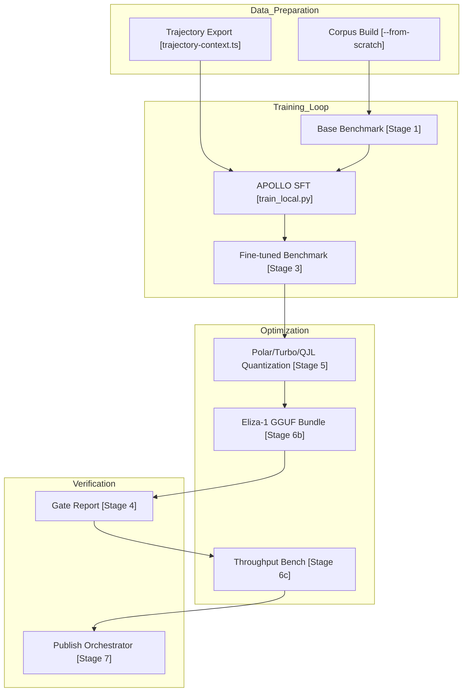
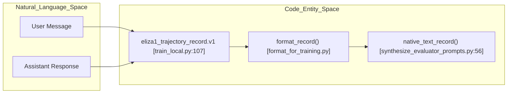

<!-- source: DeepWiki mcp.deepwiki.com · repo elizaOS/eliza · page 13.4 Training Infrastructure · fetched 2026-10-29 -->

# Training Infrastructure

Relevant source files

The following files were used as context for generating this wiki page:

- [packages/app-core/scripts/voice-e2e-hardware.ts](packages/app-core/scripts/voice-e2e-hardware.ts)
- [packages/benchmarks/configbench/README.md](packages/benchmarks/configbench/README.md)
- [packages/benchmarks/configbench/src/handlers/eliza.ts](packages/benchmarks/configbench/src/handlers/eliza.ts)
- [packages/benchmarks/configbench/tests/eliza-handler.test.ts](packages/benchmarks/configbench/tests/eliza-handler.test.ts)
- [packages/benchmarks/orchestrator/adapters.py](packages/benchmarks/orchestrator/adapters.py)
- [packages/benchmarks/orchestrator/calibration_report.py](packages/benchmarks/orchestrator/calibration_report.py)
- [packages/benchmarks/orchestrator/runner.py](packages/benchmarks/orchestrator/runner.py)
- [packages/benchmarks/orchestrator/tests/test_adapter_discovery.py](packages/benchmarks/orchestrator/tests/test_adapter_discovery.py)
- [packages/benchmarks/orchestrator/tests/test_calibration_report.py](packages/benchmarks/orchestrator/tests/test_calibration_report.py)
- [packages/benchmarks/orchestrator/tests/test_latest_snapshots.py](packages/benchmarks/orchestrator/tests/test_latest_snapshots.py)
- [packages/benchmarks/registry/__init__.py](packages/benchmarks/registry/__init__.py)
- [packages/benchmarks/registry/commands.py](packages/benchmarks/registry/commands.py)
- [packages/benchmarks/registry/scores.py](packages/benchmarks/registry/scores.py)
- [packages/chip/scripts/ai_eda/check_cuda_training_payload.py](packages/chip/scripts/ai_eda/check_cuda_training_payload.py)
- [packages/core/src/utils/prompt-batcher/batcher.test.ts](packages/core/src/utils/prompt-batcher/batcher.test.ts)
- [packages/training/docs/training/gguf-to-runtime.md](packages/training/docs/training/gguf-to-runtime.md)
- [packages/training/scripts/audit_pipeline_shapes.py](packages/training/scripts/audit_pipeline_shapes.py)
- [packages/training/scripts/classify_records_by_phase.py](packages/training/scripts/classify_records_by_phase.py)
- [packages/training/scripts/cloud/run-on-cloud.sh](packages/training/scripts/cloud/run-on-cloud.sh)
- [packages/training/scripts/download_datasets.py](packages/training/scripts/download_datasets.py)
- [packages/training/scripts/eval_checkpoint.py](packages/training/scripts/eval_checkpoint.py)
- [packages/training/scripts/format_for_training.py](packages/training/scripts/format_for_training.py)
- [packages/training/scripts/inference/entropix_sampler.py](packages/training/scripts/inference/entropix_sampler.py)
- [packages/training/scripts/inference/serve_vllm.py](packages/training/scripts/inference/serve_vllm.py)
- [packages/training/scripts/lib/adapters.py](packages/training/scripts/lib/adapters.py)
- [packages/training/scripts/lib/local_path_source.py](packages/training/scripts/lib/local_path_source.py)
- [packages/training/scripts/lib/runtime_phases.py](packages/training/scripts/lib/runtime_phases.py)
- [packages/training/scripts/lib/vast.py](packages/training/scripts/lib/vast.py)
- [packages/training/scripts/normalize.py](packages/training/scripts/normalize.py)
- [packages/training/scripts/optimize_for_eliza1.py](packages/training/scripts/optimize_for_eliza1.py)
- [packages/training/scripts/pack_dataset.py](packages/training/scripts/pack_dataset.py)
- [packages/training/scripts/privacy_filter_trajectories.py](packages/training/scripts/privacy_filter_trajectories.py)
- [packages/training/scripts/quantization/_common.py](packages/training/scripts/quantization/_common.py)
- [packages/training/scripts/quantization/qjl/matmul.py](packages/training/scripts/quantization/qjl/matmul.py)
- [packages/training/scripts/quantization/qjl_apply.py](packages/training/scripts/quantization/qjl_apply.py)
- [packages/training/scripts/quantization/turboquant_apply.py](packages/training/scripts/quantization/turboquant_apply.py)
- [packages/training/scripts/run_pipeline.py](packages/training/scripts/run_pipeline.py)
- [packages/training/scripts/synthesize_evaluator_prompts.py](packages/training/scripts/synthesize_evaluator_prompts.py)
- [packages/training/scripts/test_eval_checkpoint.py](packages/training/scripts/test_eval_checkpoint.py)
- [packages/training/scripts/test_format_for_training_privacy.py](packages/training/scripts/test_format_for_training_privacy.py)
- [packages/training/scripts/test_local_path_source.py](packages/training/scripts/test_local_path_source.py)
- [packages/training/scripts/test_tier_caps.py](packages/training/scripts/test_tier_caps.py)
- [packages/training/scripts/train_local.py](packages/training/scripts/train_local.py)
- [packages/training/scripts/train_nebius.sh](packages/training/scripts/train_nebius.sh)
- [packages/training/scripts/train_nebius_smoke_all_tiers.sh](packages/training/scripts/train_nebius_smoke_all_tiers.sh)
- [packages/training/scripts/train_vast.sh](packages/training/scripts/train_vast.sh)
- [packages/training/scripts/transform_normalize_fact_ops.py](packages/training/scripts/transform_normalize_fact_ops.py)
- [packages/training/scripts/verify_optimization_stack.py](packages/training/scripts/verify_optimization_stack.py)
- [packages/ui/src/components/local-inference/CustomModelSearch.test.tsx](packages/ui/src/components/local-inference/CustomModelSearch.test.tsx)
- [packages/ui/src/components/local-inference/hub-utils.test.ts](packages/ui/src/components/local-inference/hub-utils.test.ts)
- [packages/ui/src/services/local-inference/custom-search.ts](packages/ui/src/services/local-inference/custom-search.ts)
- [plugins/plugin-agent-orchestrator/src/setup-routes.ts](plugins/plugin-agent-orchestrator/src/setup-routes.ts)
- [plugins/plugin-local-inference/__tests__/imagegen-loader-arbiter-seam.test.ts](plugins/plugin-local-inference/__tests__/imagegen-loader-arbiter-seam.test.ts)
- [plugins/plugin-local-inference/__tests__/imagegen-vision-coexist.test.ts](plugins/plugin-local-inference/__tests__/imagegen-vision-coexist.test.ts)
- [plugins/plugin-local-inference/src/services/voice/__tests__/turn-detector-resolver.test.ts](plugins/plugin-local-inference/src/services/voice/__tests__/turn-detector-resolver.test.ts)
- [plugins/plugin-local-inference/src/services/voice/eot-classifier.ts](plugins/plugin-local-inference/src/services/voice/eot-classifier.ts)
- [plugins/plugin-social-alpha/src/events.ts](plugins/plugin-social-alpha/src/events.ts)
- [plugins/plugin-social-alpha/src/service.ts](plugins/plugin-social-alpha/src/service.ts)
- [plugins/plugin-vision/src/ws1-arbiter-bridge.test.ts](plugins/plugin-vision/src/ws1-arbiter-bridge.test.ts)

The training infrastructure in elizaOS provides a comprehensive suite for data collection, model fine-tuning, and performance evaluation. It is centered around the `@elizaos/app-training` application (located in `apps/app-training/`) and the extensive `packages/benchmarks/` suite. This infrastructure facilitates the transition from raw agent interactions to structured trajectory data suitable for Reinforcement Learning (RL) and supervised fine-tuning (SFT), specifically targeting the **Eliza-1** model family.

## Eliza-1 Model Family and Registry

The training pipeline is designed to produce and optimize the **Eliza-1** line of models. These models are based on the Qwen3.5 (for 0.8B to 9B tiers) and Qwen3.6 (for the 27B tier) architectures [packages/training/scripts/run_pipeline.py:112-126]().

### Model Tier Matrix
The `model_registry.py` serves as the single source of truth for the Eliza-1 size ladder and training budgets.

| Tier ID | Base Model | Parameter Count | Target Environment |
|---------|------------|-----------------|--------------------|
| `qwen3.5-0.8b` | Qwen3.5-0.8B | 0.8B | Local / Mobile [packages/training/scripts/train_nebius.sh:28]() |
| `qwen3.5-2b` | Qwen3.5-2B | 2B | Local / Modern Phones [packages/training/scripts/train_nebius.sh:29]() |
| `qwen3.5-4b` | Qwen3.5-4B | 4B | Workstation / Flagship [packages/training/scripts/train_nebius.sh:30]() |
| `qwen3.5-9b` | Qwen3.5-9B | 9B | Workstation / 80GB GPU [packages/training/scripts/train_nebius.sh:31]() |
| `qwen3.6-27b` | Qwen3.6-27B | 27B | Cloud / H200 Cluster [packages/training/scripts/train_nebius.sh:32]() |

**Sources:** [packages/training/scripts/train_nebius.sh:27-34](), [packages/training/scripts/train_local.py:6-10]()

## End-to-End Training Pipeline

The `run_pipeline.py` script manages the lifecycle of a model from raw corpus to a published, quantized GGUF bundle.

### Pipeline Stages

**Sources:** [packages/training/scripts/run_pipeline.py:1-21](), [packages/training/scripts/train_vast.sh:1-18]()

### Training Implementation (APOLLO SFT)
ElizaOS uses the **APOLLO** optimizer for full-parameter SFT, which allows training on commodity GPUs by maintaining a low-rank optimizer state [packages/training/scripts/train_local.py:1-4]().
*   **Local SFT**: Handled by `train_local.py`, focusing on completion-only loss where only assistant turns contribute to the loss [packages/training/scripts/train_local.py:3-4](). It uses the `TRL` library and supports `Liger` kernels [packages/training/scripts/train_local.py:77-85]().
*   **Cloud SFT**: `train_vast.sh` and `train_nebius.sh` provision remote GPU instances (H100/H200/B200/RTX4090). For the 27B tier, the system utilizes FSDP (Fully Sharded Data Parallel) across multiple GPUs [packages/training/scripts/train_nebius.sh:13-19]().
*   **Reinforcement Learning**: The infrastructure supports DPO (Direct Preference Optimization) and GRPO (Group Relative Policy Optimization) pipelines [packages/training/scripts/train_vast.sh:6-13]().

## Trajectory and Context Infrastructure

Trajectories capture the full context of agent interactions. The `TrajectoryContext` and `StreamingContext` ensure that every token and decision can be traced back to its origin for training.

### Trajectory Code Entity Mapping

**Sources:** [packages/training/scripts/train_local.py:104-108](), [packages/training/scripts/format_for_training.py:1-20](), [packages/training/scripts/synthesize_evaluator_prompts.py:56-57]()

## Benchmark Orchestrator

The `packages/benchmarks/orchestrator/` suite provides a unified interface for running and scoring 25+ different benchmarks.

### Benchmarks Suite Overview
| Benchmark | Purpose | File Pointer |
|-----------|---------|--------------|
| **OSWorld** | Desktop automation in Docker VMs | [packages/benchmarks/orchestrator/adapters.py:150]() |
| **GAIA** | General AI Assistant tasks | [packages/benchmarks/orchestrator/tests/test_adapter_discovery.py:85]() |
| **SWE-bench** | Software engineering and coding tasks | [packages/benchmarks/orchestrator/adapters.py:148]() |
| **Tau-bench** | Tool-use and agentic reasoning | [packages/benchmarks/orchestrator/tests/test_adapter_discovery.py:59]() |
| **BFCL** | Berkeley Function Calling Leaderboard | [packages/benchmarks/registry/scores.py:27]() |
| **Hyperliquid** | Live execution and trading tasks | [packages/benchmarks/orchestrator/adapters.py:144]() |

**Sources:** [packages/benchmarks/orchestrator/adapters.py:53-95](), [packages/benchmarks/registry/scores.py:1-180]()

### Scoring and Discovery
The `discover_adapters` function automatically crawls the benchmark directory to register available tests [packages/benchmarks/orchestrator/tests/test_adapter_discovery.py:24-25](). Scores are extracted using benchmark-specific parsers like `_score_from_bfcl_json` or `_score_from_swebench_json` [packages/benchmarks/registry/scores.py:27-180]().

## Semantic Evaluation

Beyond standard benchmarks, elizaOS includes specialized evaluators for internal agent states.

### Evaluator Synthesis
The `synthesize_evaluator_prompts.py` script generates training data for post-turn evaluators [packages/training/scripts/synthesize_evaluator_prompts.py:1-25]():
*   **REFLECT**: Analyzes communication clarity and helpfulness [packages/training/scripts/synthesize_evaluator_prompts.py:77-99]().
*   **FACT_EXTRACTOR**: Manages durable and current fact stores [packages/training/scripts/synthesize_evaluator_prompts.py:137-185]().
*   **SUMMARIZATION**: Captures key points and topics [packages/training/scripts/synthesize_evaluator_prompts.py:187-206]().

### End-of-Turn (EOT) Classification
The `eot-classifier.ts` implements a three-tier Voice Activity Detection (VAD) system [plugins/plugin-local-inference/src/services/voice/eot-classifier.ts:1-17]():
1.  **Tier 1**: RMS energy gate (~10ms).
2.  **Tier 2**: Silero VAD.
3.  **Tier 3**: Semantic EOT classifier (P(turn_complete | transcript)).

**Sources:** [plugins/plugin-local-inference/src/services/voice/eot-classifier.ts:1-37](), [packages/training/scripts/synthesize_evaluator_prompts.py:1-41]()

---

