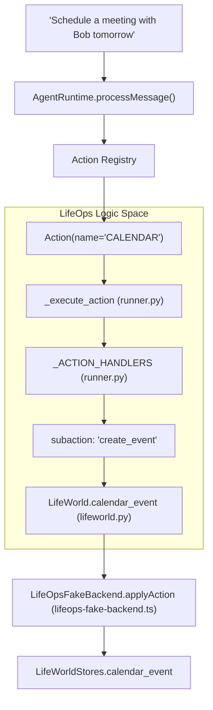
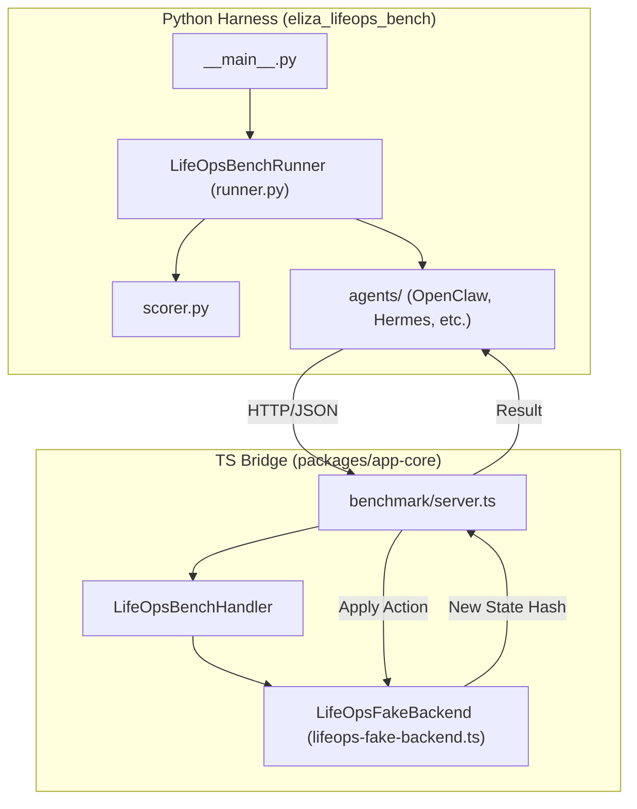

<!-- source: DeepWiki mcp.deepwiki.com · repo elizaOS/eliza · page 13.5 LifeOps Application · fetched 2026-10-29 -->

# LifeOps Application

Relevant source files

The following files were used as context for generating this wiki page:

- [packages/app-core/src/benchmark/__tests__/lifeops-bench-handler.test.ts](packages/app-core/src/benchmark/__tests__/lifeops-bench-handler.test.ts)
- [packages/app-core/src/benchmark/lifeops-bench-handler.ts](packages/app-core/src/benchmark/lifeops-bench-handler.ts)
- [packages/app-core/src/benchmark/lifeops-fake-backend.ts](packages/app-core/src/benchmark/lifeops-fake-backend.ts)
- [packages/app-core/src/benchmark/server.ts](packages/app-core/src/benchmark/server.ts)
- [packages/app/test/ui-smoke/all-pages-clicksafe.spec.ts](packages/app/test/ui-smoke/all-pages-clicksafe.spec.ts)
- [packages/app/test/ui-smoke/helpers.ts](packages/app/test/ui-smoke/helpers.ts)
- [packages/benchmarks/eliza-adapter/eliza_adapter/lifeops_bench.py](packages/benchmarks/eliza-adapter/eliza_adapter/lifeops_bench.py)
- [packages/benchmarks/eliza-adapter/eliza_adapter/vending_bench.py](packages/benchmarks/eliza-adapter/eliza_adapter/vending_bench.py)
- [packages/benchmarks/eliza-adapter/tests/test_lifeops_bench_adapter.py](packages/benchmarks/eliza-adapter/tests/test_lifeops_bench_adapter.py)
- [packages/benchmarks/eliza-adapter/tests/test_vending_adapter.py](packages/benchmarks/eliza-adapter/tests/test_vending_adapter.py)
- [packages/benchmarks/hermes-adapter/hermes_adapter/lifeops_bench.py](packages/benchmarks/hermes-adapter/hermes_adapter/lifeops_bench.py)
- [packages/benchmarks/lifeops-bench/eliza_lifeops_bench/__main__.py](packages/benchmarks/lifeops-bench/eliza_lifeops_bench/__main__.py)
- [packages/benchmarks/lifeops-bench/eliza_lifeops_bench/agents/__init__.py](packages/benchmarks/lifeops-bench/eliza_lifeops_bench/agents/__init__.py)
- [packages/benchmarks/lifeops-bench/eliza_lifeops_bench/agents/_openai_compat.py](packages/benchmarks/lifeops-bench/eliza_lifeops_bench/agents/_openai_compat.py)
- [packages/benchmarks/lifeops-bench/eliza_lifeops_bench/agents/openclaw.py](packages/benchmarks/lifeops-bench/eliza_lifeops_bench/agents/openclaw.py)
- [packages/benchmarks/lifeops-bench/eliza_lifeops_bench/clients/anthropic.py](packages/benchmarks/lifeops-bench/eliza_lifeops_bench/clients/anthropic.py)
- [packages/benchmarks/lifeops-bench/eliza_lifeops_bench/clients/base.py](packages/benchmarks/lifeops-bench/eliza_lifeops_bench/clients/base.py)
- [packages/benchmarks/lifeops-bench/eliza_lifeops_bench/clients/cerebras.py](packages/benchmarks/lifeops-bench/eliza_lifeops_bench/clients/cerebras.py)
- [packages/benchmarks/lifeops-bench/eliza_lifeops_bench/clients/hermes.py](packages/benchmarks/lifeops-bench/eliza_lifeops_bench/clients/hermes.py)
- [packages/benchmarks/lifeops-bench/eliza_lifeops_bench/evaluator.py](packages/benchmarks/lifeops-bench/eliza_lifeops_bench/evaluator.py)
- [packages/benchmarks/lifeops-bench/eliza_lifeops_bench/manifest_export.py](packages/benchmarks/lifeops-bench/eliza_lifeops_bench/manifest_export.py)
- [packages/benchmarks/lifeops-bench/eliza_lifeops_bench/runner.py](packages/benchmarks/lifeops-bench/eliza_lifeops_bench/runner.py)
- [packages/benchmarks/lifeops-bench/eliza_lifeops_bench/scenarios/_authoring/candidates/drop_log.md](packages/benchmarks/lifeops-bench/eliza_lifeops_bench/scenarios/_authoring/candidates/drop_log.md)
- [packages/benchmarks/lifeops-bench/eliza_lifeops_bench/scenarios/_authoring/candidates/spend_log.jsonl](packages/benchmarks/lifeops-bench/eliza_lifeops_bench/scenarios/_authoring/candidates/spend_log.jsonl)
- [packages/benchmarks/lifeops-bench/eliza_lifeops_bench/scenarios/_authoring/generate_candidates.py](packages/benchmarks/lifeops-bench/eliza_lifeops_bench/scenarios/_authoring/generate_candidates.py)
- [packages/benchmarks/lifeops-bench/eliza_lifeops_bench/scenarios/_authoring/import_reviewed.py](packages/benchmarks/lifeops-bench/eliza_lifeops_bench/scenarios/_authoring/import_reviewed.py)
- [packages/benchmarks/lifeops-bench/eliza_lifeops_bench/scenarios/_authoring/scale_corpus.py](packages/benchmarks/lifeops-bench/eliza_lifeops_bench/scenarios/_authoring/scale_corpus.py)
- [packages/benchmarks/lifeops-bench/eliza_lifeops_bench/scenarios/_authoring/validate.py](packages/benchmarks/lifeops-bench/eliza_lifeops_bench/scenarios/_authoring/validate.py)
- [packages/benchmarks/lifeops-bench/eliza_lifeops_bench/scenarios/calendar.py](packages/benchmarks/lifeops-bench/eliza_lifeops_bench/scenarios/calendar.py)
- [packages/benchmarks/lifeops-bench/eliza_lifeops_bench/scenarios/live/__init__.py](packages/benchmarks/lifeops-bench/eliza_lifeops_bench/scenarios/live/__init__.py)
- [packages/benchmarks/lifeops-bench/eliza_lifeops_bench/scorer.py](packages/benchmarks/lifeops-bench/eliza_lifeops_bench/scorer.py)
- [packages/benchmarks/lifeops-bench/eliza_lifeops_bench/types.py](packages/benchmarks/lifeops-bench/eliza_lifeops_bench/types.py)
- [packages/benchmarks/lifeops-bench/manifests/actions.manifest.json](packages/benchmarks/lifeops-bench/manifests/actions.manifest.json)
- [packages/benchmarks/lifeops-bench/manifests/actions.summary.md](packages/benchmarks/lifeops-bench/manifests/actions.summary.md)
- [packages/benchmarks/lifeops-bench/tests/test_cross_stack_contract.py](packages/benchmarks/lifeops-bench/tests/test_cross_stack_contract.py)
- [packages/benchmarks/lifeops-bench/tests/test_scorer_fixes.py](packages/benchmarks/lifeops-bench/tests/test_scorer_fixes.py)
- [packages/benchmarks/lifeops-bench/tests/test_tool_descriptions.py](packages/benchmarks/lifeops-bench/tests/test_tool_descriptions.py)
- [packages/benchmarks/personality-bench/src/judge/rubrics/escalation-delta.ts](packages/benchmarks/personality-bench/src/judge/rubrics/escalation-delta.ts)
- [packages/benchmarks/vending-bench/elizaos_vending_bench/cli.py](packages/benchmarks/vending-bench/elizaos_vending_bench/cli.py)
- [packages/core/src/__tests__/message-stage1-context-catalog.test.ts](packages/core/src/__tests__/message-stage1-context-catalog.test.ts)

The LifeOps application (`@elizaos/app-lifeops`) is a personal productivity agent framework designed to manage a user's digital life. It extends the core Eliza runtime with specialized capabilities for calendar management, inbox triage across multiple messaging platforms, habit tracking, and proactive reminders.

## Architecture and Plugin Integration

LifeOps is implemented as a specialized plugin that registers a suite of actions, providers, and services. The core of the application logic resides in the `LifeOpsService`, which utilizes a mixin-based architecture to compose various functional domains.

### LifeOps Service Mixins
The `LifeOpsService` is composed of several mixins that provide domain-specific functionality:
- **Calendar**: Integration with Google Calendar and Apple Reminders.
- **Gmail**: Advanced triage, searching, and drafting for Google Mail.
- **Messaging**: Connectors for Discord, Telegram, Signal, iMessage, and WhatsApp.
- **Reminders & Scheduling**: Logic for proactive notifications and scheduling negotiations.
- **Workflows**: Execution of automated routines based on events like "calendar event ended".

### Data Flow: Natural Language to LifeOps Action
This diagram illustrates how a user request flows from natural language into the specialized LifeOps service layer.

**Natural Language Space to Code Entity Space**

Sources: [packages/benchmarks/lifeops-bench/eliza_lifeops_bench/runner.py:99-113](), [packages/benchmarks/lifeops-bench/eliza_lifeops_bench/scorer.py:146-161](), [packages/app-core/src/benchmark/lifeops-fake-backend.ts:195-212]()

## LifeOpsBench: Performance Validation

LifeOps performance is validated using **LifeOpsBench**, a multi-turn life-assistant tool-use benchmark. It measures an agent's ability to handle complex, multi-step productivity tasks across various domains.

### Scoring Mechanism
The benchmark uses a `LifeOpsEvaluator` and a `LifeWorld` simulation to score agent performance based on:
- **State Hash Match**: Comparing the `state_hash` of the world after agent actions against a ground-truth state [packages/benchmarks/lifeops-bench/eliza_lifeops_bench/scorer.py:7-15]().
- **Action Overlap**: Matching predicted actions and their `kwargs` against ground-truth actions. This includes handling "soft kwargs" like `intent` or `reasoning` which do not penalize scores if missing [packages/benchmarks/lifeops-bench/eliza_lifeops_bench/scorer.py:51-53]().
- **Output Substring Presence**: Verifying that the agent's natural language response contains required information, such as "scheduled" or "added to your calendar" [packages/benchmarks/lifeops-bench/eliza_lifeops_bench/scorer.py:55-87]().

**Scoring Formula (Static Mode):**
`0.5 * state_hash_match + 0.4 * action_score + 0.1 * mean(output_substring_matches)` [packages/benchmarks/lifeops-bench/eliza_lifeops_bench/scorer.py:8-9]()

### Benchmarking Architecture

Sources: [packages/benchmarks/lifeops-bench/eliza_lifeops_bench/runner.py:42-76](), [packages/app-core/src/benchmark/server.ts:19-30](), [packages/app-core/src/benchmark/lifeops-fake-backend.ts:1-16]()

## Core Systems

### 1. Scheduling and Reminders
The system utilizes a `LifeWorld` model to track `Reminder` entities, including `due_at`, `completed_at`, and `priority` [packages/app-core/src/benchmark/lifeops-fake-backend.ts:118-127]().
- **Umbrella Actions**: The system uses the `LIFE` umbrella with subactions such as `create`, `complete`, `snooze`, and `delete` [packages/benchmarks/lifeops-bench/eliza_lifeops_bench/scorer.py:182-198]().
- **Deterministic IDs**: When a scenario lacks an explicit ID, the executor derives a deterministic synthetic ID from kwargs [packages/benchmarks/lifeops-bench/eliza_lifeops_bench/runner.py:35-38]().

### 2. Inbox Triage and Messaging
The `MESSAGE` umbrella action handles operations across platforms (Gmail, Discord, etc.):
- **Operations**: `send`, `draft_reply`, `manage`, `triage`, `search_inbox` [packages/benchmarks/lifeops-bench/eliza_lifeops_bench/scorer.py:162-176]().
- **Fuzzy Search**: The `LifeOpsFakeBackend` supports mail searching with filters like `from:boss` and `is:unread` [packages/app-core/src/benchmark/__tests__/lifeops-bench-handler.test.ts:188-197]().

### 3. Focus and Website Blocker
Productivity is enforced through the `BLOCK` umbrella action, which manages both phone apps and desktop websites [packages/benchmarks/lifeops-bench/manifests/actions.manifest.json:24-45]().
- **Targets**: `app` (phone apps) or `website` (desktop hosts-file/SelfControl) [packages/benchmarks/lifeops-bench/manifests/actions.manifest.json:29-33]().
- **Actions**: `block`, `unblock`, `status`, `request_permission`, `release`, `list_active` [packages/benchmarks/lifeops-bench/manifests/actions.manifest.json:37-47]().
- **Confirmation**: Website blocking often requires `confirmed: true` to prevent accidental lockouts [packages/benchmarks/lifeops-bench/manifests/actions.manifest.json:60-63]().

## Vending-Bench Integration
LifeOps also supports the **Vending-Bench** simulation, a 30-day business management scenario [packages/benchmarks/eliza-adapter/eliza_adapter/vending_bench.py:14-19]().
- **Session Management**: Because Vending-Bench prompts contain the full daily state, the `ElizaVendingProvider` resets the bridge session before every `generate` call to prevent unbounded context growth [packages/benchmarks/eliza-adapter/eliza_adapter/vending_bench.py:21-26]().
- **Action Normalization**: It maps raw tool calls like `PLACE_ORDER` or `RESTOCK_SLOT` into normalized JSON payloads for the Eliza runtime [packages/benchmarks/eliza-adapter/eliza_adapter/vending_bench.py:113-157]().

## UI and Permissions
The LifeOps application within the UI shell provides a centralized dashboard for managing permissions and connectors.
- **Permission IDs**: Includes `reminders`, `calendar`, `health`, `contacts`, `notes`, and `website-blocking` [packages/app/test/ui-smoke/all-pages-clicksafe.spec.ts:29-45]().
- **Settings Sections**: Users configure LifeOps through the "Capabilities", "Apps", and "App Permissions" sections of the settings shell [packages/app/test/ui-smoke/helpers.ts:66-83]().

Sources: [packages/app/test/ui-smoke/all-pages-clicksafe.spec.ts:76-154](), [packages/app/test/ui-smoke/helpers.ts:85-94]()

---

