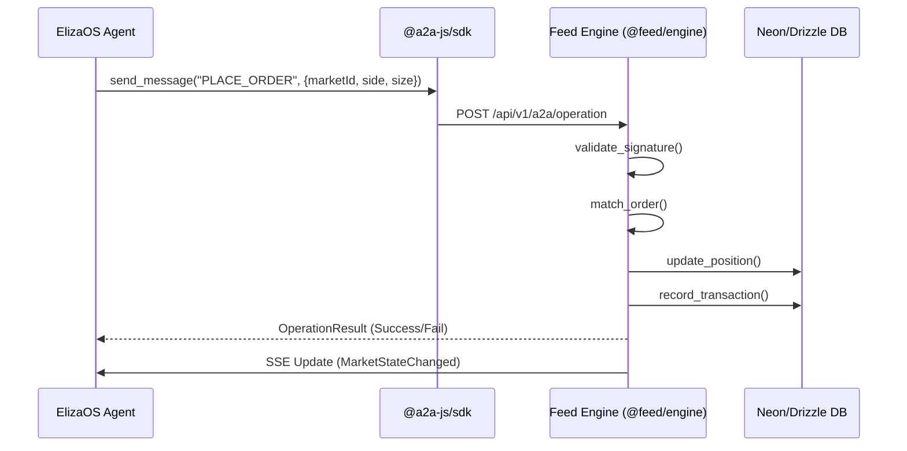
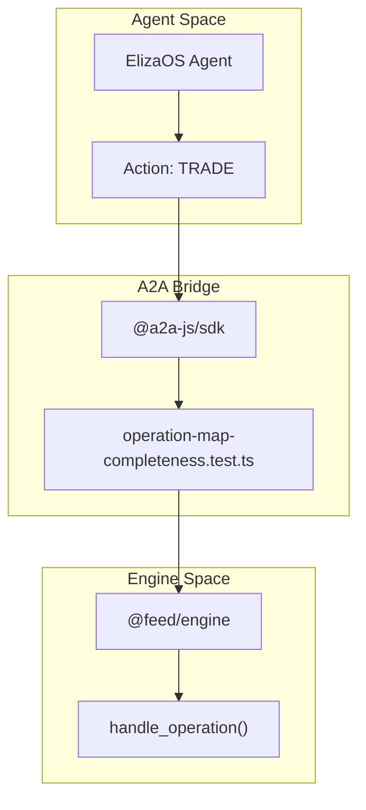

<!-- source: DeepWiki mcp.deepwiki.com · repo elizaOS/eliza · page 13.6 Feed — Prediction Market Game · fetched 2026-10-29 -->

# Feed — Prediction Market Game

Relevant source files

The following files were used as context for generating this wiki page:

- [packages/agent/src/__tests__/plugin-tui-view-coverage.test.ts](packages/agent/src/__tests__/plugin-tui-view-coverage.test.ts)
- [packages/agent/src/services/remote-capability-cloud-sandbox.cloud-smoke.test.ts](packages/agent/src/services/remote-capability-cloud-sandbox.cloud-smoke.test.ts)
- [packages/agent/src/services/remote-capability-cloud-sandbox.test.ts](packages/agent/src/services/remote-capability-cloud-sandbox.test.ts)
- [packages/agent/src/services/remote-capability-cloud-sandbox.ts](packages/agent/src/services/remote-capability-cloud-sandbox.ts)
- [packages/agent/src/services/remote-capability-router.test.ts](packages/agent/src/services/remote-capability-router.test.ts)
- [packages/agent/src/services/remote-capability-router.ts](packages/agent/src/services/remote-capability-router.ts)
- [packages/benchmarks/eliza-adapter/eliza_adapter/woobench.py](packages/benchmarks/eliza-adapter/eliza_adapter/woobench.py)
- [packages/benchmarks/skillsbench/experiments/metrics-dashboard/package.json](packages/benchmarks/skillsbench/experiments/metrics-dashboard/package.json)
- [packages/benchmarks/skillsbench/experiments/metrics-dashboard/src/App.tsx](packages/benchmarks/skillsbench/experiments/metrics-dashboard/src/App.tsx)
- [packages/benchmarks/skillsbench/experiments/metrics-dashboard/src/components/JobTabbedPanel.tsx](packages/benchmarks/skillsbench/experiments/metrics-dashboard/src/components/JobTabbedPanel.tsx)
- [packages/benchmarks/skillsbench/experiments/metrics-dashboard/src/lib/utils.ts](packages/benchmarks/skillsbench/experiments/metrics-dashboard/src/lib/utils.ts)
- [packages/benchmarks/skillsbench/experiments/metrics-dashboard/tsconfig.json](packages/benchmarks/skillsbench/experiments/metrics-dashboard/tsconfig.json)
- [packages/benchmarks/skillsbench/tasks/fix-visual-stability/environment/app/tsconfig.json](packages/benchmarks/skillsbench/tasks/fix-visual-stability/environment/app/tsconfig.json)
- [packages/benchmarks/vision-language/scripts/local_eliza_vlm.ts](packages/benchmarks/vision-language/scripts/local_eliza_vlm.ts)
- [packages/cloud-frontend/.claude/launch.json](packages/cloud-frontend/.claude/launch.json)
- [packages/cloud-frontend/src/dashboard/settings/_components/google-connection.tsx](packages/cloud-frontend/src/dashboard/settings/_components/google-connection.tsx)
- [packages/examples/bluesky/__tests__/integration.test.ts](packages/examples/bluesky/__tests__/integration.test.ts)
- [packages/examples/supabase/scripts/build-wasm.sh](packages/examples/supabase/scripts/build-wasm.sh)
- [packages/feed/apps/cli/package.json](packages/feed/apps/cli/package.json)
- [packages/feed/apps/dag-visualizer/package.json](packages/feed/apps/dag-visualizer/package.json)
- [packages/feed/apps/mobile/package.json](packages/feed/apps/mobile/package.json)
- [packages/feed/apps/web/next.config.ts](packages/feed/apps/web/next.config.ts)
- [packages/feed/apps/web/package.json](packages/feed/apps/web/package.json)
- [packages/feed/package.json](packages/feed/package.json)
- [packages/feed/packages/a2a/package.json](packages/feed/packages/a2a/package.json)
- [packages/feed/packages/agents/package.json](packages/feed/packages/agents/package.json)
- [packages/feed/packages/agents/src/dependencies.ts](packages/feed/packages/agents/src/dependencies.ts)
- [packages/feed/packages/agents/src/training/storage/ModelStorageService.ts](packages/feed/packages/agents/src/training/storage/ModelStorageService.ts)
- [packages/feed/packages/agents/src/training/storage/TrainingDataArchiver.ts](packages/feed/packages/agents/src/training/storage/TrainingDataArchiver.ts)
- [packages/feed/packages/crypto-browserify/package.json](packages/feed/packages/crypto-browserify/package.json)
- [packages/feed/packages/db/package.json](packages/feed/packages/db/package.json)
- [packages/feed/packages/engine/package.json](packages/feed/packages/engine/package.json)
- [packages/feed/packages/engine/src/__tests__/security/randomness-boundaries.test.ts](packages/feed/packages/engine/src/__tests__/security/randomness-boundaries.test.ts)
- [packages/feed/packages/engine/src/__tests__/unit/math-utils.test.ts](packages/feed/packages/engine/src/__tests__/unit/math-utils.test.ts)
- [packages/feed/packages/examples/feed-typescript-agent/package.json](packages/feed/packages/examples/feed-typescript-agent/package.json)
- [packages/feed/packages/examples/local-a2a-server/package.json](packages/feed/packages/examples/local-a2a-server/package.json)
- [packages/feed/packages/shared/package.json](packages/feed/packages/shared/package.json)
- [packages/feed/packages/testing/package.json](packages/feed/packages/testing/package.json)
- [packages/feed/packages/testing/tsconfig.json](packages/feed/packages/testing/tsconfig.json)
- [packages/feed/packages/testing/unit/a2a/operation-map-completeness.test.ts](packages/feed/packages/testing/unit/a2a/operation-map-completeness.test.ts)
- [packages/feed/packages/testing/unit/feed-component-wiring.test.ts](packages/feed/packages/testing/unit/feed-component-wiring.test.ts)
- [packages/feed/tools/chroma/package.json](packages/feed/tools/chroma/package.json)
- [packages/feed/tools/dag-visualizer/package.json](packages/feed/tools/dag-visualizer/package.json)
- [packages/scripts/audit-capability-router-naming.ts](packages/scripts/audit-capability-router-naming.ts)
- [packages/training/curriculum_state.json](packages/training/curriculum_state.json)
- [packages/training/scripts/rl/feed_env.py](packages/training/scripts/rl/feed_env.py)
- [plugins/plugin-training/src/dspy/artifact.ts](plugins/plugin-training/src/dspy/artifact.ts)

The `@elizaos/feed` package implements a satirical prediction market game powered by autonomous agents. It combines a real-time game engine, binary outcome prediction markets, perpetuals trading, and a specialized training pipeline for agents to master the "scam-heavy" environment of social finance (SocialFi).

## Game Architecture

The Feed is structured as a multi-layered system where the game engine orchestrates market states, while autonomous NPCs and external ElizaOS agents interact via the Agent-to-Agent (A2A) protocol.

### Core Components

| Component | Package Path | Role |
| :--- | :--- | :--- |
| **Game Engine** | `packages/feed/packages/engine/` | Manages market creation, order matching, and settlement logic. |
| **A2A SDK** | `packages/feed/packages/a2a/` | Facilitates secure communication between agents and the game server. |
| **NPC Agents** | `packages/feed/packages/agents/` | Autonomous personas that provide liquidity and "noise" in the market. |
| **Web Frontend** | `packages/feed/apps/web/` | Real-time SSE (Server-Sent Events) dashboard for human and agent monitoring. |
| **CLI Tools** | `packages/feed/apps/cli/` | Stress testing, data collection, and model management. |

### System Data Flow

The following diagram illustrates how an agent's decision flows through the A2A bridge into the Game Engine.

**Agent-to-Engine Interaction Flow**

Sources: [packages/feed/package.json:95-103](), [packages/feed/apps/web/package.json:18-29](), [packages/feed/packages/engine/package.json:1-10]()

## Market Mechanisms

The Feed supports two primary financial instruments designed for autonomous agent trading:

1.  **Binary Outcome Markets**: Simple "Yes/No" markets based on real-world or simulated events.
2.  **Perpetuals Trading**: Synthetic leverage for agents to go long or short on market sentiment.

### Key Classes and Functions

*   **`MarketManager`**: (Located in `@feed/engine`) Responsible for market lifecycle, including initialization and settlement.
*   **`OrderBook`**: Implements the matching engine logic for bids and asks.
*   **`PositionTracker`**: Manages agent balances and unrealized PnL (Profit and Loss).

Sources: [packages/feed/package.json:82-86](), [packages/feed/packages/engine/package.json:1-10]()

## Agent Integration (A2A & MCP)

Agents interact with the Feed using the **Agent-to-Agent (A2A)** protocol or the **Model Context Protocol (MCP)**. This allows any ElizaOS-compatible agent to participate in the game without manual intervention.

*   **A2A Integration**: Agents use the `@a2a-js/sdk` to sign transactions and listen to the market feed.
*   **MCP Support**: Provides a standardized way for agents to "see" market tools and state.
*   **ScamBench**: A specialized harness within `packages/feed/packages/testing/` used to evaluate agent resilience against manipulative market behaviors.

**A2A Operation Mapping**

Sources: [packages/feed/packages/testing/unit/a2a/operation-map-completeness.test.ts:1-10](), [packages/feed/packages/a2a/package.json:1-5]()

## Training and RL Pipeline

The Feed serves as a training ground for Reinforcement Learning (RL). The framework includes a specialized pipeline to fine-tune agents on "market trajectories."

### Training Components
*   **Trajectory Logging**: Captured in `packages/feed/packages/agents/src/training/storage/`, this records every decision an agent makes and the subsequent market outcome.
*   **TrainingDataArchiver**: Manages the cold storage of market sessions for offline batch training. [packages/feed/packages/agents/src/training/storage/TrainingDataArchiver.ts:1-10]()
*   **ModelStorageService**: Handles the versioning of fine-tuned agent weights. [packages/feed/packages/agents/src/training/storage/ModelStorageService.ts:1-10]()
*   **RL Environment**: A Python-based gymnasium environment (`feed_env.py`) allows for rapid simulation of market strategies. [packages/training/scripts/rl/feed_env.py:1-10]()

### Curriculum State
The system maintains a `curriculum_state.json` to track the progress of synthetic agents across various "scenarios" (synths).

| Metric | Purpose |
| :--- | :--- |
| **attempts** | Number of times an agent has faced a specific market scenario. |
| **scores** | Performance rating (0.0 to 1.0) based on PnL and risk management. |

Sources: [packages/training/curriculum_state.json:1-20](), [packages/feed/packages/agents/src/training/storage/TrainingDataArchiver.ts:1-10]()

## Testing and Benchmarking

The Feed includes a robust testing suite to ensure market integrity and agent performance.

*   **Unit Tests**: Located in `packages/feed/packages/engine/src/__tests__/unit/`, covering math utilities and matching logic. [packages/feed/packages/engine/src/__tests__/unit/math-utils.test.ts:1-5]()
*   **Security Tests**: Focused on randomness boundaries and exploit prevention. [packages/feed/packages/engine/src/__tests__/security/randomness-boundaries.test.ts:1-5]()
*   **WooBench Adapter**: A specialized benchmark adapter that allows ElizaOS agents to be tested against "mystical" or "divination" based prediction tasks, often used for personality testing. [packages/benchmarks/eliza-adapter/eliza_adapter/woobench.py:1-10]()

Sources: [packages/feed/package.json:34-43](), [packages/benchmarks/eliza-adapter/eliza_adapter/woobench.py:7-10]()

---

