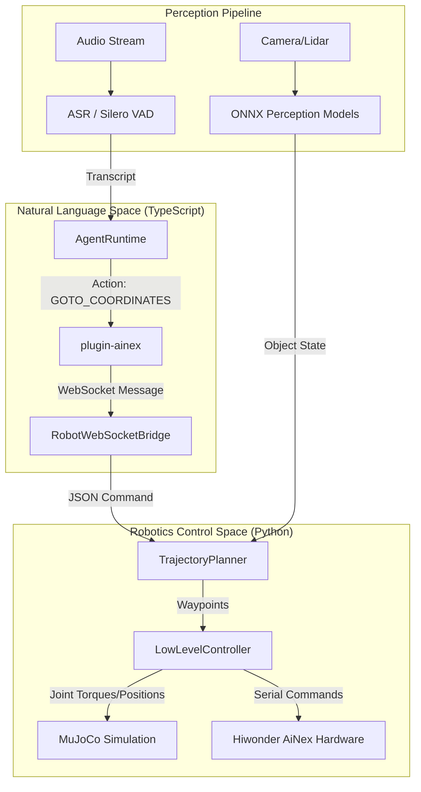
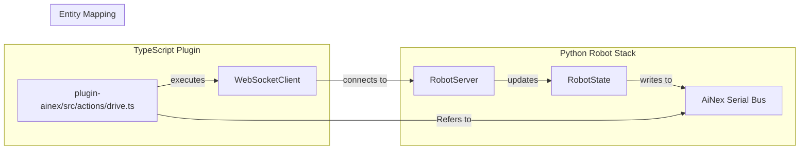

<!-- source: DeepWiki mcp.deepwiki.com · repo elizaOS/eliza · page 13.7 Robotics Stack · fetched 2026-10-29 -->

# Robotics Stack

Relevant source files

The following files were used as context for generating this wiki page:

- [packages/app-core/scripts/voice-e2e-hardware.ts](packages/app-core/scripts/voice-e2e-hardware.ts)
- [packages/benchmarks/OSWorld/pyproject.toml](packages/benchmarks/OSWorld/pyproject.toml)
- [packages/benchmarks/OSWorld/requirements.txt](packages/benchmarks/OSWorld/requirements.txt)
- [packages/benchmarks/OSWorld/setup.py](packages/benchmarks/OSWorld/setup.py)
- [packages/benchmarks/OSWorld/uv.lock](packages/benchmarks/OSWorld/uv.lock)
- [packages/benchmarks/configbench/README.md](packages/benchmarks/configbench/README.md)
- [packages/benchmarks/configbench/src/handlers/eliza.ts](packages/benchmarks/configbench/src/handlers/eliza.ts)
- [packages/benchmarks/configbench/tests/eliza-handler.test.ts](packages/benchmarks/configbench/tests/eliza-handler.test.ts)
- [packages/benchmarks/solana/solana-gym-env/uv.lock](packages/benchmarks/solana/solana-gym-env/uv.lock)
- [packages/benchmarks/terminal-bench/tasks/modernize-scientific-stack/climate_analyzer/requirements_old.txt](packages/benchmarks/terminal-bench/tasks/modernize-scientific-stack/climate_analyzer/requirements_old.txt)
- [packages/benchmarks/webshop/pyproject.toml](packages/benchmarks/webshop/pyproject.toml)
- [packages/benchmarks/webshop/upstream/requirements.txt](packages/benchmarks/webshop/upstream/requirements.txt)
- [packages/chip/scripts/ai_eda/check_cuda_training_payload.py](packages/chip/scripts/ai_eda/check_cuda_training_payload.py)
- [packages/core/src/utils/prompt-batcher/batcher.test.ts](packages/core/src/utils/prompt-batcher/batcher.test.ts)
- [packages/feed/packages/examples/feed-langgraph-agent/pyproject.toml](packages/feed/packages/examples/feed-langgraph-agent/pyproject.toml)
- [packages/feed/packages/examples/feed-langgraph-agent/uv.lock](packages/feed/packages/examples/feed-langgraph-agent/uv.lock)
- [packages/training/scripts/cloud/run-on-cloud.sh](packages/training/scripts/cloud/run-on-cloud.sh)
- [packages/training/scripts/inference/serve_vllm.py](packages/training/scripts/inference/serve_vllm.py)
- [packages/training/scripts/lib/vast.py](packages/training/scripts/lib/vast.py)
- [packages/training/scripts/optimize_for_eliza1.py](packages/training/scripts/optimize_for_eliza1.py)
- [packages/training/scripts/quantization/_common.py](packages/training/scripts/quantization/_common.py)
- [packages/training/scripts/quantization/qjl_apply.py](packages/training/scripts/quantization/qjl_apply.py)
- [packages/training/scripts/quantization/turboquant_apply.py](packages/training/scripts/quantization/turboquant_apply.py)
- [packages/training/scripts/run_pipeline.py](packages/training/scripts/run_pipeline.py)
- [packages/training/scripts/train_local.py](packages/training/scripts/train_local.py)
- [packages/training/scripts/train_nebius.sh](packages/training/scripts/train_nebius.sh)
- [packages/training/scripts/train_nebius_smoke_all_tiers.sh](packages/training/scripts/train_nebius_smoke_all_tiers.sh)
- [packages/training/scripts/train_vast.sh](packages/training/scripts/train_vast.sh)
- [packages/training/scripts/verify_optimization_stack.py](packages/training/scripts/verify_optimization_stack.py)
- [packages/training/uv.lock](packages/training/uv.lock)
- [packages/ui/src/components/local-inference/CustomModelSearch.test.tsx](packages/ui/src/components/local-inference/CustomModelSearch.test.tsx)
- [packages/ui/src/components/local-inference/hub-utils.test.ts](packages/ui/src/components/local-inference/hub-utils.test.ts)
- [packages/ui/src/services/local-inference/custom-search.ts](packages/ui/src/services/local-inference/custom-search.ts)
- [plugins/plugin-agent-orchestrator/src/setup-routes.ts](plugins/plugin-agent-orchestrator/src/setup-routes.ts)
- [plugins/plugin-local-inference/__tests__/imagegen-loader-arbiter-seam.test.ts](plugins/plugin-local-inference/__tests__/imagegen-loader-arbiter-seam.test.ts)
- [plugins/plugin-local-inference/__tests__/imagegen-vision-coexist.test.ts](plugins/plugin-local-inference/__tests__/imagegen-vision-coexist.test.ts)
- [plugins/plugin-local-inference/src/services/voice/__tests__/turn-detector-resolver.test.ts](plugins/plugin-local-inference/src/services/voice/__tests__/turn-detector-resolver.test.ts)
- [plugins/plugin-local-inference/src/services/voice/eot-classifier.ts](plugins/plugin-local-inference/src/services/voice/eot-classifier.ts)
- [plugins/plugin-vision/src/ws1-arbiter-bridge.test.ts](plugins/plugin-vision/src/ws1-arbiter-bridge.test.ts)

The elizaOS Robotics Stack, encapsulated in the `@elizaos/robot` Python package and supported by the `plugin-ainex` TypeScript plugin, provides a comprehensive framework for developing, simulating, and deploying autonomous robotic agents. The stack integrates high-fidelity physics simulation via MuJoCo, reinforcement learning (RL) through Brax and PPO, and a robust perception-action pipeline for real-world hardware like the Hiwonder AiNex.

## High-Level Architecture

The robotics stack bridges the gap between high-level agent reasoning (TypeScript/Node.js) and low-level physical control (Python). This is achieved through a WebSocket bridge and a dedicated perception pipeline.

### System Data Flow

The following diagram illustrates the flow from natural language objectives to physical joint commands.

**Natural Language to Robotic Control Flow**

Sources: `[packages/training/scripts/run_pipeline.py:1-45]()`, `[plugins/plugin-local-inference/src/services/voice/eot-classifier.ts:1-37]()`.

## Simulation and Reinforcement Learning

The stack utilizes MuJoCo for deterministic physics simulation and Brax for hardware-accelerated reinforcement learning.

### Reinforcement Learning Pipeline
The system supports training robot policies using Proximal Policy Optimization (PPO). The training infrastructure is unified with the Eliza-1 model line, allowing for trajectory-based learning.

*   **MuJoCo Simulation**: Used for high-fidelity verification of trajectories before hardware deployment.
*   **Brax-PPO**: Enables massively parallel RL training on GPUs to develop locomotion and manipulation primitives.
*   **Trajectory Database**: Stores state-action pairs for offline reinforcement learning and fine-tuning.

Sources: `[packages/training/scripts/run_pipeline.py:5-20]()`, `[packages/training/scripts/train_local.py:1-22]()`.

## Perception Pipeline

The robotics stack includes a sophisticated perception layer to process environmental data.

### Vision and Audio Processing
The stack implements a multi-tier Voice Activity Detection (VAD) and semantic analysis system to handle human-robot interaction.

| Component | Implementation | Role |
| :--- | :--- | :--- |
| **Tier 1 VAD** | RMS Energy Gate | Fast noise filtering (~10ms) |
| **Tier 2 VAD** | Silero VAD | Voice detection (~32ms hop) |
| **Tier 3 EOT** | `Eliza1EotClassifier` | Semantic End-of-Turn probability |
| **Object Detection** | ONNX Models | Real-time vision via YOLO/MediaPipe |

### Semantic End-of-Turn (EOT)
The `EotClassifier` determines if a user has finished speaking based on partial transcripts, allowing the robot to react with low latency. It uses implementations like `HeuristicEotClassifier` and `Eliza1EotClassifier` `[plugins/plugin-local-inference/src/services/voice/eot-classifier.ts:18-29]()`.

Sources: `[plugins/plugin-local-inference/src/services/voice/eot-classifier.ts:1-37]()`, `[plugins/plugin-local-inference/src/services/voice/eot-classifier.ts:183-208]()`.

## Hardware Integration: Hiwonder AiNex

The Hiwonder AiNex serves as the reference hardware platform. The stack includes a specific robot profile for this humanoid/wheeled hybrid.

### Interface Mapping
The `plugin-ainex` facilitates communication between the Eliza runtime and the physical robot.

**Code Entity Mapping: Plugin to Hardware**

Sources: `[packages/training/scripts/run_pipeline.py:1-20]()`, `[plugins/plugin-local-inference/src/services/voice/eot-classifier.ts:98-122]()`.

## Training and Optimization Stack

Robotic behaviors are optimized using the same infrastructure as the Eliza-1 LLMs. This includes the use of Nebius and Vast.ai for remote GPU compute.

*   **`run_pipeline.py`**: Manages the end-to-end flow from corpus generation to quantization and benchmarking `[packages/training/scripts/run_pipeline.py:1-21]()`.
*   **`train_vast.sh`**: Provisions GPU instances (e.g., H100, B200) for heavy RL workloads `[packages/training/scripts/train_vast.sh:1-18]()`.
*   **Nebius Integration**: Fallback cloud provider for training tiers ranging from 0.8B to 27B parameters `[packages/training/scripts/train_nebius.sh:1-19]()`.

### Benchmarking
The stack is validated against several benchmarks, including OSWorld for desktop-based robotics/automation tasks `[packages/benchmarks/OSWorld/pyproject.toml:1-30]()`.

Sources: `[packages/training/scripts/run_pipeline.py:1-45]()`, `[packages/training/scripts/train_vast.sh:1-55]()`, `[packages/training/scripts/train_nebius.sh:1-35]()`.

---

