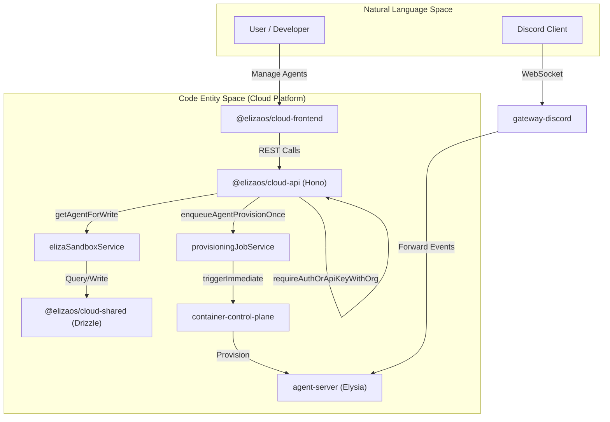
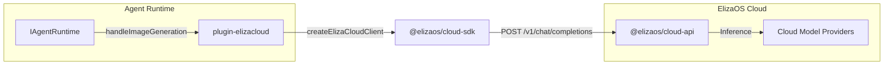

<!-- source: DeepWiki mcp.deepwiki.com · repo elizaOS/eliza · page 14 ElizaOS Cloud Platform · fetched 2026-10-29 -->

# ElizaOS Cloud Platform

Relevant source files

The following files were used as context for generating this wiki page:

- [packages/app-core/src/services/account-pool.ts](packages/app-core/src/services/account-pool.ts)
- [packages/app/scripts/patch-ios-plist.mjs](packages/app/scripts/patch-ios-plist.mjs)
- [packages/app/test/ui-smoke/android-system-apps.spec.ts](packages/app/test/ui-smoke/android-system-apps.spec.ts)
- [packages/app/test/ui-smoke/cloud-provisioning-startup.spec.ts](packages/app/test/ui-smoke/cloud-provisioning-startup.spec.ts)
- [packages/app/test/ui-smoke/onboarding-full-flow.spec.ts](packages/app/test/ui-smoke/onboarding-full-flow.spec.ts)
- [packages/app/test/ui-smoke/tts-stt-e2e.spec.ts](packages/app/test/ui-smoke/tts-stt-e2e.spec.ts)
- [packages/benchmarks/voicebench/shared/generated/voiceagentbench-single.json](packages/benchmarks/voicebench/shared/generated/voiceagentbench-single.json)
- [packages/cloud-api/package.json](packages/cloud-api/package.json)
- [packages/cloud-api/test/e2e/_helpers/api.ts](packages/cloud-api/test/e2e/_helpers/api.ts)
- [packages/cloud-api/test/e2e/group-e-agent-admin.test.ts](packages/cloud-api/test/e2e/group-e-agent-admin.test.ts)
- [packages/cloud-api/test/e2e/preload.ts](packages/cloud-api/test/e2e/preload.ts)
- [packages/cloud-api/test/e2e/run-e2e-batches.mjs](packages/cloud-api/test/e2e/run-e2e-batches.mjs)
- [packages/cloud-api/v1/agents/[agentId]/logs/route.ts](packages/cloud-api/v1/agents/[agentId]/logs/route.ts)
- [packages/cloud-api/v1/agents/[agentId]/restart/route.ts](packages/cloud-api/v1/agents/[agentId]/restart/route.ts)
- [packages/cloud-api/v1/agents/[agentId]/suspend/route.ts](packages/cloud-api/v1/agents/[agentId]/suspend/route.ts)
- [packages/cloud-api/v1/eliza/agents/[agentId]/resume/route.ts](packages/cloud-api/v1/eliza/agents/[agentId]/resume/route.ts)
- [packages/cloud-api/v1/eliza/agents/[agentId]/route.ts](packages/cloud-api/v1/eliza/agents/[agentId]/route.ts)
- [packages/cloud-api/v1/eliza/agents/[agentId]/snapshot/route.ts](packages/cloud-api/v1/eliza/agents/[agentId]/snapshot/route.ts)
- [packages/cloud-api/v1/eliza/agents/[agentId]/suspend/route.ts](packages/cloud-api/v1/eliza/agents/[agentId]/suspend/route.ts)
- [packages/cloud-frontend/content/index.mdx](packages/cloud-frontend/content/index.mdx)
- [packages/cloud-frontend/package.json](packages/cloud-frontend/package.json)
- [packages/cloud-frontend/playwright.config.ts](packages/cloud-frontend/playwright.config.ts)
- [packages/cloud-frontend/scripts/run-e2e.mjs](packages/cloud-frontend/scripts/run-e2e.mjs)
- [packages/cloud-frontend/src/hooks/use-session-auth.ts](packages/cloud-frontend/src/hooks/use-session-auth.ts)
- [packages/cloud-frontend/src/providers/StewardProvider.tsx](packages/cloud-frontend/src/providers/StewardProvider.tsx)
- [packages/cloud-frontend/tests/e2e/api-key-flow.spec.ts](packages/cloud-frontend/tests/e2e/api-key-flow.spec.ts)
- [packages/cloud-frontend/tests/e2e/cloud-routes-live.spec.ts](packages/cloud-frontend/tests/e2e/cloud-routes-live.spec.ts)
- [packages/cloud-frontend/tests/e2e/cloud-routes.spec.ts](packages/cloud-frontend/tests/e2e/cloud-routes.spec.ts)
- [packages/cloud-frontend/tests/e2e/siwe-flow.spec.ts](packages/cloud-frontend/tests/e2e/siwe-flow.spec.ts)
- [packages/cloud-frontend/vite.config.ts](packages/cloud-frontend/vite.config.ts)
- [packages/cloud-shared/src/db/schemas/agent-sandboxes.ts](packages/cloud-shared/src/db/schemas/agent-sandboxes.ts)
- [packages/cloud-shared/src/lib/services/__tests__/provisioning-job-types.test.ts](packages/cloud-shared/src/lib/services/__tests__/provisioning-job-types.test.ts)
- [packages/cloud-shared/src/lib/services/provisioning-job-types.ts](packages/cloud-shared/src/lib/services/provisioning-job-types.ts)
- [packages/cloud-shared/src/lib/services/provisioning-jobs.ts](packages/cloud-shared/src/lib/services/provisioning-jobs.ts)
- [packages/cloud-shared/src/lib/types/cloud-api.ts](packages/cloud-shared/src/lib/types/cloud-api.ts)
- [packages/examples/VALIDATION.md](packages/examples/VALIDATION.md)
- [packages/examples/scripts/verify-examples.mjs](packages/examples/scripts/verify-examples.mjs)
- [packages/os-homepage/index.html](packages/os-homepage/index.html)
- [packages/test/vitest/integration.config.ts](packages/test/vitest/integration.config.ts)
- [packages/test/vitest/workspace-aliases.ts](packages/test/vitest/workspace-aliases.ts)
- [plugins/app-model-tester/scripts/model-tester-e2e.mjs](plugins/app-model-tester/scripts/model-tester-e2e.mjs)

The **ElizaOS Cloud Platform** is the managed hosting and orchestration layer for elizaOS agents. It provides a scalable, multi-tenant infrastructure for deploying, managing, and monetizing AI agents without requiring manual server management. The platform encompasses a high-performance REST API, a React-based dashboard, and a suite of infrastructure services including asynchronous provisioning jobs, secure tunneling, and specialized agent runners.

## Architecture Overview

The platform is built on a distributed architecture designed for low latency and high availability. It utilizes Cloudflare Workers for the edge API, PostgreSQL (via Drizzle ORM) for persistence, and a specialized container control plane for managing agent runtimes on dedicated hardware nodes.

### System Interaction Diagram

This diagram illustrates the flow from the user-facing Frontend through the Cloud API to the underlying infrastructure services and the asynchronous job system.

**Sources:**
- `packages/cloud-api/package.json` [33-33]() (Hono routing)
- `packages/cloud-shared/src/lib/services/provisioning-jobs.ts` [1-14]() (Job service overview)
- `packages/cloud-api/v1/eliza/agents/[agentId]/resume/route.ts` [33-47]() (API interaction flow)

---

## Component Modules

The ElizaOS Cloud platform is divided into three primary functional areas. Detailed documentation for each can be found on their respective child pages.

### [Cloud API and Backend](#14.1)
The core logic of the platform resides in `@elizaos/cloud-api`. This is a Cloudflare Workers-based REST API that handles:
- **Agent Lifecycle**: Complex actions like `agent_provision`, `agent_suspend`, `agent_resume`, and `agent_restart` [packages/cloud-shared/src/lib/services/provisioning-job-types.ts:18-24]().
- **Asynchronous Jobs**: Bridges HTTP requests to long-running operations via a `jobs` table, returning `202 Accepted` to callers immediately [packages/cloud-shared/src/lib/services/provisioning-jobs.ts:2-6]().
- **Billing & Credits**: Credit gating ensures a minimum deposit before agents can be resumed or provisioned [packages/cloud-api/v1/eliza/agents/[agentId]/resume/route.ts:78-99]().
- **Service Security**: Uses `requireServiceKey` for service-to-service communication, such as log retrieval [packages/cloud-api/v1/agents/[agentId]/logs/route.ts:32-32]().

For details, see [Cloud API and Backend](#14.1).

### [Cloud Frontend](#14.2)
The user interface for the platform is `@elizaos/cloud-frontend`, a React/Vite application that provides:
- **Dashboard & Analytics**: Views for agent performance, billing, and resource monitoring [packages/cloud-frontend/tests/e2e/cloud-routes.spec.ts:162-190]().
- **Authentication**: Integration with Steward for session management and JWT handling [packages/cloud-frontend/src/providers/StewardProvider.tsx:14-20]().
- **SSR & Prerendering**: Optimized for performance using Vite SSR and a custom prerender script [packages/cloud-frontend/package.json:7-10]().
- **Local-First Aliasing**: A Vite build system that prefers local overrides for components and hooks while falling back to `cloud-shared` [packages/cloud-frontend/vite.config.ts:155-189]().

For details, see [Cloud Frontend](#14.2).

### [Cloud Services and Infrastructure](#14.3)
The platform relies on several specialized microservices to handle scale and connectivity:
- **gateway-discord**: A multi-tenant WebSocket gateway that consolidates thousand of Discord connections.
- **tunnel-proxy**: A Go-based proxy (using Headscale/Wireguard) that allows agents to be reached securely behind NAT.
- **agent-server**: An Elysia-based runtime host optimized for executing elizaOS agent containers.
- **Provisioning Worker**: A background service that processes the `agent_provision` and `agent_logs` job queues [packages/cloud-api/v1/agents/[agentId]/logs/route.ts:4-7]().

For details, see [Cloud Services and Infrastructure](#14.3).

---

## The ElizaCloud Plugin

To bridge local agents with the cloud platform, the `plugin-elizacloud` package allows any elizaOS agent to leverage cloud-hosted services, such as high-performance image generation and vision analysis.

### Cloud Integration Flow

The following diagram shows how the `IAgentRuntime` interacts with `plugin-elizacloud` to delegate heavy inference tasks to the Cloud API.

**Key Features of the Plugin:**
- **Inference Delegation**: Offloads compute-heavy tasks to the Cloud API.
- **Credit Management**: Automatically checks for available credits before initiating cloud tasks.
- **Global Reach**: Provides a unified interface for agents running on desktop, mobile, or local servers to access high-tier models.

---

## Deployment & CI/CD

The cloud platform components are deployed using a combination of Wrangler (for Workers) and automated Docker pipelines.

| Component | Target | Tooling |
| :--- | :--- | :--- |
| **Cloud API** | Cloudflare Workers | `wrangler deploy` [packages/cloud-api/package.json:13]() |
| **Cloud Frontend** | Vite SSR / Prerender | `bun run build` [packages/cloud-frontend/package.json:7]() |
| **E2E Testing** | Playwright / Vitest | `test:e2e` [packages/cloud-frontend/package.json:14]() |
| **Job Processor** | Cron / Control Plane | `triggerImmediate` [packages/cloud-api/v1/agents/[agentId]/logs/route.ts:56]() |

**Sources:**
- `packages/cloud-api/package.json` [13-13]()
- `packages/cloud-frontend/package.json` [7-16]()
- `packages/cloud-frontend/vite.config.ts` [85-114]()

---

